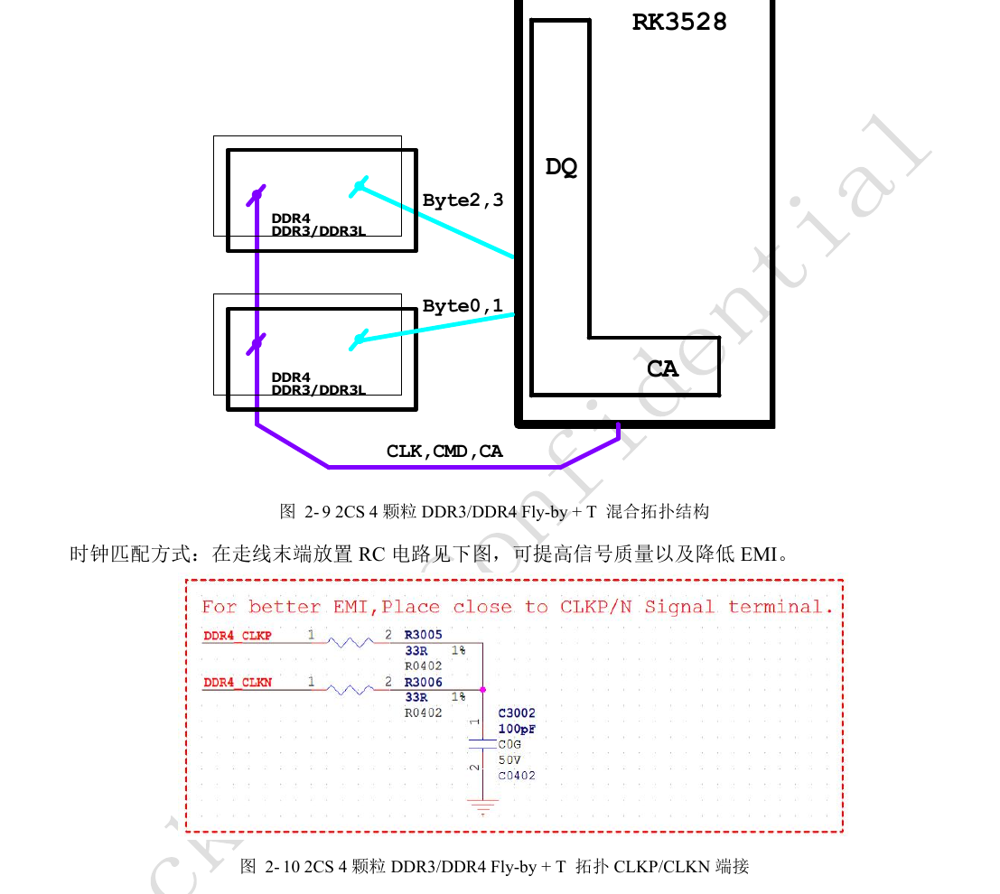
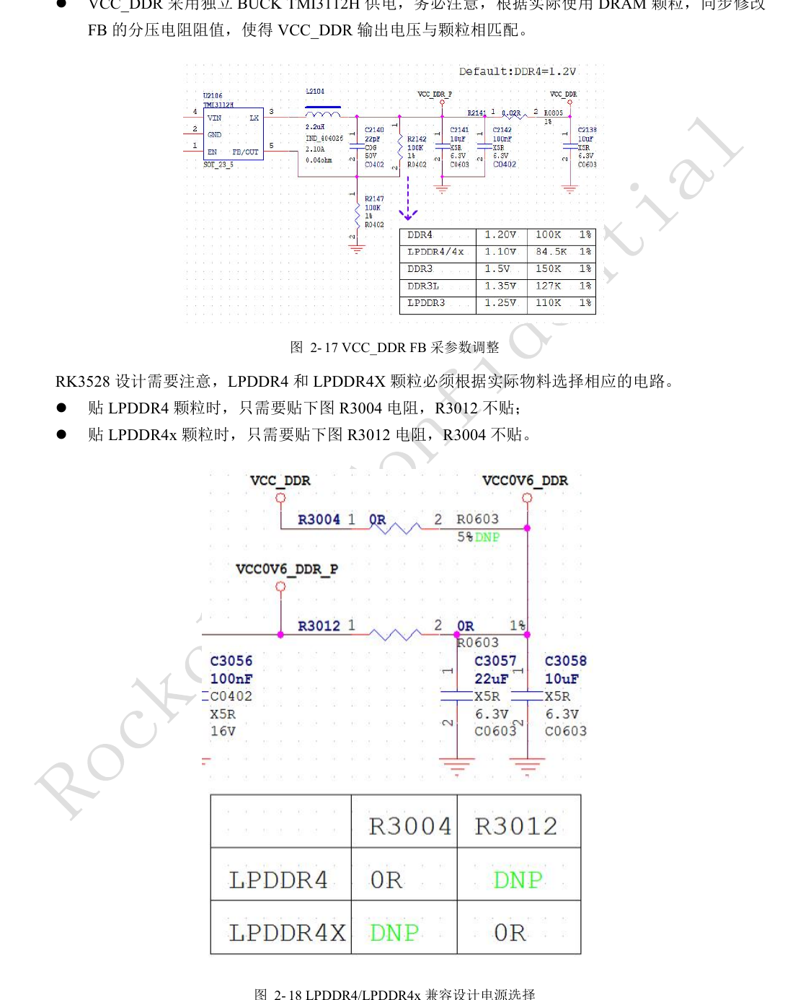
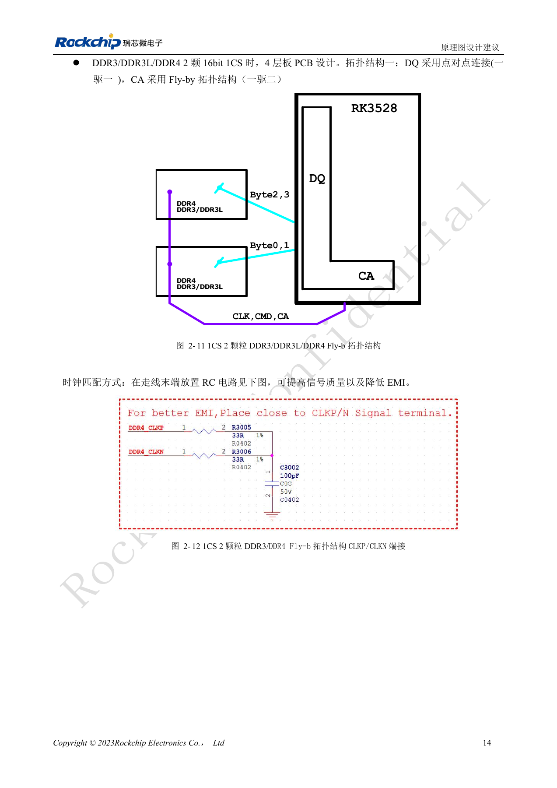
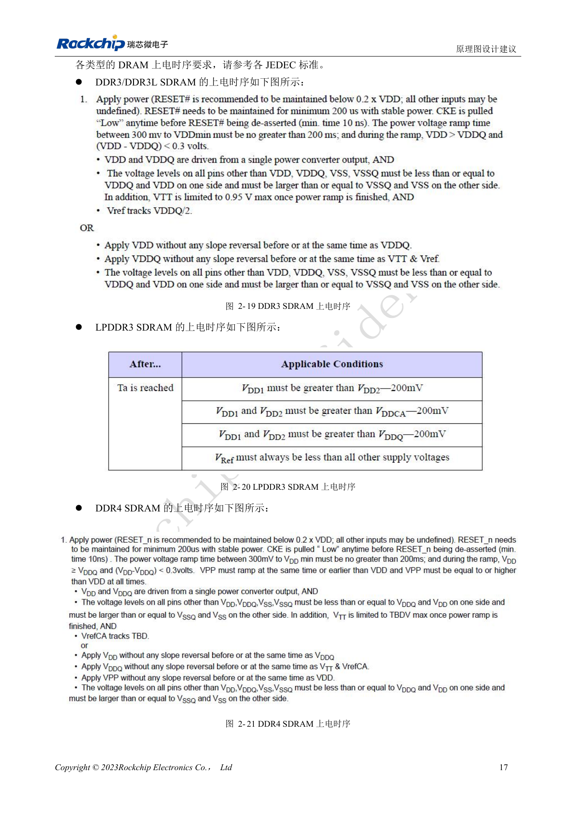
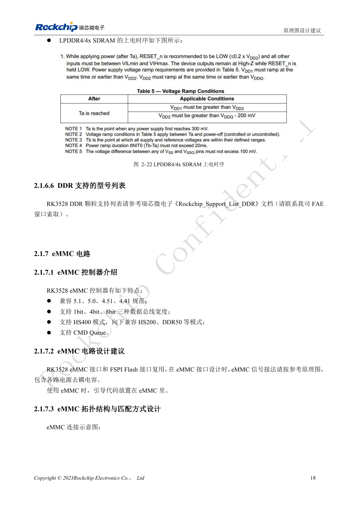
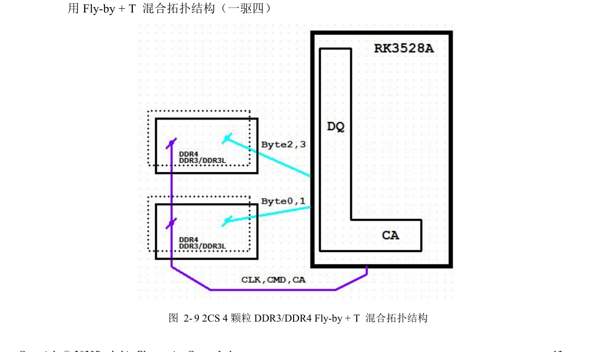
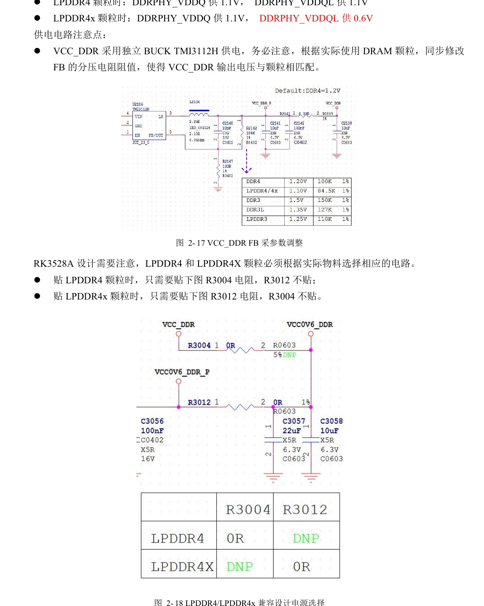
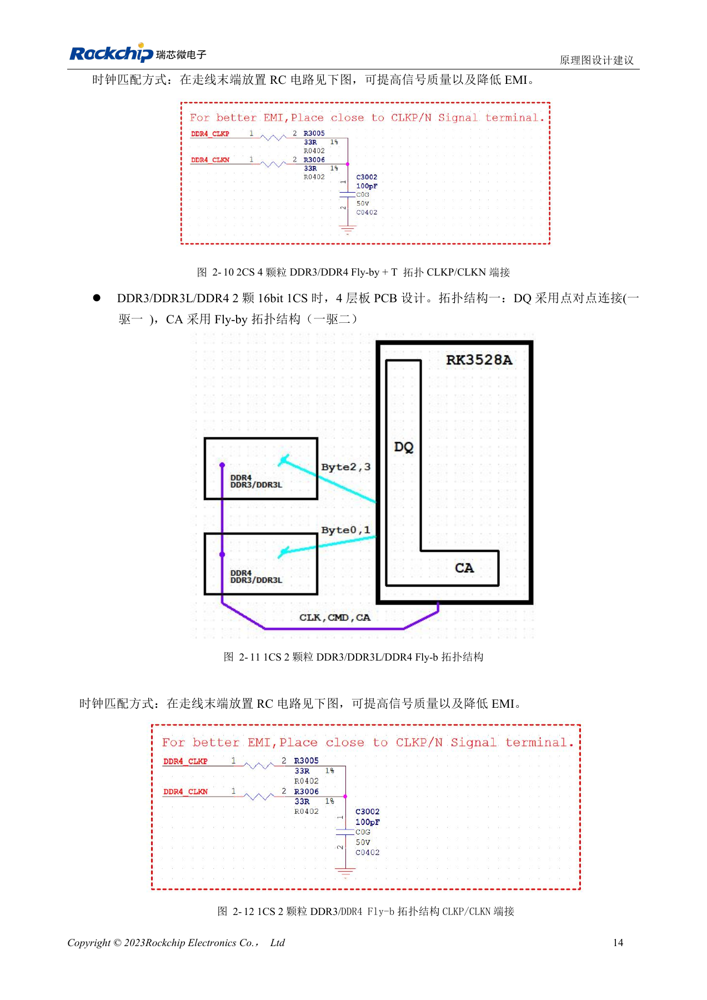
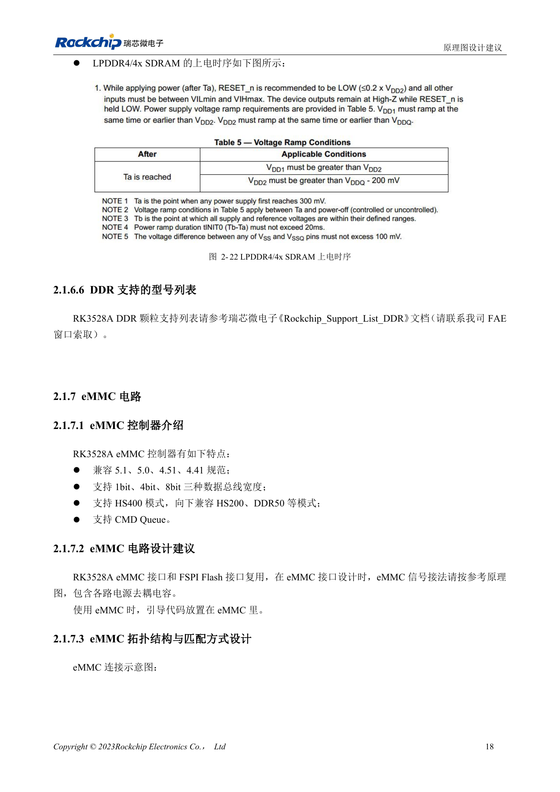

# RK3528 / RK3528A DDR: топология, питание, перестановка и PCB

Инженерная статья основана на китайских руководствах RK3528 V1.0 (2023-05-25) и RK3528A V1.0 (2023-07-12), а не является их дословным полным переводом. Сходство рассматриваемых глав не доказывает взаимозаменяемость микросхем. Официальная [документация Sige1](https://docs.armsom.org/armsom-sige1) указывает RK3528 в плате ArmSoM [Sige1](https://www.armsom.org/sige1), подходящей для оценки соответствующих приложений. Это не означает, что Sige1 использует RK3528A, и не доказывает взаимозаменяемость микросхем. Эталонные схемы SoC не являются схемами Sige1; выводы, корпус, BSP/SDK, ядро и ревизию платы проверяйте для конкретного изделия. Значения взяты из источников, не из измерений ArmSoM.

**§2.1.6; §3.3.3; PDF 23–32, 127–141**

## Выбирая память, зафиксируйте топологию

Контроллер поддерживает DDR3/DDR3L/LPDDR3/DDR4/LPDDR4/LPDDR4X, общую шину 32bit, два ранга и адресацию до 4GB. Две половины 16bit образуют канал 32bit; источник упоминает асимметричные 1GB+2GB. Для четырёх DDR3/DDR4 применяются T-топология DQ и Fly-by+T для CA; для двух устройств 16bit — точка-точка DQ и Fly-by CA. Одиночный LPDDR требует своего шаблона. Изменение ёмкости или количества корпусов затрагивает топологию, согласование и обучение.

## Правила перестановки и ZQ зависят от SoC

DDR3/DDR3L/DDR4 разрешают перестановку целых байтов и DQ внутри байта, но не CA; проекты 16bit и совместимые 16/32bit требуют шаблона производителя. У LPDDR3 D0–D7 и связанные DQS/DM фиксированы; остальные байты переставляются по правилам источника. Для LPDDR4/4X перестановки DQ и CA запрещены. DDR_RZQ SoC — 120Ω, 1%: на землю для DDR3/3L/4/LPDDR3, на DDRPHY_VDDQ для LPDDR4/4X. ZQ самой памяти — 240Ω, 1%, на землю, VCC_DDR или VCC0V6_DDR согласно типу памяти.

## Разделяйте питание и согласование по типу памяти

LPDDR4 использует 1.1V на DDRPHY_VDDQ и VDDQL; LPDDR4X — 1.1V/0.6V. R3004 и R3012 в эталоне устанавливаются взаимоисключающе. DDR3/DDR3L используют 1.5V/1.35V, DDR4 — 1.2V. Для LPDDR3 источник указывает номинальные 1.2V и фактические 1.25V ради совместимости; проверяйте пределы выбранной памяти. Таблица LPDDR4X задаёт 50Ω single-ended и 100Ω differential, оба ±10%; DQ/DM–DQS в байте ≤600mil, внутри пар DQS и CLK ≤12mil, DQS–CLK ≤1700mil. Для других типов действуют отдельные таблицы.

## Справочные параметры

| Параметр | Значение источника |
| --- | --- |
| Шина / адресация | 32bit / 4GB |
| RZQ SoC | 120Ω ±1% |
| ZQ памяти | 240Ω ±1% |
| LPDDR4X VDDQ / VDDQL | 1.1V / 0.6V |

## Полная таблица сигналов DDR PHY

На страницах PDF 24–26 находятся 74 строки, одинаковые в обеих извлечённых таблицах. Сохранены идентификаторы, включая вероятные опечатки `DDR33_A15` и `DDR33_ODT1`; сверяйте их с PinOut/TRM, не создавайте новые имена сетей. `------` означает отсутствие соответствия в источнике. Таблица не отменяет ограничения перестановки сигналов.

| DDRPHY | DDR4 | LPDDR4 / LPDDR4X | DDR3 | LPDDR3 |
| --- | --- | --- | --- | --- |
| DDRPHY_A_DQ0 | DDR4_DQL6_A | LPDDR4_DQ0_A | DDR3_D4 | LPDDR3_D0 |
| DDRPHY_A_DQ1 | DDR4_DQL2_A | LPDDR4_DQ1_A | DDR3_D0 | LPDDR3_D1 |
| DDRPHY_A_DQ2 | DDR4_DQL0_A | LPDDR4_DQ2_A | DDR3_D2 | LPDDR3_D2 |
| DDRPHY_A_DQ3 | DDR4_DQL1_A | LPDDR4_DQ3_A | DDR3_D1 | LPDDR3_D3 |
| DDRPHY_A_DQ4 | DDR4_DQL4_A | LPDDR4_DQ4_A | DDR3_D6 | LPDDR3_D4 |
| DDRPHY_A_DQ5 | DDR4_DQL5_A | LPDDR4_DQ5_A | DDR3_D7 | LPDDR3_D5 |
| DDRPHY_A_DQ6 | DDR4_DQL7_A | LPDDR4_DQ6_A | DDR3_D5 | LPDDR3_D6 |
| DDRPHY_A_DQ7 | DDR4_DQL3_A | LPDDR4_DQ7_A | DDR3_D3 | LPDDR3_D7 |
| DDRPHY_A_DM0 | DDR4_DML_A | LPDDR4_DM0_A | DDR3_DM0 | LPDDR3_DM0 |
| DDRPHY_A_DQS0 | DDR4_DQSL_P_A | LPDDR4_DQS0P_A | DDR3_DQS0P | LPDDR3_DQS0P |
| DDRPHY_A_DQSB0 | DDR4_DQSL_N_A | LPDDR4_DQS0N_A | DDR3_DQS0N | LPDDR3_DQS0N |
| DDRPHY_A_DQ8 | DDR4_DQU1_A | LPDDR4_DQ8_A | DDR3_D12 | LPDDR3_D19 |
| DDRPHY_A_DQ9 | DDR4_DQU5_A | LPDDR4_DQ9_A | DDR3_D14 | LPDDR3_D16 |
| DDRPHY_A_DQ10 | DDR4_DQU0_A | LPDDR4_DQ10_A | DDR3_D15 | LPDDR3_D21 |
| DDRPHY_A_DQ11 | DDR4_DQU2_A | LPDDR4_DQ11_A | DDR3_D9 | LPDDR3_D17 |
| DDRPHY_A_DQ12 | DDR4_DQU7_A | LPDDR4_DQ12_A | DDR3_D10 | LPDDR3_D20 |
| DDRPHY_A_DQ13 | DDR4_DQU3_A | LPDDR4_DQ13_A | DDR3_D8 | LPDDR3_D23 |
| DDRPHY_A_DQ14 | DDR4_DQU4_A | LPDDR4_DQ14_A | DDR3_D13 | LPDDR3_D22 |
| DDRPHY_A_DQ15 | DDR4_DQU6_A | LPDDR4_DQ15_A | DDR3_D11 | LPDDR3_D18 |
| DDRPHY_A_DM1 | DDR4_DMU_A | LPDDR4_DM1_A | DDR3_DM1 | LPDDR3_DM2 |
| DDRPHY_A_DQS1 | DDR4_DQSU_P_A | LPDDR4_DQS1P_A | DDR3_DQS1P | LPDDR3_DQS2P |
| DDRPHY_A_DQSB1 | DDR4_DQSU_N_A | LPDDR4_DQS1N_A | DDR3_DQS1N | LPDDR3_DQS2N |
| DDRPHY_B_DQ0 | DDR4_DQU4_B | LPDDR4_DQ0_B | DDR3_D29 | LPDDR3_D14 |
| DDRPHY_B_DQ1 | DDR4_DQU0_B | LPDDR4_DQ1_B | DDR3_D31 | LPDDR3_D12 |
| DDRPHY_B_DQ2 | DDR4_DQU1_B | LPDDR4_DQ2_B | DDR3_D28 | LPDDR3_D13 |
| DDRPHY_B_DQ3 | DDR4_DQU5_B | LPDDR4_DQ3_B | DDR3_D30 | LPDDR3_D8 |
| DDRPHY_B_DQ4 | DDR4_DQU7_B | LPDDR4_DQ4_B | DDR3_D26 | LPDDR3_D9 |
| DDRPHY_B_DQ5 | DDR4_DQU3_B | LPDDR4_DQ5_B | DDR3_D24 | LPDDR3_D15 |
| DDRPHY_B_DQ6 | DDR4_DQU6_B | LPDDR4_DQ6_B | DDR3_D27 | LPDDR3_D10 |
| DDRPHY_B_DQ7 | DDR4_DQU2_B | LPDDR4_DQ7_B | DDR3_D25 | LPDDR3_D11 |
| DDRPHY_B_DM0 | DDR4_DMU_B | LPDDR4_DM0_B | DDR3_DM3 | LPDDR3_DM1 |
| DDRPHY_B_DQS0 | DDR4_DQSU_P_B | LPDDR4_DQS0P_B | DDR3_DQS3P | LPDDR3_DQS1P |
| DDRPHY_B_DQSB0 | DDR4_DQSU_N_B | LPDDR4_DQS0N_B | DDR3_DQS3N | LPDDR3_DQS1N |
| DDRPHY_B_DQ8 | DDR4_DQL1_B | LPDDR4_DQ8_B | DDR3_D17 | LPDDR3_D27 |
| DDRPHY_B_DQ9 | DDR4_DQL3_B | LPDDR4_DQ9_B | DDR3_D19 | LPDDR3_D26 |
| DDRPHY_B_DQ10 | DDR4_DQL4_B | LPDDR4_DQ10_B | DDR3_D18 | LPDDR3_D30 |
| DDRPHY_B_DQ11 | DDR4_DQL6_B | LPDDR4_DQ11_B | DDR3_D22 | LPDDR3_D31 |
| DDRPHY_B_DQ12 | DDR4_DQL0_B | LPDDR4_DQ12_B | DDR3_D16 | LPDDR3_D28 |
| DDRPHY_B_DQ13 | DDR4_DQL2_B | LPDDR4_DQ13_B | DDR3_D20 | LPDDR3_D24 |
| DDRPHY_B_DQ14 | DDR4_DQL7_B | LPDDR4_DQ14_B | DDR3_D21 | LPDDR3_D25 |
| DDRPHY_B_DQ15 | DDR4_DQL5_B | LPDDR4_DQ15_B | DDR3_D23 | LPDDR3_D29 |
| DDRPHY_B_DM1 | DDR4_DML_B | LPDDR4_DM1_B | DDR3_DM2 | LPDDR3_DM3 |
| DDRPHY_B_DQS1 | DDR4_DQSL_P_B | LPDDR4_DQS1P_B | DDR3_DQS2P | LPDDR3_DQS3P |
| DDRPHY_B_DQSB1 | DDR4_DQSL_N_B | LPDDR4_DQS1N_B | DDR3_DQS2N | LPDDR3_DQS3N |
| DDRPHY_A0 | DDR4_A0 | LPDDR4_ODT1_CA_B | DDR3_A9 | LPDDR3_ODT2 |
| DDRPHY_A1 | DDR4_A1 | LPDDR4_CKE1_A | DDR3_A14 | ------ |
| DDRPHY_A2 | DDR4_A2 | LPDDR4_ODT0_CA_B | DDR3_A13 | LPDDR3_ODT3 |
| DDRPHY_A3 | DDR4_A3 | LPDDR4_CKE0_A | DDR3_A1 | ------ |
| DDRPHY_A4 | DDR4_A4 | LPDDR4_A0_B | DDR3_A2 | LPDDR3_A5 |
| DDRPHY_A5 | DDR4_A5 | LPDDR4_A1_A | DDR3_A4 | ------ |
| DDRPHY_A6 | DDR4_A6 | LPDDR4_CS1N_B | DDR3_A3 | LPDDR3_CSN2 |
| DDRPHY_A7 | DDR4_A7 | LPDDR4_A4_A | DDR3_A6 | ------ |
| DDRPHY_A8 | DDR4_A8 | LPDDR4_A4_B | DDR3_A5 | LPDDR3_A6 |
| DDRPHY_A9 | DDR4_A9 | LPDDR4_CLKP_A | DDR3_A11 | LPDDR3_A2 |
| DDRPHY_A10 | DDR4_A10 | LPDDR4_A1_B | DDR3_A0 | ------ |
| DDRPHY_A11 | DDR4_A11 | LPDDR4_A5_B | DDR3_A7 | LPDDR3_A7 |
| DDRPHY_A12 | DDR4_A12 | LPDDR4_A2_A | DDR3_A10 | LPDDR3_A4 |
| DDRPHY_A13 | DDR4_A13 | LPDDR4_CLKN_A | DDR3_A8 | LPDDR3_A3 |
| DDRPHY_A14 | DDR4_WEN/A14 | LPDDR4_CS0N_B | DDR3_ODT0 | LPDDR3_CSN3 |
| DDRPHY_A15 | DDR4_CASN/A15 | LPDDR4_A3_A | DDR3_BA1 | LPDDR3_A0 |
| DDRPHY_A16 | DDR4_RASN/A16 | LPDDR4_A0_A | DDR3_CKE0 | ------ |
| DDRPHY_ACTN | DDR4_ACTN | LPDDR4_A2_B | DDR3_CSN0 | LPDDR3_A9 |
| DDRPHY_BA0 | DDR4_BA0 | LPDDR4_CKE0_B | DDR3_BA2 | LPDDR3_CKE0 |
| DDRPHY_BA1 | DDR4_BA1 | LPDDR4_A5_A | DDR3_A12 | LPDDR3_A1 |
| DDRPHY_BG0 | DDR4_BG0 | LPDDR4_A3_B | DDR3_BA0 | LPDDR3_A8 |
| DDRPHY_BG1 | DDR4_BG1 | ------ | DDR33_A15 | ------ |
| DDRPHY_CKE | DDR4_CKE | LPDDR4_CKE1_B | DDR3_RASN | ------ |
| DDRPHY_CK | DDR4_CLKP | LPDDR4_CLKP_B | DDR3_CLKP | LPDDR3_CLKP |
| DDRPHY_CKB | DDR4_CLKN | LPDDR4_CLKN_B | DDR3_CLKN | LPDDR3_CLKN |
| DDRPHY_CSB0 | DDR4_CSN0 | LPDDR4_CS1N_A | DDR3_CASN | LPDDR3_CSN1 |
| DDRPHY_CSB1 | DDR4_CSN1 | LPDDR4_CS0N_A | DDR3_CSN1 | LPDDR3_CSN0 |
| DDRPHY_ODT0 | DDR4_ODT0 | LPDDR4_ODT1_CA_A | DDR3_WEN | LPDDR3_ODT0 |
| DDRPHY_ODT1 | DDR4_ODT1 | LPDDR4_ODT0_CA_A | DDR33_ODT1 | LPDDR3_ODT1 |
| DDRPHY_RESETN | DDR4_RESETN | LPDDR4_RESETN | DDR3_RESETN | ------ |

## Иллюстрации и страницы источника

Английские оригиналы не предоставлены. Во всех языках используются китайские изображения с указанием микросхемы и физической страницы; изображения RK3528 не выдаются за RK3528A.

RK3528 · CN · PDF 27

RK3528 · CN · PDF 30

RK3528 · CN · PDF 28

RK3528 · CN · PDF 31

RK3528 · CN · PDF 32

RK3528A · CN · PDF 27

RK3528A · CN · PDF 30

RK3528A · CN · PDF 28

RK3528A · CN · PDF 31

RK3528A · CN · PDF 32

## Разработка и документация

Выбирайте изделия ArmSoM по их документации; серия не утверждает наличие платы ArmSoM на RK3528/RK3528A. Опыт разработки интерфейсов и ПО других плат полезен как методика, но не делает взаимозаменяемыми напряжения, выводы или PCB-правила.

- [ArmSoM](https://www.armsom.org/) · [ArmSoM Docs](https://docs.armsom.org/)
- [RK3528 / RK3528A: девять тем аппаратного проектирования](/ru/articles/rk3528-rk3528a-hardware-design-series/)
- [RK3528 / RK3528A: дискретное питание, последовательность и нагрузка](/ru/articles/rk3528-rk3528a-power-sequencing/)
- [RK3528 / RK3528A: eMMC, FSPI, SDMMC и SDIO](/ru/articles/rk3528-rk3528a-storage-sdio-design/)
