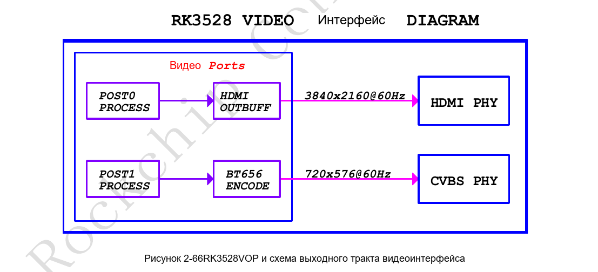
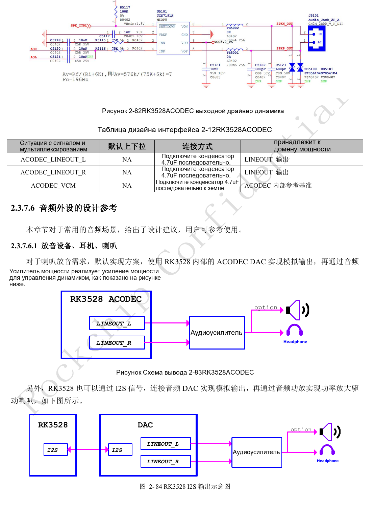
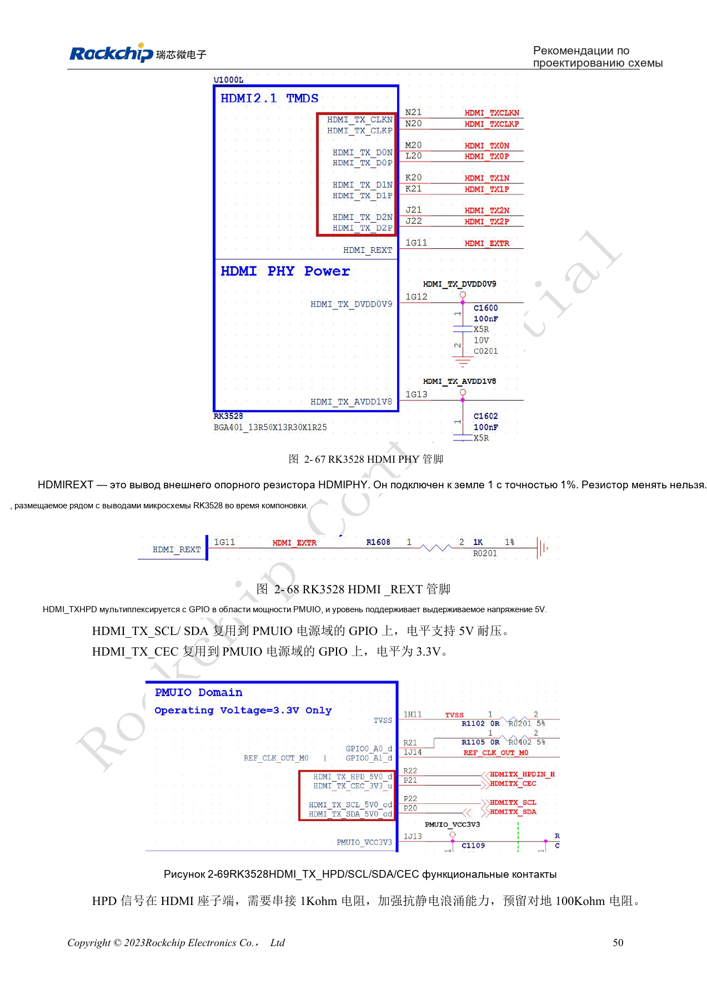
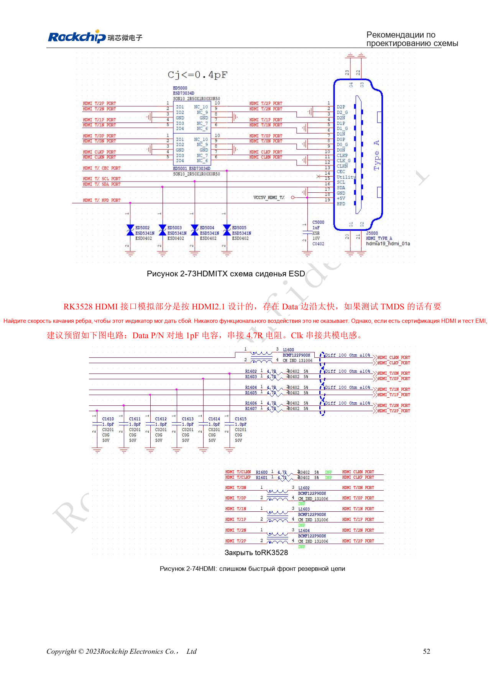
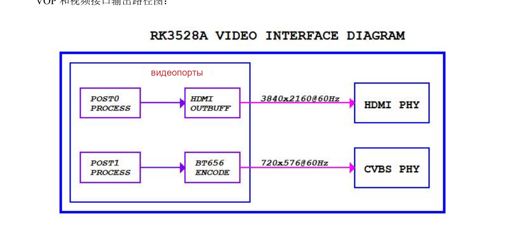
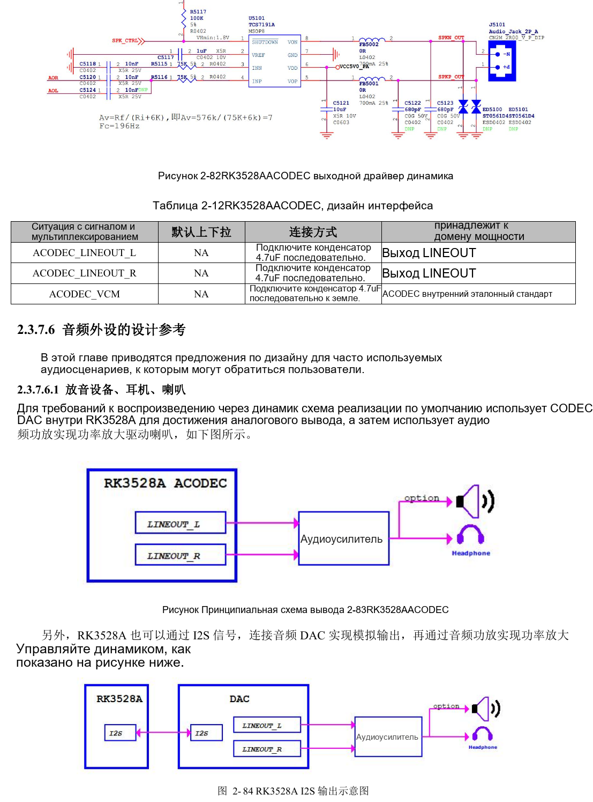
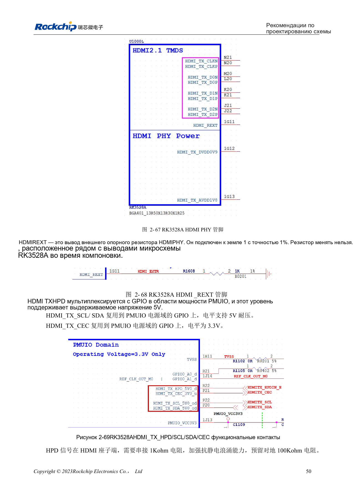
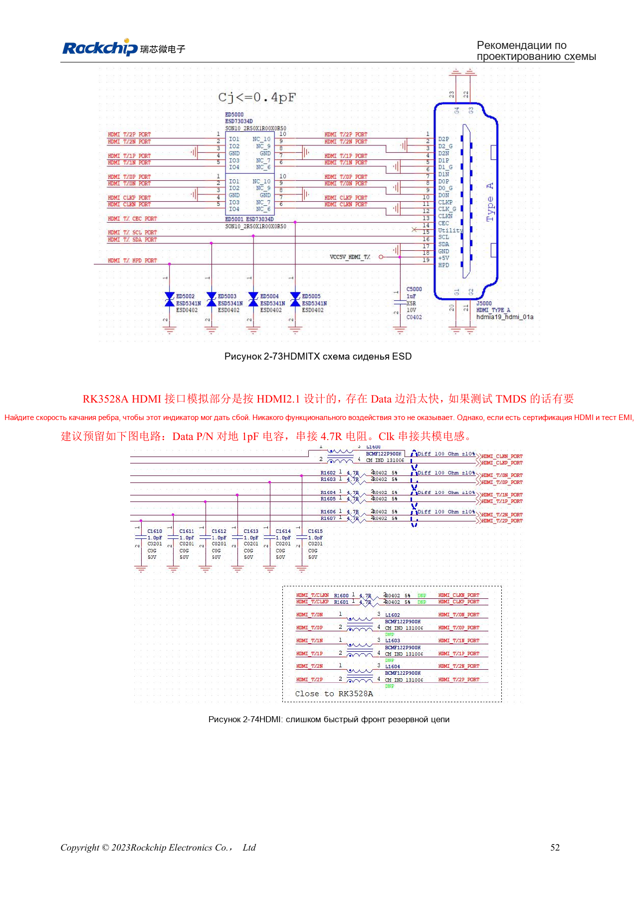

# RK3528 / RK3528A: HDMI, CVBS, TSI и аналоговый звук

Инженерная статья основана на китайских руководствах RK3528 V1.0 (2023-05-25) и RK3528A V1.0 (2023-07-12), а не является их дословным полным переводом. Сходство рассматриваемых глав не доказывает взаимозаменяемость микросхем. Официальная [документация Sige1](https://docs.armsom.org/armsom-sige1) указывает RK3528 в плате ArmSoM [Sige1](https://www.armsom.org/sige1), подходящей для оценки соответствующих приложений. Это не означает, что Sige1 использует RK3528A, и не доказывает взаимозаменяемость микросхем. Эталонные схемы SoC не являются схемами Sige1; выводы, корпус, BSP/SDK, ядро и ревизию платы проверяйте для конкретного изделия. Значения взяты из источников, не из измерений ArmSoM.

**§2.3.5–2.3.7; §3.3 HDMI/ACODEC/audio; PDF 62–75, 143, 148–149**

## Рассматривайте HDMI вместе с периферией

VOP имеет два выходных порта; руководства показывают HDMI и CVBS. HDMI2.0 TX поддерживает до 4K@60Hz, RGB/YCbCr444/YCbCr420 до 10bit. HDMI_REXT требует 1kΩ, 1%, на землю рядом с SoC. HPD и DDC описаны как 5V-tolerant, CEC — 3.3V; это не делает все связанные IO совместимыми с 5V. На HPD у разъёма нужен 1kΩ и место для подтяжки 100kΩ вниз; проверяйте питание 5V и горячее подключение.

## Предусмотрите регулировку для испытаний

Источник говорит об аналоговой части HDMI2.1, но описывает внешние функции как HDMI2.0; это не подтверждает функции HDMI2.1. Для быстрых фронтов TMDS предлагаются опциональные 1pF на землю в P/N данных, 4.7Ω последовательно и синфазный дроссель такта, с выбором по eye/EMI. PCB: 100Ω±10%, внутри пары <6mil, между парами <480mil, длина <5in, ESD ≤0.2pF, желательно максимум два перехода. TSI — вход транспортного потока; ошибочный заголовок CIF не означает интерфейс камеры.

## Разделяйте аналоговую и цифровую части

Аналоговый ACODEC требует усилителя для динамика. Запись возможна через PDM-микрофоны, внешний I2S/PDM ADC или отдельный Codec. Трассы ACODEC/CVBS рекомендуется делать шире 12mil с непрерывной землёй рядом, вдали от DDR, силовых дросселей и RF. CVBS 75Ω размещается у SoC, фильтр — у AV-разъёма; левый и правый каналы экранируются отдельно. Цифровые CLK требуют 22Ω у источника и daisy-chain для нескольких устройств; два CLK группы PDM могут уменьшить ветвление. Проверяйте каналы отдельно и затем шум при работе дисплея и Wi-Fi.

## Справочные параметры

| Параметр | Значение источника |
| --- | --- |
| HDMI_REXT | 1kΩ ±1% |
| Импеданс HDMI | 100Ω ±10% |
| Длина HDMI | <5in |
| Терминация CVBS | 75Ω |

## Иллюстрации и страницы источника

Английские оригиналы не предоставлены. Во всех языках используются китайские изображения с указанием микросхемы и физической страницы; изображения RK3528 не выдаются за RK3528A.

RK3528 · CN · PDF 63

RK3528 · CN · PDF 74

RK3528 · CN · PDF 64

RK3528 · CN · PDF 66

RK3528A · CN · PDF 63

RK3528A · CN · PDF 74

RK3528A · CN · PDF 64

RK3528A · CN · PDF 66

## Разработка и документация

Выбирайте изделия ArmSoM по их документации; серия не утверждает наличие платы ArmSoM на RK3528/RK3528A. Опыт разработки интерфейсов и ПО других плат полезен как методика, но не делает взаимозаменяемыми напряжения, выводы или PCB-правила.

- [ArmSoM](https://www.armsom.org/) · [ArmSoM Docs](https://docs.armsom.org/)
- [RK3528 / RK3528A: девять тем аппаратного проектирования](/ru/articles/rk3528-rk3528a-hardware-design-series/)
- [RK3528 / RK3528A: общий PHY USB/PCIe и проверка канала](/ru/articles/rk3528-rk3528a-usb-pcie-design/)
- [RK3528 / RK3528A: RGMII, PHY, UART, I2C и PWM](/ru/articles/rk3528-rk3528a-ethernet-control-interfaces/)
