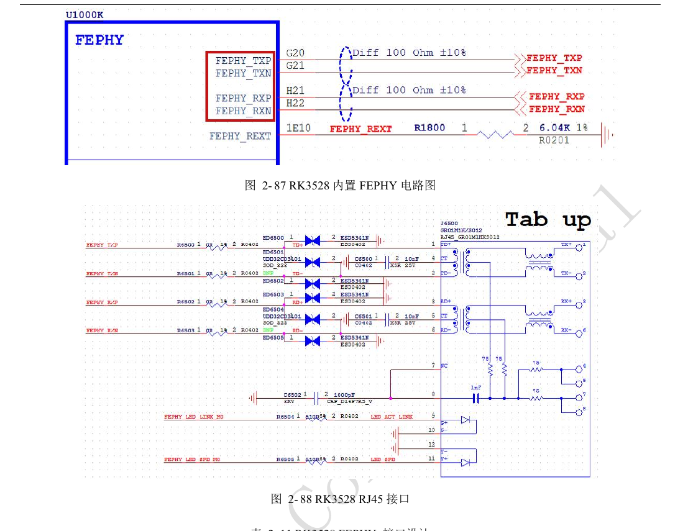
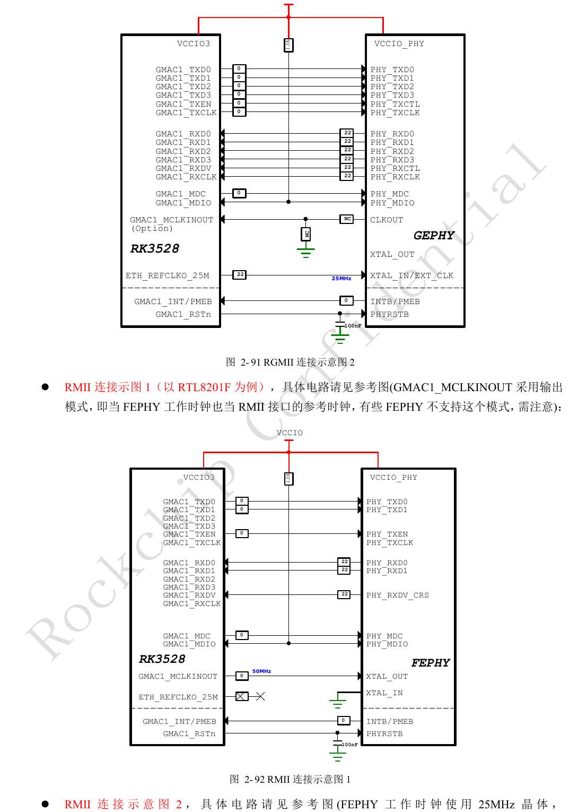
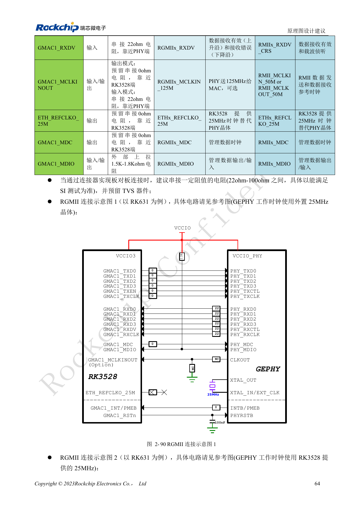
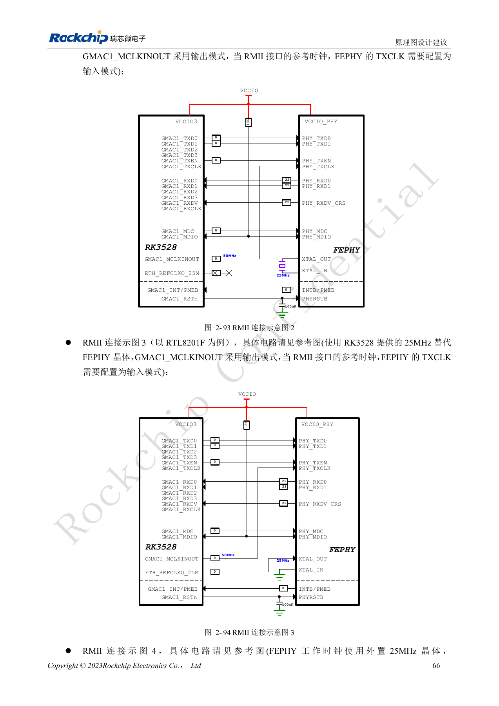
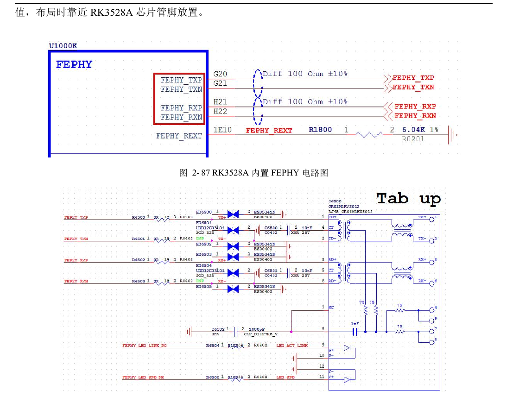
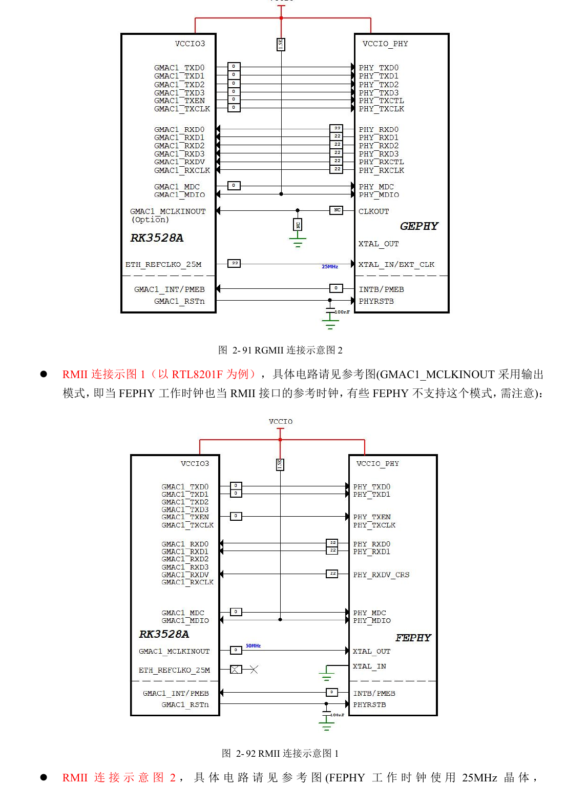
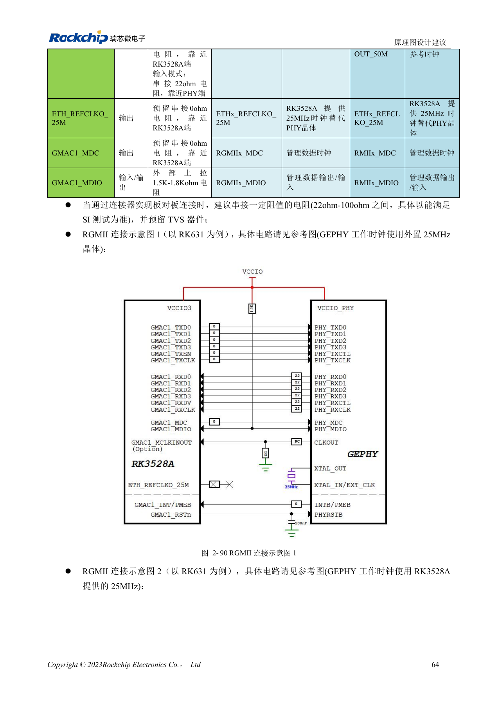
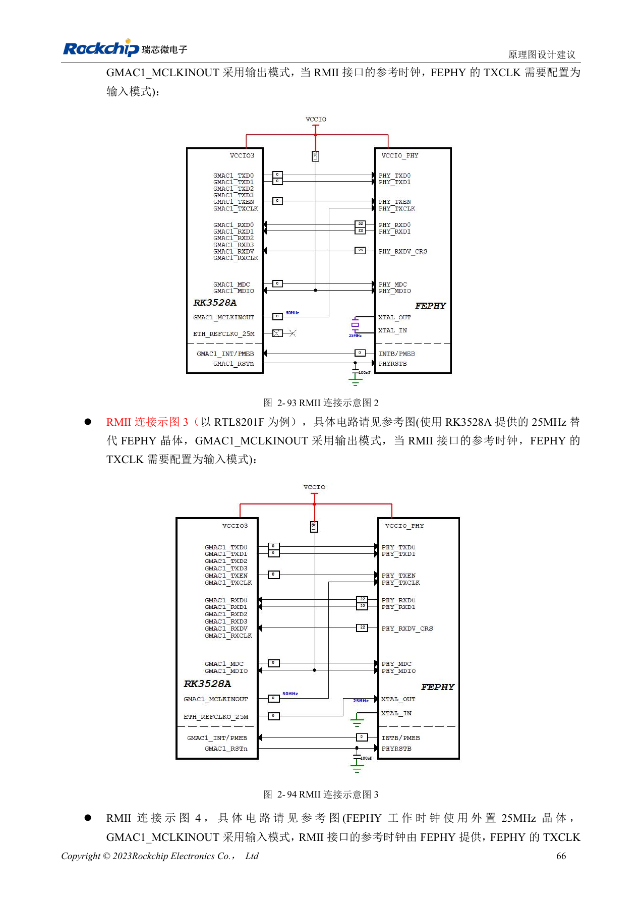

# RK3528 / RK3528A: RGMII, PHY, UART, I2C и PWM

Инженерная статья основана на китайских руководствах RK3528 V1.0 (2023-05-25) и RK3528A V1.0 (2023-07-12), а не является их дословным полным переводом. Сходство рассматриваемых глав не доказывает взаимозаменяемость микросхем. Официальная [документация Sige1](https://docs.armsom.org/armsom-sige1) указывает RK3528 в плате ArmSoM [Sige1](https://www.armsom.org/sige1), подходящей для оценки соответствующих приложений. Это не означает, что Sige1 использует RK3528A, и не доказывает взаимозаменяемость микросхем. Эталонные схемы SoC не являются схемами Sige1; выводы, корпус, BSP/SDK, ядро и ревизию платы проверяйте для конкретного изделия. Значения взяты из источников, не из измерений ArmSoM.

**§2.3.8–2.3.13; PDF 75–87, 147–148**

## Встроенный Fast Ethernet и внешний PHY — разные пути

Руководства перечисляют один GMAC, один EMAC и встроенный FEPHY. FEPHY подключается через MDI к трансформатору и RJ45; REXT — 6.04kΩ, 1%, рядом с SoC, места 0Ω в дифференциальных линиях сохраняются. GMAC поддерживает RGMII 10/100/1000Mbps или RMII 10/100Mbps в VCCIO3. Для внешнего PHY проверяйте уровни, сброс, straps и средние точки трансформатора по его документации. RJ45 tab-up/tab-down меняет порядок выводов: сверяйте символ и footprint.

## Согласуйте направление такта и задержку

Эталон назначает задержку TXCLK–данные MAC, а RXCLK–данные PHY; в примере RK631 включена RX-задержка 2ns. При смене PHY исключите двойную вставку задержки. RMII допускает разные направления 50MHz; не путайте рабочие 25MHz PHY с опорными 50MHz шины. MDIO требует внешнюю подтяжку 1.5–1.8kΩ к IO-питанию; у сброса PHY ставится 100nF. RGMII PCB: 50Ω±10%, данные TX/RX согласуются со своим тактом <120mil, длина <6in.

## Распределяйте управление по IO-доменам и Mx

Восемь UART, восемь I2C, два обычных SPI и до восьми PWM не гарантируют одновременный вывод всех сигналов. TX/RX UART должны принадлежать одной группе Mx. Для UART7 одна колонка содержит M1/M2, а колонка питания M0/M1: сверяйте с PinOut, не угадывайте. SPI0 относится к VCCIO4, SPI1 — к VCCIO0. I2C поддерживает до 400Kbit/s; внешняя подтяжка 2.2kΩ проверяется по ёмкости шины. PWM3/PWM7 принимают IR, по умолчанию 38kHz. Удаляйте приёмники от антенн и прямого света LED, согласуйте выходной уровень.

## Справочные параметры

| Параметр | Значение источника |
| --- | --- |
| REXT встроенного PHY | 6.04kΩ ±1% |
| Подтяжка MDIO | 1.5–1.8kΩ |
| Скорость I2C | ≤400Kbit/s |
| Подтяжка I2C | 2.2kΩ |

## Мультиплексирование и питание управления

Таблицы 2-24, 2-25, 2-27, 2-29 и 2-31, PDF 82–86. Сохранены все строки; звёздочка отмечает противоречие UART7. Идентификаторы не переводятся, включая исходное PMUIO0 для HDMI_TX_I2C.

### UART

| Интерфейс | Группа: домен питания |
| --- | --- |
| UART0 | M0: VCCIO0; M1: VCCIO1 |
| UART1 | M0: VCCIO4; M1: VCCIO4 |
| UART2 | M0: VCCIO3; M1: VCCIO0 |
| UART3 | M0: VCCIO4; M1: VCCIO4 |
| UART4 | VCCIO2 |
| UART5 | M0: VCCIO0; M1: VCCIO1 |
| UART6 | M0: VCCIO3; M1: VCCIO3 |
| UART7 | M1/M2 ↔ M0: VCCIO3; M1: VCCIO0 * |

### UART RTSN / CTSN

| Интерфейс | Группа: домен питания |
| --- | --- |
| UART0_RTSN / UART0_CTSN | -- |
| UART1_RTSN / UART1_CTSN | VCCIO4 |
| UART2_RTSN / UART2_CTSN | M0: VCCIO3; M1: VCCIO0 |
| UART3_RTSN / UART3_CTSN | VCCIO4 |
| UART4_RTSN / UART4_CTSN | VCCIO2 |
| UART5_RTSN / UART5_CTSN | M0: VCCIO0; M1: VCCIO1 |
| UART6_RTSN / UART6_CTSN | VCCIO3 |
| UART7_RTSN / UART7_CTSN | M0: VCCIO3; M1: VCCIO0 |

### SPI

| Интерфейс | Группа: домен питания |
| --- | --- |
| SPI0 | VCCIO4 |
| SPI1 | VCCIO0 |

### I2C

| Интерфейс | Группа: домен питания |
| --- | --- |
| I2C0 | M0: VCCIO4; M1: VCCIO4 |
| I2C1 | M0: VCCIO4; M1: VCCIO4 |
| I2C2 | M1: VCCIO0 |
| I2C3 | M0: VCCIO0; M1: VCCIO3 |
| I2C4 | VCCIO2 |
| I2C5 | M0: VCCIO0; M1: VCCIO1 |
| I2C6 | M0: VCCIO3; M1: VCCIO1 |
| I2C7 | VCCIO2 |
| HDMI_TX_I2C | PMUIO0 |

### PWM

| Интерфейс | Группа: домен питания |
| --- | --- |
| PWM0 | M0: VCCIO4; M1: VCCIO0 |
| PWM1 | M0: VCCIO4; M1: VCCIO0 |
| PWM2 | M0: VCCIO4; M1: VCCIO0 |
| PWM3 | M0: VCCIO4; M1: VCCIO2 |
| PWM4 | M0: VCCIO4; M1: VCCIO0 |
| PWM5 | M0: VCCIO4; M1: VCCIO3 |
| PWM6 | M0: VCCIO4; M1: VCCIO0; M2: VCCIO3 |
| PWM7 | M0: VCCIO4; M1: VCCIO0 |

## Иллюстрации и страницы источника

Английские оригиналы не предоставлены. Во всех языках используются китайские изображения с указанием микросхемы и физической страницы; изображения RK3528 не выдаются за RK3528A.

RK3528 · CN · PDF 76

RK3528 · CN · PDF 79

RK3528 · CN · PDF 78

RK3528 · CN · PDF 80

RK3528A · CN · PDF 76

RK3528A · CN · PDF 79

RK3528A · CN · PDF 78

RK3528A · CN · PDF 80

## Разработка и документация

Выбирайте изделия ArmSoM по их документации; серия не утверждает наличие платы ArmSoM на RK3528/RK3528A. Опыт разработки интерфейсов и ПО других плат полезен как методика, но не делает взаимозаменяемыми напряжения, выводы или PCB-правила.

- [ArmSoM](https://www.armsom.org/) · [ArmSoM Docs](https://docs.armsom.org/)
- [RK3528 / RK3528A: девять тем аппаратного проектирования](/ru/articles/rk3528-rk3528a-hardware-design-series/)
- [RK3528 / RK3528A: HDMI, CVBS, TSI и аналоговый звук](/ru/articles/rk3528-rk3528a-display-audio-design/)
- [RK3528 / RK3528A PCB: слои, fanout, возвратный ток и защита](/ru/articles/rk3528-rk3528a-pcb-stackup-signal-integrity/)
