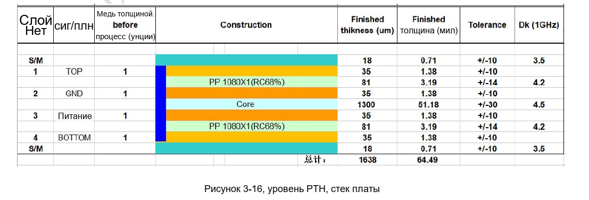
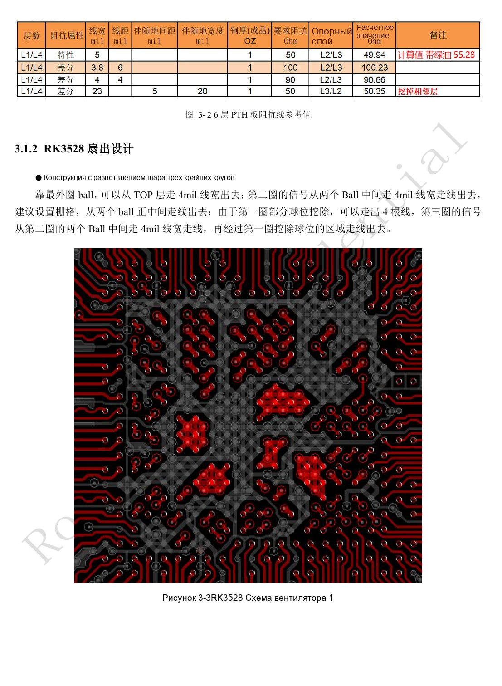
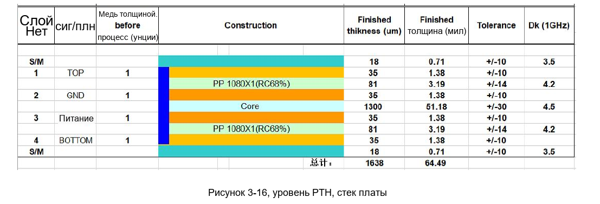
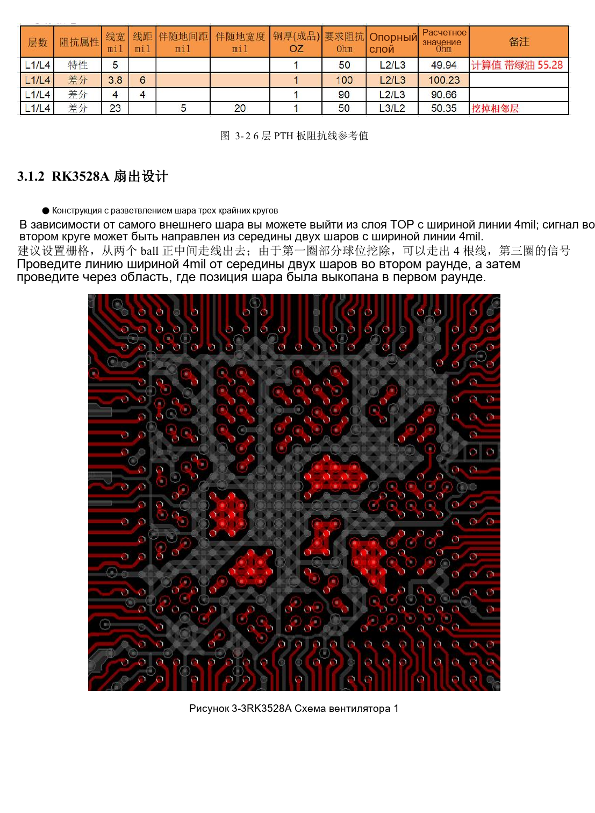

# RK3528 / RK3528A PCB: слои, fanout, возвратный ток и защита

Инженерная статья основана на китайских руководствах RK3528 V1.0 (2023-05-25) и RK3528A V1.0 (2023-07-12), а не является их дословным полным переводом. Сходство рассматриваемых глав не доказывает взаимозаменяемость микросхем. Официальная [документация Sige1](https://docs.armsom.org/armsom-sige1) указывает RK3528 в плате ArmSoM [Sige1](https://www.armsom.org/sige1), подходящей для оценки соответствующих приложений. Это не означает, что Sige1 использует RK3528A, и не доказывает взаимозаменяемость микросхем. Эталонные схемы SoC не являются схемами Sige1; выводы, корпус, BSP/SDK, ядро и ревизию платы проверяйте для конкретного изделия. Значения взяты из источников, не из измерений ArmSoM.

**§3.1–3.3.2; §5; PDF 88–126, 156–158**

## Сначала согласуйте слои с производителем PCB

Текст задаёт четырёхслойную PTH-плату TOP–GND–POWER–BOTTOM, 1.6mm и 1oz, но подписи рисунков 3-1 и 3-2 называют шесть слоёв. Это противоречие источника; подпись не доказывает шестислойный проект. При смене материалов или числа слоёв изготовитель должен пересчитать single-ended и differential impedance. Земля располагается рядом с SoC, сигнальные слои по возможности рядом с землёй, питание рядом с землёй; структура и медь симметричны.

## Fanout должен сохранять возвратный путь

Пример трёх внешних рядов BGA использует трассы 4mil и пустые позиции внешнего ряда. Это шаблон конкретных корпуса, площадок и технологии, а не универсальная ширина всей платы. Разрывы плоскостей, смена слоя и переходы меняют возвратный ток. Для питания сначала проверяйте падение DC, токовую нагрузку и контуры развязки; для дифференциальных пар — непрерывную землю, затем длины и зазоры. Разъёмы, фильтры и ESD-площадки входят в канал импеданса.

## ESD и EMI нельзя исправить одним последним элементом

Защита располагается у разъёма: разряд сначала проходит TVS, затем путь к SoC. Сокращайте контур земли и добавляйте переходы. Reset, такт и прерывания держите минимум в 5mm от края. Тактовые резисторы ставятся у источника; SoC–резистор <400mil. Отступ силовой плоскости рекомендован 20H, где H — расстояние питание–земля. Общая ESD-глава задаёт 2.2–10Ω между платами, интерфейсные главы — 22–100Ω: нельзя назначать одно значение всем линиям. Выбирайте по форме сигнала, импульсным испытаниям и ошибкам. Экраны и радиаторы также проверяются в составе изделия.

## Справочные параметры

| Параметр | Значение источника |
| --- | --- |
| Эталонные слои по тексту | 4-layer PTH; 1.6mm; 1oz |
| Пример внешнего fanout | 4mil |
| Отступ чувствительных сигналов | ≥5mm |
| Расстояние до тактового резистора | <400mil |

## Иллюстрации и страницы источника

Английские оригиналы не предоставлены. Во всех языках используются китайские изображения с указанием микросхемы и физической страницы; изображения RK3528 не выдаются за RK3528A.

RK3528 · CN · PDF 88

RK3528 · CN · PDF 89

RK3528A · CN · PDF 88

RK3528A · CN · PDF 89

## Разработка и документация

Выбирайте изделия ArmSoM по их документации; серия не утверждает наличие платы ArmSoM на RK3528/RK3528A. Опыт разработки интерфейсов и ПО других плат полезен как методика, но не делает взаимозаменяемыми напряжения, выводы или PCB-правила.

- [ArmSoM](https://www.armsom.org/) · [ArmSoM Docs](https://docs.armsom.org/)
- [RK3528 / RK3528A: девять тем аппаратного проектирования](/ru/articles/rk3528-rk3528a-hardware-design-series/)
- [RK3528 / RK3528A: RGMII, PHY, UART, I2C и PWM](/ru/articles/rk3528-rk3528a-ethernet-control-interfaces/)
- [RK3528 / RK3528A: тепло, оплавление и контроль влажности](/ru/articles/rk3528-rk3528a-thermal-assembly-storage/)
