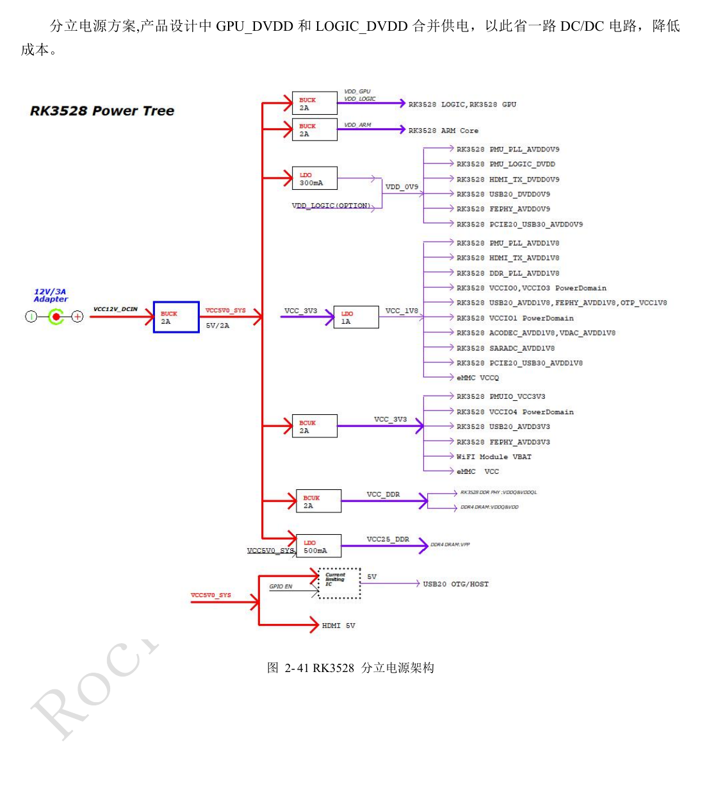
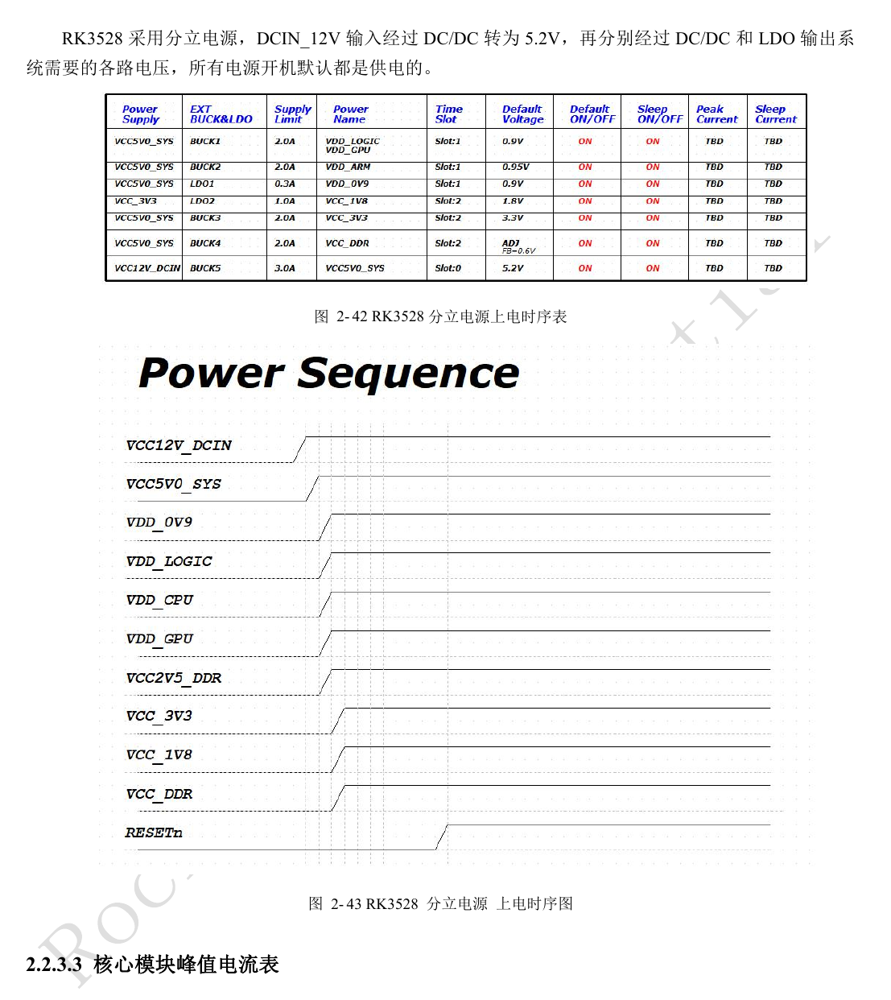
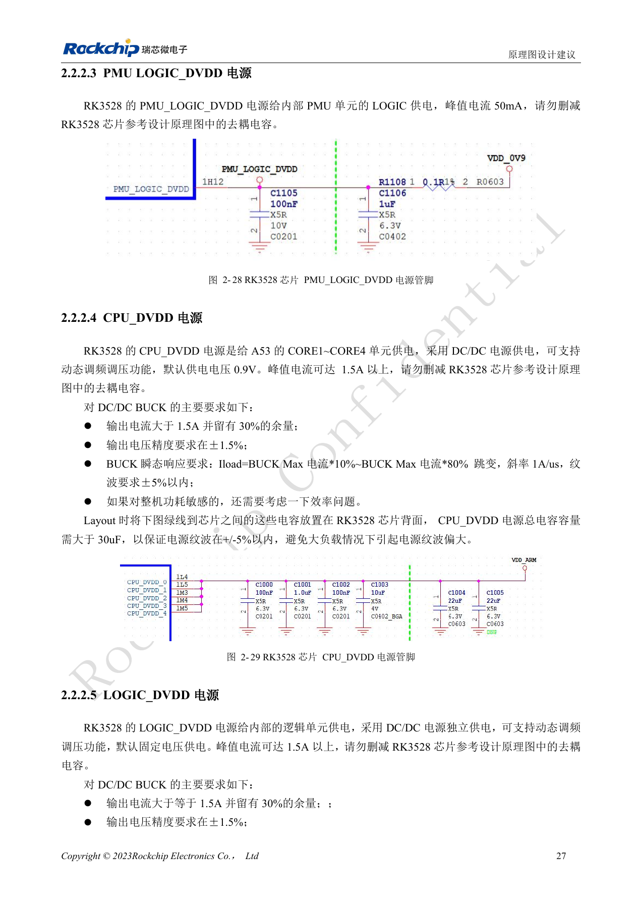
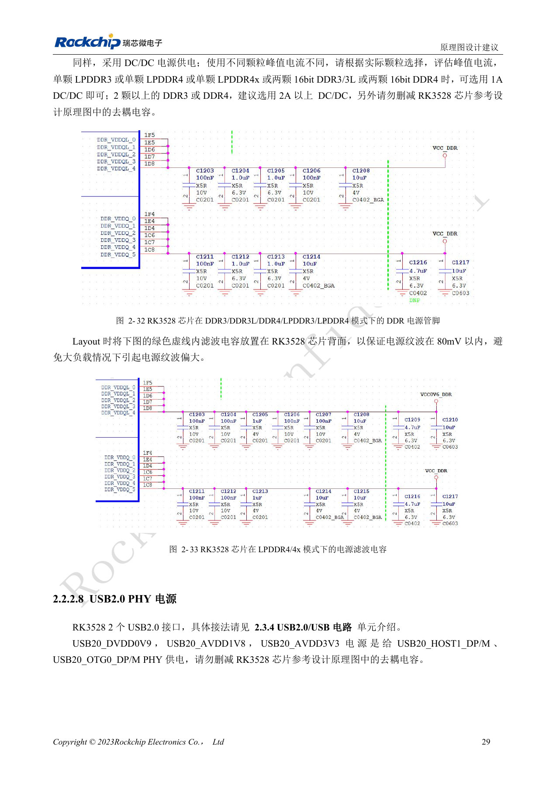
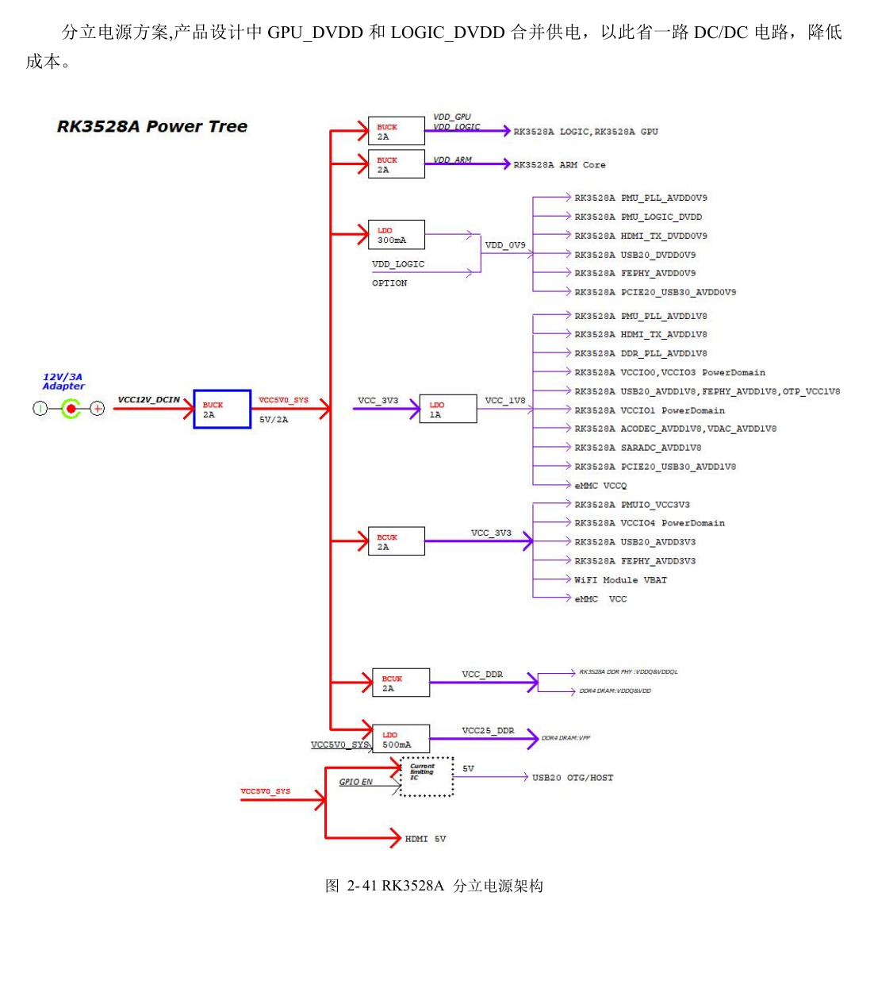
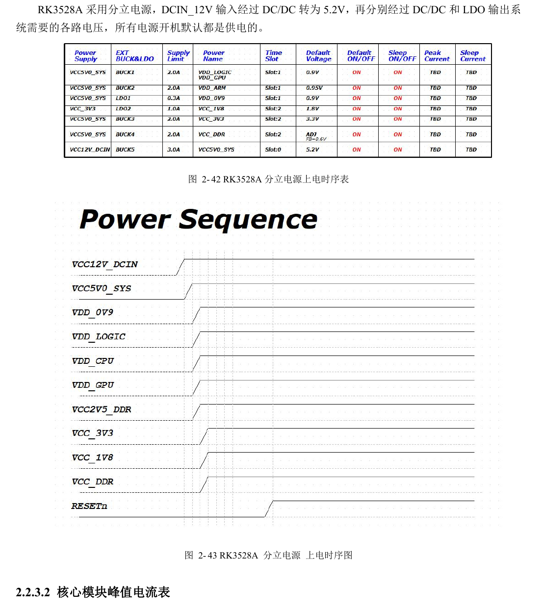
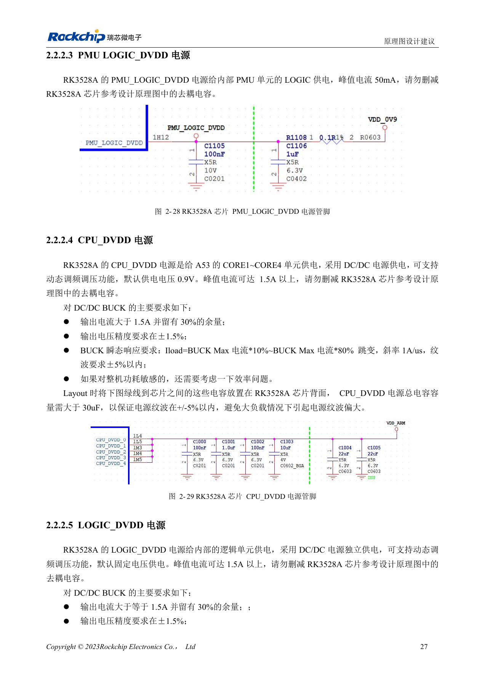

# RK3528 / RK3528A: дискретное питание, последовательность и нагрузка

Инженерная статья основана на китайских руководствах RK3528 V1.0 (2023-05-25) и RK3528A V1.0 (2023-07-12), а не является их дословным полным переводом. Сходство рассматриваемых глав не доказывает взаимозаменяемость микросхем. Официальная [документация Sige1](https://docs.armsom.org/armsom-sige1) указывает RK3528 в плате ArmSoM [Sige1](https://www.armsom.org/sige1), подходящей для оценки соответствующих приложений. Это не означает, что Sige1 использует RK3528A, и не доказывает взаимозаменяемость микросхем. Эталонные схемы SoC не являются схемами Sige1; выводы, корпус, BSP/SDK, ядро и ревизию платы проверяйте для конкретного изделия. Значения взяты из источников, не из измерений ArmSoM.

**§2.2; PDF 37–49; §3.3.2**

## Начните с перечня доменов

Руководства отдельно рассматривают PLL, логику, CPU, GPU, DDR, IO и аналоговые PHY. VCCIO0–4 работают с 1.8V или 3.3V и автоматически определяют аппаратный уровень; PMUIO имеет фиксированное питание. Это не разрешает смешивать уровни периферии в одном домене. Зафиксируйте питание, подтяжки, сброс и состояние при выключении каждого устройства, чтобы исключить обратное питание через сигналы.

## Стабилизируйте питание до снятия сброса

Внутри модуля низкое напряжение подаётся раньше высокого, одинаковые напряжения — одновременно. RESETn удерживается минимум 10ms после стабилизации последней линии. При выключении сначала активируйте RESETn, затем снимайте питание. Пример группирует 0.9V, 1.8V, 3.3V, DDR и сброс; зависимости реальных регуляторов проверяйте по рисункам 2-41–2-43. Необязательное начальное питание домена не разрешает подавать произвольное напряжение на его выводы.

## Номинального тока регулятора недостаточно

В эталоне GPU_DVDD объединён с LOGIC_DVDD ради экономии одного преобразователя; изменения требуют проверки динамической нагрузки, падения напряжения и DVFS. Начальное напряжение CPU в примере — 0.9V, пиковый ток может превышать 1.5A. Для CPU и LOGIC указана суммарная развязка более 30µF на каждую линию, близко к кристаллу с сохранением токовых путей. Неиспользуемый PCIe2.0/USB3 Combo PHY всё равно требует питания из-за внутренних PLL. Измеряйте переходные нагрузки и последовательность на стороне микросхемы.

## Справочные параметры

| Параметр | Значение источника |
| --- | --- |
| Удержание сброса | ≥10ms |
| Начальное напряжение CPU | 0.9V |
| Развязка CPU / LOGIC | >30µF each |
| Пульсации DDR | <80mV |

## Питание при первом включении

Таблица 2-9, страница PDF 39. Необязательное питание относится только к указанному первому включению, не к работе модуля. Сон и выключение проверяются отдельно.

| Модуль | Выводы питания | Первое включение |
| --- | --- | --- |
| PLL | PMU_PLL_AVDD0V9, PMU_PLL_AVDD1V8 | Обязательно |
| PMU_DVDD | PMU_LOGIC_DVDD | Обязательно |
| DDR PLL | DDR_PLL_AVDD1V8 | Обязательно |
| DDR VDDQ | DDR VDDQ | Обязательно |
| DDR VDDQL | DDR VDDQL | Обязательно |
| CPU | CPU_DVDD | Допускается без питания при первом включении |
| GPU | GPU_DVDD | Допускается без питания при первом включении |
| LOGIC | LOGIC_DVDD | Обязательно |
| IO | VCCIO0_VCC, VCCIO2_VCC, VCCIO3_VCC, VCCIO4_VCC | Допускается без питания при первом включении |
| PMUIO | PMUIO_VCC3V3 | Обязательно |
| EMMCIO | VCCIO1_VCC | Обязательно |
| USB2.0 PHY | USB20_DVDD0V9, USB20_AVDD1V8, USB20_AVDD3V3 | Обязательно |
| PCIe2.0 / USB3 Combo PHY | PCIE20_USB30_AVDD0V9, PCIE20_USB30_AVDD1V8 | Обязательно |
| SARADC | SARADC_AVDD1V8 | Обязательно |
| OTP | OTP_VCC1V8 | Обязательно |
| HDMI TX PHY | HDMI_TX_DVDD0V9, HDMI_TX0_AVDD1V8 | Допускается без питания при первом включении |
| ACODEC PHY | ACODEC_AVDD1V8 | Допускается без питания при первом включении |
| VDAC PHY | VDAC_AVDD1V8 | Допускается без питания при первом включении |
| FEPHY | FEPHY_AVDD0V9, FEPHY_AVDD1V8, FEPHY_AVDD3V3 | Допускается без питания при первом включении |

### PLL

| Питание | Пиковый ток | Требование AC |
| --- | --- | --- |
| PMU_PLL_AVDD0V9 | 10mA | <20mV |
| PMU_PLL_AVDD1V8 | 10mA | <50mV |
| DDR_PLL_AVDD1V8 | 5mA | <50mV |

## Иллюстрации и страницы источника

Английские оригиналы не предоставлены. Во всех языках используются китайские изображения с указанием микросхемы и физической страницы; изображения RK3528 не выдаются за RK3528A.

RK3528 · CN · PDF 48

RK3528 · CN · PDF 49

RK3528 · CN · PDF 41

RK3528 · CN · PDF 43

RK3528A · CN · PDF 48

RK3528A · CN · PDF 49

RK3528A · CN · PDF 41

RK3528A · CN · PDF 43

## Разработка и документация

Выбирайте изделия ArmSoM по их документации; серия не утверждает наличие платы ArmSoM на RK3528/RK3528A. Опыт разработки интерфейсов и ПО других плат полезен как методика, но не делает взаимозаменяемыми напряжения, выводы или PCB-правила.

- [ArmSoM](https://www.armsom.org/) · [ArmSoM Docs](https://docs.armsom.org/)
- [RK3528 / RK3528A: девять тем аппаратного проектирования](/ru/articles/rk3528-rk3528a-hardware-design-series/)
- [RK3528 / RK3528A: тактирование, сброс, Maskrom и отладочный UART](/ru/articles/rk3528-rk3528a-boot-clock-debug/)
- [RK3528 / RK3528A DDR: топология, питание, перестановка и PCB](/ru/articles/rk3528-rk3528a-ddr-circuit-routing/)
