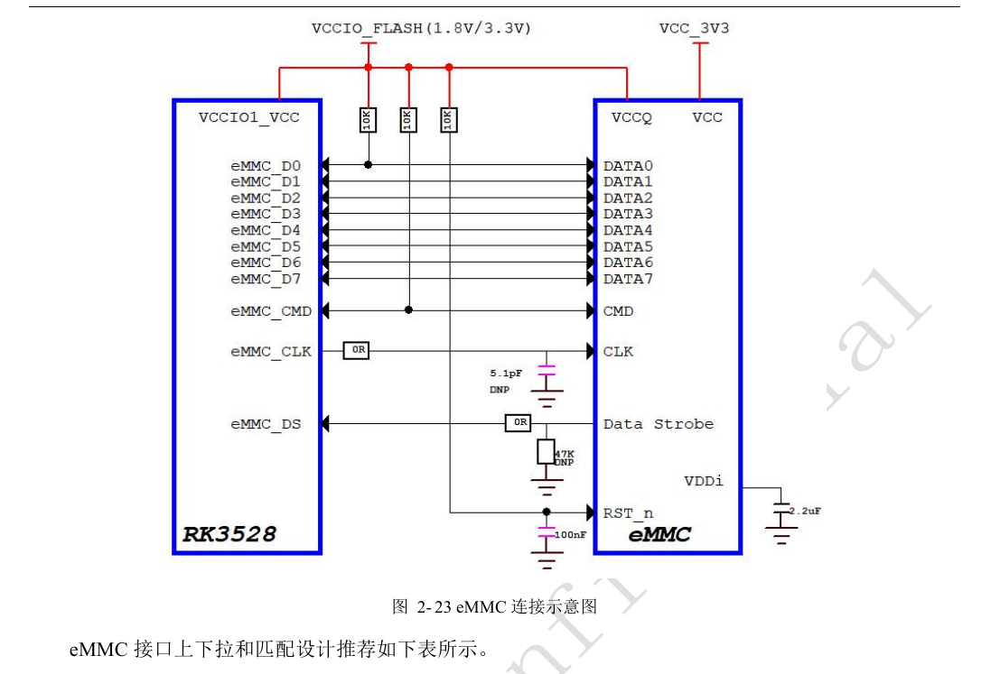
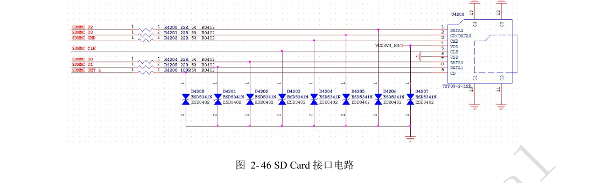
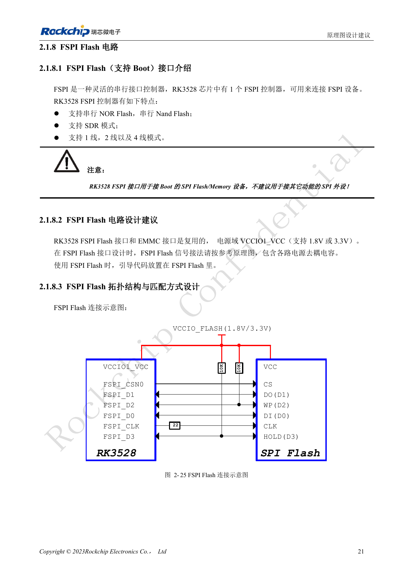
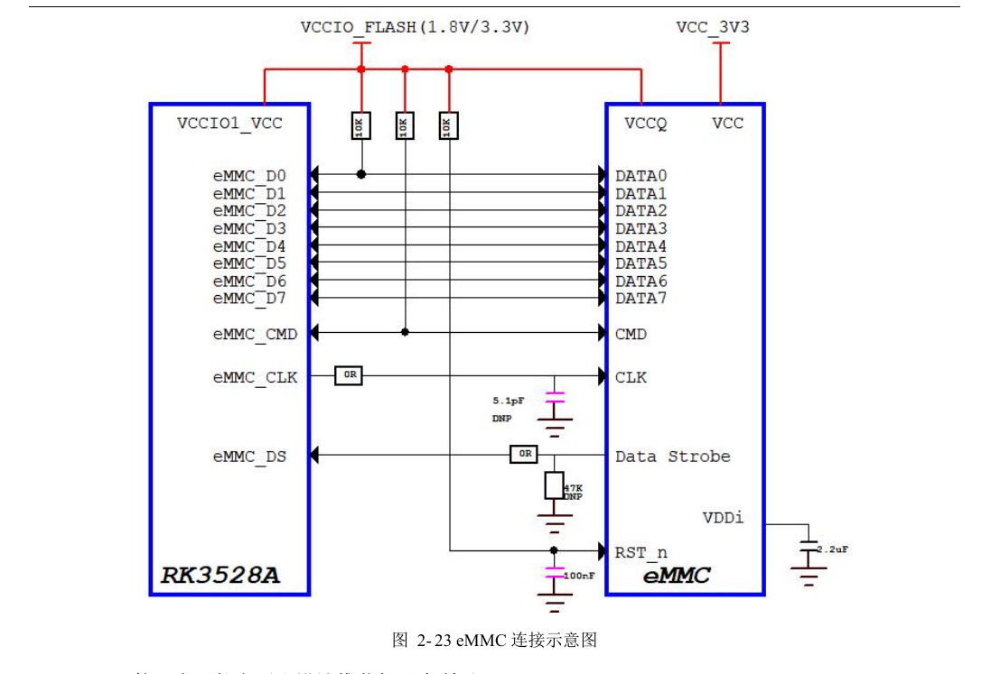
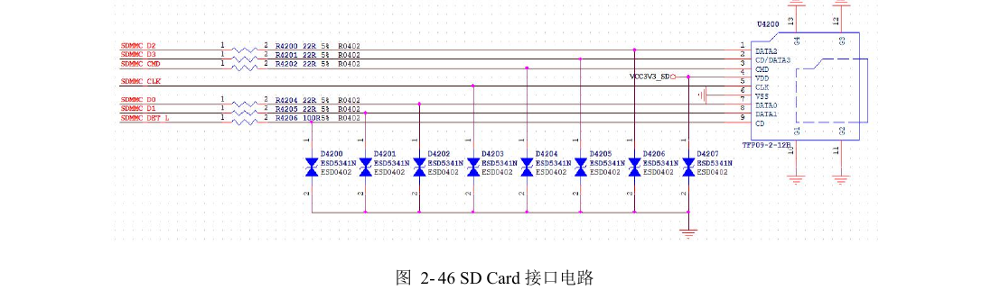
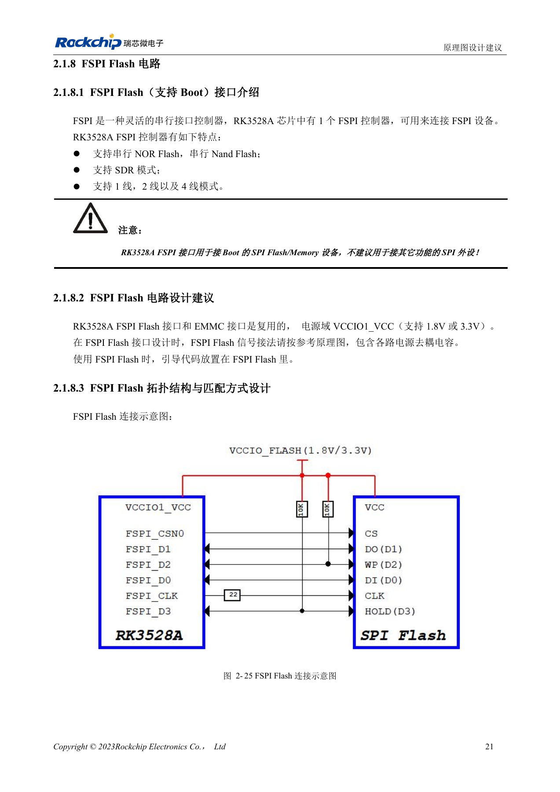

# RK3528 / RK3528A: eMMC, FSPI, SDMMC и SDIO

Инженерная статья основана на китайских руководствах RK3528 V1.0 (2023-05-25) и RK3528A V1.0 (2023-07-12), а не является их дословным полным переводом. Сходство рассматриваемых глав не доказывает взаимозаменяемость микросхем. Официальная [документация Sige1](https://docs.armsom.org/armsom-sige1) указывает RK3528 в плате ArmSoM [Sige1](https://www.armsom.org/sige1), подходящей для оценки соответствующих приложений. Это не означает, что Sige1 использует RK3528A, и не доказывает взаимозаменяемость микросхем. Эталонные схемы SoC не являются схемами Sige1; выводы, корпус, BSP/SDK, ядро и ревизию платы проверяйте для конкретного изделия. Значения взяты из источников, не из измерений ArmSoM.

**§2.1.7–2.1.8; §2.3.1; PDF 32–36, 50–54, 145–147**

## eMMC и FSPI делят ресурсы

eMMC и FSPI используют общие выводы VCCIO1_VCC (1.8V/3.3V), поэтому их нельзя считать безусловно одновременными интерфейсами. eMMC поддерживает 5.1, 1/4/8bit и HS400. Сохраните внешние подтяжки CMD и D0 по 10kΩ, CLK через 22Ω у SoC, Strobe через 0Ω у eMMC и место для 47kΩ на землю. Одна линия питания IO SoC не отменяет требований VCC/VCCQ самой памяти. Замена памяти требует проверки списка поддержки и загрузчика.

## FSPI предназначен для загрузочной памяти

FSPI поддерживает serial NOR/NAND, SDR и 1/2/4 линии; руководства не рекомендуют подключать обычную SPI-периферию. Питание Flash должно совпадать с IO-доменом. Предусмотрите 10kΩ на D2/D3 и 22Ω в CLK у SoC. Для eMMC указаны 50Ω±10%, рассогласование CLK/STRB–данные <120mil, длина <3in и желательно не более двух переходов. Для FSPI — 50Ω±10%, CLK–данные <200mil, длина <4in. Считайте весь канал, включая разъёмы и дочерние платы.

## Разделяйте загрузку SDMMC и беспроводной SDIO

SDIO0/1 относятся к VCCIO0/VCCIO3 и не поддерживают System Boot; SDMMC также зависит от начального SDMMC_DET. Для данных, команды и такта SDMMC указаны 22Ω, для DET — 100Ω. На CLK SDIO сохраняйте 22Ω; резисторы данных/команды выбирайте по SI коротких трасс. SDMMC/SDIO: 50Ω±10%, такт–данные <120mil; длина <4in при 50MHz<CLK≤200MHz и <6in при CLK≤50MHz. Дополнительно проверяйте направления UART/PCM, амплитуду 32.768kHz, согласование и запретные зоны антенны.

## Противоречие резистора такта eMMC

На странице 33 PDF рисунок 2-23 обозначает CLK-резистор 0Ω, а таблица 2-5 рекомендует 22Ω. Текст сохраняет рекомендацию таблицы, изображение не изменяется. Фактическую установку проверяйте по выбранной памяти, BSP и осциллограммам, не исправляя исходную схему молча.

## Справочные параметры

| Параметр | Значение источника |
| --- | --- |
| Длина eMMC | <3in |
| Длина FSPI | <4in |
| Подтяжка CMD / D0 | 10kΩ |
| Загрузка SDIO | Не поддерживается |

## Иллюстрации и страницы источника

Английские оригиналы не предоставлены. Во всех языках используются китайские изображения с указанием микросхемы и физической страницы; изображения RK3528 не выдаются за RK3528A.

RK3528 · CN · PDF 33

RK3528 · CN · PDF 52

RK3528 · CN · PDF 35

RK3528A · CN · PDF 33

RK3528A · CN · PDF 52

RK3528A · CN · PDF 35

## Разработка и документация

Выбирайте изделия ArmSoM по их документации; серия не утверждает наличие платы ArmSoM на RK3528/RK3528A. Опыт разработки интерфейсов и ПО других плат полезен как методика, но не делает взаимозаменяемыми напряжения, выводы или PCB-правила.

- [ArmSoM](https://www.armsom.org/) · [ArmSoM Docs](https://docs.armsom.org/)
- [RK3528 / RK3528A: девять тем аппаратного проектирования](/ru/articles/rk3528-rk3528a-hardware-design-series/)
- [RK3528 / RK3528A DDR: топология, питание, перестановка и PCB](/ru/articles/rk3528-rk3528a-ddr-circuit-routing/)
- [RK3528 / RK3528A: общий PHY USB/PCIe и проверка канала](/ru/articles/rk3528-rk3528a-usb-pcie-design/)
