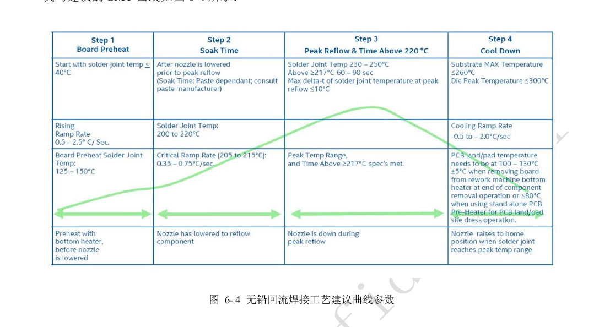
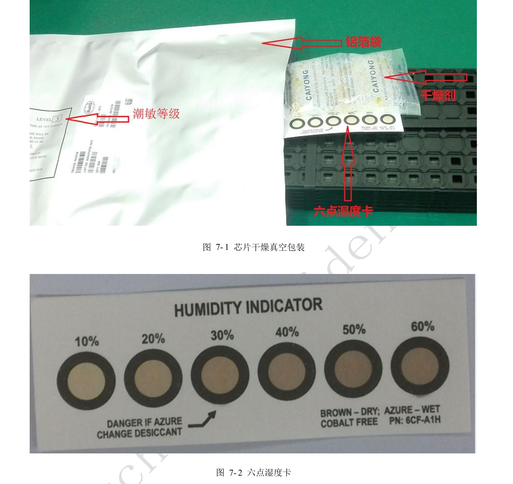
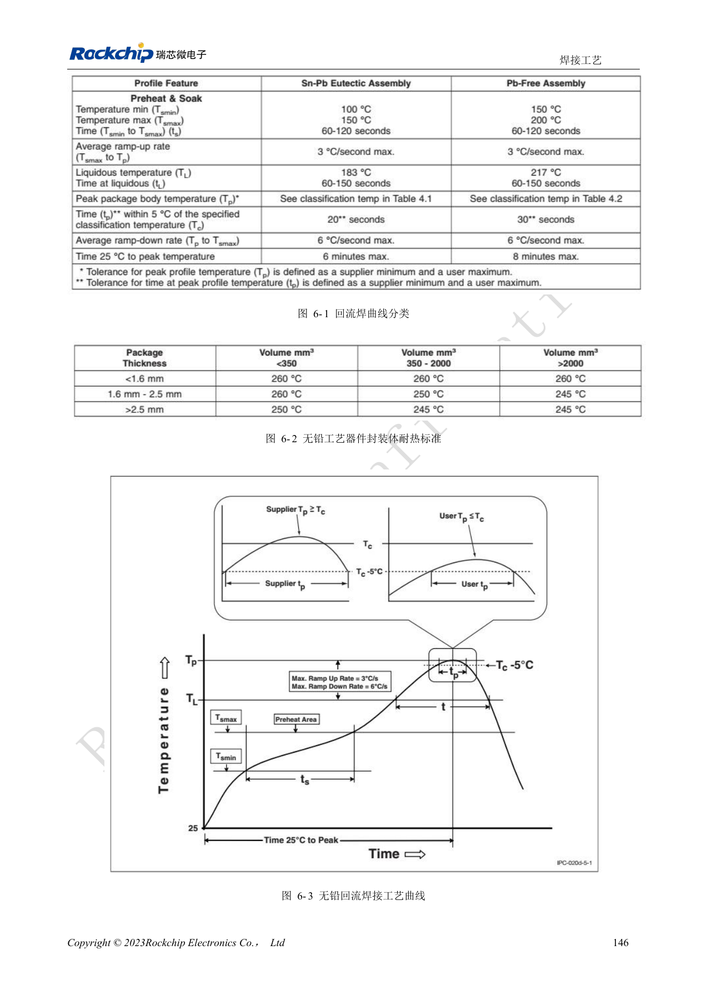

# RK3528 / RK3528A: тепло, оплавление и контроль влажности

Инженерная статья основана на китайских руководствах RK3528 V1.0 (2023-05-25) и RK3528A V1.0 (2023-07-12), а не является их дословным полным переводом. Сходство рассматриваемых глав не доказывает взаимозаменяемость микросхем. Официальная [документация Sige1](https://docs.armsom.org/armsom-sige1) указывает RK3528 в плате ArmSoM [Sige1](https://www.armsom.org/sige1), подходящей для оценки соответствующих приложений. Это не означает, что Sige1 использует RK3528A, и не доказывает взаимозаменяемость микросхем. Эталонные схемы SoC не являются схемами Sige1; выводы, корпус, BSP/SDK, ядро и ревизию платы проверяйте для конкретного изделия. Значения взяты из источников, не из измерений ArmSoM.

**§4, §6–7; PDF 152–164**

## Тепловая симуляция не является измерением ArmSoM

Источник использует FEM для JEDEC PCB 140×180mm, 1.6mm, четыре слоя, без радиатора. Корпус, медь, поток воздуха и нагрузка реального изделия отличаются; тепловое сопротивление симуляции не доказывает температуру перехода или длительную производительность. Раздел Linux перечисляет Power allocator, Step wise, Fair share и Userspace, по умолчанию Power_allocator. Проверяйте пороги, снижение частоты и восстановление в реальном BSP; записывайте длительные частоты, температуру среды и горячие точки.

## Топология и сборка влияют на надёжность

Руководство рекомендует около 20–50mm между SoC и DC/DC против локального перегрева. Силовая медь должна выдерживать ток; каждому земляному шару желательно дать переход, минимальный ориентир — один переход на 1.5 шара. Профиль оплавления корректируется по тепловой массе, печи и пасте. Источник задаёт хранение пасты 2–10°C, прогрев 3–4h и перемешивание вручную 3–5min либо механически 3min. Это не универсальные условия допуска любой пасты; записи производства должны указывать реальный материал и аттестованный процесс.

## Учитывайте суммарное время MSL3

Оба руководства относят микросхему к MSL3. Суммарное время после вскрытия до оплавления — 168h при ≤30°C/60%RH; также указано сухое хранение <10%RH. Для вакуумной упаковки: ≤40°C, <90%RH, до 12 месяцев. При превышении времени или изменении карты влажности используйте таблицу re-bake и маркировку упаковки. Аномальные «≤300°C» в строке MSL1 отмечены в журнале проверки и не используются как рекомендация. Ниже приведены минимальные времена для толщины ≤1.4mm, MSL3, не для произвольных плат или аккумуляторов.

## Справочные параметры

| Параметр | Значение источника |
| --- | --- |
| Сушка 125°C +10/−0°C: превышение >72h / ≤72h | 9h / 7h |
| Сушка 90°C +8/−0°C: превышение >72h / ≤72h | 33h / 23h |
| Сушка 40°C +5/−0°C: превышение >72h / ≤72h | 13 дней / 9 дней |

## Иллюстрации и страницы источника

Английские оригиналы не предоставлены. Во всех языках используются китайские изображения с указанием микросхемы и физической страницы; изображения RK3528 не выдаются за RK3528A.

RK3528 · CN · PDF 161

RK3528 · CN · PDF 163

RK3528 · CN · PDF 160

RK3528A · CN · PDF 161

RK3528A · CN · PDF 163

RK3528A · CN · PDF 160

## Разработка и документация

Выбирайте изделия ArmSoM по их документации; серия не утверждает наличие платы ArmSoM на RK3528/RK3528A. Опыт разработки интерфейсов и ПО других плат полезен как методика, но не делает взаимозаменяемыми напряжения, выводы или PCB-правила.

- [ArmSoM](https://www.armsom.org/) · [ArmSoM Docs](https://docs.armsom.org/)
- [RK3528 / RK3528A: девять тем аппаратного проектирования](/ru/articles/rk3528-rk3528a-hardware-design-series/)
- [RK3528 / RK3528A PCB: слои, fanout, возвратный ток и защита](/ru/articles/rk3528-rk3528a-pcb-stackup-signal-integrity/)
