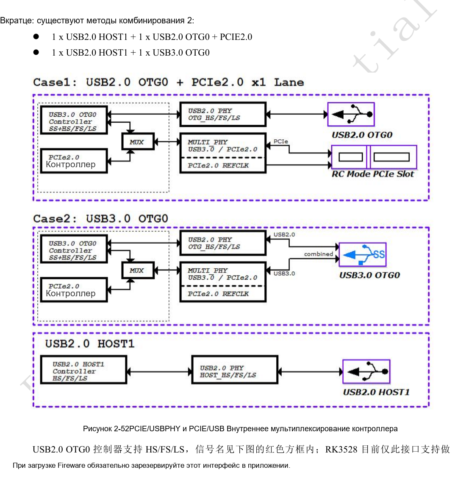
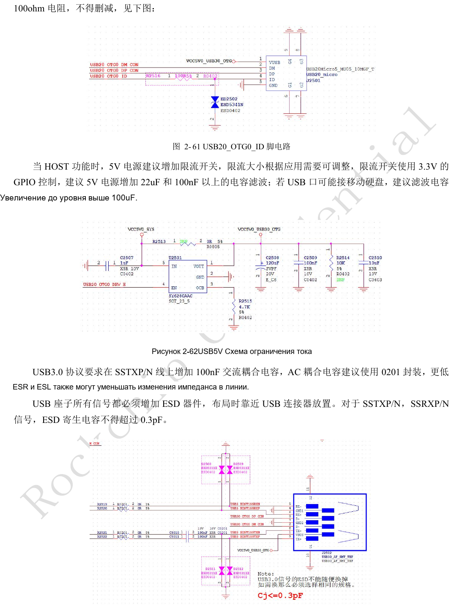
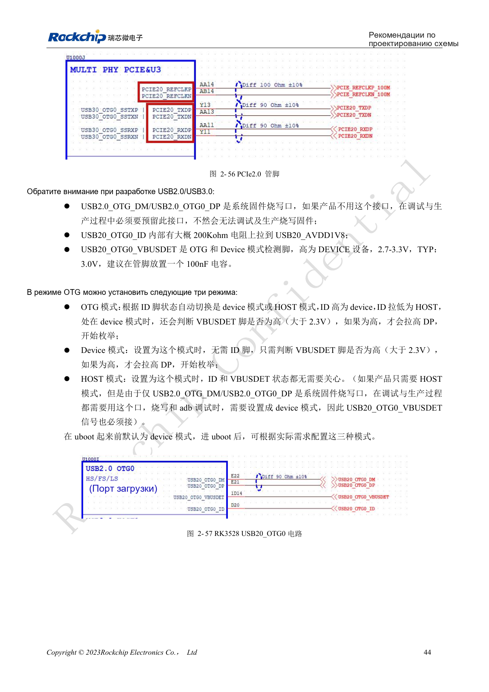
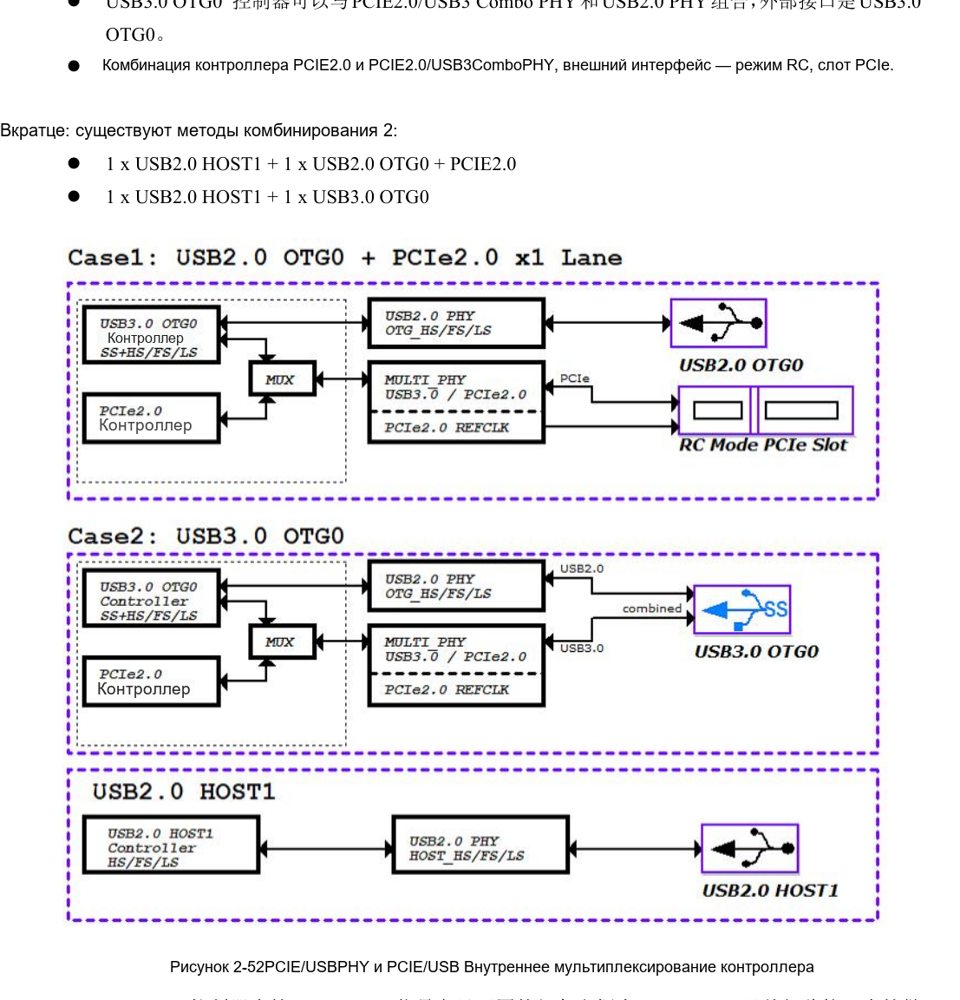
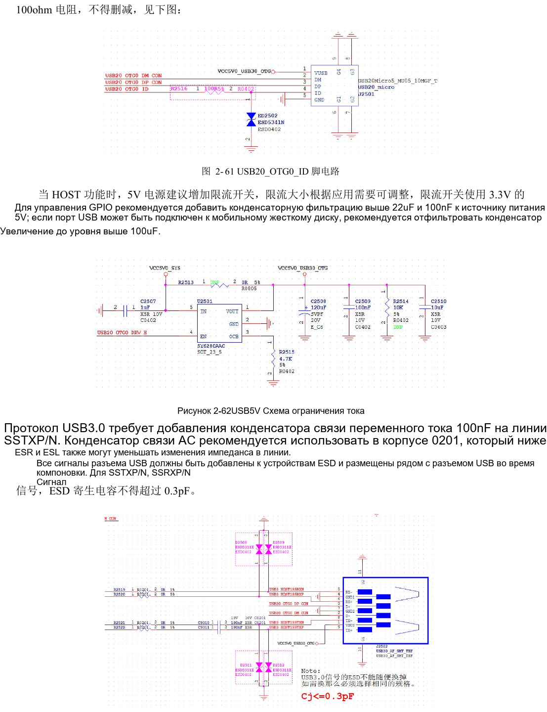
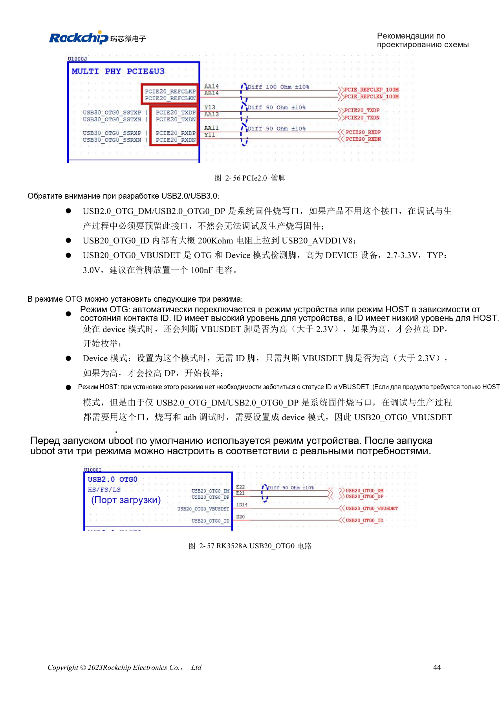

# RK3528 / RK3528A: общий PHY USB/PCIe и проверка канала

Инженерная статья основана на китайских руководствах RK3528 V1.0 (2023-05-25) и RK3528A V1.0 (2023-07-12), а не является их дословным полным переводом. Сходство рассматриваемых глав не доказывает взаимозаменяемость микросхем. Официальная [документация Sige1](https://docs.armsom.org/armsom-sige1) указывает RK3528 в плате ArmSoM [Sige1](https://www.armsom.org/sige1), подходящей для оценки соответствующих приложений. Это не означает, что Sige1 использует RK3528A, и не доказывает взаимозаменяемость микросхем. Эталонные схемы SoC не являются схемами Sige1; выводы, корпус, BSP/SDK, ядро и ревизию платы проверяйте для конкретного изделия. Значения взяты из источников, не из измерений ArmSoM.

**§2.3.4; PDF 55–61, 141–145**

## Выберите комбинацию до разъёмов

Два USB2 PHY и один PCIe2.0/USB3 Combo PHY не означают одновременную доступность всех портов. Руководства задают USB2 HOST1 + USB2 OTG0 + PCIe2.0 либо USB2 HOST1 + USB3 OTG0. PCIe работает как RC. USB2 OTG0 используется для прошивки: сохраните D+/D− и VBUSDET для производства и отладки, даже без пользовательского USB. Прошивка, device tree и схема должны опираться на одну матрицу ресурсов.

## Проверяйте питание, согласование и защиту вместе

USB HOST 5V рекомендуется питать через ограничитель тока с фильтрами минимум 22µF и 100nF. Для переносных дисков источник рекомендует более 100µF с последующей проверкой пускового тока и ключа. Данные USB2 — через 2.2Ω; USB3 TX — через 100nF, желательно 0201, RX — с местом для 0Ω. Используемый OTG ID требует 100Ω и ESD. В схемной части предел ёмкости USB3 ESD ≤0.3pF, в PCB — ≤0.2pF. Сохраняйте обе ссылки, ориентируйтесь на более строгий бюджет и проверяйте компонент.

## Перенесите значения PCB в ограничения

Данные PCIe: 90Ω±10%, разница внутри пары <6mil, длина <6in; REFCLK: 100Ω±10%, разница <12mil, желательно не более двух переходов. USB3: 90Ω±10%, разница <6mil, HOST <6in, Device/OTG <5in, желательно максимум два перехода. USB2: 90Ω±10%, разница <20mil, длина <6in; желательно максимум четыре перехода, не более шести. Строка межпарного согласования PCIe содержит <6in без ясного временного смысла: это не точный бюджет skew. Земляные переходы экранирования — каждые ≤300mil, опорная земля непрерывна.

## Справочные параметры

| Параметр | Значение источника |
| --- | --- |
| Импеданс данных USB3 / PCIe | 90Ω ±10% |
| Импеданс PCIe REFCLK | 100Ω ±10% |
| USB3 ESD: два предела | ≤0.3pF / ≤0.2pF |

## Иллюстрации и страницы источника

Английские оригиналы не предоставлены. Во всех языках используются китайские изображения с указанием микросхемы и физической страницы; изображения RK3528 не выдаются за RK3528A.

RK3528 · CN · PDF 56

RK3528 · CN · PDF 60

RK3528 · CN · PDF 58

RK3528A · CN · PDF 56

RK3528A · CN · PDF 60

RK3528A · CN · PDF 58

## Разработка и документация

Выбирайте изделия ArmSoM по их документации; серия не утверждает наличие платы ArmSoM на RK3528/RK3528A. Опыт разработки интерфейсов и ПО других плат полезен как методика, но не делает взаимозаменяемыми напряжения, выводы или PCB-правила.

- [ArmSoM](https://www.armsom.org/) · [ArmSoM Docs](https://docs.armsom.org/)
- [RK3528 / RK3528A: девять тем аппаратного проектирования](/ru/articles/rk3528-rk3528a-hardware-design-series/)
- [RK3528 / RK3528A: eMMC, FSPI, SDMMC и SDIO](/ru/articles/rk3528-rk3528a-storage-sdio-design/)
- [RK3528 / RK3528A: HDMI, CVBS, TSI и аналоговый звук](/ru/articles/rk3528-rk3528a-display-audio-design/)
