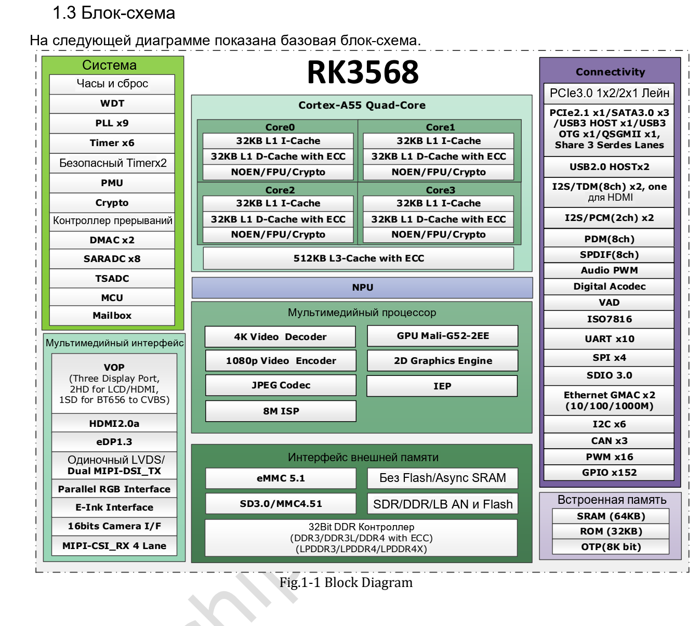

Статья основана на указанной редакции datasheet. Значения являются спецификациями производителя, а не измерениями ArmSoM; новых аппаратных испытаний не проводилось. Проверьте ревизию кристалла, схему платы, SDK/BSP, ядро и драйверы. Пояснения и редактируемые таблицы помогают чтению; полная спецификация и не рассмотренные подробно битовые поля находятся в исходном PDF.

**RK3568 · Rockchip RK3568 Datasheet V1.2-20210601.pdf · PDF 7–19.**

*Английский оригинал, PDF, стр. 19.*

## Вычисления, память и загрузка

CPU, GPU и NPU — разные ресурсы. Спецификация NPU не определяет напрямую частоту кадров модели; нужны преобразование модели, драйверы и проверка полосы на Sige3. Максимальная DDR не равна комплектации.

| Параметр | Спецификация / примечание |
|---|---|
| CPU | 4 × Cortex-A55 · Armv8-A · NEON |
| GPU | Mali-G52 · 1 core / 2 execution engines |
| NPU | 1 TOPS · INT8/INT16/FP16/BFP16 |
| DDR | 32 bit · ≤8 GB |
| DDR3/DDR3L/LPDDR3 | ≤2133 Mbit/s |
| DDR4/LPDDR4/LPDDR4X | ≤3200 Mbit/s |
| Ranks | DDR3/DDR3L/DDR4: 2; LPDDR3/LPDDR4/LPDDR4X: 4 |
| ECC | 8 bit · DDR3/DDR3L/DDR4 |
| eMMC | 5.1 · HS200 · command queue · 1/4/8 bit |
| NAND | 8 bit · 4 banks · ECC 70 bit / 1 KB · DDR clock ≤75 MHz |
| FSPI | 1/2/4 bit SDR · serial NOR/NAND/pSRAM/SRAM |
| SRAM | 64 KB + PMU 8 KB |

## Кодеки и обработка изображения

| Параметр | Спецификация / примечание |
|---|---|
| Декодирование | H.265 Main10 YUV420 / H.264 Main10 YUV400/420/422 / VP9 Profile 0/2: 4096×2304 @60 |
| Другие декодеры | VP8/VC-1/MPEG-4/2/1: 1920×1088 @60; H.263: 720×576 @60 |
| Кодирование | H.264 BP/MP/HP L4.2: 1920×1080 @60; H.265 MP L4.1: 1920×1080 @60 or 4096×4096 @10 (tile) |
| JPEG | Decode ≤8176×8176 / 76 Mpixel/s; encode ≤8192×8192 / 90 Mpixel/s |
| RGA | Input ≤8192×8192; output ≤4096×4096; scaling 1/16–16; rotation/mirror |
| MIPI CSI | 1 × 4 lanes or 2 × 2 lanes · ≤2.5 Gbit/s per lane |
| DVP | 8/10/12/16 bit · ≤150 MHz |
| ISP | ≤4096×2304; two-frame HDR |
| VICAP | 4 IDs; crop; NV16/NV12 |

## Ограничения трёх дисплеев

У трёх выходов разные пределы; нельзя всем назначить максимальную характеристику одного. LVDS недоступен в dual-MIPI. Проверяйте VOP, пиксельные такты, общие выводы и ПО совместно.

| Параметр | Спецификация / примечание |
|---|---|
| VOP | 2 cluster + 2 esmart + 2 smart; 4096×2304 / 2048×1536 / 1920×1080 @60 |
| HDMI | 1080p120 or 4096×2304 @60 · ≤10 bit · HDCP 1.4/2.2 |
| eDP | 1.3 · 4 lanes × 2.7 Gbit/s · 2560×1600 @60 · PSR |
| MIPI DSI | 2 × 4 lanes · ≤2.5 Gbit/s per lane; single 1080p60 / dual 2560×1440 @60 |
| RGB/BT.1120 | 1920×1080 @60 · ≤150 MHz |
| EBC | ≤2200×1650 · 16 bit · 16 gray levels · ≤256 frames per scan |

## Общие PHY и отдельный PCIe 3.0

Для каждого общего PHY выбирается одна функция. Отдельные линии PCIe 3.0 образуют один x2 либо два x1, а не их сумму. ПО не превращает неразведённые ресурсы в разъёмы.

| Параметр | Спецификация / примечание |
|---|---|
| Multi-PHY0 | USB 3.0 OTG / SATA0 |
| Multi-PHY1 | USB 3.0 Host / SATA1 / QSGMII-SGMII |
| Multi-PHY2 | PCIe 2.1 / SATA2 / QSGMII-SGMII |
| PCIe 3.0 | 2 lanes · 2.5/5/8 Gbit/s; x2: RC/EP; x1 controller: RC |
| SATA | 3 controllers · 1.5/3/6 Gbit/s · AHCI 1.3.1 |
| QSGMII | 1 PCS; only 2 GMII controllers |
| Ethernet | 2 MAC · RGMII 10/100/1000 or RMII 10/100 |
| USB 2.0 Host | 2 · 480/12/1.5 Mbit/s |

## Управление, аудио и измерения

| Параметр | Спецификация / примечание |
|---|---|
| SPI | 4 controllers |
| I2C | 6 · 7/10-bit address · 100/400 kbit/s / 1 Mbit/s |
| UART | 10 · TX/RX FIFO 64 bytes · ≤4 Mbit/s; flow control UART0/1/3/4/5 |
| PWM | 16 × 32 bit; IR PWM3/7/11/15 |
| SARADC | 10 bit · 8 inputs · ≤1 MS/s |
| TSADC | 2 channels · ≤50 kS/s · −20…120 °C |
| OTP | 8 Kbit; 7 Kbit secure |
| I2S0/1 | 8 channels; I2S0 HDMI / I2S1 external |
| I2S2/3 | 2 channels |
| I2S | 16–32 bit · ≤192 kHz |
| PDM | 8 channels · 16–24 bit · ≤192 kHz |
| VAD | I2S/PDM input; amplitude detection; multi-mic storage |

## Вопросы к источнику и проверка проекта

Распределите память и PHY, проверьте разъёмы и реальную нагрузку. Заголовок памяти упоминает LPDDR2, но список поддержки его не содержит; поддержка не подтверждена. Ссылка Base Specification 3.0 в разделе PCIe 2.1 не подтверждает 8 Gbit/s у этого x1 PHY. Максимумы CPU/GPU в электрической таблице — TBD; проверяйте SKU и BSP.

## Продукты ArmSoM и границы применения

Sige3 использует RK3568B2. Здесь рассматривается общий datasheet RK3568 V1.2; вариант B2, ревизию платы и выведенные интерфейсы нужно проверять отдельно.

- [Sige3](https://www.armsom.org/sige3) · [Docs](https://docs.armsom.org/armsom-sige3)

## Серия по datasheet и исходный PDF

- [RK3568 обзор](/ru/articles/rk3568-datasheet-v12/)
- [RK3568: корпус и полная таблица 636 шариков](/ru/articles/rk3568-package-pin-reference/)
- [RK3568: DDR, дисплеи и распределение PCIe/SATA/USB](/ru/articles/rk3568-architecture-phy-resource-planning/)
- [RK3568: питание, I/O и тепловое сопротивление](/ru/articles/rk3568-electrical-power-thermal/)
- [Скачать полный исходный PDF](/assets/datasheet-series-20261110/Rockchip-RK3568-Datasheet-V1.2-20210601.pdf)
