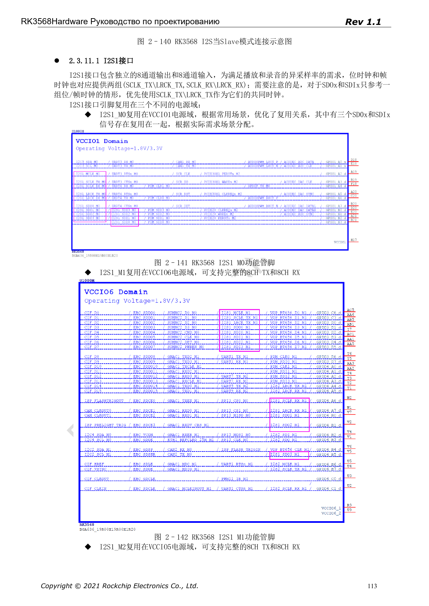
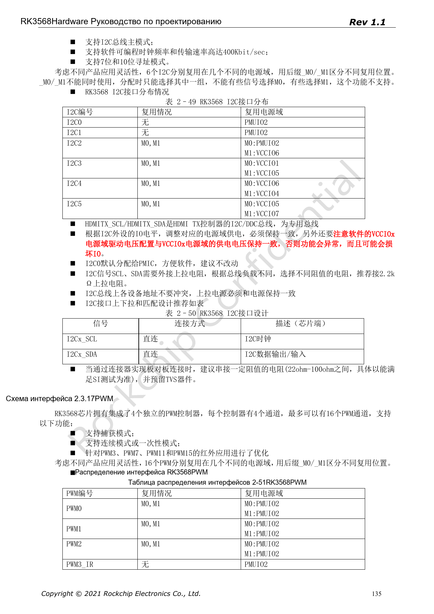

# Аудио и управление RK3568: I2S, UART, SPI, CAN и I2C

Серия перерабатывает RK3568 Hardware Design Guide V1.1 (китайский, 2021-06-08) и отдельный High Speed PCB Design Guide V1.0.0 (английский, 2021-04-12) по инженерным темам. ArmSoM [Sige3](https://www.armsom.org/sige3) использует RK3568B2. [Документация платы](https://docs.armsom.org/armsom-sige3) помогает изучать и оценивать рассматриваемые решения. Эталонные схемы SoC не описывают все реальные схемы и выведенные интерфейсы Sige3. Проверяйте SDK/BSP, ядро, ревизию чипа, прошивку и периферию. Значения взяты из источников, не из испытаний ArmSoM.

**CN V1.1 §2.3.11; §2.3.13–2.3.17 · PDF 111–125,132–137**

## Внутренний аудиоканал не является группой внешних выводов

I2S0 из четырёх контроллеров соединён внутри с HDMI2.0 TX и не выведен на IO. I2S1 — 8 TX + 8 RX с I2S/PCM/TDM; I2S2 и I2S3 — по 2 TX + 2 RX с I2S/PCM. Источник указывает 16–32-bit, до 192kHz, master/slave, но режимы одного контроллера взаимоисключающие. Роли кодека, MCLK/BCLK/LRCK, аналоговое питание и уровни решают вместе.

## Выбирайте группу мультиплексирования целиком

M0/M1/M2 у UART, SPI, CAN — альтернативные позиции одной функции: TX_M0 нельзя сочетать с RX_M1. Источник перечисляет 10 UART, 4 обычных SPI, 3 CAN, 6 I2C и до 16 PWM. Это ресурсы контроллеров, а не число разъёмов платы. _u/_d/_z означают подтяжку вверх/вниз/высокий импеданс при сбросе; проверяйте также состояние периферии при включении.

## I2C, SPI и межплатные соединения

I2C0 по умолчанию отведён PMIC. Подтяжка SCL/SDA рекомендована 2.2kΩ с проверкой нагрузки и правильного питания. Адреса не должны конфликтовать; HDMI DDC — отдельная шина. Для SPI CLK указаны 22Ω, поддерживаются 4/8/16-bit, master/slave и полный/полудуплекс. В межплатных соединениях совместно проверяют резисторы, TVS, землю и кабель; вывод SoC не заменяет промышленный трансивер.

## Уточните формулировку скорости CAN

Страница 134 одновременно называет CAN 2.0B, 1Mbps и 8Mbps, не разделяя режимы и фазы. Это не доказывает классический CAN на 8Mbps или проверенный CAN FD. Сверьте TRM, драйвер, трансивер и конфигурацию шины. Для PWM ИК-приёмника проверьте питание выбранного IO-домена и возможность пробуждения.

## Параметры и ограничения источника

| Параметр | Значение источника |
| --- | --- |
| I2S0 | internal HDMI |
| I2S1 | 8 TX + 8 RX |
| I2S2 / I2S3 | 2 TX + 2 RX each |
| I2C | ≤400Kbit/sec; 7-bit / 10-bit |
| SPI | 4 / 8 / 16-bit; CLK 22Ω |

## Иллюстрации источника

Снимки страниц сохраняют подписи схем и контекст; текст и таблицы статьи редактируемые. Соответствующего английского издания основного руководства нет, поэтому его рисунки остаются китайскими во всех версиях. Материалы отдельного английского PCB-гайда отмечены отдельно. Номера относятся к физическим страницам PDF.

Китайское руководство · PDF 113

Китайское руководство · PDF 135

## Дополнительные материалы

- [RK3568: 10 тем схемотехники, PCB и производства](/ru/articles/rk3568-hardware-design-series/)
- [Дисплеи и камеры RK3568: VOP, MIPI, HDMI и питание](/ru/articles/rk3568-display-camera-hardware/)
- [PCB для RK3568: стек, fanout и возвратные токи](/ru/articles/rk3568-pcb-stackup-return-path-design/)
- [ArmSoM Docs](https://docs.armsom.org/)
- [ArmSoM](https://www.armsom.org/)
