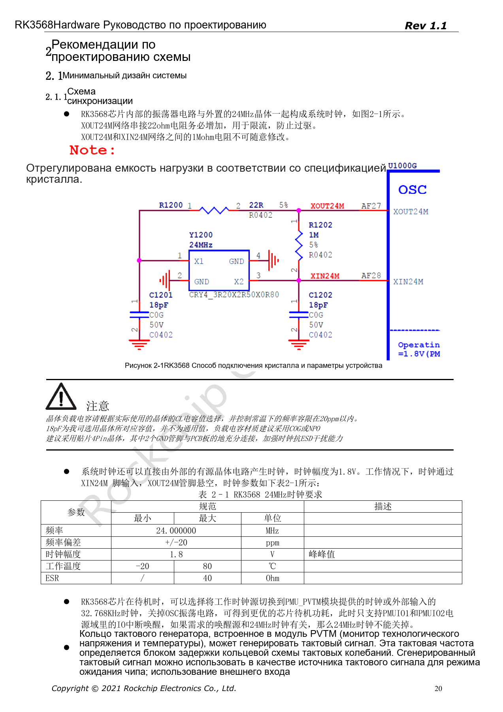
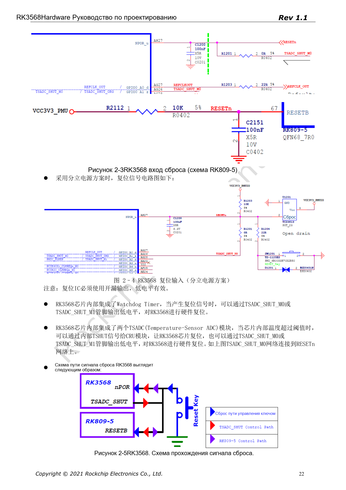

# Минимальная система RK3568: тактирование, сброс и загрузка

Серия перерабатывает RK3568 Hardware Design Guide V1.1 (китайский, 2021-06-08) и отдельный High Speed PCB Design Guide V1.0.0 (английский, 2021-04-12) по инженерным темам. ArmSoM [Sige3](https://www.armsom.org/sige3) использует RK3568B2. [Документация платы](https://docs.armsom.org/armsom-sige3) помогает изучать и оценивать рассматриваемые решения. Эталонные схемы SoC не описывают все реальные схемы и выведенные интерфейсы Sige3. Проверяйте SDK/BSP, ядро, ревизию чипа, прошивку и периферию. Значения взяты из источников, не из испытаний ArmSoM.

**CN V1.1 §2.1.1–2.1.6; §2.3.2; §3.2.1 · PDF 20–25, 72, 141–142**

## Начните с восстанавливаемой системы

Проверяйте такт 24MHz, сброс, питание, загрузочную память, USB для прошивки и UART как единую цепочку. Порядок из руководства: Serial NOR (FSPI), Serial NAND (FSPI), NAND, eMMC, SDMMC0. Если корректного загрузчика нет, загрузка выполняется через USB3_OTG0_DP/DM; сохраните и VBUSDET. Этот путь нужен для производства и восстановления даже без пользовательского USB-порта.

## Нагрузку кварца нельзя копировать вслепую

Последовательный резистор XOUT24M — 22Ω, между XOUT24M и XIN24M — 1MΩ. Показанные 18pF относятся к выбранному эталонному кварцу: ёмкости подбирают по CL и паразитам, предпочтительно C0G/NP0. Активный такт 1.8V подают на XIN24M, XOUT24M оставляют открытым. Кварц размещают рядом с SoC на той же стороне, с непрерывной землёй; под его проекцией не проводят другие сигналы. Интервал земляных переходов: 200–300mil.

## Стабилизируйте сброс и конфигурационные входы

NPOR — AH27, активный низкий, с 100nF возле вывода. Подтяжка должна соответствовать PMUIO1, супервизор — иметь открытый сток. Источник пишет «100 периодов 24MHz, не менее 4µs», но 100/24MHz ≈4.17µs; нельзя округлять требование вниз. FLASH_VOL_SEL=1 при VCCIO2=1.8V и 0 при 3.3V. SDMMC0_DET=0 выбирает SDMMC0, 1 — ARM JTAG.

## Учитывайте отладку и сон

Сохраните 100Ω и TVS на UART2_RX_M0/TX_M0. На странице 25 скорость записана как «1500000M»: это отмеченная ошибка источника, а не настройка порта; сверяйтесь с loader/U-Boot. Перед отключением 24MHz проверьте источники пробуждения. Подтяжку SARADC_VIN0 10kΩ к 1.8V удалять нельзя. Вход кнопкой Recovery в Loader требует соответствующей прошивки и не равен Maskrom.

## Параметры и ограничения источника

| Параметр | Значение источника |
| --- | --- |
| 24MHz | ±20ppm; 1.8V; ESR ≤40Ω |
| 32.768kHz | ±30ppm; 50%; 0.65×VDD … VDD+0.3V (PMUIO2) |
| NPOR | 100 × (1/24MHz) ≈4.17µs; 100nF |
| FLASH_VOL_SEL | 1 → 1.8V; 0 → 3.3V |

## Иллюстрации источника

Снимки страниц сохраняют подписи схем и контекст; текст и таблицы статьи редактируемые. Соответствующего английского издания основного руководства нет, поэтому его рисунки остаются китайскими во всех версиях. Материалы отдельного английского PCB-гайда отмечены отдельно. Номера относятся к физическим страницам PDF.

Китайское руководство · PDF 20

Китайское руководство · PDF 22

## Дополнительные материалы

- [RK3568: 10 тем схемотехники, PCB и производства](/ru/articles/rk3568-hardware-design-series/)
- [Питание и IO-домены RK3568: RK809-5 и дежурный режим](/ru/articles/rk3568-power-io-domain-hardware/)
- [ArmSoM Docs](https://docs.armsom.org/)
- [ArmSoM](https://www.armsom.org/)
