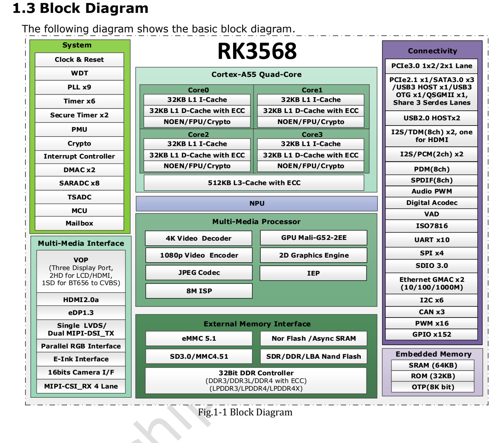

Это тематическое руководство по исходному документу: ключевые параметры, ограничения и оригинальные иллюстрации. Оно не заменяет полный перевод, таблицу выводов или регистров. Примеры производителя не являются измерениями ArmSoM. Перед применением проверьте ревизию платы, схему, SDK/BSP, ядро и драйверы; новых аппаратных испытаний для статьи не проводилось.

**Основной источник：** `Rockchip RK3568 Datasheet V1.2-20210601.pdf` · PDF 62 стр..

## Сначала нагрузка, затем распределение интерфейсов

RK3568 сочетает четыре Cortex-A55, специализированные медиаблоки и набор встроенных интерфейсов. Сеть, дисплей, накопители и инференс следует планировать совместно. В документации ArmSoM плата Sige3 указана как RK3568B2. Более ранний Datasheet V1.2 служит архитектурным ориентиром; ревизию B2, установленную память и выведенные интерфейсы сверяйте с документацией Sige3.

*Блок-схема RK3568 производителя — Оригинал на английском. `Rockchip RK3568 Datasheet V1.2-20210601.pdf`, PDF p. 19.*

## Параметры, определяющие проект

| Блок | Данные источника | Практическое значение |
| --- | --- | --- |
| CPU | 4× Cortex-A55; ARMv8; Neon, TrustZone | Отдельно оценить приложение, связь и обработку медиаданных |
| NPU | До 1 TOPS; INT8/INT16/FP16/BFP16 | Проверить операторы, квантование и инструменты; TOPS не определяет частоту кадров |
| GPU | Mali-G52 1-Core-2EE; OpenGL ES 1.1/2.0/3.2, OpenCL 2.0, Vulkan 1.1 | Доступность API зависит от образа и драйвера |
| Память | 32-bit; DDR3/DDR3L/DDR4/LPDDR3/LPDDR4/LPDDR4X; адресация до 8GB | Типы памяти альтернативны; предел адресации не равен установленному объёму |
| Видео | Декодирование H.264/H.265 до 4096×2304@60fps; кодирование 1920×1080@60fps | Предел кодека не задаёт суммарную производительность нескольких потоков |
| Камера | MIPI CSI: 1×4-lane либо 2×2-lane; до 2.5Gbps на линию | Согласовать сенсор, разъём, тактирование, питание и драйвер |
| Ethernet | 2 MAC; Gigabit RGMII либо Fast Ethernet RMII | Нужны также PHY, трансформаторы и корректная трассировка |

На стр. 56 максимальные частоты CPU/GPU всё ещё обозначены `TBD`. Частоту из рекламы другой платы нельзя выдавать за утверждение этого документа. Часть функций зависит от комплектации и сторонних лицензий.

## SATA, USB и PCIe нельзя просто суммировать

На стр. 16–17 описаны три Multi-PHY. До выбора платы составьте схему одновременно необходимых соединений.

| Ресурс | Взаимоисключающие варианты внутри ресурса |
| --- | --- |
| Multi-PHY0 | USB3.0 OTG / SATA0 |
| Multi-PHY1 | USB3.0 Host / SATA1 / QSGMII/SGMII |
| Multi-PHY2 | PCIe2.1 / SATA2 / QSGMII/SGMII |
| Отдельный PCIe3.0 PHY | 2 линии; организация контроллеров 1×x2 либо 2×x1 |

Если одновременно нужны быстрый USB, диск SATA и расширение PCIe, проверьте физическую разводку и режим PHY в device tree. Наличие интерфейса в SoC не означает доступность всех сочетаний на Sige3.

## Три направления применения

**Шлюз оборудования и лёгкие сервисы.** Разделите сбор данных, преобразование протоколов, буферизацию и управление. Проверьте потери пакетов, восстановление накопителя после отключения питания и длительную запись, затем совместную работу сервисов. Трансиверы и изоляцию выбирайте по условиям установки.

**Информационные экраны и панели оператора.** HDMI, MIPI DSI, LVDS, eDP, RGB и EBC дают несколько вариантов. Источник допускает три одновременных дисплея, но LVDS недоступен в режиме dual-MIPI. Помимо разрешения нужны правильные тайминги, сенсорный ввод, поворот, слои и графический backend.

**Компактное машинное зрение.** Проверяйте захват, масштабирование, преобразование цвета, инференс NPU и передачу результата одной цепочкой. Экспорт модели на PC не доказывает аппаратное исполнение всех операторов. Измеряйте полную задержку, переходы на CPU и пропущенные кадры.

## Электрические и тепловые ограничения

Стр. 56 требует соответствия настройки GPIO фактическому питанию. Одинаковый разъём не делает сигналы 1.8V и 3.3V совместимыми. Документ указывает окружающую температуру 0–80℃, а тепловой раздел требует температуры кристалла ниже 125℃. Это разные величины, не готовая промышленная спецификация изделия.

Тепловые сопротивления относятся к заданной эталонной PCB и расчётным условиям. После добавления корпуса, расширения и термопрокладки заново измерьте температуру и троттлинг при максимальной нагрузке. В бюджет питания включите USB-устройства, накопитель и дисплей.

## Воспроизводимая проверка на Sige3

Сохраните ревизию платы, контрольную сумму образа, версии ядра, device tree, драйверов и приложения. Проверьте холодный запуск, интерфейсы по отдельности, совместную нагрузку, работу после прогрева и восстановление после внезапного отключения. Результаты Sige3 на RK3568B2 не заменяют испытания другой платы RK3568.

## Продукты и документация

- **Sige3** — [Продукт](https://www.armsom.org/sige3) · [Документация](https://docs.armsom.org/armsom-sige3)

## Читайте также

<!-- datasheet-series-20261110 -->

## Серия по datasheet и исходный PDF

- [RK3568 обзор](/ru/articles/rk3568-datasheet-v12/)
- [RK3568: корпус и полная таблица 636 шариков](/ru/articles/rk3568-package-pin-reference/)
- [RK3568: DDR, дисплеи и распределение PCIe/SATA/USB](/ru/articles/rk3568-architecture-phy-resource-planning/)
- [RK3568: питание, I/O и тепловое сопротивление](/ru/articles/rk3568-electrical-power-thermal/)
- [Скачать полный исходный PDF](/assets/datasheet-series-20261110/Rockchip-RK3568-Datasheet-V1.2-20210601.pdf)

<!-- datasheet-related-20261110 -->
## Другие datasheet

Ссылки предназначены для сравнения платформ; электрические условия и выводы не взаимозаменяемы.

- [RK3506B](/ru/articles/rk3506b-datasheet-v10/)
- [RK3576](/ru/articles/rk3576-datasheet-v10/)
- [RK3588](/ru/articles/rk3588-datasheet-v14/)
- [RK3528](/ru/articles/rk3528-datasheet-v10/)
- [RK730](/ru/articles/rk730-audio-codec-design/)
