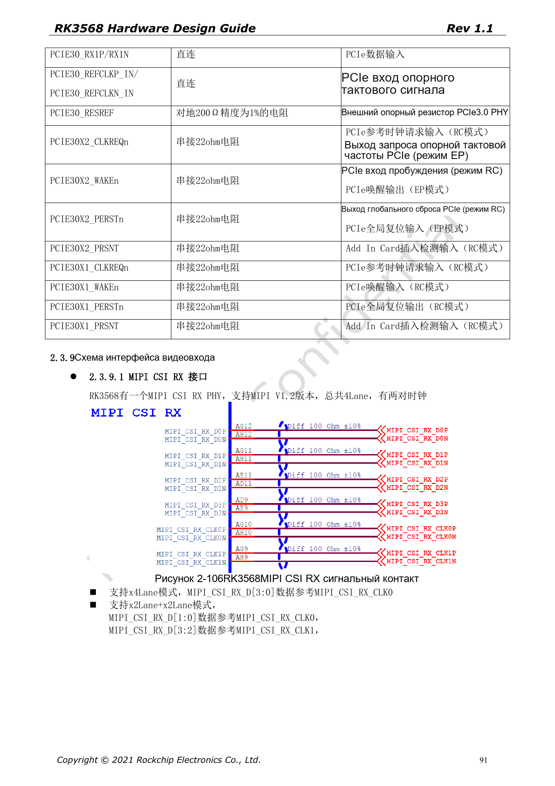
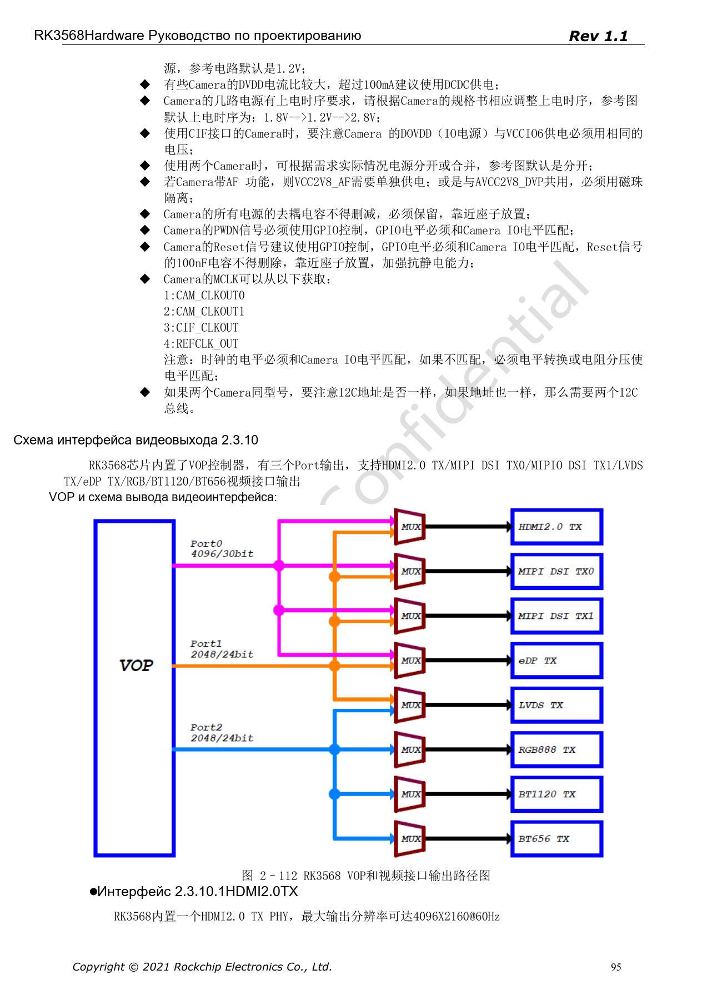
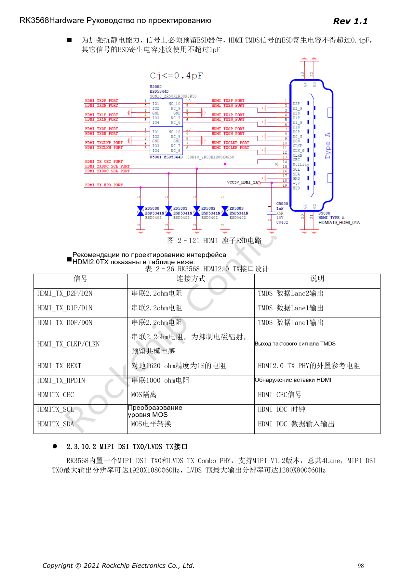

# Дисплеи и камеры RK3568: VOP, MIPI, HDMI и питание

Серия перерабатывает RK3568 Hardware Design Guide V1.1 (китайский, 2021-06-08) и отдельный High Speed PCB Design Guide V1.0.0 (английский, 2021-04-12) по инженерным темам. ArmSoM [Sige3](https://www.armsom.org/sige3) использует RK3568B2. [Документация платы](https://docs.armsom.org/armsom-sige3) помогает изучать и оценивать рассматриваемые решения. Эталонные схемы SoC не описывают все реальные схемы и выведенные интерфейсы Sige3. Проверяйте SDK/BSP, ядро, ревизию чипа, прошивку и периферию. Значения взяты из источников, не из испытаний ArmSoM.

**CN V1.1 §2.3.9–2.3.10; §3.2.25–3.2.26 · EN PCB §1.4, §1.7, §1.9–1.10, §1.16–1.18**

## Контроллеры дисплея не равны числу разъёмов

VOP имеет три выходных порта для HDMI2.0, MIPI DSI, LVDS, eDP, RGB, BT1120/656 с ограничениями мультиплексирования. HDMI2.0 указан до 4096×2160@60Hz; DSI TX0 — 1920×1080@60Hz и делит Combo PHY с LVDS TX, для которого указано 1280×800@60Hz. Одновременные комбинации проверяют по маршрутам VOP и BSP.

## Проверяйте данные, такт и питание камеры совместно

Четырёхлинейный CSI RX PHY поддерживает 1×4 либо 2×2 Lane: D[1:0] с CLK0, D[3:2] с CLK1. AVDD/DOVDD/DVDD, PWDN, Reset, I2C и MCLK определяются документацией сенсора. Последовательность 1.8V→1.2V→2.8V — пример, не универсальное правило. Для двух сенсоров с одинаковым I2C-адресом руководство рекомендует разные шины.

## Защита и скоростные ограничения

Паразитная ёмкость ESD HDMI TMDS ≤0.4pF, для прочих сигналов рекомендовано ≤1pF; REXT — 1620Ω, 1%. HDMI: внутри пары <12mil, такт–данные <480mil. MIPI: <12mil внутри пары, данные–такт <36mil. В разъёме соседние пары разделяют землёй, тестовые точки ставят рядом с короткими ответвлениями. Не забывайте питание подсветки, тачскрина и сенсора.

## Для VGA нужен мост

RK3568 не имеет прямого VGA; источник использует внешний RTD2166 или другой мост. По списку видеовозможностей нельзя заключать о наличии VGA. Питание, Reset, HPD, синхронизация 5V, терминация 75Ω и TVS определяются мостом. Например, нельзя произвольно удалять 100kΩ вниз на Pin32 RTD2166.

## Параметры и ограничения источника

| Параметр | Значение источника |
| --- | --- |
| HDMI | 100Ω±10%; intra <12mil; CLK/data <480mil |
| MIPI | 100Ω±10%; intra <12mil; data/CLK <36mil |
| LVDS | 100Ω±10%; intra <20mil; data/CLK 60mil |
| eDP | 100Ω±10%; intra <12mil; 100nF±20% |

## Иллюстрации источника

Снимки страниц сохраняют подписи схем и контекст; текст и таблицы статьи редактируемые. Соответствующего английского издания основного руководства нет, поэтому его рисунки остаются китайскими во всех версиях. Материалы отдельного английского PCB-гайда отмечены отдельно. Номера относятся к физическим страницам PDF.

Китайское руководство · PDF 91

Китайское руководство · PDF 95

Китайское руководство · PDF 98

## Дополнительные материалы

- [RK3568: 10 тем схемотехники, PCB и производства](/ru/articles/rk3568-hardware-design-series/)
- [Ethernet RK3568: два GMAC, RGMII и QSGMII](/ru/articles/rk3568-ethernet-rgmii-qsgmii-hardware/)
- [Аудио и управление RK3568: I2S, UART, SPI, CAN и I2C](/ru/articles/rk3568-audio-control-interfaces-hardware/)
- [ArmSoM Docs](https://docs.armsom.org/)
- [ArmSoM](https://www.armsom.org/)
