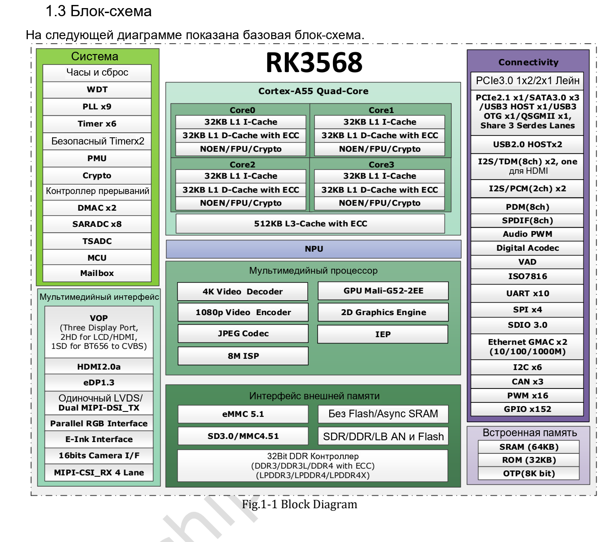

Статья основана на указанной редакции datasheet. Значения являются спецификациями производителя, а не измерениями ArmSoM; новых аппаратных испытаний не проводилось. Проверьте ревизию кристалла, схему платы, SDK/BSP, ядро и драйверы. Пояснения и редактируемые таблицы помогают чтению; полная спецификация и не рассмотренные подробно битовые поля находятся в исходном PDF.

**RK3568 · Rockchip RK3568 Datasheet V1.2-20210601.pdf · PDF 54–62.**

*Английский оригинал, PDF, стр. 19.*

## Предельные и рабочие условия

Абсолютные пределы — не уставки стабилизатора. Min/Typ/Max не заменяют последовательность питания, анализ просадок и таблицы частота/напряжение. Измеряйте у кристалла при запуске, простое и переходах нагрузки, не только у стабилизатора.

## Рекомендуемые питание и такты

### PDF 55

| Питание / такт | Min | Typ | Max | Единица |
|---|---|---|---|---|
| VDD_CPU | 0.8 | 0.9 | 1.2 | V |
| VDD_GPU | 0.8 | 0.9 | 1.1 | V |
| VDD_NPU | 0.8 | 0.9 | 1.1 | V |
| VDD_LOGIC | 0.81 | 0.9 | 0.99 | V |
| PMU_VDD_LOGIC_0V9 | 0.81 | 0.9 | 0.99 | V |
| PMUIO1 | 2.97 | 3.3 | 3.63 | V |
| VCCIO1,VCCIO2, VCCIO3, VCCIO4VCCIO5, VCCIO6, VCCIO7, PMUIO2 | 2.97 1.62 | 3.3 1.8 | 3.63 1.98 | V |
| DDR3 / DDRPHY_VDDQ/DDRPHY_VDDQL | 1.425 | 1.5 | 1.575 | V |
| DDR3L / DDRPHY_VDDQ/DDRPHY_VDDQL | 1.283 | 1.35 | 1.417 | V |
| LPDDR3 / DDRPHY_VDDQ/DDRPHY_VDDQL | 0.994 | 1.2 | 1.3 | V |
| DDR4 / DDRPHY_VDDQ/DDRPHY_VDDQL | 0.994 | 1.2 | 1.3 | V |
| LPDDR4 / DDRPHY_VDDQ/DDRPHY_VDDQL | 1.0 | 1.1 | 1.21 | V |
| LPDDR4X / DDRPHY_VDDQ | 1.0 | 1.1 | 1.21 | V |
| LPDDR4X / DDRPHY_VDDQL | 0.54 | 0.6 | 0.66 | V |
| PMUPLL_AVDD_0V9 | 0.81 | 0.9 | 0.99 | V |
| PMUPLL_AVDD_1V8 | 1.62 | 1.8 | 1.98 | V |
| SYSPLL_AVDD_0V9 | 0.81 | 0.9 | 0.99 | V |
| SYSPLL_AVDD_1V8 | 1.62 | 1.8 | 1.98 | V |
| USB2_AVDD_0V9 | 0.81 | 0.9 | 0.99 | V |
| USB2_AVDD_1V8 | 1.62 | 1.8 | 1.98 | V |
| USB2_AVDD_3V3 | 2.97 | 3.3 | 3.63 | V |
| USB3_AVDD_0V9 | 0.81 | 0.9 | 0.99 | V |
| USB3_AVDD_1V8 | 1.62 | 1.8 | 1.98 | V |
| USB3_AVDD_3V3 | 2.97 | 3.3 | 3.63 | V |
| MULTI_PHY_AVDD_0V9 | 0.81 | 0.9 | 0.99 | V |
| MULTI_PHY_AVDD_1V8 | 1.62 | 1.8 | 1.98 | V |
| PCIE30_AVDD_0V9 | 0.81 | 0.9 | 0.99 | V |
| PCIE30_AVDD_1V8 | 1.62 | 1.8 | 1.98 | V |
| MIPI_CSI_RX_AVDD_0V9 | 0.81 | 0.9 | 0.99 | V |
| MIPI_CSI_RX_AVDD_1V8 | 1.62 | 1.8 | 1.98 | V |
| MIPI_DSI_TX0/LVDS_TX0_AVDD_0V9 | 0.81 | 0.9 | 0.99 | V |
| MIPI_DSI_TX0/LVDS_TX0_AVDD_1V8 | 1.62 | 1.8 | 1.98 | V |
| MIPI_DSI_TX1_AVDD_0V9 | 0.81 | 0.9 | 0.99 | V |
| MIPI_DSI_TX1_AVDD_1V8 | 1.62 | 1.8 | 1.98 | V |
| EDP/DP_TX_AVDD_0V9 | 0.81 | 0.9 | 0.99 | V |
| EDP/DP_TX_AVDD_1V8 | 1.62 | 1.8 | 1.98 | V |
| HDMI_TX_AVDD_0V9 | 0.81 | 0.9 | 0.99 | V |
| HDMI_TX_AVDD_1V8 | 1.62 | 1.8 | 1.98 | V |
| SARADC_AVDD_1V8 | 1.62 | 1.8 | 1.98 | V |

### PDF 56

| Питание / такт | Min | Typ | Max | Единица |
|---|---|---|---|---|
| OTP_VCC_1V8 | 1.62 | 1.8 | 1.98 | V |
| OSC | NA | 24 | NA | MHz |
| CPU | NA | NA | TBD | GHz |
| GPU | NA | NA | TBD | MHz |
| NPU | NA | NA | 1.0 | GHz |
| TA | 0 | NA | 80 | ℃ |

## Уровни GPIO и внутренние резисторы

| Параметр | Спецификация / примечание |
|---|---|
| 3.3 V I/O: VIL | −0.3…0.8 V |
| 3.3 V I/O: VIH | 2.0…VDDO+0.3 V |
| 3.3 V I/O: VOL | −0.3…0.4 V |
| 3.3 V I/O: VOH | 2.4…VDDO+0.3 V |
| 1.8 V I/O: VIL max | 0.35 × VDDO |
| 1.8 V I/O: VIH min | 0.65 × VDDO |
| 1.8 V I/O: VOH min | 1.4 V |
| Внутренние подтяжки | 16 / NA / 43 kΩ (Min/Typ/Max) |

## Параметры PLL и USB

| Параметр | Спецификация / примечание |
|---|---|
| PLL integer: Fin / Fvco / Fout | 10–800 / 475–1900 / 9–1900 MHz |
| PLL integer: lock | 1000 typ / 1500 max input-clock cycles |
| PLL fractional: Fin / Fvco / Fout | 1–1200 / 950–3800 / 19–3800 MHz |
| PLL fractional: lock | 250 typ / 500 max input-clock cycles |
| USB output resistance | 40.5 / 45 / 49.5 Ω |
| USB HS high | 360 / 400 / 440 mV |
| USB HS low | −40 / 0 / 40 mV |
| USB disconnect | 570 / 590 / 625 mV |
| USB squelch | 100 / 112 / 150 mV |

## Температурные и тепловые ограничения

Тепловое сопротивление — моделирование производителя на заданной PCB, не измерение ArmSoM. Корпус, медь, воздух, радиатор и распределение мощности меняют нагрев. Диапазон датчика — не рабочая температура среды.

| Параметр | Спецификация / примечание |
|---|---|
| θJA / θJB / θJC | 15.925 / 10.813 / 0.487 °C/W |
| Тепловая модель | 4-layer PCB · 114.3 × 101.6 mm · 1.6 mm · ambient 25 °C |
| Tj | В источнике: ниже 125 °C |
| Ta | 0…80 °C |
| SARADC | 10 bit · ≤1 MS/s |
| TSADC | −20…120 °C; electrical table: ±5 °C resolution |

## Сохранённые вопросы к источнику

Абсолютный/рекомендуемый максимумы RK3568: CPU 1.25/1.2 V, GPU/NPU 1.2/1.1 V. Частоты CPU/GPU — TBD, NPU — до 1 GHz. Минимум LPDDR3/DDR4 в оригинале 0.994 V сохранён, не заменён на 1.14 V. Пункт Multi-PHY 80–120 Ω описан словом деэмфазис; проверьте имя и единицу по спецификации PHY.

Не копируйте пороги USB из RK3528. Ток утечки DDR указан при 125 °C и не задаёт напрямую бюджет питания при комнатной температуре.

## Продукты ArmSoM и границы применения

Sige3 использует RK3568B2. Здесь рассматривается общий datasheet RK3568 V1.2; вариант B2, ревизию платы и выведенные интерфейсы нужно проверять отдельно.

- [Sige3](https://www.armsom.org/sige3) · [Docs](https://docs.armsom.org/armsom-sige3)

## Серия по datasheet и исходный PDF

- [RK3568 обзор](/ru/articles/rk3568-datasheet-v12/)
- [RK3568: корпус и полная таблица 636 шариков](/ru/articles/rk3568-package-pin-reference/)
- [RK3568: DDR, дисплеи и распределение PCIe/SATA/USB](/ru/articles/rk3568-architecture-phy-resource-planning/)
- [RK3568: питание, I/O и тепловое сопротивление](/ru/articles/rk3568-electrical-power-thermal/)
- [Скачать полный исходный PDF](/assets/datasheet-series-20261110/Rockchip-RK3568-Datasheet-V1.2-20210601.pdf)
