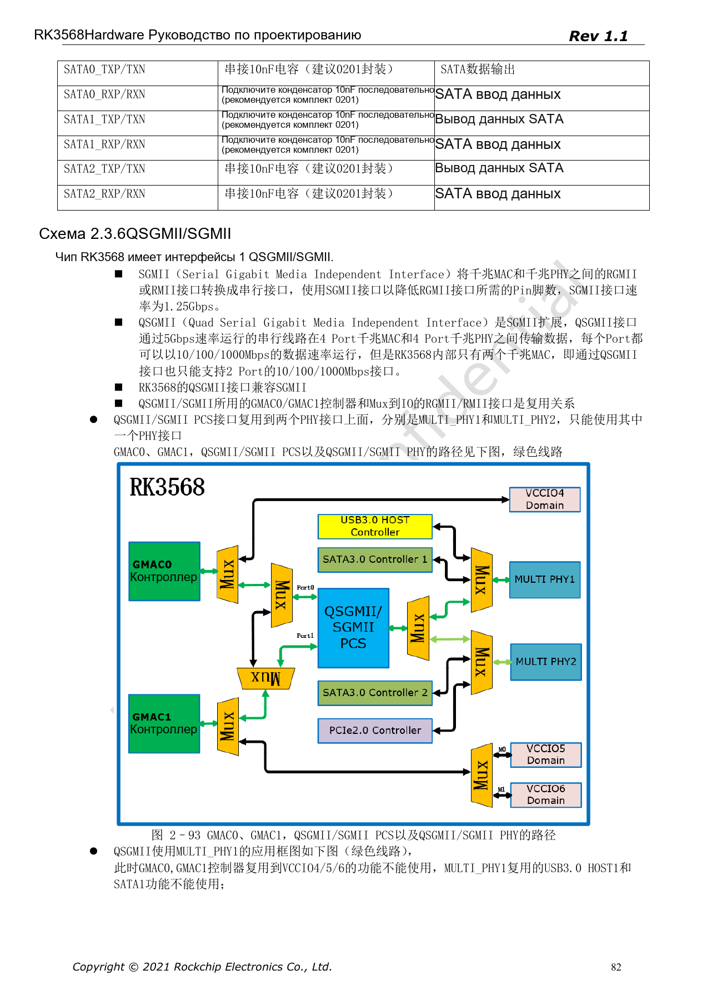
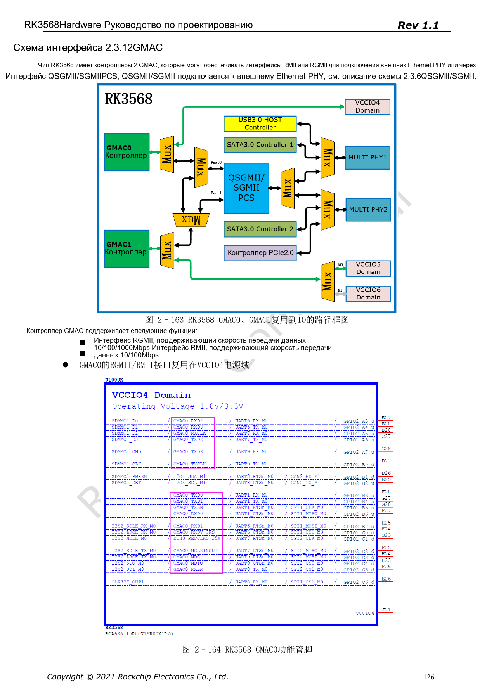
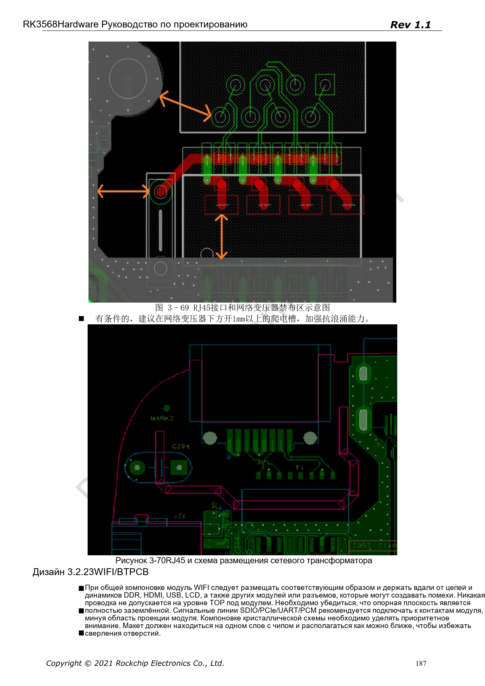

# Ethernet RK3568: два GMAC, RGMII и QSGMII

Серия перерабатывает RK3568 Hardware Design Guide V1.1 (китайский, 2021-06-08) и отдельный High Speed PCB Design Guide V1.0.0 (английский, 2021-04-12) по инженерным темам. ArmSoM [Sige3](https://www.armsom.org/sige3) использует RK3568B2. [Документация платы](https://docs.armsom.org/armsom-sige3) помогает изучать и оценивать рассматриваемые решения. Эталонные схемы SoC не описывают все реальные схемы и выведенные интерфейсы Sige3. Проверяйте SDK/BSP, ядро, ревизию чипа, прошивку и периферию. Значения взяты из источников, не из испытаний ArmSoM.

**CN V1.1 §2.3.6; §2.3.12; §3.2.22 · EN PCB §1.8; §1.19**

## Различайте MAC, PHY и режим интерфейса

RK3568 имеет два GMAC: RGMII — 10/100/1000Mbps, RMII — 10/100Mbps. Протокол QSGMII может передавать четыре порта, но у чипа лишь два MAC, поэтому руководство ограничивает число Ethernet-портов двумя. QSGMII/SGMII делит MAC с RGMII/RMII на IO; PCS выбирает один из MULTI_PHY1 или MULTI_PHY2.

## Пример RTL8211F не универсален

В примере RESET RTL8211F/FI допускает только 3.3V, рядом нужен 100nF. RSET — 2.49kΩ, 1%; MDIO рекомендуется подтянуть внешними 1.5–1.8kΩ. При замене PHY заново проверяют сброс, питание, straps, такт, внутреннюю задержку и центральные отводы трансформатора. Распиновка RJ45 Tab up/down должна совпадать с посадочным местом.

## Проверяйте задержки и изоляцию вместе

RGMII TX/enable выравнивают относительно TXCLK, RX/valid — относительно RXCLK отдельно. Английский PCB-гид: разница <120mil, длина <5in, 50Ω±10%; TX и RX не являются одной группой. QSGMII/SGMII: 100Ω±10%, внутри пары <12mil, длина <6in, связь 100nF±20%. Также проверяют запрет трасс под трансформатором, изоляцию и путь импульсного тока. Примеры защиты не являются сертификацией.

## Параметры и ограничения источника

| Параметр | Значение источника |
| --- | --- |
| GMAC | 2 |
| QSGMII / SGMII | 5Gbps / 1.25Gbps |
| RGMII | 50Ω±10%; <120mil; <5in |
| RTL8211F/FI RSET | 2.49kΩ ±1% |
| MDIO | 1.5–1.8kΩ pull-up |

## Иллюстрации источника

Снимки страниц сохраняют подписи схем и контекст; текст и таблицы статьи редактируемые. Соответствующего английского издания основного руководства нет, поэтому его рисунки остаются китайскими во всех версиях. Материалы отдельного английского PCB-гайда отмечены отдельно. Номера относятся к физическим страницам PDF.

Китайское руководство · PDF 82

Китайское руководство · PDF 126

Китайское руководство · PDF 187

## Дополнительные материалы

- [RK3568: 10 тем схемотехники, PCB и производства](/ru/articles/rk3568-hardware-design-series/)
- [Скоростные интерфейсы RK3568: USB, SATA, PCIe и тактирование](/ru/articles/rk3568-usb-sata-pcie-hardware/)
- [Дисплеи и камеры RK3568: VOP, MIPI, HDMI и питание](/ru/articles/rk3568-display-camera-hardware/)
- [ArmSoM Docs](https://docs.armsom.org/)
- [ArmSoM](https://www.armsom.org/)
