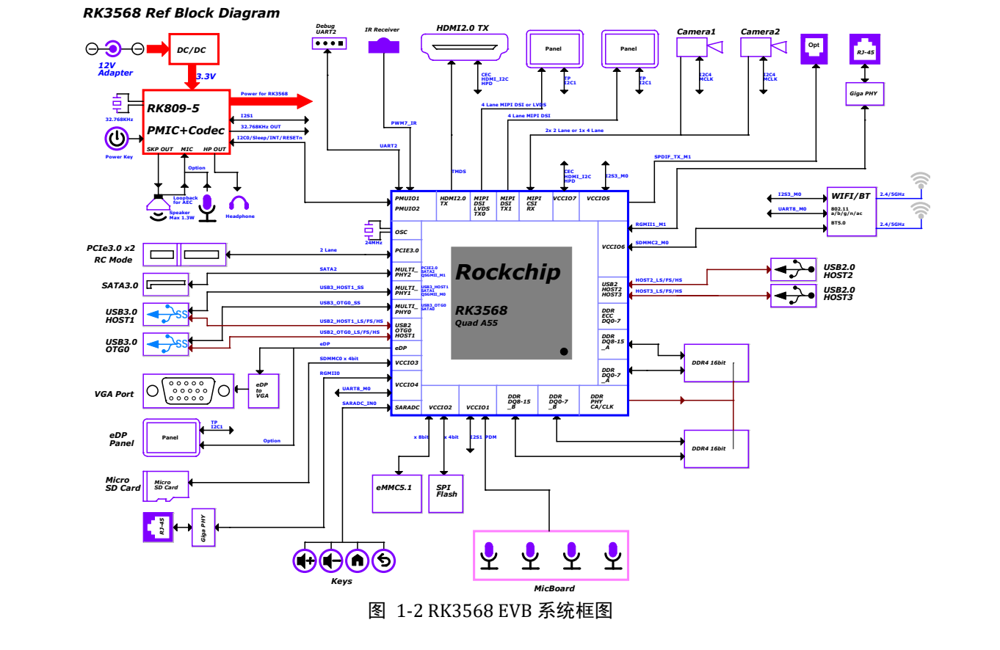
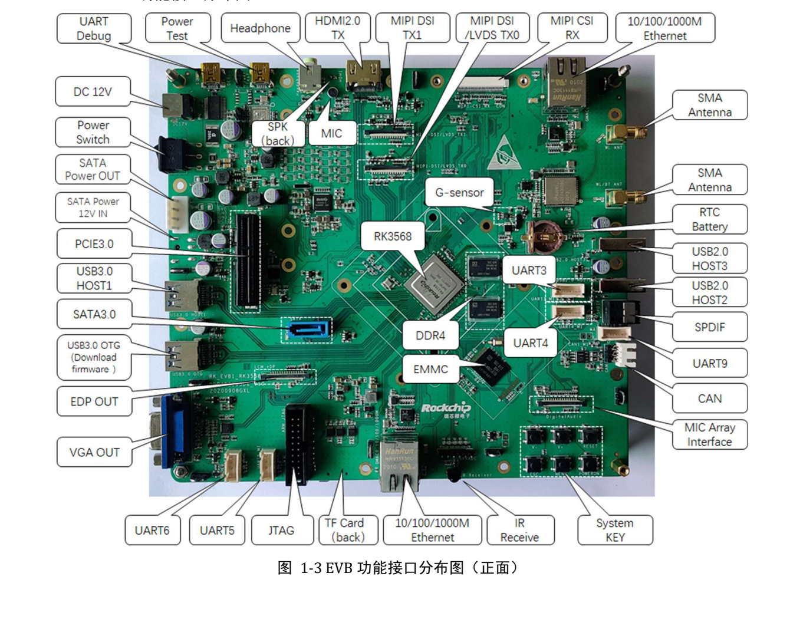

Это тематическое руководство по исходному документу: ключевые параметры, ограничения и оригинальные иллюстрации. Оно не заменяет полный перевод, таблицу выводов или регистров. Примеры производителя не являются измерениями ArmSoM. Перед применением проверьте ревизию платы, схему, SDK/BSP, ядро и драйверы; новых аппаратных испытаний для статьи не проводилось.

**Основной источник：** `Rockchip_RK3568_EVB_User_Guide_V1.0_CN.pdf` · PDF 43 стр..

## Отделить эталон от Sige3

Руководство относится к `RK_EVB1_RK3568_DDR4P216SD6_V10_20200908`: RK809-5, 2GB DDR4, 32GB eMMC, адаптер 12V/2A. Sige3 документирована как RK3568B2. Её память, вход питания, разъёмы и прошивку проверяйте по собственным материалам продукта.


[](/assets/hardware-reference-20261110/rk3568-evb-p11.png)

*Соединения RK3568 EVB — Оригинал на китайском; соответствующей английской иллюстрации в этой подборке нет. `Rockchip_RK3568_EVB_User_Guide_V1.0_CN.pdf`, PDF p. 11.*


## Записи для первой отладки

Сфотографируйте ревизию и подключения, запишите питание, образ и инструмент. Подключите USB Debug к PC и определите COM. Источник использует UART2 через FT232RL, `1500000` (1.5M), RTS/CTS выключен. При нечитаемом выводе сначала проверьте скорость, порт, соединения и напряжение.


[](/assets/hardware-reference-20261110/rk3568-evb-p13.png)

*Разъёмы лицевой стороны RK3568 EVB — Оригинал на китайском; соответствующей английской иллюстрации в этой подборке нет. `Rockchip_RK3568_EVB_User_Guide_V1.0_CN.pdf`, PDF p. 13.*


## Loader и Maskrom

Для Loader подключают USB3.0 OTG, удерживают RECOVER при включении/reset и отпускают после обнаружения. Условие источника — низкий `SARADC_VIN0`. Кнопка MASKROM эталона вызывает отказ загрузки eMMC; текст описывает замыкание `eMMC_D0` на землю, но используйте предусмотренную кнопку конкретной ревизии, не замыкайте произвольные платы.

После обнаружения выберите согласованные Loader, Parameter, Uboot и остальные образы, предварительно сохранив данные. Путь примера драйвера — `SDK\RKTools\windows\Release_DriverAssitant`. Написание `Rcovery` отмечено как неточность источника, а не основание угадывать имя прошивки.

Если образ включает ADB, после загрузки:

```sh
adb devices
adb shell
```

UART показывает ранний старт, ADB требует работающей системы и службы. Каналы не заменяют друг друга.

## Общие интерфейсы: схема и ПО

| Функция | Описание источника | Проверка |
| --- | --- | --- |
| Камера | 1×4-lane или 2×2-lane MIPI CSI | Драйвер, такт, питание, reset и разъём |
| Дисплей | MIPI DSI/LVDS, второй MIPI, HDMI, eDP/VGA | Выбор eDP/VGA и компоненты, не только число портов |
| Расширение | Общие CIF/EBC/RGMII/BT656 | Резисторы и pinmux по §3.19 |
| PCIe | PCIe3.0, 2 линии, RC | Карта, опорный такт, reset, питание и согласование |
| SATA | Раздельные данные и питание | Штатный путь 12V не установлен |

Стр. 41 требует отдельное SATA-питание 12V. Возможность питания дисков от системных 12V по умолчанию разомкнута; указана позиция FB8301. Это опция монтажа EVB, не инструкция изменения Sige3. Подключение SATA-кабеля не обеспечивает питание диска.

## Отсутствие звука может быть ошибкой маршрута

Стр. 36: S7000 1-8 и 2-7 ON, 3-6 и 4-5 OFF выбирают обычный MIC; обратное состояние — speaker loopback. S1900/S1901 переключают I2S1. Меняется аналоговая/цифровая цепь, поэтому громкость в ПО — не единственная причина.

Проверяйте запись, воспроизведение и loopback раздельно, затем полный дуплекс. Сохраняйте схему, переключатели и mixer вместе. Позиционные обозначения относятся к EVB, не Sige3.

## I2C: адресов недостаточно

На стр. 21 RK809-5 `0X20` и TCS4525 `0X1C` работают на I2C0 при 3.3V; камера I2C4 — 1.8V, адрес не задан. У расширений встречается `TBD`. До подключения проверьте домен и подтяжки, а не только конфликт адресов.

## Применить метод к Sige3

Сохраните порядок питание → UART → загрузка → накопитель → отдельный интерфейс → совместная нагрузка, но заполните его данными Sige3: выводы, память, device tree и образ. Добавьте прогрев, отключение питания и suspend/resume. Заголовок RK3399 на стр. 17–18 — ошибка шаблона, не смена рассматриваемой платформы RK3568.


## Продукты и документация

- **Sige3** — [Продукт](https://www.armsom.org/sige3) · [Документация](https://docs.armsom.org/armsom-sige3)


## Читайте также

- [Ресурсы и выбор RK3568](/ru/articles/rk3568-datasheet-v12/)
