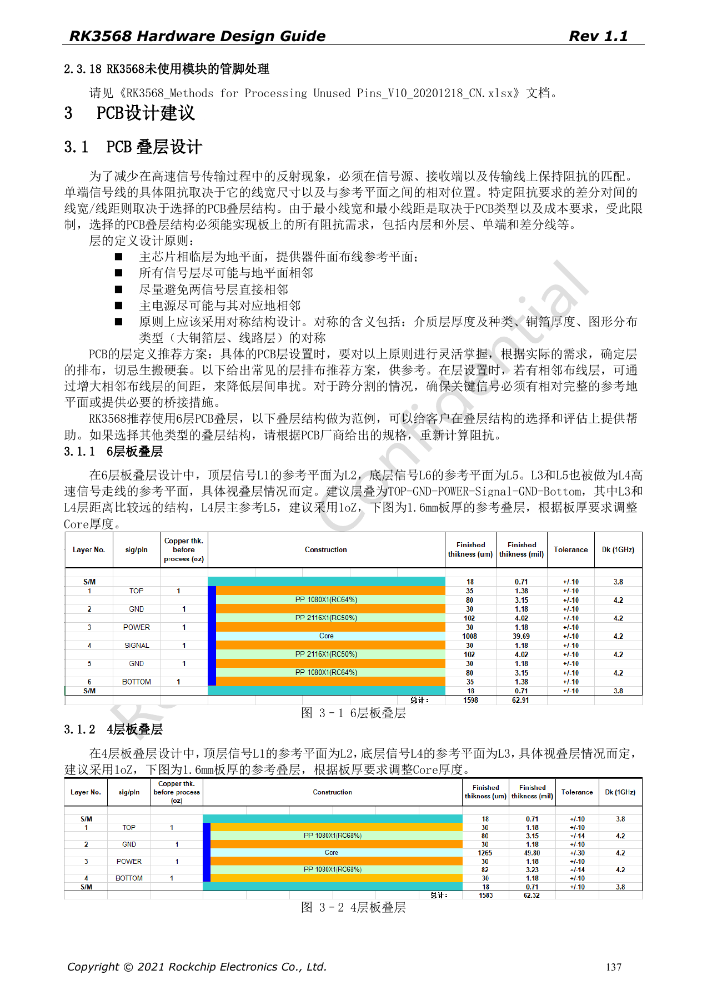
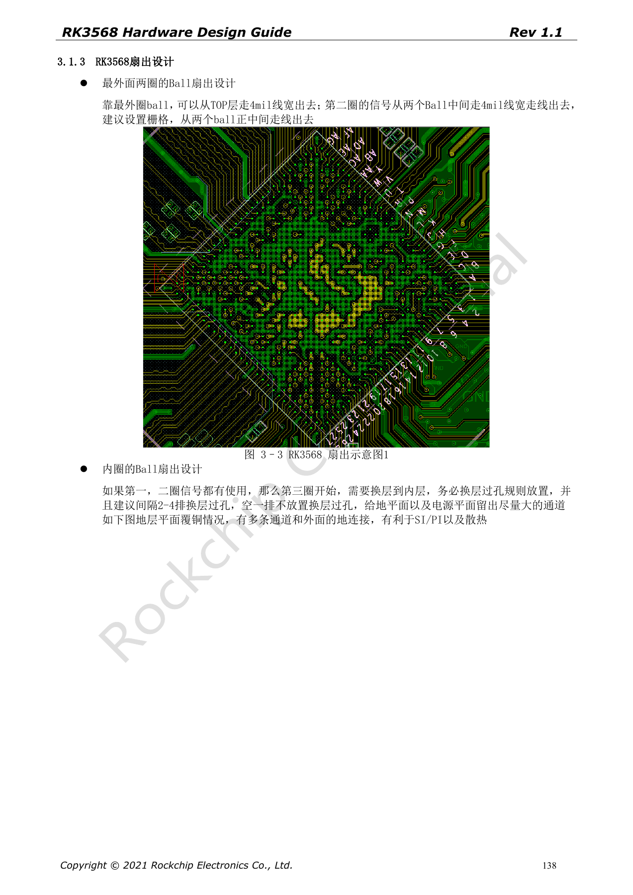
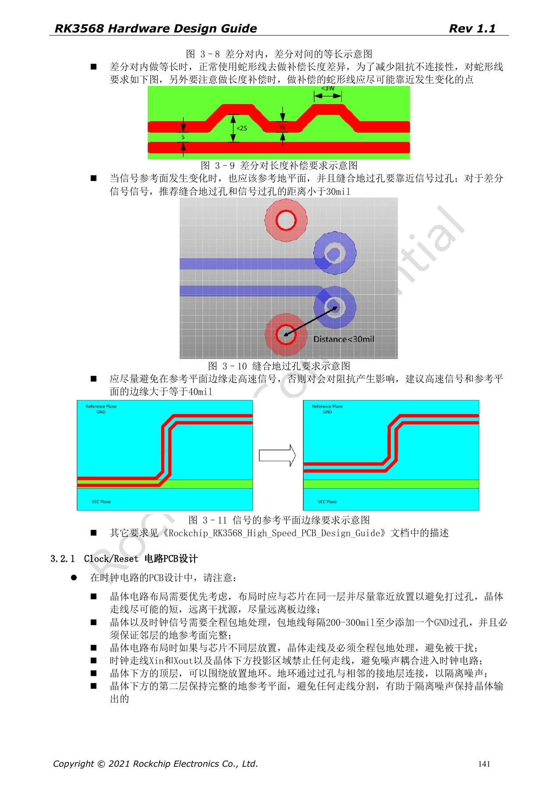

# PCB для RK3568: стек, fanout и возвратные токи

Серия перерабатывает RK3568 Hardware Design Guide V1.1 (китайский, 2021-06-08) и отдельный High Speed PCB Design Guide V1.0.0 (английский, 2021-04-12) по инженерным темам. ArmSoM [Sige3](https://www.armsom.org/sige3) использует RK3568B2. [Документация платы](https://docs.armsom.org/armsom-sige3) помогает изучать и оценивать рассматриваемые решения. Эталонные схемы SoC не описывают все реальные схемы и выведенные интерфейсы Sige3. Проверяйте SDK/BSP, ядро, ревизию чипа, прошивку и периферию. Значения взяты из источников, не из испытаний ArmSoM.

**CN V1.1 §3.1–3.2 · EN PCB V1.0.0 §1.1–1.26**

## Эталонный стек не является заказом на производство

Китайский документ показывает 4 и 6 слоёв. Пример 6 слоёв: TOP–GND–POWER–Signal–GND–Bottom, 1.6mm и медь 1oz. Диэлектрик, медь и прессование влияют на импеданс; размеры трасс пересчитывают с производителем. Наличие примера 4 слоёв не означает пригодность для любой комбинации интерфейсов и тепловой нагрузки.

## Сохраняйте каналы земли и питания

Для двух внешних рядов ball показан fanout 4mil. Внутренние переходы располагают регулярно; источник рекомендует оставлять свободный ряд после каждых 2–4 рядов, сохраняя каналы плоскости. При смене слоя земли ставьте рядом возвратные переходы: ориентир <30mil для дифференциальных сигналов. Отступ от края плоскости ≥40mil, компенсация длины рядом с местом возникновения разницы.

## Английское руководство — отдельный источник ограничений

Документ на 45 страниц добавляет нормы USB, SATA, PCIe, дисплеев, памяти, RGMII и DDR; это не перевод китайских 199 страниц. Сохраняйте единицы, строгие и нестрогие пределы, рекомендации и минимумы. Таблицы DDR для команд, данных, управления и ECC зависят от топологии; единое выравнивание всей шины неверно. Для приёмки нужны правила, исключения и протоколы моделирования.

## Проверяйте питание наряду с разъёмами

Возврат развязки, коммутационные петли PMIC, обратная связь SoC и силовая медь влияют на стабильность. Wi-Fi удаляют от DDR/HDMI/USB/дисплея. Антенный фидер — ориентировочно 50Ω, короткий без ветвей; VBAT >40mil в примере. SI/PI и радио проверяют с реальным стеком, производством, кабелями и корпусом. Ширина из руководства не задаёт универсальный импеданс.

## Параметры и ограничения источника

| Параметр | Значение источника |
| --- | --- |
| Пример 6 слоёв | TOP–GND–POWER–Signal–GND–Bottom |
| Fanout внешних шаров | 4mil reference |
| Сигнальный via → GND via | <30mil reference |
| Сигнал → край плоскости | ≥40mil reference |

## Иллюстрации источника

Снимки страниц сохраняют подписи схем и контекст; текст и таблицы статьи редактируемые. Соответствующего английского издания основного руководства нет, поэтому его рисунки остаются китайскими во всех версиях. Материалы отдельного английского PCB-гайда отмечены отдельно. Номера относятся к физическим страницам PDF.

Китайское руководство · PDF 137

Китайское руководство · PDF 138

Китайское руководство · PDF 141

## Дополнительные материалы

- [RK3568: 10 тем схемотехники, PCB и производства](/ru/articles/rk3568-hardware-design-series/)
- [Аудио и управление RK3568: I2S, UART, SPI, CAN и I2C](/ru/articles/rk3568-audio-control-interfaces-hardware/)
- [RK3568 перед производством: охлаждение, ESD, монтаж и хранение](/ru/articles/rk3568-thermal-esd-assembly-hardware/)
- [ArmSoM Docs](https://docs.armsom.org/)
- [ArmSoM](https://www.armsom.org/)
