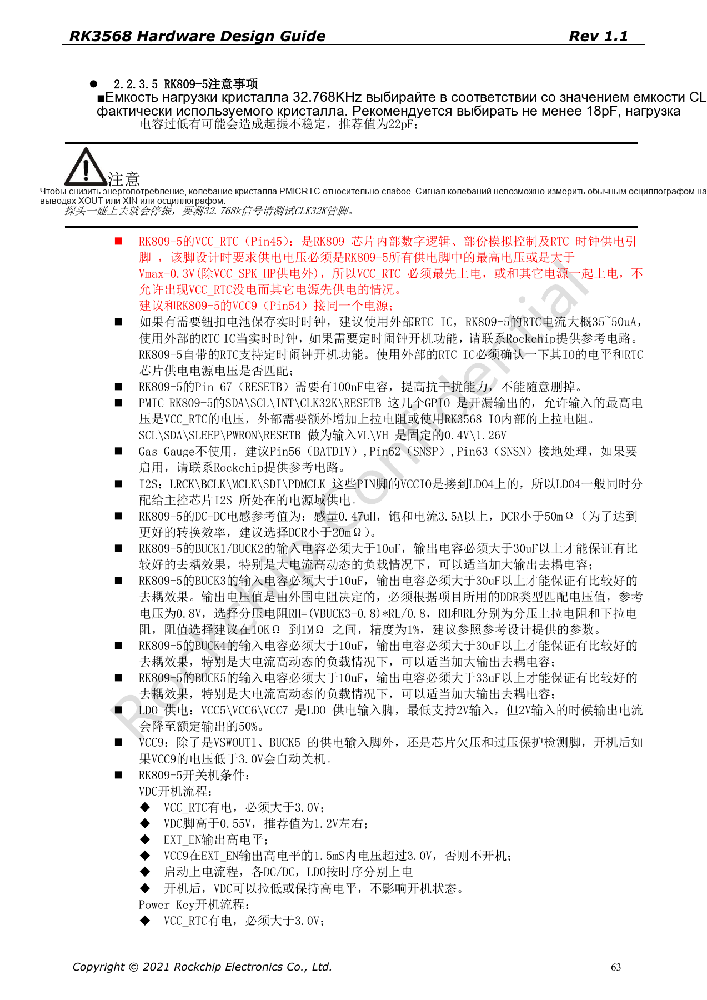
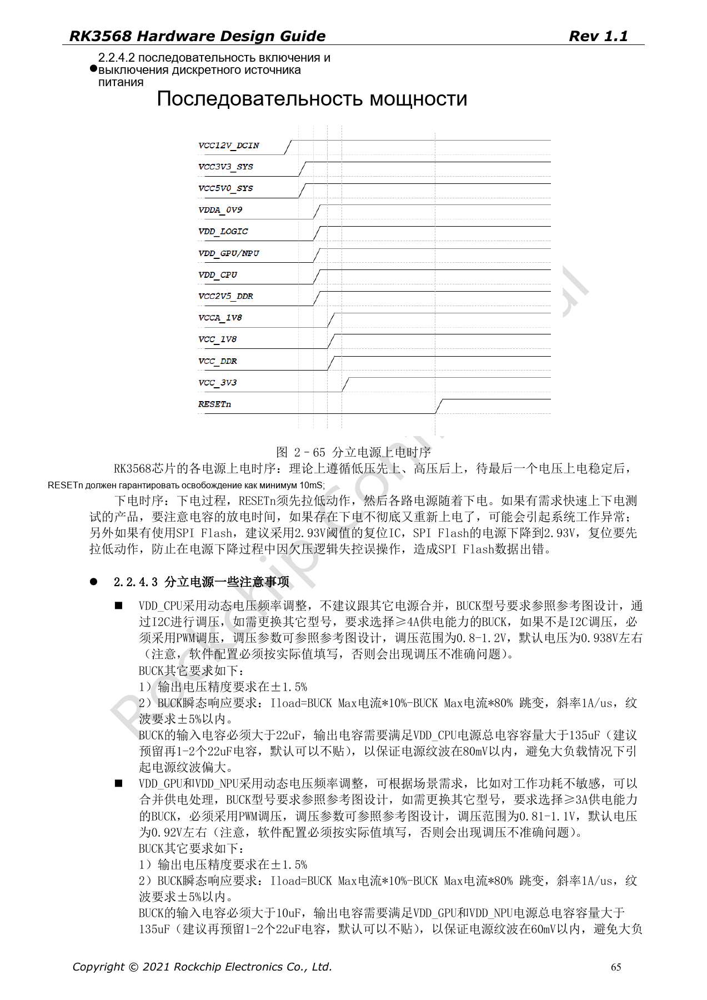

# Питание и IO-домены RK3568: RK809-5 и дежурный режим

Серия перерабатывает RK3568 Hardware Design Guide V1.1 (китайский, 2021-06-08) и отдельный High Speed PCB Design Guide V1.0.0 (английский, 2021-04-12) по инженерным темам. ArmSoM [Sige3](https://www.armsom.org/sige3) использует RK3568B2. [Документация платы](https://docs.armsom.org/armsom-sige3) помогает изучать и оценивать рассматриваемые решения. Эталонные схемы SoC не описывают все реальные схемы и выведенные интерфейсы Sige3. Проверяйте SDK/BSP, ядро, ревизию чипа, прошивку и периферию. Значения взяты из источников, не из испытаний ArmSoM.

**CN V1.1 §2.1.11; §2.2 · PDF 44–67**

## Согласуйте питание с ПО

PMUIO0 фиксирован на 1.8V, PMUIO1 — на 3.3V. PMUIO2 и VCCIO1–7 поддерживают 1.8V/3.3V, но VCCIO2 выбирается аппаратно через FLASH_VOL_SEL. Настройки DTS остальных доменов должны совпадать с фактическим питанием, как и уровни периферии и подтяжки. Перед удалением питания неиспользуемого домена проверьте таблицу обязательного питания при включении.

## Пиковый ток не равен мощности системы

Общие требования: CPU BUCK ≥4A, GPU/NPU/LOGIC ≥2A; суммарная развязка CPU >135µF, остальных в общих разделах >90µF. VDD_CPU_COM подключается к обратной связи BUCK для компенсации падения на PCB. Таблица страницы 67 содержит отдельные пиковые токи; их нельзя складывать в «пик SoC» или применять для расчёта охлаждения. Измеряйте запуск, стационарную нагрузку, DVFS и переходные процессы.

## Проверяйте последовательность вместе со сном

В дискретной схеме RESETn удерживают не менее 10ms после стабилизации последнего питания; при выключении сначала активируют сброс. Для быстрого перезапуска учитывают разряд конденсаторов. PMIC_SLEEP низкий в работе, высокий во сне и вновь низкий при пробуждении. Сохраняют питание самообновления DDR, PMU и IO пробуждения. Для USB HID необходимо питание USB PHY; узлы отключённых модулей в DTS следует выключить.

## Сохраняйте расхождения источника

На странице 53 LOGIC BUCK ≥2A, на странице 66 в дискретной схеме ≥1.5A. Пульсации при скачке нагрузки заданы как ±3% в общих требованиях и ±5% в дискретных; для LOGIC также указаны >90µF и >99µF. Эти нормы не объединяются молча. Уточните их по актуальным исправлениям, эталонной схеме и модели регулятора, затем проверьте плату, температуру и нагрузку.

## Полная таблица пиковых токов

Таблица 2–14, страница 67 PDF. TBD остаётся неопределённым. Значения нельзя суммировать как мощность SoC.

| PowerName | V | mA |
| --- | --- | --- |
| PMUPLL_AVDD_0V9 | 0.9 | 10 |
| PMUPLL_AVDD_1V8 | 1.8 | 9 |
| SYSPLL_AVDD_0V9 | 0.9 | 30 |
| SYSPLL_AVDD_1V8 | 1.8 | 18 |
| PMU_VDD_LOGIC_0V9 | 0.9 | 50 |
| VDD_CPU | DVFS | 3000 |
| VDD_GPU | DVFS | 1200 |
| VDD_NPU | DVFS | 1000 |
| VDD_LOGIC | 0.9 | 1200 |
| DDRPHY_VDDQ | 1.1/1.2/1.35/1.5 | TBD |
| DDRPHY_VDDQL | 0.6/1.1/1.2/1.35/1.5 | TBD |
| USB3_AVDD_0V9 | 0.9 | 5 |
| USB3_AVDD_1V8 | 1.8 | 30 |
| USB3_AVDD_3V3 | 3.3 | 10 |
| USB2_AVDD_0V9 | 0.9 | 5 |
| USB2_AVDD_1V8 | 1.8 | 30 |
| USB2_AVDD_3V3 | 3.3 | 10 |
| MULTI_PHY_AVDD_0V9 | 0.9 | 150 |
| MULTI_PHY_AVDD_1V8 | 1.8 | 21 |
| PCIE30_AVDD_0V9 | 0.9 | 160 |
| PCIE30_AVDD_1V8 | 1.8 | 60 |
| MIPI_CSI_RX_AVDD_0V9 | 0.9 | 10 |
| MIPI_CSI_RX_AVDD_1V8 | 1.8 | 2.5 |
| MIPI_DSI_TX0/LVDS_TX0_AVDD_0V9 | 0.9 | 50 |
| MIPI_DSI_TX0/LVDS_TX0_AVDD_1V8 | 1.8 | 15 |
| MIPI_DSI_TX1_AVDD_0V9 | 0.9 | 50 |
| MIPI_DSI_TX1_AVDD_1V8 | 1.8 | 15 |
| eDP_TX_AVDD_0V9 | 0.9 | 150 |
| eDP_TX_AVDD_1V8 | 1.8 | 100 |
| HDMI_TX_AVDD_0V9 | 0.9 | 25 |
| HDMI_TX_AVDD_1V8 | 1.8 | 16 |
| SARADC_AVDD_1V8 | 1.8 | 1.5 |
| OTP_VCC18 | 1.8 | 59 |
| PMUIO0 | 1.8 | TBD |
| PMUIO1 | 3.3 | TBD |
| PMUIO2/VCCIO1/2/3/4/5/6/7/ | 1.8/3.3 | TBD |


## Параметры и ограничения источника

| Параметр | Значение источника |
| --- | --- |
| VDD_CPU | BUCK ≥4A; C >135µF |
| VDD_GPU / VDD_NPU | BUCK ≥2A; C >90µF |
| VDD_LOGIC | p53 ≥2A / p66 ≥1.5A |
| RESETn | ≥10ms after final rail stable |
| PMIC_SLEEP | RUN=0; SLEEP=1 |

Пример DTS при физическом питании VCCIO4 от 3.3V. Ссылка должна совпадать с питанием; не переносите вслепую на другую плату.

```dts
&pmu_io_domains {
    status = "okay";
    pmuio2-supply = <&vcc_3v3>;
    vccio1-supply = <&vcc_3v3>;
    vccio3-supply = <&vcc_3v3>;
    vccio4-supply = <&vcc_3v3>;
    vccio5-supply = <&vcc_3v3>;
    vccio6-supply = <&vcc_3v3>;
    vccio7-supply = <&vcc_3v3>;
};
```

## Иллюстрации источника

Снимки страниц сохраняют подписи схем и контекст; текст и таблицы статьи редактируемые. Соответствующего английского издания основного руководства нет, поэтому его рисунки остаются китайскими во всех версиях. Материалы отдельного английского PCB-гайда отмечены отдельно. Номера относятся к физическим страницам PDF.

[](/assets/localized/figures/ru/3ad031645b7713d9f24a.png)

Китайское руководство · PDF 63

[](/assets/localized/figures/ru/3931ac2d2fa776ffb863.png)

Китайское руководство · PDF 65

## Дополнительные материалы

- [RK3568: 10 тем схемотехники, PCB и производства](/ru/articles/rk3568-hardware-design-series/)
- [Минимальная система RK3568: тактирование, сброс и загрузка](/ru/articles/rk3568-boot-clock-reset-hardware/)
- [DDR для RK3568: микросхемы, топология, ECC и трассировка](/ru/articles/rk3568-ddr-topology-routing/)
- [ArmSoM Docs](https://docs.armsom.org/)
- [ArmSoM](https://www.armsom.org/)
