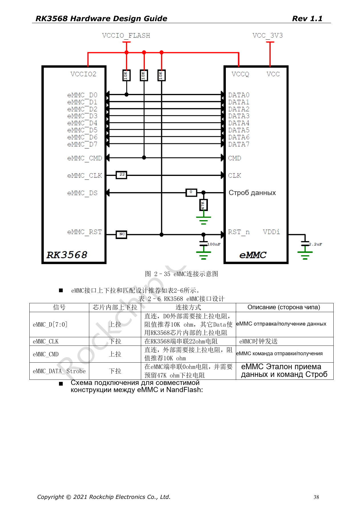
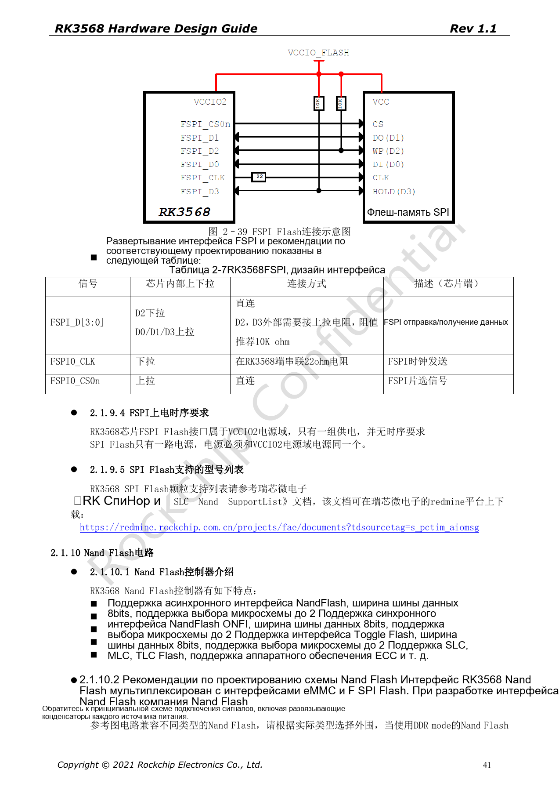
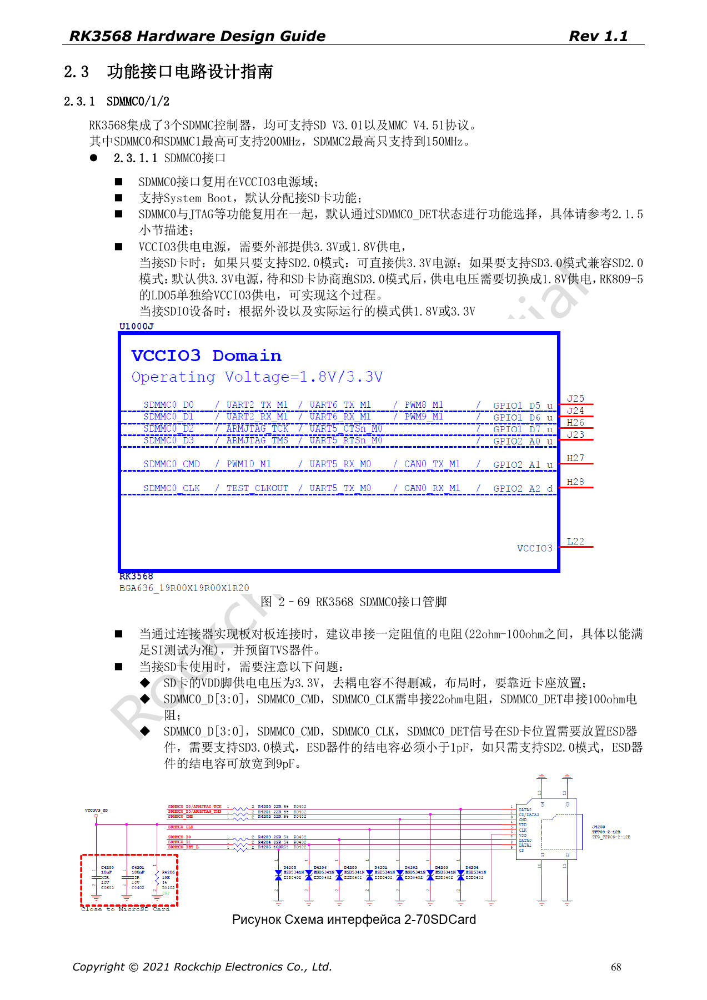

# Загрузочная память RK3568: eMMC, FSPI, NAND и SDMMC

Серия перерабатывает RK3568 Hardware Design Guide V1.1 (китайский, 2021-06-08) и отдельный High Speed PCB Design Guide V1.0.0 (английский, 2021-04-12) по инженерным темам. ArmSoM [Sige3](https://www.armsom.org/sige3) использует RK3568B2. [Документация платы](https://docs.armsom.org/armsom-sige3) помогает изучать и оценивать рассматриваемые решения. Эталонные схемы SoC не описывают все реальные схемы и выведенные интерфейсы Sige3. Проверяйте SDK/BSP, ядро, ревизию чипа, прошивку и периферию. Значения взяты из источников, не из испытаний ArmSoM.

**CN V1.1 §2.1.8–2.1.10; §2.3.1 · EN PCB §1.11–1.15**

## Общие выводы определяют схему загрузки

eMMC, NAND и FSPI используют общие ресурсы. VCCIO2 и FLASH_VOL_SEL должны совпадать до включения, исправление после загрузки недопустимо. Руководство перечисляет eMMC 4.41/4.51/5.0/5.1, режимы 1/4/8-bit и HS200. Режим выбирают по микросхеме, loader и BSP. При нескольких посадочных местах проверяют ветвления и неподключённые остатки трасс.

## Резисторы, подтяжки и восстановление

Для eMMC D0 и CMD нужны 10kΩ вверх, CLK — 22Ω у SoC; Data Strobe — 0Ω у eMMC с местом под 47kΩ вниз. FSPI D2/D3 — 10kΩ вверх, CLK — 22Ω; Flash и VCCIO2 питаются от одного источника. Описанный в оригинале сервисный вход Maskrom через тестовую точку требует снятия замыкания после обнаружения и не предназначен для обычного обновления из-за риска повреждения IO. Сначала предусмотрите обычный путь Loader.

## Питание SD-карты отличается от уровня сигналов

Загрузочный SDMMC0 находится в VCCIO3. SDMMC1 по умолчанию служит SDIO Wi-Fi в VCCIO4 и не загружает систему. Пределы контроллеров из оригинала: 200MHz для SDMMC0/1, 150MHz для SDMMC2. VDD карты остаётся 3.3V, а IO при SD3.0 после согласования переключается на 1.8V. Ёмкость ESD <1pF для SD3.0, до 9pF для SD2.0. Не путайте переключение IO с питанием карты.

## Перенесите скорость в ограничения PCB

Английские таблицы задают 50Ω±10% для этих одиночных шин. eMMC: данные–такт <120mil, длина <4in; FSPI: <200mil, <4in. SDIO/SDMMC: <120mil, длина <6in при ≤50Mbps и <4in выше 50Mbps. Единица Mbps сохранена из источника, не заменена на MHz. Проверяйте скорость, разные карты, восстановление питания и длительные операции.

## Параметры и ограничения источника

| Параметр | Значение источника |
| --- | --- |
| eMMC CLK / D0 / CMD | 22Ω / 10kΩ pull-up / 10kΩ pull-up |
| FSPI CLK / D2 / D3 | 22Ω / 10kΩ pull-up / 10kΩ pull-up |
| eMMC / FSPI length | <4in / <4in |
| SDMMC0/1 / SDMMC2 | ≤200MHz / ≤150MHz |

## Иллюстрации источника

Снимки страниц сохраняют подписи схем и контекст; текст и таблицы статьи редактируемые. Соответствующего английского издания основного руководства нет, поэтому его рисунки остаются китайскими во всех версиях. Материалы отдельного английского PCB-гайда отмечены отдельно. Номера относятся к физическим страницам PDF.

Китайское руководство · PDF 38

Китайское руководство · PDF 41

Китайское руководство · PDF 68

## Дополнительные материалы

- [RK3568: 10 тем схемотехники, PCB и производства](/ru/articles/rk3568-hardware-design-series/)
- [DDR для RK3568: микросхемы, топология, ECC и трассировка](/ru/articles/rk3568-ddr-topology-routing/)
- [Скоростные интерфейсы RK3568: USB, SATA, PCIe и тактирование](/ru/articles/rk3568-usb-sata-pcie-hardware/)
- [ArmSoM Docs](https://docs.armsom.org/)
- [ArmSoM](https://www.armsom.org/)
