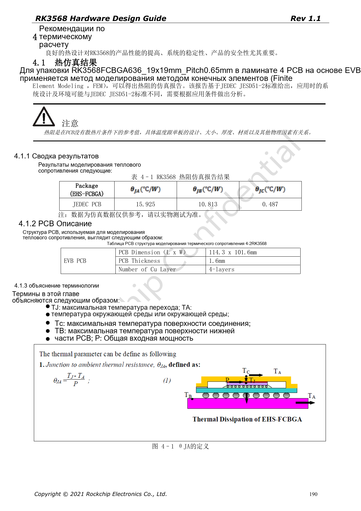
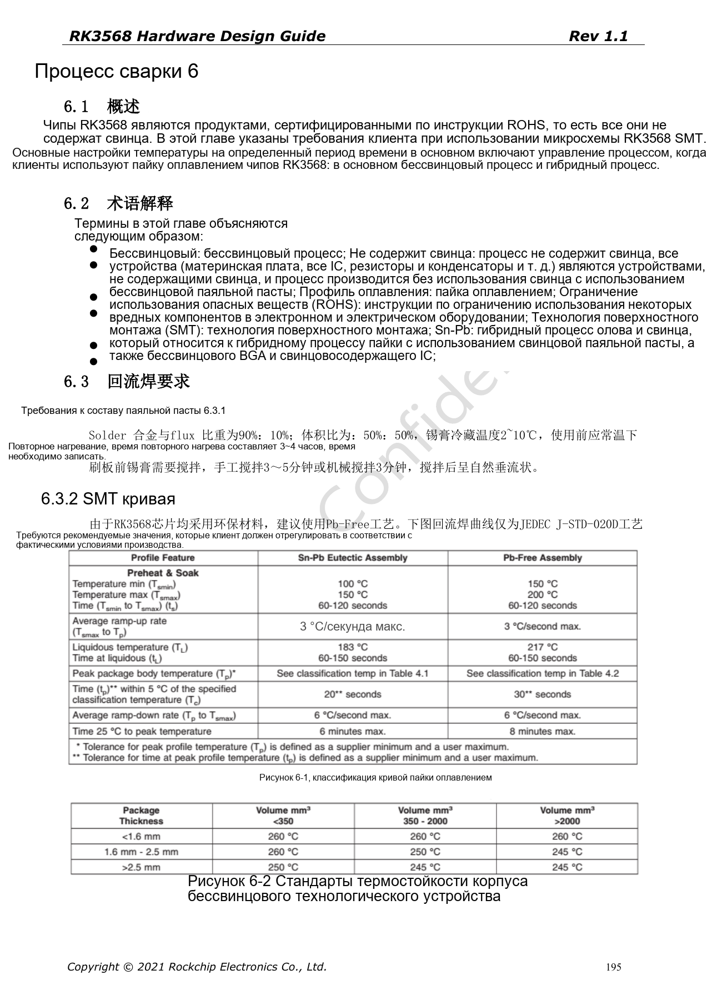
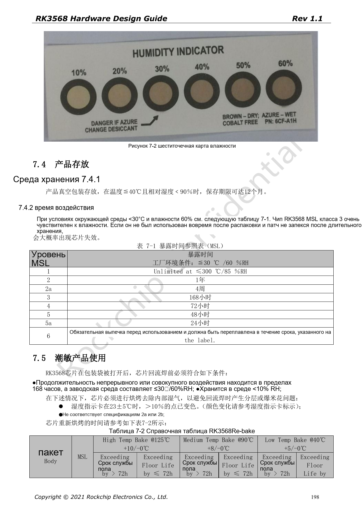

# RK3568 перед производством: охлаждение, ESD, монтаж и хранение

Серия перерабатывает RK3568 Hardware Design Guide V1.1 (китайский, 2021-06-08) и отдельный High Speed PCB Design Guide V1.0.0 (английский, 2021-04-12) по инженерным темам. ArmSoM [Sige3](https://www.armsom.org/sige3) использует RK3568B2. [Документация платы](https://docs.armsom.org/armsom-sige3) помогает изучать и оценивать рассматриваемые решения. Эталонные схемы SoC не описывают все реальные схемы и выведенные интерфейсы Sige3. Проверяйте SDK/BSP, ядро, ревизию чипа, прошивку и периферию. Значения взяты из источников, не из испытаний ArmSoM.

**CN V1.1 §4–7 · PDF 190–199**

## Тепловые результаты относятся к конкретным условиям

Симуляция выполнена для FCBGA636, 19×19mm, шаг 0.65mm, на EVB 114.3×101.6mm толщиной 1.6mm с четырьмя слоями, без радиатора. Это не гарантия температуры для произвольной платы и корпуса. Визуальная проверка таблицы 4-1 подтверждает θJA=15.925°C/W, θJB=10.813°C/W, θJC=0.487°C/W. Это симуляция производителя, не измерения данного проекта.

## Охлаждение касается не только SoC

Руководство рекомендует 20–50mm между SoC и RK809-5, достаточную медь и земляные переходы, распределение источников тепла. Силовая медь должна выдерживать ток. Проверяйте закрытый корпус при реальной совместной нагрузке CPU/GPU/NPU, видео и IO, фиксируя среду, прошивку, частоту и ограничение температуры. Измеряйте также PMIC, дроссели и питание подсветки.

## ESD зависит от возвратного пути

Защиту ставят у внешнего разъёма или входа разряда, сохраняя поверхностную землю. Нельзя разрезать её сигнальными трассами возле разъёма. Источник требует ≥5mm от края для Reset, такта и прерываний; 100nF nPOR размещают у вывода с короткой землёй. Корпус, экраны, разъёмы и питание вместе определяют путь разряда. Руководство не заменяет EMC/ESD-испытания изделия.

## Управляйте MSL3 до оплавления

Источник относит RK3568 к MSL3: накопленная экспозиция 168 часов при ≤30°C/60%RH. Вакуумное хранение указано ≤40°C, <90%RH, до 12 месяцев, с учётом маркировки упаковки. Повторная сушка различает толщину ≤1.4mm и превышение срока более/менее 72h; нельзя смешивать времена для 125°C, 90°C и 40°C. В строке MSL1 есть «≤300°C»: ошибка записана, но не используется как условие хранения.

## Параметры и ограничения источника

| Параметр | Значение источника |
| --- | --- |
| MSL3: открытое хранение | 168h at ≤30°C /60%RH |
| Толщина корпуса | ≤1.4mm |
| Повторная сушка 125°C +10/−0°C | >72h: 9h; ≤72h: 7h |
| Повторная сушка 90°C +8/−0°C | >72h: 33h; ≤72h: 23h |
| Повторная сушка 40°C +5/−0°C | >72h: 13d; ≤72h: 9d |

## Иллюстрации источника

Снимки страниц сохраняют подписи схем и контекст; текст и таблицы статьи редактируемые. Соответствующего английского издания основного руководства нет, поэтому его рисунки остаются китайскими во всех версиях. Материалы отдельного английского PCB-гайда отмечены отдельно. Номера относятся к физическим страницам PDF.

Китайское руководство · PDF 190

Китайское руководство · PDF 195

Китайское руководство · PDF 198

## Дополнительные материалы

- [RK3568: 10 тем схемотехники, PCB и производства](/ru/articles/rk3568-hardware-design-series/)
- [PCB для RK3568: стек, fanout и возвратные токи](/ru/articles/rk3568-pcb-stackup-return-path-design/)
- [ArmSoM Docs](https://docs.armsom.org/)
- [ArmSoM](https://www.armsom.org/)
