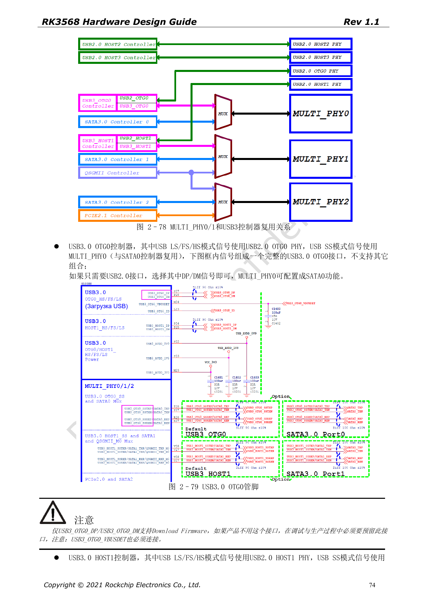
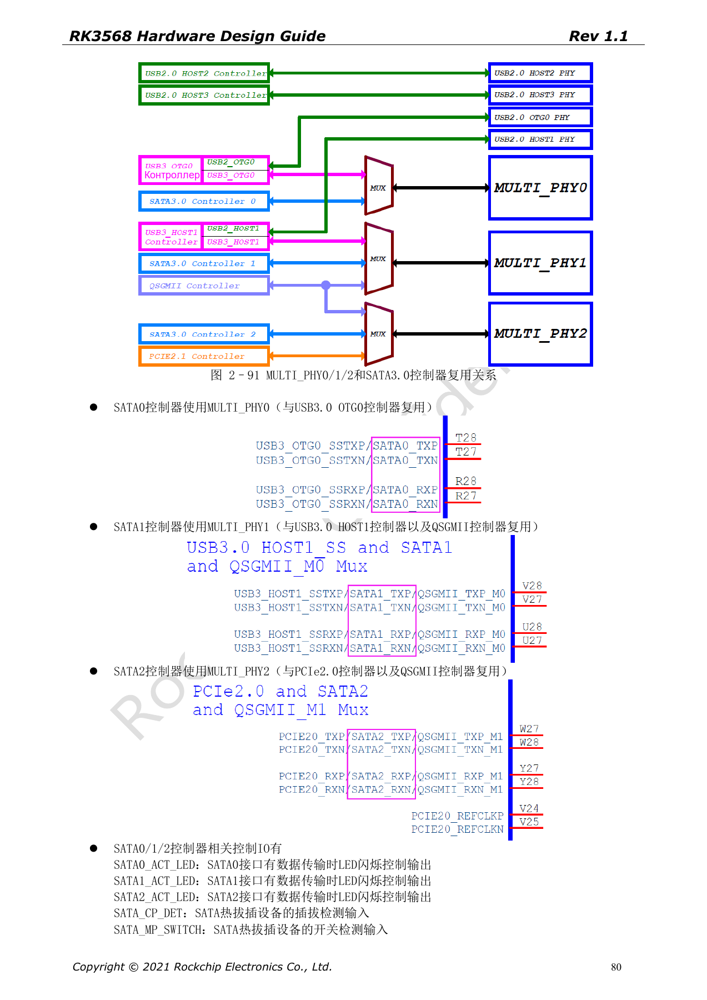
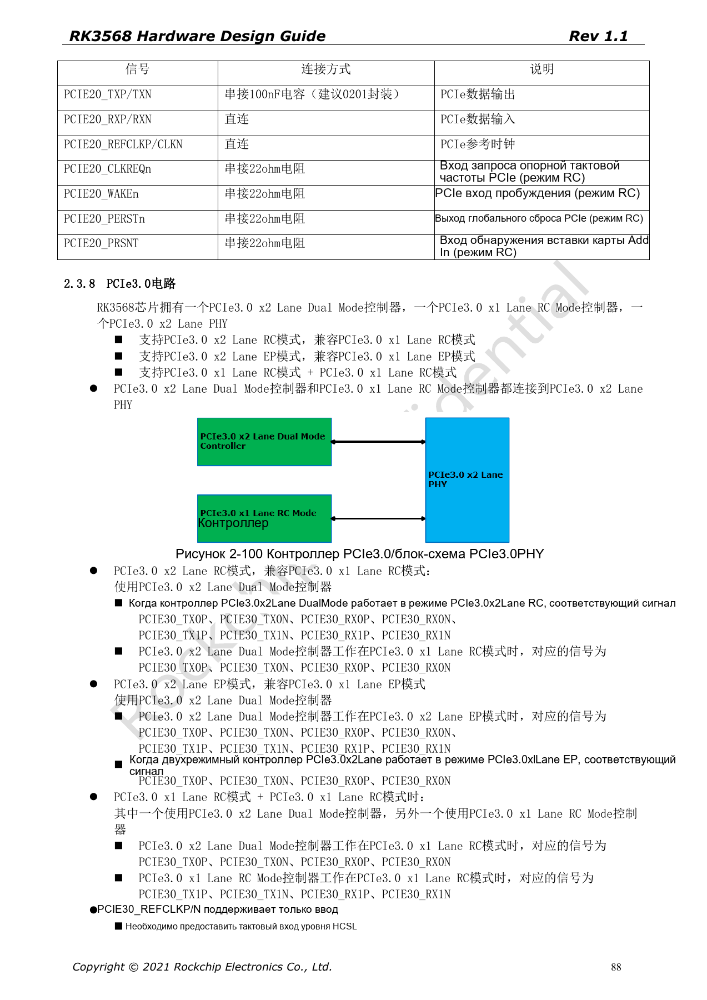

# Скоростные интерфейсы RK3568: USB, SATA, PCIe и тактирование

Серия перерабатывает RK3568 Hardware Design Guide V1.1 (китайский, 2021-06-08) и отдельный High Speed PCB Design Guide V1.0.0 (английский, 2021-04-12) по инженерным темам. ArmSoM [Sige3](https://www.armsom.org/sige3) использует RK3568B2. [Документация платы](https://docs.armsom.org/armsom-sige3) помогает изучать и оценивать рассматриваемые решения. Эталонные схемы SoC не описывают все реальные схемы и выведенные интерфейсы Sige3. Проверяйте SDK/BSP, ядро, ревизию чипа, прошивку и периферию. Значения взяты из источников, не из испытаний ArmSoM.

**CN V1.1 §2.3.4–2.3.8 · EN PCB §1.1–1.6**

## Сначала составьте матрицу PHY

MULTI_PHY0 выбирает USB3 OTG0 или SATA0; MULTI_PHY1 — USB3 HOST1, SATA1 либо QSGMII/SGMII; MULTI_PHY2 — PCIe2.0, SATA2 либо QSGMII/SGMII. Количество контроллеров не равно числу одновременно доступных портов. SuperSpeed USB3 объединяют с указанным в схеме USB2 PHY; OTG0 DP/DM и VBUSDET сохраняют для прошивки.

## Направления такта PCIe2 и PCIe3 различаются

PCIe2.0 — x1 RC, REFCLK обычно выход, допустим и вход. Двухлинейный PHY PCIe3.0 работает как x2 RC, x2 EP или два x1 RC. REFCLK у него только вход, нужен соответствующий PCIe3.0 источник HCSL. CLKREQn/WAKEn должны быть функциональными выводами одной группы M0/M1/M2. PERSTn допускает GPIO; функциональный вывод берётся из той же группы. Уровень стандартного слота 3.3V согласуют с IO.

## Разделяйте ёмкости и импеданс по интерфейсам

В английском PCB-гиде: USB3 TX 100nF, SATA TX/RX 10nF, PCIe2 TX 100nF, PCIe3 TX 220nF; ±20%, предпочтительно 0201. USB — 90Ω±10%, SATA — 100Ω±10%, PCIe данные — 85Ω±10%, REFCLK — 100Ω±10%. Единое правило 100Ω для всех пар неверно. Для PCIe3 рекомендована симуляция готовой трассировки с разъёмами, переходами, конденсаторами и потерями канала.

## Проверяйте реальное сочетание интерфейсов

Зафиксируйте контроллер, PHY, такт, IO-группу, питание и DTS, затем проверяйте обнаружение, скорость, сон и длительный обмен. До пяти устройств SATA через Port Multiplier — характеристика источника, не подтверждение любых драйверов и плат. В таблице PCIe написано «Max inter-pair skew <6inches», как и ограничение длины; это сохраняется как исходная формулировка, а не точная цель выравнивания.

## Параметры и ограничения источника

| Параметр | Значение источника |
| --- | --- |
| USB3 | 90Ω±10%; <12mil; <6in; 100nF±20% |
| SATA3 | 100Ω±10%; <12mil; <6in; 10nF±20% |
| PCIe2 | 85Ω±10%; <12mil; <6in; 100nF±20% |
| PCIe3 | 85Ω±10%; <12mil; <6in; 220nF±20% |

## Иллюстрации источника

Снимки страниц сохраняют подписи схем и контекст; текст и таблицы статьи редактируемые. Соответствующего английского издания основного руководства нет, поэтому его рисунки остаются китайскими во всех версиях. Материалы отдельного английского PCB-гайда отмечены отдельно. Номера относятся к физическим страницам PDF.

Китайское руководство · PDF 74

Китайское руководство · PDF 80

Китайское руководство · PDF 88

## Дополнительные материалы

- [RK3568: 10 тем схемотехники, PCB и производства](/ru/articles/rk3568-hardware-design-series/)
- [Загрузочная память RK3568: eMMC, FSPI, NAND и SDMMC](/ru/articles/rk3568-storage-emmc-fspi-sdmmc-hardware/)
- [Ethernet RK3568: два GMAC, RGMII и QSGMII](/ru/articles/rk3568-ethernet-rgmii-qsgmii-hardware/)
- [ArmSoM Docs](https://docs.armsom.org/)
- [ArmSoM](https://www.armsom.org/)
