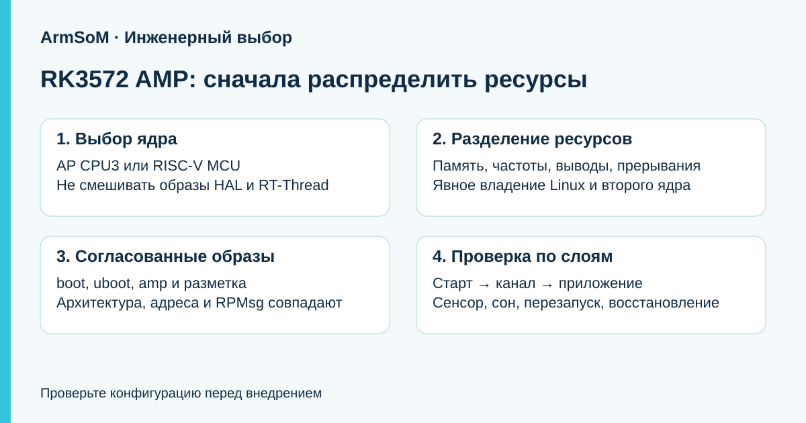

**Первый шаг RK3572 AMP — распределить ресурсы, а не просто собрать RT-Thread.** Android и вспомогательная прошивка должны одинаково понимать память, периферию, прерывания и точки входа. Только затем интерфейс и сеть можно оставить Android, а отдельные задачи управления передать другому ядру.

Руководство ArmSoM опирается на предоставленную запись проекта **RK3572 EVB1, Android 16, Linux 6.12**. Это не проверенный образ для конкретного продукта ArmSoM RK3572. Адреса, пути и параметры относятся к примеру. Скриншот обрывается в разделе восстановления; отсутствующие шаги не восстановлены предположениями.



## 1. Выбираем один из четырёх вариантов

| Вариант | Вспомогательный ресурс | Прошивка | Требование к Android |
| --- | --- | --- | --- |
| 1 | AP CPU3 | Rockchip HAL | Исключить ядро из Linux SMP |
| 2 | AP CPU3 | RT-Thread | То же, с согласованной AP-архитектурой и входом |
| 3 | RISC-V MCU | Rockchip HAL | AP остаются Android, периферия разделяется отдельно |
| 4 | RISC-V MCU | RT-Thread | Основной путь статьи, независимая прошивка |

Одинаковое имя `amp.img` не делает AP- и MCU-образы взаимозаменяемыми. В примере AP использует `rk3572-64/Image/amp.img`, MCU — `rk3572-mcu/Image/amp.img`. Пути запуска AP и standalone MCU в U-Boot также различаются.

RPMsg передаёт сообщения, но не обеспечивает автоматическую защиту всех ресурсов. Документация Linux напоминает о доступе вспомогательных процессоров к физической памяти и периферии: каналы и сообщения приложений следует ограничивать. [Linux RPMsg](https://docs.kernel.org/staging/rpmsg.html)

## 2. Фиксируем репозитории и инструментальную цепочку

Нужны согласованные `u-boot`, `rkbin`, `kernel-6.12`, `device/rockchip`, `rt-thread-rk3572`. Android `build.sh` не собирает RT-Thread автоматически: вспомогательный образ строится отдельно.

Для MCU замените путь компилятора реальным абсолютным путём и проверьте требуемую SDK версию:

```bash
cd rt-thread-rk3572/bsp/rockchip/rk3572-mcu
export RTT_EXEC_PATH=/absolute/path/to/riscv-toolchain/bin
test -x "$RTT_EXEC_PATH/riscv64-unknown-elf-gcc"
scons --menuconfig
scons -j8
./mkimage.sh
```

`RT_USING_RPMSG_LITE` включает обмен сообщениями. Тесты зависят от `RT_USING_COMMON_TEST` и параметров GPIO/WDT. `.config`, `rtconfig.h` и результат сборки должны совпадать. В примере `mkimage.sh` упаковывает `rtt.bin` в FIT `Image/amp.img`, адрес загрузки MCU — `0x45000000`; другие BSP не обязаны использовать его.

## 3. Обе стороны согласуют резервирование памяти

Это разметка исходного проекта для сверки, не универсальный шаблон платы.

| Регион | База | Резерв |
| --- | --- | --- |
| mcu_reserved | 0x45000000 | 2 MiB |
| amp_shmem_reserved | 0x45200000 | 2 MiB |
| rpmsg_reserved | 0x45400000 | 2 MiB |
| rpmsg_dma_reserved | 0x45600000 | 2 MiB |
| amp_reserved | 0x45800000 | 32 MiB |
| amp_uart_reserved | 0x47800000 | 128 KiB |

Исключительная верхняя граница `amp_reserved` — `0x47800000`, поэтому следующий регион не пересекается с ним. Точка входа AP CPU3 в источнике — `0x46400000`, отличная от MCU.

Узел RPMsg отображает только область vring размером `0x20000`, а DMA-пул указывается отдельно через `memory-region`. Резерв, отображение и ёмкость сообщений — разные величины:

```dts
rpmsg: rpmsg@45400000 {
    compatible = "rockchip,rpmsg";
    mbox-names = "rpmsg-rx", "rpmsg-tx";
    mboxes = <&mailbox0 0 &mailbox3 0>;
    rockchip,vdev-nums = <1>;
    rockchip,link-id = <0x03>;
    reg = <0x0 0x45400000 0x0 0x20000>;
    memory-region = <&rpmsg_dma_reserved>;
    status = "okay";
};
```

Согласуйте `rockchip,link-id`, mailbox и адреса с rpmsg-lite второй стороны. `0x03` взят из примера, а не вычислен из имени канала. Проверяйте итоговый DTS и linker script: две успешно собранные стороны могут работать с разной памятью.

## 4. Ядро Android и параметры платы

В источнике используется non-GKI. Это не означает обязательное отключение GKI для любой AMP-платформы; сначала проверьте поддержанный вариант своего SDK.

```makefile
BOARD_BUILD_GKI := false
PRODUCT_KERNEL_CONFIG += rockchip_amp.config
BOARD_WITH_SPECIAL_PARTITIONS += amp:4M
```

Пример настроек ядра:

```text
CONFIG_ROCKCHIP_AMP=y
CONFIG_MAILBOX=y
CONFIG_ROCKCHIP_MBOX=y
CONFIG_RPMSG=y
CONFIG_RPMSG_VIRTIO=y
CONFIG_RPMSG_NS=y
CONFIG_RPMSG_ROCKCHIP_MBOX=y
CONFIG_RPMSG_TTY=y
CONFIG_VIRTIO=y
```

Источник подключает `rk3572-amp.dtsi` после `rk3572-android.dtsi`. Только варианты AP CPU3 отключают соответствующий CPU-узел:

```dts
&cpu_l3 {
    status = "disabled";
};
```

Не уменьшайте число AP-ядер без необходимости в MCU-варианте. `nproc` зависит от online-состояния и affinity и не доказывает владение ядром; сопоставьте DTS, список online CPU и загрузочные сообщения.

## 5. Периферия, прерывания и GPIO

Передавая периферию вспомогательному ядру, совместно проверяйте Linux-узел, такты, reset, pinctrl, DMA и IRQ. Отключение одного драйвера не освобождает автоматически остальные ресурсы.

В исходной ветке `amp-irqs` использует глобальные GIC ID. Для относительного номера DTS типа SPI применяйте предусмотренное binding преобразование `+32` ровно один раз. Это не динамический виртуальный IRQ Linux; нельзя просто брать левое число из `/proc/interrupts`.

GPIO может распределяться по bank/выходам, а не по отдельным контактам. Автор описывает отказ сенсора Android после захвата bank при старте MCU и предлагает отложенное подключение IRQ. Полный патч отсутствует, поэтому **фрагмент скриншота не выдаётся за проверенную универсальную правку драйвера**. Сначала перечислите всех пользователей bank и правила конкретного драйвера.

## 6. Включаем прошивку в воспроизводимую сборку

Вход Android-сборки из примера приведён ниже; сначала проверьте параметры и каталоги в своём скрипте:

```bash
./build.sh -ACKUu
ls -lh rockdev/Image-rk3572_a16/
sha256sum rockdev/Image-rk3572_a16/amp.img
```

| Результат | Проверка |
| --- | --- |
| `boot.img` | Ядро, DTS, AMP и RPMsg соответствуют варианту |
| `uboot.img` | Тип прошивки и путь загрузки |
| `amp.img` | Архитектура, FIT, точка входа и общая память |
| `parameter.txt` | Размеры, разметка и правила упаковки |
| `update.img` | Все обязательные образы нужных версий |

Если упаковка пересоздаёт `rockdev`, ручная копия `amp.img` исчезнет при следующей сборке. Включите копирование и отказ при отсутствии файла в pipeline, сохраняйте хеши. Пропуск отсутствующего образа может помочь при отладке, но недопустим как незаметный пропуск обязательной прошивки в производстве.

## 7. Перед записью и после неё

Следующие запросы не пишут разделы. Для журналов может требоваться отладочный образ; фиксируйте ошибки:

```bash
adb shell cat /sys/devices/system/cpu/online
adb shell ls -l /dev/ttyRPMSG0
adb shell dmesg | grep -Ei 'amp|rpmsg|mailbox'
adb shell cat /proc/interrupts
adb shell ls -l /dev/block/by-name/
```

При первом запуске или изменении таблицы разделов используйте полный комплект, согласованный с платой, носителем, loader, подписью и разметкой. Сохраните данные и подготовьте восстановление. Команда полного обновления из источника **записывает прошивку, а не диагностирует устройство**; выполняйте её только для проверенной тестовой платы в нужном режиме:

```bash
./upgrade_tool uf update.img
```

Здесь нет универсальной записи в `/dev/block/sda13` или фиксированный LBA и нет придуманных шагов отсутствующего Maskrom-раздела. При изменении разметки такие рецепты неверны. Отдельное обновление `amp` также требует неизменной разметки, совместимости и восстановления.

Порядок приёмки: загрузка вспомогательного образа U-Boot; его консоль; имя и endpoints RPMsg; короткие сообщения с проверкой длины; приложение; параллельная работа сенсора, сети и накопителя; перезапуск, питание, сон и восстановление. `/dev/ttyRPMSG0` — точка наблюдения примера, не обязательный узел любого образа.

Загрузка не подтверждает жёсткое реальное время. Нужны нагрузка, метод измерения, максимальная задержка и обработка отказов. [Руководство ArmSoM AMP](/ru/articles/022-rockchip-amp/) объясняет основу, но параметры других SoC не заменяют RK3572. [Предоставленный проект](https://mp.weixin.qq.com/s/LZsdrAUAg8sIBmwEcc1PAw)

## Продукты и дальнейшее чтение

Для проекта ArmSoM можно оценить [Sige7](https://www.armsom.org/sige7), [AIM7](https://www.armsom.org/aim7) и [LM7](https://www.armsom.org/lm7) на RK3588 либо [CM5](https://www.armsom.org/cm5) и [Sige5](https://www.armsom.org/sige5) на RK3576. Интерфейсы и доступные образы проверяйте в документации [Sige7](https://docs.armsom.org/armsom-sige7), [CM5](https://docs.armsom.org/armsom-cm5) и [Sige5](https://docs.armsom.org/armsom-sige5). Ссылки помогают выбрать продукт, но не подтверждают проверку всех описанных сочетаний SDK на этих платах.
