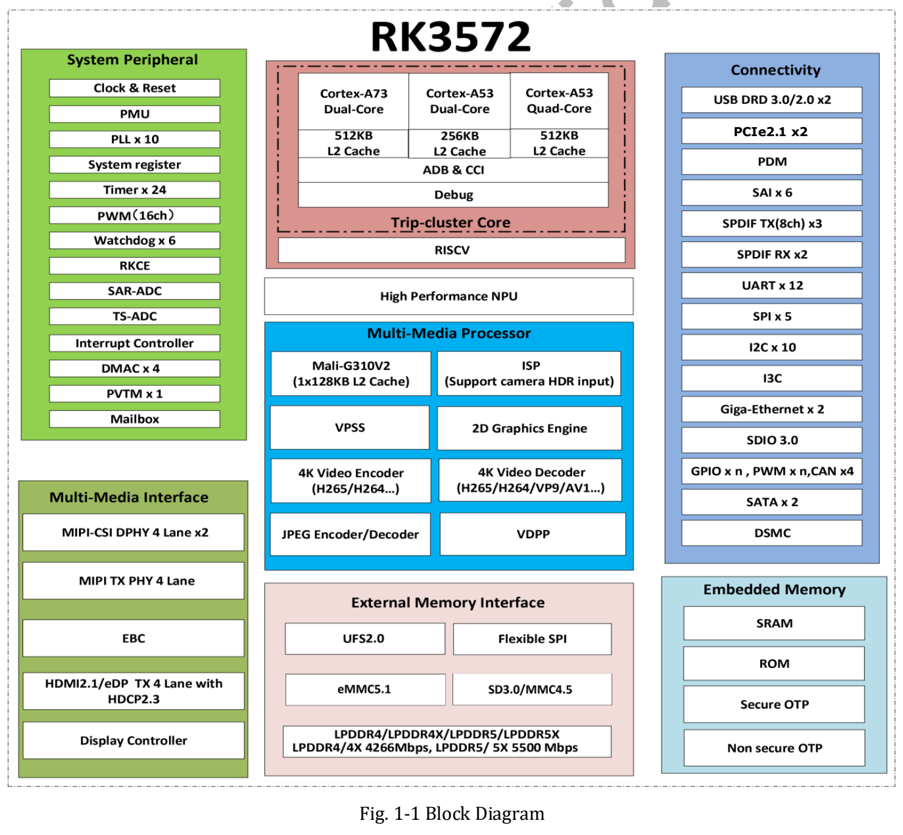
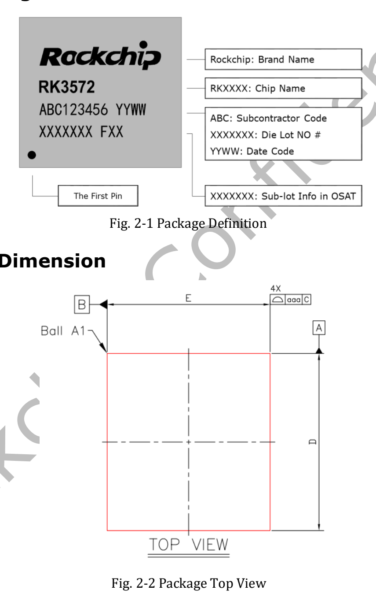
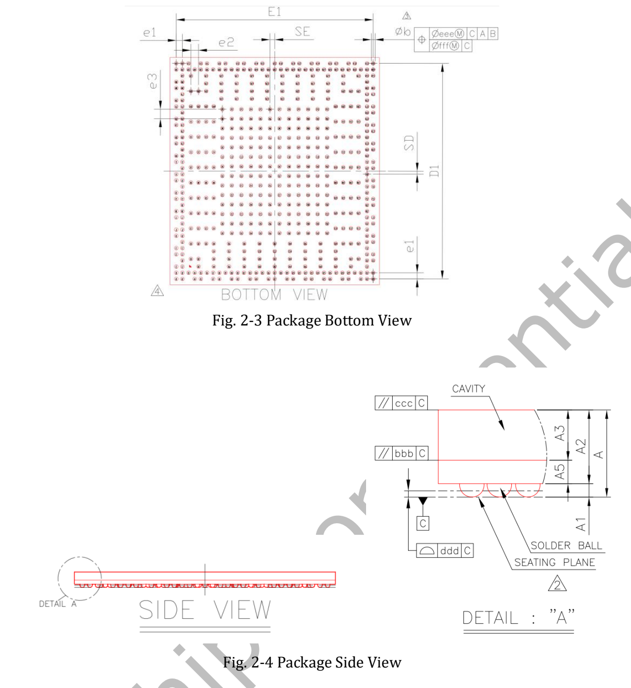
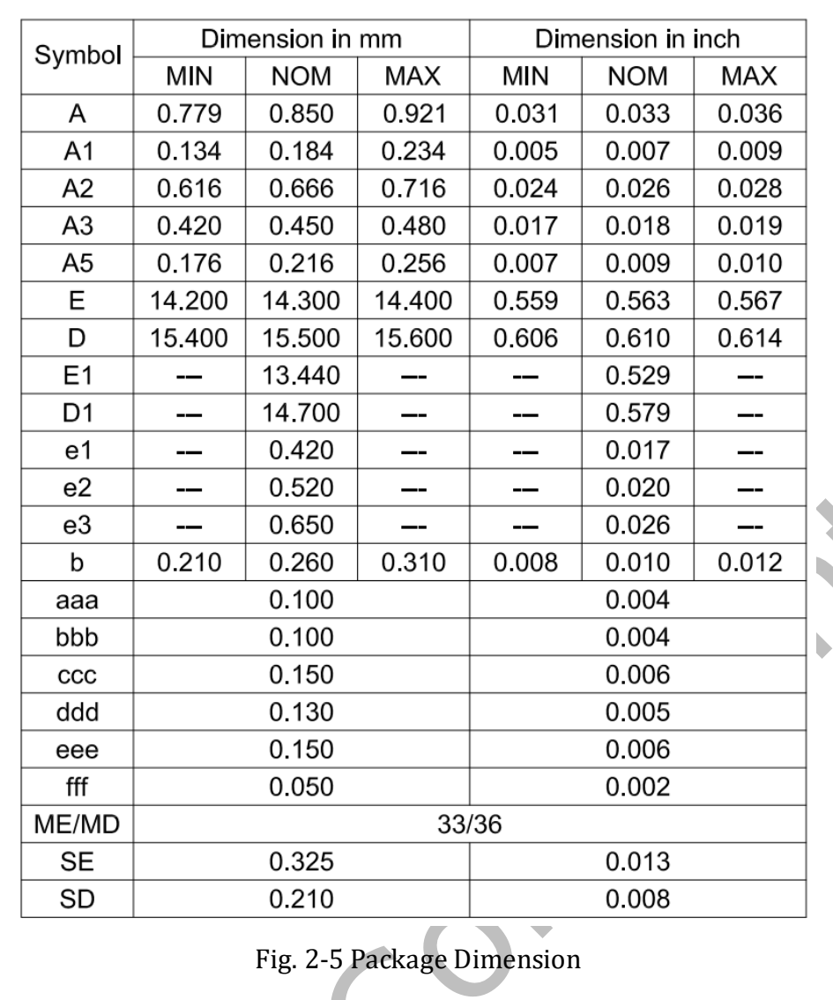

RK3572 объединяет восемь ядер CPU, NPU, обработку изображений и видеокодеки для компактных AIoT-устройств. Статья основана на **RK3572 Datasheet V1.0, 51 страница, первая редакция от 2026-03-24**, с пояснением условий характеристик.

[Скачать оригинальный RK3572 Datasheet V1.0 (PDF, около 2.33 MiB)](/assets/rk3572-datasheet/RK3572-Datasheet-V1.0.pdf)

Это руководство по чтению и выбору, не полный перевод 51 страницы. Оригинал сохранён для проверки электрических параметров и контактов. V1.0 не называется последней редакцией.

## CPU, память и ИИ

| Узел | Характеристика V1.0 | Страница PDF |
|---|---|---|
| CPU | 2× Cortex-A73 + 6× Cortex-A53, Armv8-A | 7–8 |
| Кластеры | Два A73, четыре A53, два A53; L2 соответственно 512kB, 512kB, 256kB | 7–8 |
| Память | LPDDR4/4X-4266, LPDDR5/5X-5500; 32-bit; адресное пространство до 16GB | 8 |
| GPU | Mali G310V2 MC1; OpenGL ES 3.2, OpenCL 3.0 Full Profile, Vulkan 1.2 | 13 |
| NPU | 4 TOPS INT8, сноска Sparsity | 13 |
| Форматы | INT4/INT8/INT16, FP4/FP8/FP16/BF16; асимметричный W4A16 MAC | 13 |

**Для 4 TOPS необходимо сохранять оговорку о разреженности.** Это не плотная производительность любой модели и не частота кадров. Результат зависит от структуры модели, разреженности, квантования, операторов и runtime. Поддержка формата не означает 4 TOPS для каждой точности. Контроллер памяти и адресное пространство также не определяют комплектацию будущего изделия ArmSoM.

## Блок-схема

На блок-схеме указано «4K Video Decoder», в обзоре — до 8K@30fps. Обе исходные формулировки сохранены; конкретные режимы проверяйте по подробным характеристикам и BSP.

Схема показывает вычислительные, медиа- и периферийные блоки. Количество контроллеров и мультиплексирование сверяйте с подробными разделами, контактами и схемой платы. Не каждый блок превращается в одновременно доступный внешний порт.

## Видео и камера

На странице 7 перечислены H.265, VP9, AV1 и AVS2 с декодированием до 8K@30fps или 4K@120fps, а H.264 — до 4K@60fps. Кодирование H.264/H.265 — до 4K@40fps, JPEG — до 4K@60fps. Форматы, профили, глубину цвета и сочетания следует проверять по функциональным разделам: максимумы не обязательно доступны одновременно.

ISP класса 12MP включает HDR, 3A, CAC, шумоподавление, повышение резкости, удаление дымки и коррекцию объектива. Качество зависит от сенсора, оптики и IQ-настройки. RGA v2.5 выполняет подходящие операции масштабирования, поворота и преобразования, CPU — прикладную логику. Это направления для локального зрения, экранов и терминалов, не измеренная производительность продукта.

## Корпус и производство

Указаны FCCSP550L, тело 14.3 × 15.5 mm, шарики 0.25 mm и смешанный шаг 0.42/0.52/0.65 mm. MSL — 3, материал — SnAgCu. Допуски, ориентацию и единицы читайте по чертежам. Это размеры микросхемы, не платы.

## Электрические и тепловые границы

Абсолютные пределы начинаются на странице 41, рекомендуемые условия — на странице 42. Для питания и IO используйте условия соответствующего домена. Абсолютный максимум не является рабочей целью; нельзя считать GPIO допускающими 5V без проверки.

Страница 51 требует температуру перехода ниже 125°C, не температуру окружающей среды. θJA, θJB, θJC и ψJT в V1.0 обозначены **TBD**. По ним нельзя заявлять тепловое сопротивление системы, потребление или работу без охлаждения. Питание, нагрев и длительную нагрузку проверяют на реальной плате.

## Навигация по документу

| Страницы | Содержание |
|---|---|
| 7–23 | Обзор, функции и схема |
| 24–26 | Заказ, маркировка, корпус, MSL, материал |
| 27–40 | Контакты |
| 41–50 | Электрика, IO, LPDDR, PLL, PHY, ADC |
| 51 | Тепловой режим и незаданные параметры |

Предыдущая статья опиралась на материалы анонса с Vulkan 1.4; более ранний datasheet V1.0 указывает Vulkan 1.2. Источники и даты не смешиваются. Реальные API нужно проверять по окончательному BSP и драйверу GPU.

## План ArmSoM для RK3572

ArmSoM планирует продукт на RK3572 в форм-факторе Raspberry Pi Zero для компактного зрения, интерактивных устройств и периферийного ИИ. Модель, память, интерфейсы, ОС, цена и дата выхода здесь не объявлены. Форм-фактор не подтверждает совместимость контактов или ПО.

[RK3572 и план ArmSoM Zero](/ru/articles/rockchip-rk3572-armsom-zero-preview/) · [ArmSoM](https://www.armsom.org/)
