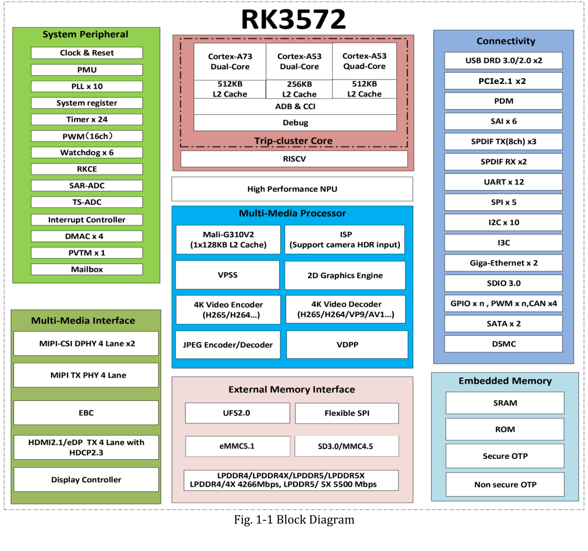

## Область применения

Материал предназначен для проектирования плат RK3572 и оценки проекта ArmSoM Zero5. Основа — Hardware Design Guide V1.1 и предоставленный комплект аппаратной документации. Интерфейс кристалла не обязательно выведен на плате. Окончательную конфигурацию Zero5, доступные ОС и версии ядра следует сверять с документацией конкретной ревизии изделия. Аппаратные испытания ArmSoM для этой статьи не проводились.

Выбор RK3572 определяется сочетанием CPU, NPU, мультимедиа и интерфейсов. До выбора памяти, накопителей и разъёмов разделите возможности кристалла, мультиплексирование PHY и реализацию платы. Страница обновлена до V1.1 с сохранением прежнего адреса.

## Что изменилось с V1.0 до V1.1

| Параметр | Спецификация и ограничение |
|---|---|
| GPU API | Vulkan 1.2 → Vulkan 1.4 |
| LPDDR4 / LPDDR4X | Добавлено ограничение: R17 не поддерживается при числе rank, равном 2. Максимальная ёмкость не означает поддержку любой организации DRAM. |
| VideoPort1 | 2048 × 1080 @ 60 Hz, 8-bit |

Источник — 47-страничный `Rockchip RK3572 Datasheet V1.1-20260413.pdf`. Ранее использовалась V1.0 (2026-03-24, 51 страница). Изменение объёма не означает пропорционального сокращения функций. Приоритет имеют новые значения и условия; v10 в URL сохранён для совместимости ссылок.

*Функциональная схема RK3572*

## CPU, GPU, NPU и память

| Параметр | Спецификация и ограничение |
|---|---|
| CPU | 2 × Cortex-A73 + 6 × Cortex-A53; ARMv8-A |
| CPU clusters | 2 × A73 / 4 × A53 / 2 × A53; L2 соответственно 512 / 512 / 256 KB |
| GPU | Mali-G310V2 MC1; OpenGL ES 3.2; OpenCL 3.0 Full Profile; Vulkan 1.4 |
| NPU | 4 TOPS (INT8 Sparse); INT4/INT8/INT16; FP4/FP8/FP16/BF16; W4A16 |
| DRAM | LPDDR4/4X-4266; LPDDR5/5X-5500; 32-bit; ≤16 GB; ≤4 ranks |
| MCU | RISC-V Nuclei N320; 24 KB ILM; 8 KB I-cache; 8 KB D-cache |

4 TOPS следует читать вместе с условием INT8 Sparse; это не скорость любой модели. 16 GB — предел адресации, а не подтверждённая комплектация Zero5. Скорость моделей, пропускную способность памяти, охлаждение и потребление проверяют на конкретной плате, прошивке и модели.

## Видеокодеки, дисплей и ввод изображения

| Параметр | Спецификация и ограничение |
|---|---|
| H.265 / VP9 / AV1 / AVS2 decode | 8K @ 30 / 4K @ 120 |
| H.264 decode | 4K @ 60 |
| H.264 / H.265 encode | 4K @ 40 |
| JPEG | 4K @ 60 |
| ISP | 12 MP |
| VideoPort0 | 4096 × 2160 @ 60 Hz; 10-bit |
| VideoPort1 | 2048 × 1080 @ 60 Hz; 8-bit |
| HDMI / eDP | HDMI 2.1 / eDP 1.3 Combo PHY; HDMI ≤4K @ 60 |
| MIPI DSI | 4 lanes; 2.5 Gbit/s/lane |
| MIPI CSI | 2 × 4-lane D-PHY; DVP |

Максимум декодирования, полоса выходного интерфейса и одновременная работа дисплеев — разные ограничения. На блок-схеме V1.1 остаётся надпись «4K Video Decoder», хотя текст указывает 8K@30. Таблица следует текстовому описанию кодеков и частоты кадров. Пример двух экранов 4096×2160@60 и 2560×1600@60 в руководстве противоречит пределу VideoPort1 в datasheet. Работа такой комбинации здесь не обещается: необходима проверка официальной спецификации и BSP.

## Накопители, периферия и корпус

| Параметр | Спецификация и ограничение |
|---|---|
| Storage | eMMC 5.1; UFS 2.0 HS-G3 ×2; SDMMC; FSPI 1/2/4/8-bit |
| Network | 2 × GMAC |
| USB | 2 × USB 3.0 / USB 2.0 DRD |
| Low-speed I/O | 12 × UART; 10 × I2C; 5 × SPI; 4 × CAN; 16 × PWM |
| Package | FCCSP550L; 14.3 × 15.5 mm; ball 0.25 mm; pitch 0.42 / 0.52 / 0.65 mm |
| Assembly | MSL 3; SnAgCu |
| Junction temperature | <125 °C |
| Thermal coefficients | θJA / θJB / θJC / ψJT: TBD |

Число интерфейсов нужно сопоставлять со схемами мультиплексирования. V1.1 перечисляет две комбинированные группы PCIe/SATA/USB и одну PCIe/SATA. Это три мультиплексируемых PHY, а не три независимых контроллера. Руководство описывает два контроллера PCIe, два SATA и три общих PHY. Схемотехнические статьи серии следуют этой карте и не считают альтернативные MUX отдельными портами. Тепловые коэффициенты остаются TBD; выдумывать тепловое сопротивление для расчёта радиатора нельзя.

## Продукты ArmSoM и следующие шаги

Для компактного изделия на RK3572 начните с плана ArmSoM в форм-факторе Zero и составьте список необходимых интерфейсов дисплея, накопителей, сети и питания. План не является спецификацией выпущенной модели или окончательной схемой. Для выбора доступной платформы и проверки интерфейсов используйте официальный каталог и Docs.

- [План RK3572 / ArmSoM Zero](/ru/articles/rockchip-rk3572-armsom-zero-preview/)
- [ArmSoM](https://www.armsom.org/category/all-products) · [ArmSoM Docs](https://docs.armsom.org/)

## Порядок чтения серии

- [RK3572 Datasheet V1.1: характеристики, интерфейсы и изменения](/ru/articles/rk3572-datasheet-v10/)
- [Проектирование RK3572: от выбора документации до проверки первой платы](/ru/articles/rk3572-hardware-design-series/)
- [Минимальная система RK3572: 24 МГц, сброс, загрузка и UART](/ru/articles/rk3572-minimum-system-bringup/)
- [Питание RK3572: домены, RK806-5 и варианты с двумя PMIC](/ru/articles/rk3572-power-domains-pmic/)
- [DDR для RK3572: схемы LPDDR4X/LPDDR5 и требования к плате](/ru/articles/rk3572-ddr-circuit-pcb/)
- [Настройка RK3572 DDRBIN: шаблоны, выбор по ADC и несколько профилей](/ru/articles/rk3572-ddrbin-adc-configuration/)
- [Накопители и загрузка RK3572: подключения и питание eMMC, UFS и FSPI](/ru/articles/rk3572-storage-boot-design/)
- [USB и Type-C RK3572: прошивка, роли и обнаружение питания](/ru/articles/rk3572-usb-typec-power-design/)
- [PCIe и SATA RK3572: мультиплексирование Combo PHY, тактирование и трассировка](/ru/articles/rk3572-high-speed-interface-design/)
- [Дисплеи и камеры RK3572: HDMI, eDP, MIPI и согласование уровней](/ru/articles/rk3572-display-camera-design/)
