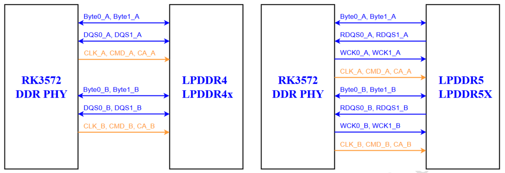
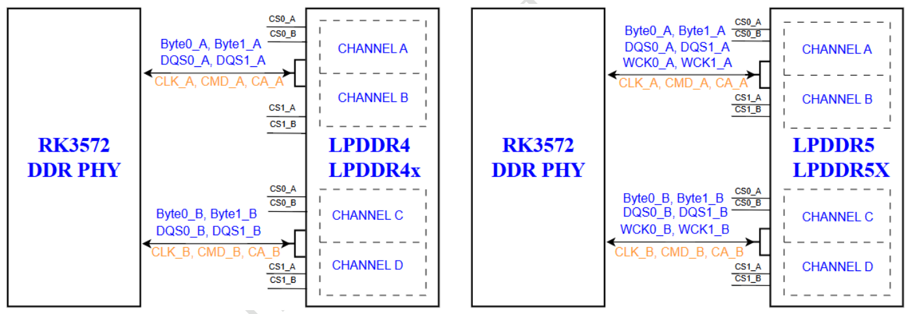
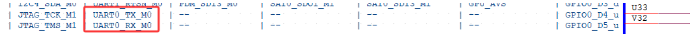
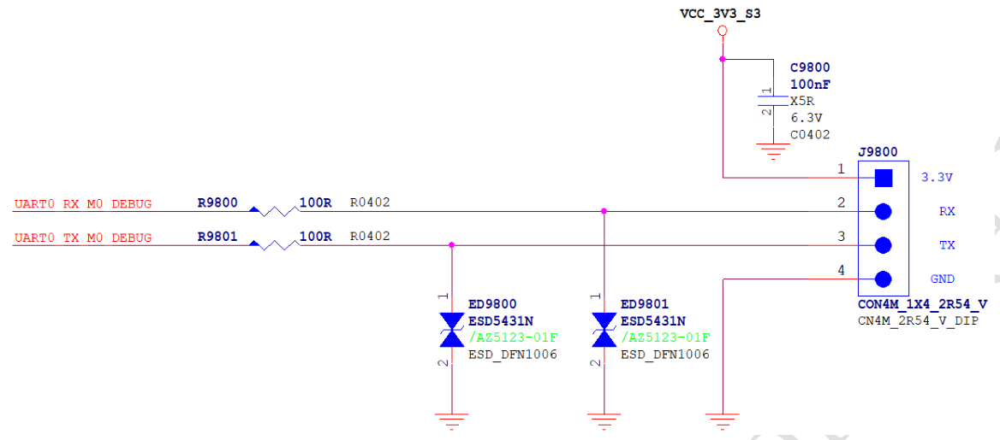
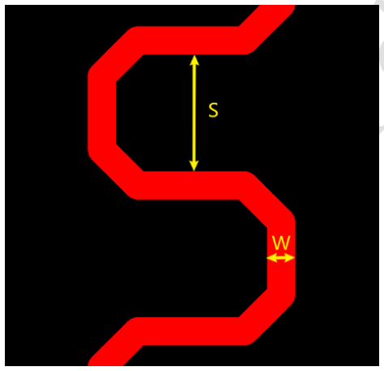
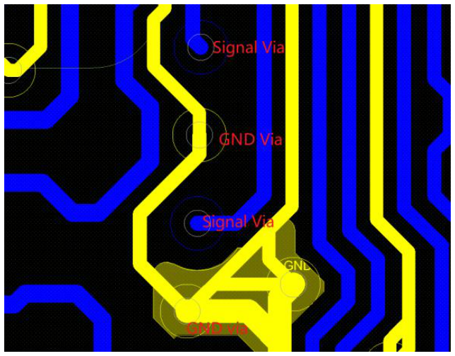
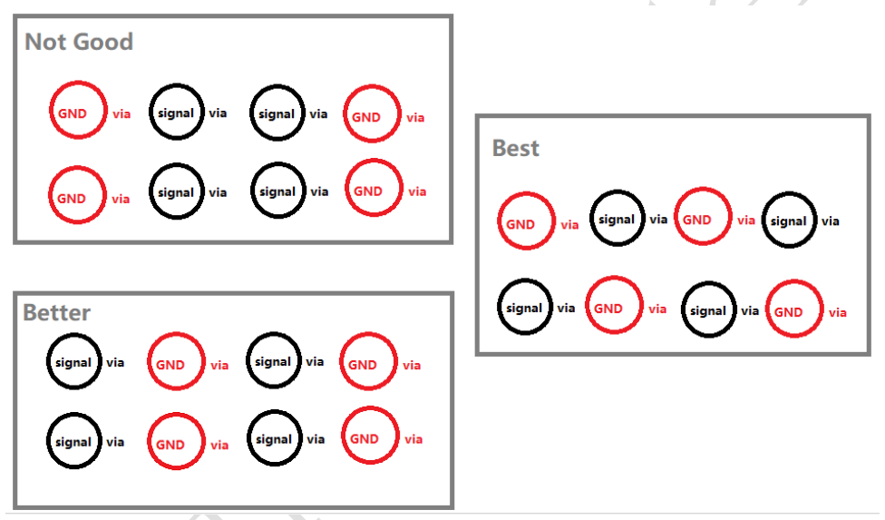

## Область применения

Материал предназначен для проектирования плат RK3572 и оценки проекта ArmSoM Zero5. Основа — Hardware Design Guide V1.1 и предоставленный комплект аппаратной документации. Интерфейс кристалла не обязательно выведен на плате. Окончательную конфигурацию Zero5, доступные ОС и версии ядра следует сверять с документацией конкретной ревизии изделия. Аппаратные испытания ArmSoM для этой статьи не проводились.

Для DDR RK3572 совместно выбирают организацию DRAM, соединения, PCB-шаблон и DDRBIN. Формулировки «LPDDR5, 8 GB» недостаточно: rank, корпус, отображение байтов, питание и обучение влияют на надёжность запуска. Начните с подходящего шаблона производителя, затем проверьте задержки и питание для своего стека слоёв.

## 1. Ширина шины, ёмкость и топология

| Параметр | Требование |
|---|---|
| Controller | 32-bit; 1 channel; ≤4 ranks; ≤16 GB |
| LPDDR4 / LPDDR4X | ≤4266 MT/s |
| LPDDR5 / LPDDR5X | ≤5500 MT/s |
| LPDDR4 / LPDDR4X, V1.1 | R17 не поддерживается при двух rank |

Предельные значения не подтверждают любую комбинацию ёмкости, корпуса и rank. Надпись «64-bit DRAM» относится к организации корпуса и схеме подключения, а не к ширине контроллера RK3572. Для двух микросхем опорная схема требует одинаковой ёмкости. Согласуйте модель, корпус и CS с шаблоном и DDRBIN.

*Соединение точка-точка с 32-битной DRAM*

*Альтернативная топология корпуса DRAM*

## 2. Какие сигналы допускают перестановку

| Параметр | Требование |
|---|---|
| Byte lanes | Только byte 0↔1 и byte 2↔3, без переноса между группами |
| DQ | Можно менять внутри байта; сохранить карту |
| DM / CLK / CS / WCK / DQS | Произвольная перестановка как у DQ недопустима |
| CA_A0–CA_A5 | Допустим обмен внутри группы; CA_A6 исключён |
| 4 ranks | Одинаковое отображение для всех rank |

## 3. Питание и ZQ: различайте SoC и DRAM

| Узел | LPDDR4 | LPDDR4X | LPDDR5 / 5X |
|---|---|---|---|
| DRAM VDD1 | 1.8 V | 1.8 V | 1.8 V |
| DRAM VDD2 / VDD2H | 1.1 V | 1.1 V | 1.05 V |
| DRAM VDD2L | — | — | 0.9 / 1.05 V |
| DRAM VDDQ | 1.1 V | 0.6 V | 0.5 V |
| PHY VDDQ / CKVDDQ | 0.75 V | 0.6 V | 0.5 V |
| PHY VDDQH | 1.1 V | 1.1 V | 1.05 V |

Таблица отражает примеры руководства; для конкретной DRAM руководствуйтесь её datasheet. ZQ SoC подключается через 120 Ω, 1% к DDRPHY_VDDQ_S0. ZQ DRAM — через 240 Ω, 1%: к VDD2 для LPDDR4, к VDDQ для LPDDR4X/LPDDR5. ODT_CA LPDDR4 подключается к VDD2. Проверяйте и номинал, и сеть: схемы ZQ на двух сторонах различаются.

*Вывод DDR ZQ RK3572*

*Опорные соединения ZQ и ODT DRAM*

## 4. CK, WCK и RDQS LPDDR5

LPDDR5 разделяет CK команд и WCK данных, работающий с частотой 2× или 4× CK; чтение использует RDQS. Группировка, выравнивание задержек и обучение должны соответствовать этой архитектуре, а не всем правилам LPDDR4. Для удержания нужен DDRPHY_VDDQH; до отключения других шин проверьте self-refresh и восстановление.

## 5. Импеданс и выравнивание задержек

| Параметр | Требование |
|---|---|
| DQ / DM / CA | 40–45 Ω ±10%; предпочтительно 40 Ω |
| CLK / DQS / WCK | 90 Ω differential ±10% |
| DQ/DM ↔ DQS/WCK | ≤45 ps / ≤90 mil |
| CA/control ↔ CLK | ≤45 ps / ≤90 mil |
| Перекос внутри пары | ≤1 ps / ≤5 mil |
| LPDDR5: DQS/WCK ↔ CLK | ≤130 ps / ≤550 mil |
| LPDDR4: DQS ↔ CLK | ≤90 ps / ≤410 mil |

Значения ps и mil не задают универсального коэффициента: задержка зависит от слоёв, диэлектрика и переходов. Проверяйте время распространения с учётом vias. Обычный зазор — минимум 2W; для тактов и стробов относительно других линий желательно 3W, минимум 2W. Шаг меандра S — минимум 3W; плотные зигзаги не заменяют анализ задержек.

*Требования к шагу меандра*

## 6. Опорные плоскости, возвратные vias и питание

*Возвратные vias возле смены слоя*

*Расположение сигнальных и возвратных vias*

При смене слоя расстояние между центрами сигнального и ближайшего возвратного via — не более 25 mil. Нужны непрерывная земля и отступ от края опорной плоскости минимум 12 mil. Проверьте минимум 0.8 земляного via на вывод земли DRAM. Для экранирования тактов шаг земляных vias — не более 400 mil. Удаление неиспользуемых площадок должно учитывать технологичность и надёжность.

| Шина | 100 kHz–30 MHz | 30–100 MHz |
|---|---|---|
| LPDDR4X VDD2 / VDDQ; LPDDR5 VDDQ / VDD2H | ≤0.03 Ω | ≤0.04 Ω |
| LPDDR5 VDD2L | ≤0.075 Ω | ≤0.08 Ω |

Целевые импедансы PDN оценивают вместе с корпусом, развязкой и моделью платы. Сигнальные vias не должны разрезать питание. Возврат конденсатора делайте коротким; для 0603/0805 руководство требует минимум два соответствующих перехода питания/земли. Проверяйте холодный старт, повторы сброса, объём, нагрузку памяти, температуру и suspend/resume. Один успешный запуск не квалифицирует DDR.

## Продукты ArmSoM и следующие шаги

Для компактного изделия на RK3572 начните с плана ArmSoM в форм-факторе Zero и составьте список необходимых интерфейсов дисплея, накопителей, сети и питания. План не является спецификацией выпущенной модели или окончательной схемой. Для выбора доступной платформы и проверки интерфейсов используйте официальный каталог и Docs.

- [План RK3572 / ArmSoM Zero](/ru/articles/rockchip-rk3572-armsom-zero-preview/)
- [ArmSoM](https://www.armsom.org/category/all-products) · [ArmSoM Docs](https://docs.armsom.org/)

## Порядок чтения серии

- [RK3572 Datasheet V1.1: характеристики, интерфейсы и изменения](/ru/articles/rk3572-datasheet-v10/)
- [Проектирование RK3572: от выбора документации до проверки первой платы](/ru/articles/rk3572-hardware-design-series/)
- [Минимальная система RK3572: 24 МГц, сброс, загрузка и UART](/ru/articles/rk3572-minimum-system-bringup/)
- [Питание RK3572: домены, RK806-5 и варианты с двумя PMIC](/ru/articles/rk3572-power-domains-pmic/)
- [DDR для RK3572: схемы LPDDR4X/LPDDR5 и требования к плате](/ru/articles/rk3572-ddr-circuit-pcb/)
- [Настройка RK3572 DDRBIN: шаблоны, выбор по ADC и несколько профилей](/ru/articles/rk3572-ddrbin-adc-configuration/)
- [Накопители и загрузка RK3572: подключения и питание eMMC, UFS и FSPI](/ru/articles/rk3572-storage-boot-design/)
- [USB и Type-C RK3572: прошивка, роли и обнаружение питания](/ru/articles/rk3572-usb-typec-power-design/)
- [PCIe и SATA RK3572: мультиплексирование Combo PHY, тактирование и трассировка](/ru/articles/rk3572-high-speed-interface-design/)
- [Дисплеи и камеры RK3572: HDMI, eDP, MIPI и согласование уровней](/ru/articles/rk3572-display-camera-design/)
