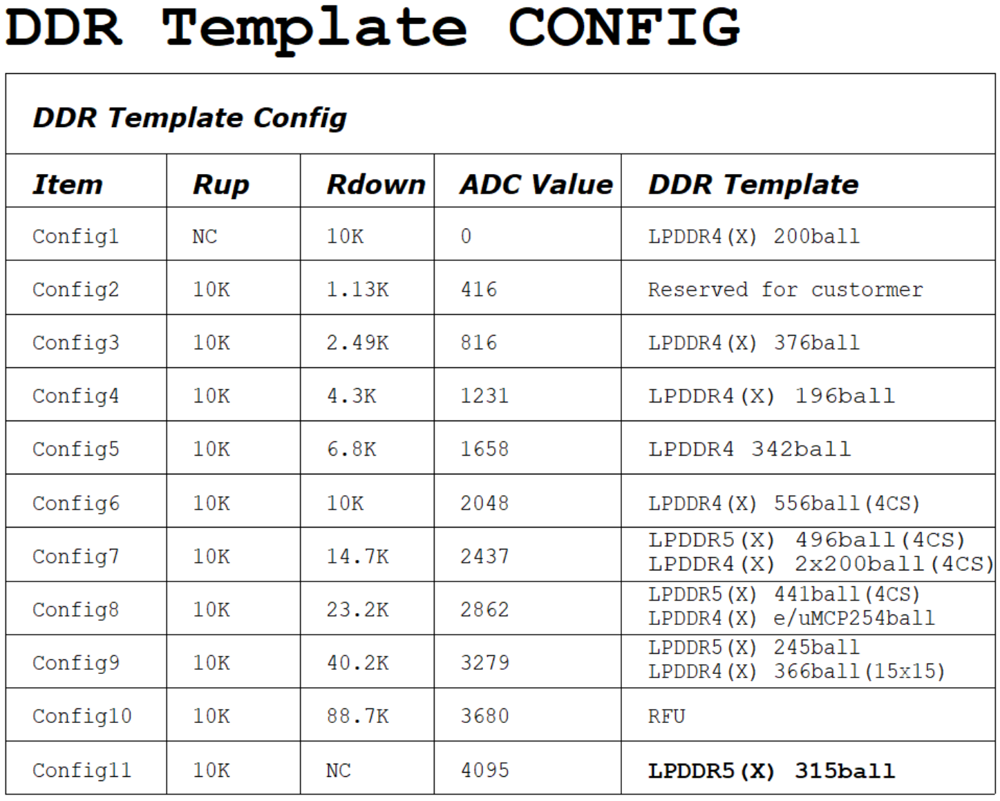
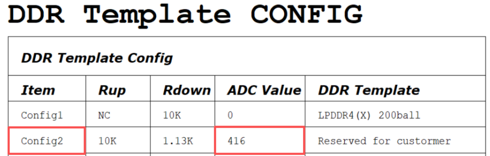

## Область применения

Материал предназначен для проектирования плат RK3572 и оценки проекта ArmSoM Zero5. Основа — Hardware Design Guide V1.1 и предоставленный комплект аппаратной документации. Интерфейс кристалла не обязательно выведен на плате. Окончательную конфигурацию Zero5, доступные ОС и версии ядра следует сверять с документацией конкретной ревизии изделия. Аппаратные испытания ArmSoM для этой статьи не проводились.

Настройка DDRBIN не сводится к одному набору параметров для любой памяти. Фиксируйте совместно шаблон RK3572, ADC, тип DRAM и версию бинарного файла. Статья основана на инструкции от 2026-05-18 для Linux и Windows и сохраняет смысл параметров команд.

## 1. Подготовьте три согласованных компонента

Подготовьте применяемый шаблон схемы/PCB, его `_ddrbin_tool_config.txt` и соответствующий SDK `rk3572_ddr_*MHz_v*.*.bin`. Если файла конфигурации в шаблоне нет, инструкция предусматривает настройки rkbin по умолчанию; зафиксируйте выбор и не придумывайте параметры по похожей ёмкости. Сохраните исходный binary, конфигурацию, версию утилиты и контрольную сумму результата.

## 2. ADC Config — индекс, а не измеренное значение

| Config | Rup | Rdown | ADC | Выбор шаблона DDR |
|---|---|---|---|---|
| 1 | NC | 10 kΩ | 0 | LPDDR4(X) 200-ball |
| 2 | 10 kΩ | 1.13 kΩ | 416 | Резерв для заказчика |
| 3 | 10 kΩ | 2.49 kΩ | 816 | LPDDR4(X) 376-ball |
| 4 | 10 kΩ | 4.3 kΩ | 1231 | LPDDR4(X) 196-ball |
| 5 | 10 kΩ | 6.8 kΩ | 1658 | LPDDR4 342-ball |
| 6 | 10 kΩ | 10 kΩ | 2048 | LPDDR4(X) 556-ball (4 CS) |
| 7 | 10 kΩ | 14.7 kΩ | 2437 | LPDDR5(X) 496-ball (4 CS) / LPDDR4(X) 2 × 200-ball (4 CS) |
| 8 | 10 kΩ | 23.2 kΩ | 2862 | LPDDR5(X) 441-ball (4 CS) / LPDDR4(X) e/uMCP 254-ball |
| 9 | 10 kΩ | 40.2 kΩ | 3279 | LPDDR5(X) 245-ball / LPDDR4(X) 366-ball (15 × 15) |
| 10 | 10 kΩ | 88.7 kΩ | 3680 | RFU |
| 11 | 10 kΩ | NC | 4095 | LPDDR5(X) 315-ball |

Например, ADC 416 соответствует Config 2: параметр — `adc_value_to_ddr_config=2`, не `=416`. Config 2 — пользовательская позиция примера, а не общий выбор для LPDDR4. Для загрузочных носителей тоже существует таблица ADC, но она задаёт порядок загрузки, а не эту карту DDR.

## 3. Настройка в Linux

Сначала прочитайте `rkbin/tools/ddrbin_tool_user_guide.txt` соответствующей версии, затем используйте `ddrbin_tool.py`. Ниже сохранён шаблон команды источника. Замените имя шаблона и маски частоты/версии точными именами; маска не должна выбирать несколько binary. Команда меняет файл на ПК, а не прошивает плату.

```text
./ddrbin_tool.py rk3572 模板名称_ddrbin_tool_config.txt rk3572_ddr_*MHz_v*.*.bin LPDDR4 adc_value_to_ddr_config=2
```

Проверьте rk3572, файл фактического PCB-шаблона, тип DRAM и Config по резисторам платы. Путь и имя результата определяются версией инструмента. Проверьте сообщения и изменённый файл перед упаковкой в SDK. Для платформ без таблицы ADC инструкция требует опустить тип DRAM и ADC-параметры; пример RK3572 нельзя переносить на всё семейство.

[](/assets/rk3572-hardware-20261119/ddrbin-config-5.png)

*Инструмент DDRBIN и поля настройки*

## 4. Настройка в Windows

В источнике используется `rk_ddrBin_tool_windows`: выберите платформу, DramType (в примере LPDDR4), ADC Config (2), импортируйте binary и заполните параметры шаблона. Не сопоставляйте поля Linux и GUI только по картинке: нужны документация той же версии, шаблон и проверка результата. Ёмкость и timing на снимке не являются настройками для другой памяти.

[](/assets/rk3572-hardware-20261119/ddrbin-config-6.png)

*Настройка DDR в Windows*

## 5. Несколько профилей нужно накопить в одном результате

Одна операция меняет только выбранные тип DRAM и ADC-профиль. Для нескольких профилей подавайте результат первого изменения на вход второго и далее. Если каждый раз открывать исходный binary, изменения не накопятся. Записывайте вход, выход, тип и Config каждого шага, затем проверяйте каждую аппаратную конфигурацию.

## 6. Протокол перед выпуском прошивки

| Параметр | Требование |
|---|---|
| Аппаратура | Ревизия PCB, полный номер DRAM, ёмкость, rank и установленные резисторы |
| Файлы | Шаблон, конфигурация, версия инструмента и суммы исходного/конечного binary |
| Проверка | Журналы запуска, объём, нагрузка и resume каждого профиля |

Для статьи утилиты не запускались, а результат не проверялся на Zero5. Перед производством окончательный binary должны подтвердить ответственные за плату и SDK. Успешный запуск одной EVB не подтверждает все варианты памяти.

## Продукты ArmSoM и следующие шаги

Для компактного изделия на RK3572 начните с плана ArmSoM в форм-факторе Zero и составьте список необходимых интерфейсов дисплея, накопителей, сети и питания. План не является спецификацией выпущенной модели или окончательной схемой. Для выбора доступной платформы и проверки интерфейсов используйте официальный каталог и Docs.

- [План RK3572 / ArmSoM Zero](/ru/articles/rockchip-rk3572-armsom-zero-preview/)
- [ArmSoM](https://www.armsom.org/category/all-products) · [ArmSoM Docs](https://docs.armsom.org/)

## Порядок чтения серии

- [RK3572 Datasheet V1.1: характеристики, интерфейсы и изменения](/ru/articles/rk3572-datasheet-v10/)
- [Проектирование RK3572: от выбора документации до проверки первой платы](/ru/articles/rk3572-hardware-design-series/)
- [Минимальная система RK3572: 24 МГц, сброс, загрузка и UART](/ru/articles/rk3572-minimum-system-bringup/)
- [Питание RK3572: домены, RK806-5 и варианты с двумя PMIC](/ru/articles/rk3572-power-domains-pmic/)
- [DDR для RK3572: схемы LPDDR4X/LPDDR5 и требования к плате](/ru/articles/rk3572-ddr-circuit-pcb/)
- [Настройка RK3572 DDRBIN: шаблоны, выбор по ADC и несколько профилей](/ru/articles/rk3572-ddrbin-adc-configuration/)
- [Накопители и загрузка RK3572: подключения и питание eMMC, UFS и FSPI](/ru/articles/rk3572-storage-boot-design/)
- [USB и Type-C RK3572: прошивка, роли и обнаружение питания](/ru/articles/rk3572-usb-typec-power-design/)
- [PCIe и SATA RK3572: мультиплексирование Combo PHY, тактирование и трассировка](/ru/articles/rk3572-high-speed-interface-design/)
- [Дисплеи и камеры RK3572: HDMI, eDP, MIPI и согласование уровней](/ru/articles/rk3572-display-camera-design/)
