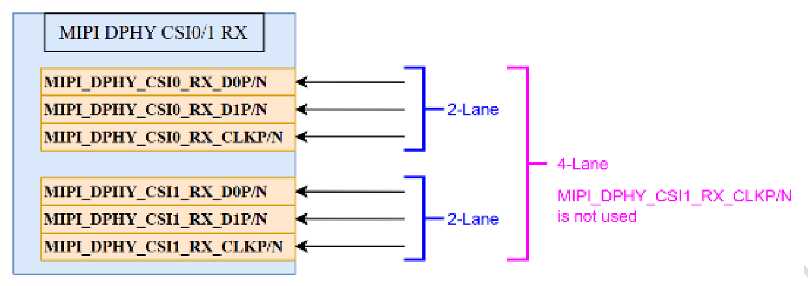
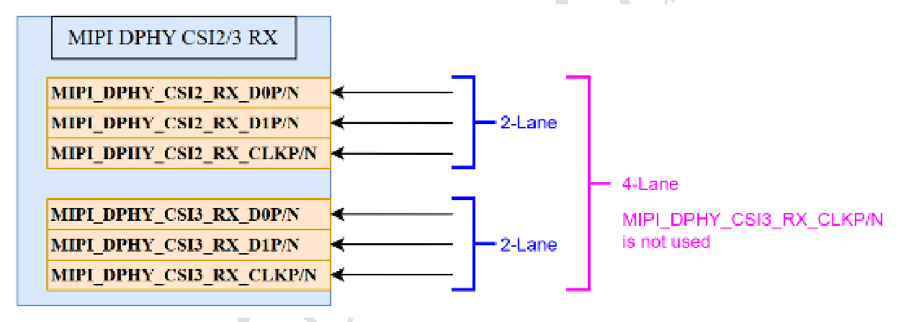
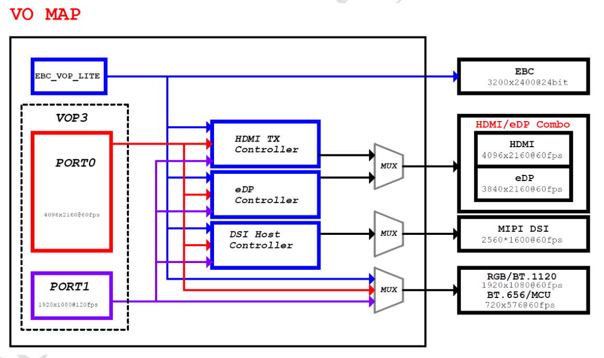
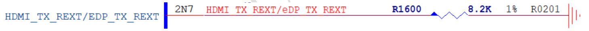
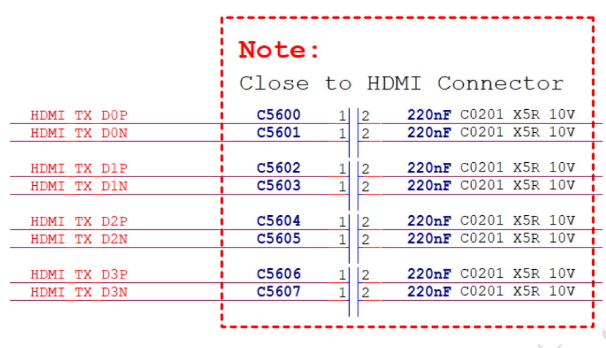
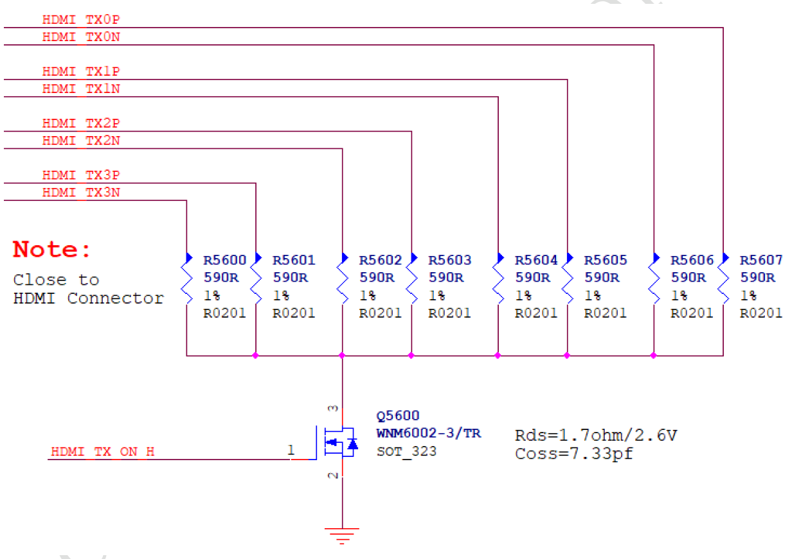
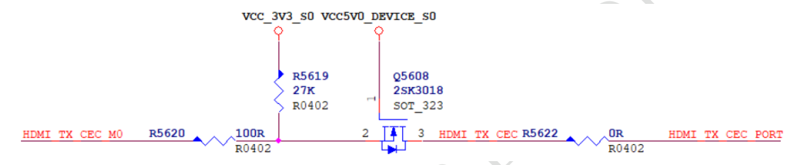
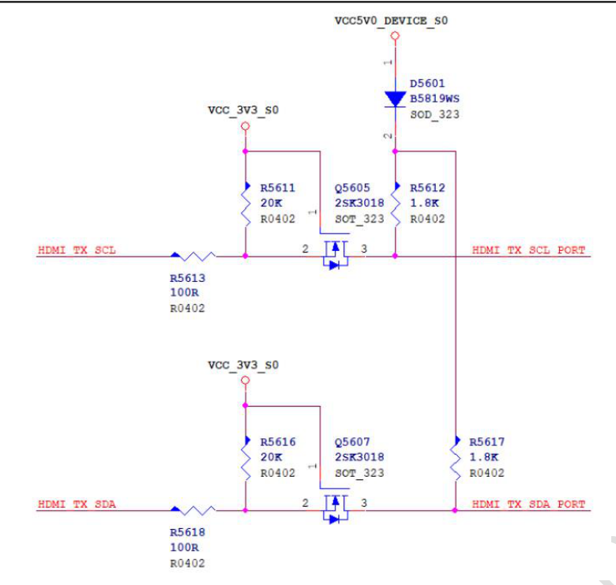
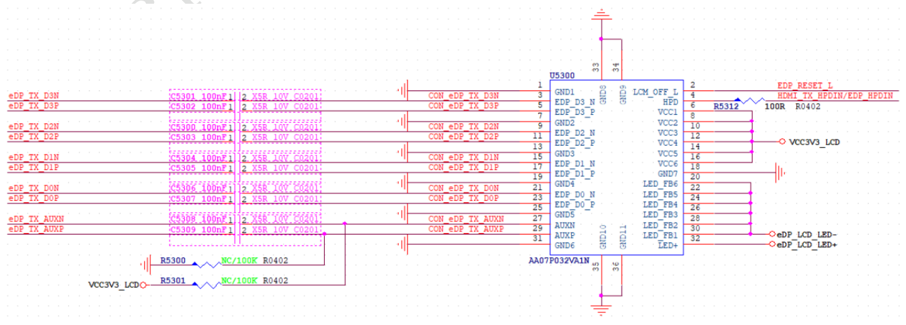
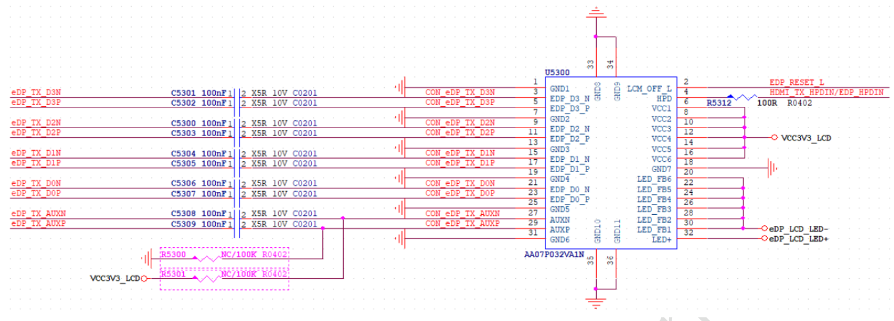

## Область применения

Материал предназначен для проектирования плат RK3572 и оценки проекта ArmSoM Zero5. Основа — Hardware Design Guide V1.1 и предоставленный комплект аппаратной документации. Интерфейс кристалла не обязательно выведен на плате. Окончательную конфигурацию Zero5, доступные ОС и версии ядра следует сверять с документацией конкретной ревизии изделия. Аппаратные испытания ArmSoM для этой статьи не проводились.

Проектирование дисплеев и камер RK3572 начинается с потока пикселей, VOP/ISP, MUX PHY и уровней. Совпадающий разъём не гарантирует разрешение, частоту, линии, питание и драйвер. Входы камер и выходы дисплеев рассмотрены отдельно для проверки схемы.

## 1. Две группы CSI по четыре линии и разделение

RK3572 имеет две группы MIPI D-PHY CSI RX версии 1.2, до 2.5 Gbit/s на линию. Каждая четырёхлинейная группа разделяется на две двухлинейные по схеме со своими тактовыми парами. Нельзя произвольно распределять четыре линии между четырьмя датчиками.

| Ресурс данных | Интерфейс после разделения |
|---|---|
| CSI0 D0/D1 | CSI0 D0/D1 + CLK0 |
| CSI0 D2/D3 | CSI1 D0/D1 + CLK1 |
| CSI2 D0/D1 | CSI2 D0/D1 + CLK2 |
| CSI2 D2/D3 | CSI3 D0/D1 + CLK3 |

*Распределение линий CSI0/CSI1*

*Распределение линий CSI2/CSI3*

## 2. Питание датчика, MCLK и I2C

Опорная камера использует 1.8, 1.2 и 2.8 V, но DVDD датчика может требовать 1.5 либо 1.8 V — следуйте его datasheet. При токе ядра свыше 100 mA оцените DC/DC. DOVDD согласуйте с VCCIO2/VCCIO4 и I2C. Двум датчикам с одинаковым I2C-адресом нужны разные шины либо проверенная адресация.

Питание автофокуса 2.8 V отделите от аналогового либо развяжите ферритом; конденсаторы разместите у разъёма. Начальные PWDN/RESET должны исключать случайный запуск; опорная ёмкость RESET — 100 nF. Частоту и уровень MCLK, последовательность питания подтверждайте для модуля, не для «любой камеры».

## 3. Разрядность и порядок параллельного ввода

CIF поддерживает BT.601 RAW 8/10/12-bit и YCbCr422 8-bit, BT.656 8-bit и BT.1120 16-bit. Выравнивание вниз использует data[0:n−1], вверх — data[16−n:15]. Согласуйте Y/C BT.1120 с источником: одинаковая ширина не гарантирует порядок байтов. Для тактового входа 22 Ω размещают у источника, для выхода — у SoC; межплатные цепи требуют проверки демпфирования и ESD.

## 4. Выходы VOP и MUX HDMI/eDP

*VOP и интерфейсы дисплеев*

HDMI и eDP используют общий Combo PHY и не являются независимыми одновременными выходами. Datasheet V1.1 ограничивает VideoPort1 значением 2048×1080@60, 8-bit; руководство приводит второй дисплей 2560×1600@60. Из-за расхождения такой максимум двух экранов не обещается. Отдельно проверяйте полосу интерфейса, VOP и BSP. DP Alt Mode Type-C из этих возможностей не следует.

## 5. HDMI: REXT, ёмкости и смещение TMDS

*Опорный резистор HDMI REXT*

*Развязка дифференциальных линий HDMI*

*Смещение TMDS и ключи*

REXT подключается к земле через 8.2 kΩ, 1% возле SoC, дифференциальные линии — через 220 nF, желательно 0201. Смещение TMDS 590 Ω управляется MOS с разными состояниями для FRL и TMDS. Частная схема TMDS к RK628F не заменяет внешнее HDMI с проверкой утечек и соответствия. Перечень режимов FRL не означает поддержку всех режимов кристаллом; учитывайте PHY RK3572 и BSP.

## 6. Согласование управляющих уровней HDMI

*Развязка CEC*

*Преобразование уровней DDC*

HPD согласуйте с выбранным VCCIO6 или PMUIO1. CEC использует 3.3 V и 27 kΩ; утечка и ёмкость MOS влияют на ожидание и фронты. Внешний DDC — 5 V, но выводы SoC не становятся 5-V-tolerant: сохраните преобразователь и проверьте обратную утечку D5601. Для HDMI pin 18 нужны 4.8–5.3 V и опорные 1 µF. ESD: ≤0.2 pF для быстрых линий, ≤1 pF для остальных.

## 7. eDP, DSI и управление панелью

*Развязка основного канала eDP*

*Опорное подключение eDP AUX*

eDP 1.3 поддерживает 1/2/4 линии на 1.62/2.7/5.4 Gbit/s, AUX — 1 Mbit/s; произвольная перестановка линий недопустима. Раздел схем задаёт 100 nF для основного канала и AUX, а 100 kΩ вниз AUXP и вверх AUXN к 3.3 V устанавливаются по требованиям панели. PCB-раздел указывает 220 nF. Конфликт 100/220 nF сохранён; перед изготовлением требуется актуальное подтверждение производителя и спецификации панели.

MIPI DSI имеет четыре выходные линии; инициализация, питание, RESET и подсветка определяются панелью. Для FB подсветки рекомендуются 1%, EN/PWM по умолчанию подтянуты вниз против вспышки. Отдельно проверьте напряжение и адрес touch-I2C. RGB, BT.1120 и MCU-дисплей требуют правильного IOMUX без двойного использования выводов; не предполагайте чтение через MCU-интерфейс.

## 8. PCB и приёмка системы

| Параметр | MIPI | HDMI | eDP |
|---|---|---|---|
| Дифференциальный импеданс | 100 Ω ±10% | 100 Ω ±10% | 90 Ω ±10% |
| Перекос внутри пары | <1 ps / 6 mil | <1 ps / 6 mil | <1 ps / 6 mil |
| Длина | <6 in | <4 in | <6 in |
| Сигнальные vias | ≤4 | По возможности избегать | ≤2 |
| Зазор между парами | ≥4W; min 3W | ≥7W | ≥4W |

Отдельно проверяйте MIPI такт–данные <2 ps/12 mil и HDMI между парами <80 ps/480 mil. Это ограничения таблиц, не универсальный перевод времени в длину. Испытайте разрешение, частоту, глубину цвета, hot-plug, восстановление изображения, подсветку, touch, потери кадров и совместную нагрузку. Сохраните одно- и многопоточные результаты с моделями кабелей, панели/датчика и BSP. Один работающий экран не подтверждает все комбинации.

## Продукты ArmSoM и следующие шаги

Для компактного изделия на RK3572 начните с плана ArmSoM в форм-факторе Zero и составьте список необходимых интерфейсов дисплея, накопителей, сети и питания. План не является спецификацией выпущенной модели или окончательной схемой. Для выбора доступной платформы и проверки интерфейсов используйте официальный каталог и Docs.

- [План RK3572 / ArmSoM Zero](/ru/articles/rockchip-rk3572-armsom-zero-preview/)
- [ArmSoM](https://www.armsom.org/category/all-products) · [ArmSoM Docs](https://docs.armsom.org/)

## Порядок чтения серии

- [RK3572 Datasheet V1.1: характеристики, интерфейсы и изменения](/ru/articles/rk3572-datasheet-v10/)
- [Проектирование RK3572: от выбора документации до проверки первой платы](/ru/articles/rk3572-hardware-design-series/)
- [Минимальная система RK3572: 24 МГц, сброс, загрузка и UART](/ru/articles/rk3572-minimum-system-bringup/)
- [Питание RK3572: домены, RK806-5 и варианты с двумя PMIC](/ru/articles/rk3572-power-domains-pmic/)
- [DDR для RK3572: схемы LPDDR4X/LPDDR5 и требования к плате](/ru/articles/rk3572-ddr-circuit-pcb/)
- [Настройка RK3572 DDRBIN: шаблоны, выбор по ADC и несколько профилей](/ru/articles/rk3572-ddrbin-adc-configuration/)
- [Накопители и загрузка RK3572: подключения и питание eMMC, UFS и FSPI](/ru/articles/rk3572-storage-boot-design/)
- [USB и Type-C RK3572: прошивка, роли и обнаружение питания](/ru/articles/rk3572-usb-typec-power-design/)
- [PCIe и SATA RK3572: мультиплексирование Combo PHY, тактирование и трассировка](/ru/articles/rk3572-high-speed-interface-design/)
- [Дисплеи и камеры RK3572: HDMI, eDP, MIPI и согласование уровней](/ru/articles/rk3572-display-camera-design/)
