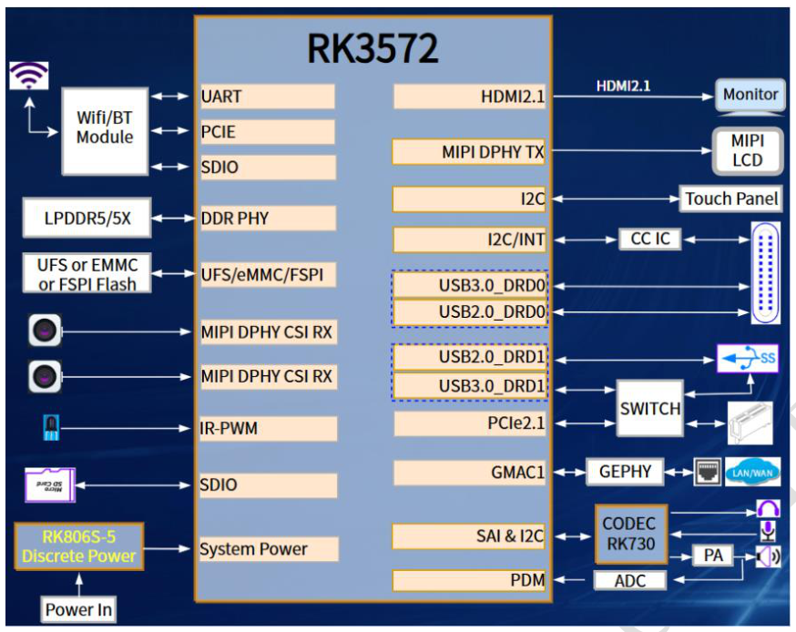
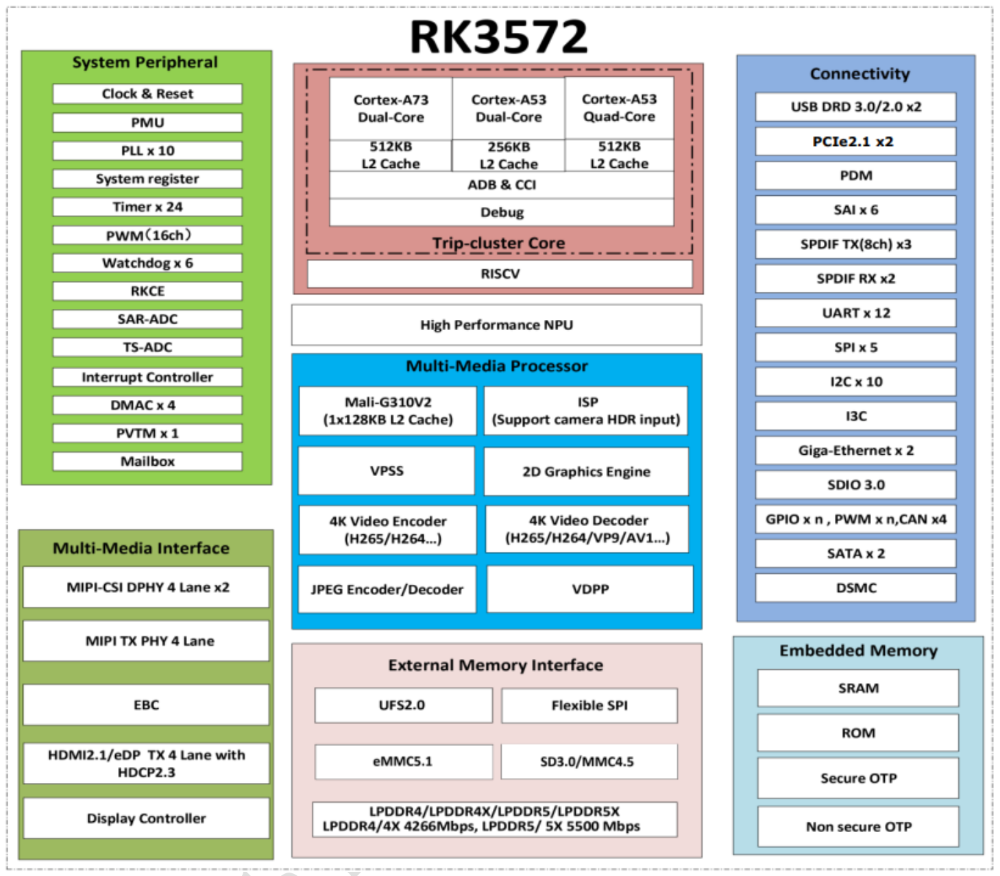

## Область применения

Материал предназначен для проектирования плат RK3572 и оценки проекта ArmSoM Zero5. Основа — Hardware Design Guide V1.1 и предоставленный комплект аппаратной документации. Интерфейс кристалла не обязательно выведен на плате. Окончательную конфигурацию Zero5, доступные ОС и версии ядра следует сверять с документацией конкретной ревизии изделия. Аппаратные испытания ArmSoM для этой статьи не проводились.

Комплект RK3572 включает datasheet, аппаратное руководство, инструкции EVB, шаблоны DDR, схемы и отчёты испытаний. Причиной переделок нередко становится смешивание ревизий и документов для разных задач. Серия построена вокруг инженерных решений с привязкой каждого интерфейса к его аппаратному контексту.

*Опорная конфигурация RK3572 EVB*

*Функции и интерфейсы RK3572*

## Сначала выберите подходящую опорную схему

| Документ | Назначение | Обработка в этой серии |
|---|---|---|
| RK3572 Datasheet V1.1 | Функции, выводы и электрические пределы | Обновить имеющуюся статью |
| Hardware Design Guide V1.1 CN/EN | Рекомендации по схемам и платам | Разделить по задачам; китайские рисунки для ZH, английские для EN/RU/DE |
| RK3572_AIOT_REF_SCH_V13 | Основа AIoT-платы без батареи | Сверить основную схему и исправление корпуса TMI3255S |
| RK809C-8 + RK805B-8 V14 | Опорный вариант для батарейного питания | Проверить Adapter/Type-C и HUSB311 |
| EVB1 / EVB2 / EVB3 | Работа интерфейсов и функции | Не считать актуальной серийной схемой |
| NVR / E-ink DEMO | Демонстрации отдельных приложений | Сохранить ограничения обновления и standby |

В примечаниях указано, что EVB1 больше не обновляется и не рекомендуется напрямую как основа серийной платы. У NVR есть ограничения актуальности и standby; E-ink DEMO также не заменяет полноценную малопотребляющую схему. Сначала выбирают питание, затем DDR-шаблон с прошивкой и после этого распределяют общие интерфейсы.

## Шесть этапов от требований до первой платы

1. Составьте матрицу функций с контроллером, PHY, MUX, доменом питания и разъёмом для каждого дисплея, камеры, USB, PCIe, SATA и GPIO.
2. Обеспечьте контроль основного такта, сброса, загрузочного ADC, UART0 и прошивки USB DRD0.
3. Ведите DRAM, ёмкость, rank, PCB-шаблон, ADC Config и DDRBIN как одну конфигурацию.
4. Совместно проверьте напряжения, последовательность включения, сохраняемые питания и источники пробуждения.
5. До изготовления проверьте импеданс, задержки, опорные плоскости, возвратные переходы, разъёмы и ESD.
6. На первой плате начните с питания и загрузки, затем памяти, накопителей и отдельных интерфейсов; совместную нагрузку и resume проверяйте последними.

## Что подтверждает отчёт испытаний

Отчёт помогает определить проверки и условия измерений, но результаты относятся к испытанным EVB, прошивке и среде. Изменение стека слоёв, DRAM, PMIC, разъёмов, кабелей или корпуса требует повторной проверки затронутых пунктов. Этот порядок — инженерная рекомендация, а не утверждение о прохождении тестов ArmSoM Zero5.

## Охват этой серии

Выпуск добавляет девять тем: вводный маршрут, минимальная система, питание, DDR, DDRBIN, накопители, USB, PCIe/SATA, дисплеи и камеры; обновлены datasheet и статьи RK730. Полный постраничный перевод разделов аудио, GMAC, низкоскоростных I/O, EMC, производства и пайки здесь не заявляется: это отдельные последующие темы.

## Продукты ArmSoM и следующие шаги

Для компактного изделия на RK3572 начните с плана ArmSoM в форм-факторе Zero и составьте список необходимых интерфейсов дисплея, накопителей, сети и питания. План не является спецификацией выпущенной модели или окончательной схемой. Для выбора доступной платформы и проверки интерфейсов используйте официальный каталог и Docs.

- [План RK3572 / ArmSoM Zero](/ru/articles/rockchip-rk3572-armsom-zero-preview/)
- [ArmSoM](https://www.armsom.org/category/all-products) · [ArmSoM Docs](https://docs.armsom.org/)

## Порядок чтения серии

- [RK3572 Datasheet V1.1: характеристики, интерфейсы и изменения](/ru/articles/rk3572-datasheet-v10/)
- [Проектирование RK3572: от выбора документации до проверки первой платы](/ru/articles/rk3572-hardware-design-series/)
- [Минимальная система RK3572: 24 МГц, сброс, загрузка и UART](/ru/articles/rk3572-minimum-system-bringup/)
- [Питание RK3572: домены, RK806-5 и варианты с двумя PMIC](/ru/articles/rk3572-power-domains-pmic/)
- [DDR для RK3572: схемы LPDDR4X/LPDDR5 и требования к плате](/ru/articles/rk3572-ddr-circuit-pcb/)
- [Настройка RK3572 DDRBIN: шаблоны, выбор по ADC и несколько профилей](/ru/articles/rk3572-ddrbin-adc-configuration/)
- [Накопители и загрузка RK3572: подключения и питание eMMC, UFS и FSPI](/ru/articles/rk3572-storage-boot-design/)
- [USB и Type-C RK3572: прошивка, роли и обнаружение питания](/ru/articles/rk3572-usb-typec-power-design/)
- [PCIe и SATA RK3572: мультиплексирование Combo PHY, тактирование и трассировка](/ru/articles/rk3572-high-speed-interface-design/)
- [Дисплеи и камеры RK3572: HDMI, eDP, MIPI и согласование уровней](/ru/articles/rk3572-display-camera-design/)
