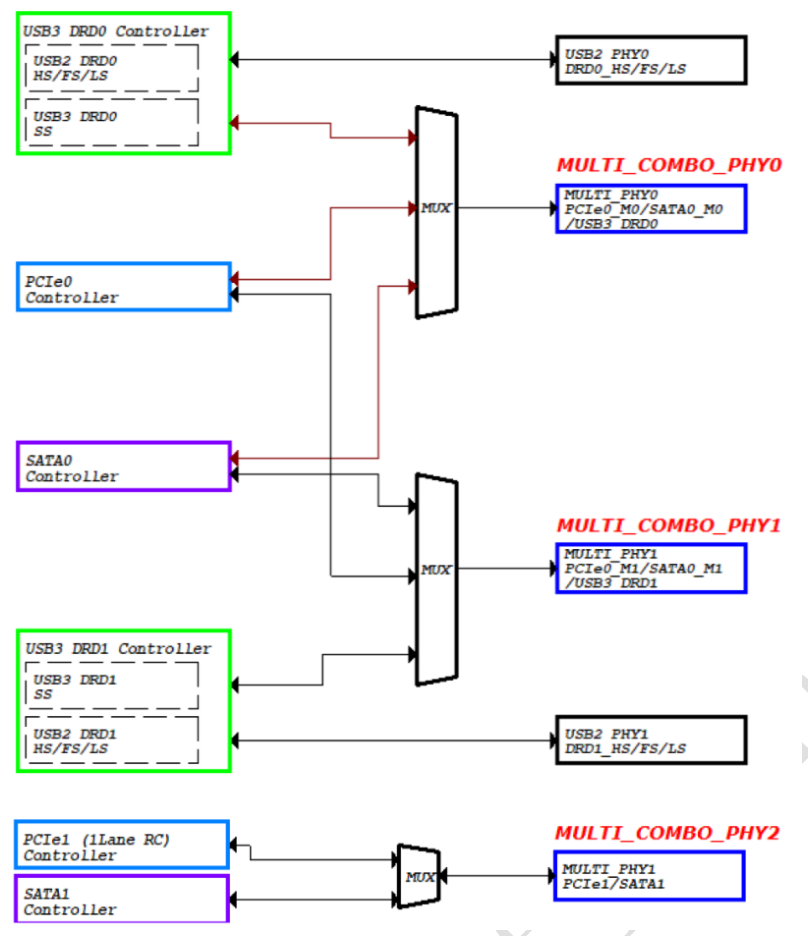
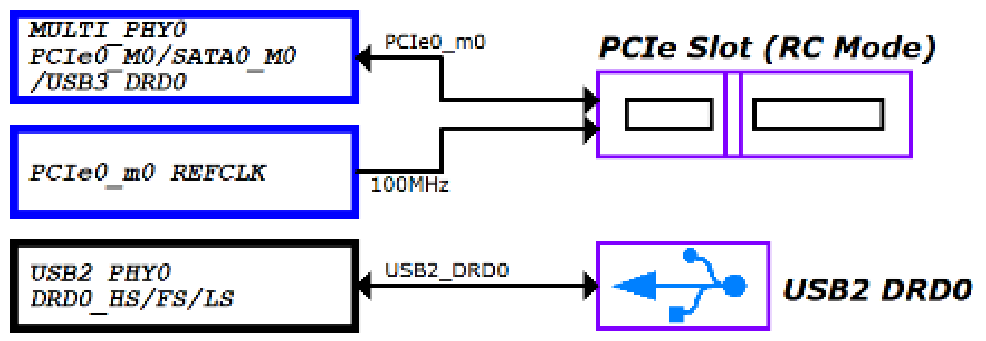
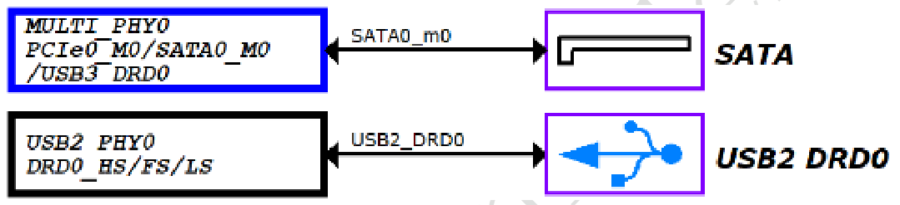
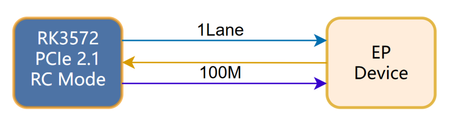
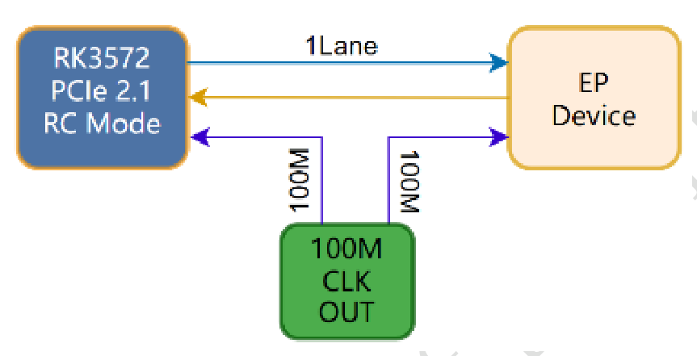
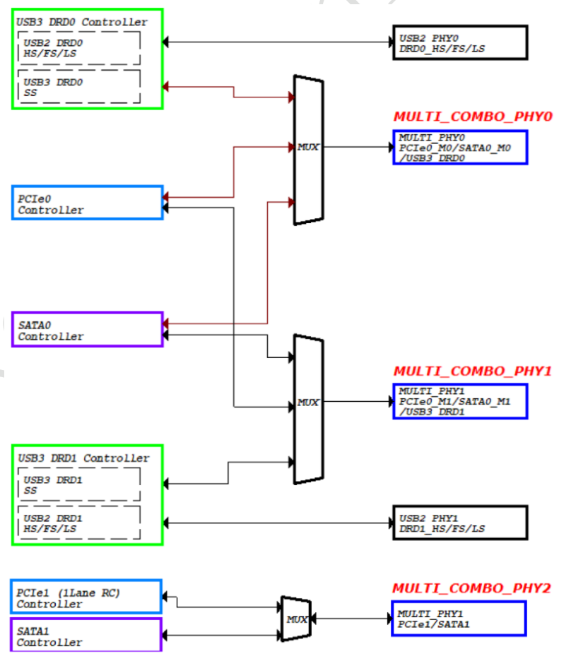

## Область применения

Материал предназначен для проектирования плат RK3572 и оценки проекта ArmSoM Zero5. Основа — Hardware Design Guide V1.1 и предоставленный комплект аппаратной документации. Интерфейс кристалла не обязательно выведен на плате. Окончательную конфигурацию Zero5, доступные ОС и версии ядра следует сверять с документацией конкретной ревизии изделия. Аппаратные испытания ArmSoM для этой статьи не проводились.

Для SSD, SATA и быстрой периферии RK3572 начните с карты контроллер–PHY, а не числа разъёмов. Три Combo PHY не означают три независимых PCIe плюс три SATA. M0/M1 одного контроллера не являются двумя одновременно работающими портами.

## 1. Сначала определите количество и мультиплексирование

| PHY | Выбираемые функции |
|---|---|
| Combo PHY0 | PCIe0_M0 / SATA0_M0 / USB3_DRD0 |
| Combo PHY1 | PCIe0_M1 / SATA0_M1 / USB3_DRD1 |
| Combo PHY2 | PCIe1 / SATA1 |

*Соответствие PCIe-контроллеров и PHY*

Руководство V1.1 явно указывает два PCIe 2.1 x1, только RC без EP, и два SATA-контроллера. Datasheet V1.1 перечисляет две группы PCIe/SATA/USB и одну PCIe/SATA — три мультиплексируемых PHY. Контроллеры и PHY являются разными ресурсами. Нельзя складывать варианты MUX и заявлять три независимых PCIe/SATA; выведенные интерфейсы определяются платой.

*Опорная комбинация USB2 и PCIe0*

*Опорная комбинация USB2 и SATA0*

## 2. Опорный такт PCIe и служебные сигналы

PCIE0/1_REFCLKP/N поддерживает вход и выход, по умолчанию выдаёт такт внешнему EP. Определите источник 100 MHz; оба конца нельзя делать выходами. TX требует 100 nF, желательно 0201; RX и REFCLK — прямое соединение. Инверсия TXP/TXN поддерживается протоколом, но не разрешает произвольную перестановку тактов, линий и управления.

*Опорный такт как выход*

*Опорный такт как вход*

| Параметр | Требование |
|---|---|
| CLKREQN | Нужен функциональный вывод, не обычный GPIO |
| PERSTN / WAKEN / PRSNT | Допустимы GPIO подходящего уровня; проверить направление и стартовое состояние |
| CLKREQN M0 / M1 / M2 / M3 | VCCIO4 / VCCIO3 / VCCIO2 / VCCIO6 |
| Уровень управления стандартного слота | 3.3 V |

## 3. SATA, горячее подключение и PM

*SATA-контроллеры и Combo PHY*

SATA поддерживает 1.5/3/6 Gbit/s и eSATA. Port Multiplier допускает до пяти устройств на порт с общей полосой, а не новые контроллеры. И TX, и RX SATA требуют 10 nF, желательно 0201; не переносите 100 nF из PCIe. Защиту eSATA размещайте у разъёма, ёмкость не более 0.4 pF.

SATA0_ACTLED и SATA1_ACTLED показывают активность, варианты выводов относятся к VCCIO4/VCCIO6. CPDET, MPSWIT и CPPOD — общие ресурсы, назначаемые контроллеру регистрами. Два hot-plug-разъёма не могут независимо использовать один ресурс. Согласуйте силовые ключи, порядок подключения и поддержку ОС.

## 4. Импеданс, длины и защита PCB

| Параметр | PCIe | SATA |
|---|---|---|
| Дифференциальный импеданс | 85 Ω ±10%; REFCLK 100 Ω ±10% | 100 Ω ±10% |
| Перекос внутри пары | <1 ps / 6 mil | <1 ps / 6 mil |
| Длина | <6 in | <6 in |
| Сигнальные vias | ≤2 | ≤2 |
| Развязка AC | TX 100 nF ±20% | TX/RX 10 nF ±20% |
| Зазор между парами | ≥4W | ≥4W |

Перекос опорного такта PCIe отдельно проверяют по пределу менее 12 mil. Между парами данных и другими сигналами желательно 5W, минимум 4W. Для SATA предпочтительны 100 Ω; пониженная цель из руководства требует оценки стека и моделирования. Допуск не отменяет контроль импеданса. При смене слоя сохраняйте возврат и не пересекайте разрывы плоскостей.

## 5. Неиспользуемые интерфейсы и запуск

Для неиспользуемого PCIe руководство описывает неподключённые линии, питание и DTS disable. Сначала проверьте, не занят ли общий PHY USB или SATA: отключение PCIe не позволяет заземлять питание работающей функции. При запуске проверьте питание, REFCLK, PERSTN, PHY, затем скорость, ширину, ошибки и длительный I/O. Отдельно проверяйте resume и перезапуск периферии по питанию.

## Продукты ArmSoM и следующие шаги

Для компактного изделия на RK3572 начните с плана ArmSoM в форм-факторе Zero и составьте список необходимых интерфейсов дисплея, накопителей, сети и питания. План не является спецификацией выпущенной модели или окончательной схемой. Для выбора доступной платформы и проверки интерфейсов используйте официальный каталог и Docs.

- [План RK3572 / ArmSoM Zero](/ru/articles/rockchip-rk3572-armsom-zero-preview/)
- [ArmSoM](https://www.armsom.org/category/all-products) · [ArmSoM Docs](https://docs.armsom.org/)

## Порядок чтения серии

- [RK3572 Datasheet V1.1: характеристики, интерфейсы и изменения](/ru/articles/rk3572-datasheet-v10/)
- [Проектирование RK3572: от выбора документации до проверки первой платы](/ru/articles/rk3572-hardware-design-series/)
- [Минимальная система RK3572: 24 МГц, сброс, загрузка и UART](/ru/articles/rk3572-minimum-system-bringup/)
- [Питание RK3572: домены, RK806-5 и варианты с двумя PMIC](/ru/articles/rk3572-power-domains-pmic/)
- [DDR для RK3572: схемы LPDDR4X/LPDDR5 и требования к плате](/ru/articles/rk3572-ddr-circuit-pcb/)
- [Настройка RK3572 DDRBIN: шаблоны, выбор по ADC и несколько профилей](/ru/articles/rk3572-ddrbin-adc-configuration/)
- [Накопители и загрузка RK3572: подключения и питание eMMC, UFS и FSPI](/ru/articles/rk3572-storage-boot-design/)
- [USB и Type-C RK3572: прошивка, роли и обнаружение питания](/ru/articles/rk3572-usb-typec-power-design/)
- [PCIe и SATA RK3572: мультиплексирование Combo PHY, тактирование и трассировка](/ru/articles/rk3572-high-speed-interface-design/)
- [Дисплеи и камеры RK3572: HDMI, eDP, MIPI и согласование уровней](/ru/articles/rk3572-display-camera-design/)
