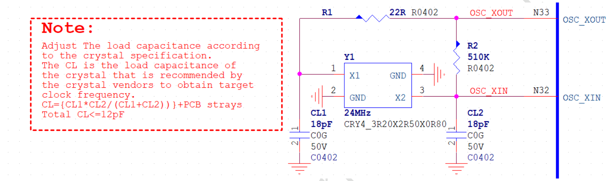
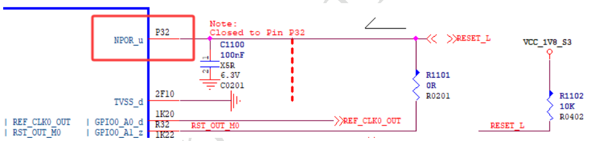
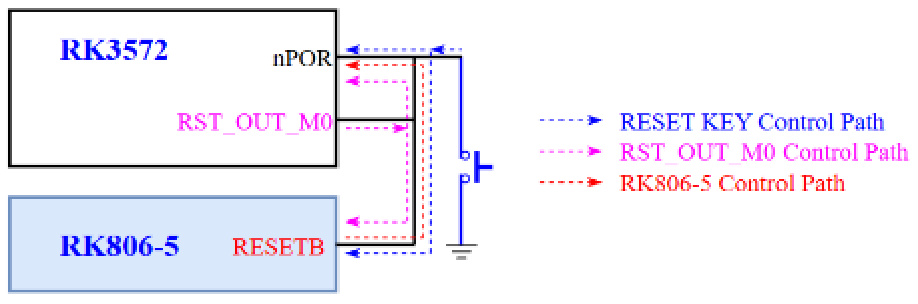
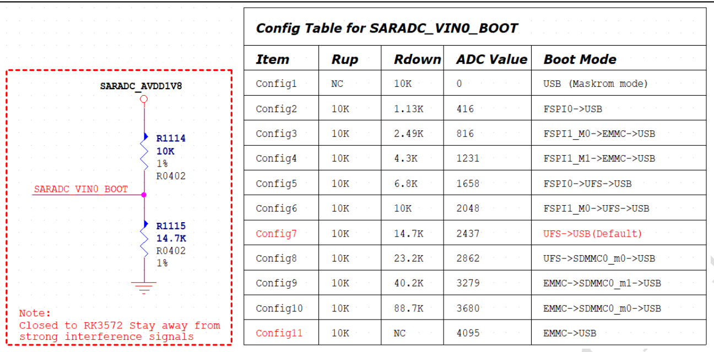

## Область применения

Материал предназначен для проектирования плат RK3572 и оценки проекта ArmSoM Zero5. Основа — Hardware Design Guide V1.1 и предоставленный комплект аппаратной документации. Интерфейс кристалла не обязательно выведен на плате. Окончательную конфигурацию Zero5, доступные ОС и версии ядра следует сверять с документацией конкретной ревизии изделия. Аппаратные испытания ArmSoM для этой статьи не проводились.

Если первая плата RK3572 не выводит сообщения UART, сначала проверьте питание, основной такт, сброс и выбор загрузки, затем DDR и образ ОС. Сохраните UART0, USB DRD0 и принудительный вход в Maskrom: они нужны и при повреждении загрузочного накопителя.

## 1. Основной такт 24 MHz и нагрузочные ёмкости

*Опорная схема кварца 24 MHz*

| Проверка | Требование |
|---|---|
| Crystal | 24 MHz; CL ≤12 pF; ±20 ppm |
| XOUT | 22 Ω |
| Обратная связь | 510 kΩ |
| Опорные нагрузочные конденсаторы | 18 pF; уточнить по CL и паразитным ёмкостям, предпочтительно C0G/NP0 |

18 pF — значение опорной схемы, а не универсальная ёмкость для любого кварца 24 MHz. Заземлите соответствующие площадки четырёхконтактного кварца; разместите его и конденсаторы возле SoC, вдали от преобразователей и быстрых линий. При измерении учитывайте ёмкость щупа: вызванная им остановка генератора не доказывает неисправность SoC.

## 2. 32.768 kHz, тактовые выходы и ожидание

Внешний RTC-такт: 32.768 kHz, ±30 ppm, заполнение 45%–55%; высокий уровень — от 0.7 напряжения PMUIO0 до самого напряжения питания. Настройте IOMUX CLK32K_IN и отключите внутреннюю подтяжку вниз при источнике с открытым стоком. Выбор PMU_PVTM или внешнего низкочастотного такта согласуйте с сохраняемыми доменами питания.

| Выход | Частоты по руководству |
|---|---|
| REF_CLK0 / REF_CLK1 / REF_CLK2 | 10, 12, 20, 24, 25, 26, 27, 37.125, 40, 50, 58.5, 74.25, 100 MHz |
| ETH0_CLK25M / ETH1_CLK25M | 25 MHz |
| CAM_CLK0 / CAM_CLK1 / CAM_CLK2 | 24 MHz; 27 / 37.125 / 74.25 MHz |
| CLK0_32K_OUT / CLK1_32K_OUT | Зависят от генератора 24 MHz и останавливаются при его отключении |

## 3. Длительность сброса и задержка после питания различаются

*Схема сброса RK3572*

NPOR_u расположен на P32 и активен низким уровнем. Требуется минимум 100 периодов 24 MHz, приблизительно обозначенных как 4 µs. Фактически это около 4.17 µs; ориентируйтесь на число периодов с запасом. После стабилизации последнего питания удерживайте сброс не менее 1 ms; опорный диапазон — 5–200 ms. Это разные временные требования.

RESET_L подтягивается к PMUIO0_VCC1V8; опорный конденсатор — 100 nF. Для внешнего watchdog предпочтителен открытый сток, исключающий конфликт с двунаправленным RESETB PMIC. Термозащита использует TSADC, RST_OUT и цепь сброса; не превращайте этот путь в обычный отладочный GPIO.

*Цепи сброса и термозащиты*

## 4. Выбор загрузки по ADC и восстановление

SARADC_IN0_BOOT выбирает порядок загрузки; низкий уровень включает USB Maskrom. Кнопка на SARADC_IN1 предназначена для Recovery. Используйте делитель с точностью 1% рядом с SoC. Эта таблица загрузки не заменяет таблицу ADC Config для DDRBIN.

| Config | Rup | Rdown | ADC | Порядок загрузки |
|---|---|---|---|---|
| 1 | NC | 10 kΩ | 0 | USB (Maskrom) |
| 2 | 10 kΩ | 1.13 kΩ | 416 | FSPI0 → USB |
| 3 | 10 kΩ | 2.49 kΩ | 816 | FSPI1_M0 → EMMC → USB |
| 4 | 10 kΩ | 4.3 kΩ | 1231 | FSPI1_M1 → EMMC → USB |
| 5 | 10 kΩ | 6.8 kΩ | 1658 | FSPI0 → UFS → USB |
| 6 | 10 kΩ | 10 kΩ | 2048 | FSPI1_M0 → UFS → USB |
| 7 | 10 kΩ | 14.7 kΩ | 2437 | UFS → USB |
| 8 | 10 kΩ | 23.2 kΩ | 2862 | UFS → SDMMC0_m0 → USB |
| 9 | 10 kΩ | 40.2 kΩ | 3279 | EMMC → SDMMC0_m1 → USB |
| 10 | 10 kΩ | 88.7 kΩ | 3680 | EMMC → SDMMC0_m0 → USB |
| 11 | 10 kΩ | NC | 4095 | EMMC → USB |

*Резисторы загрузочного ADC*

BootROM не загружается непосредственно с PCIe SSD. Для ОС на SSD сначала нужен загрузчик из поддерживаемого носителя, например SPI Flash, затем инициализация PCIe. Размещение ОС на SSD не означает поддержку PCIe в BootROM.

## 5. UART, JTAG и проверка первой платы

UART0 M0 по умолчанию работает на 1500000 бод. JTAG M0 совмещён с SDMMC0. SDMMC0_DETN_M0 (T33) считывается при запуске, имеет внутреннюю подтяжку вверх и опорный конденсатор 1 nF: высокий уровень выбирает JTAG, низкий — SD; затем действует IOMUX. JTAG M1 совмещён с UART0 M0: U33 — TX/TCK, V32 — RX/TMS. Предусмотрите 100 Ω и TVS, разъём 2.54 mm либо площадки диаметром не менее 0.7 mm, соблюдая уровни домена I/O.

Порядок проверки: короткие замыкания → последовательность питания → 24 MHz → снятие RESET_L → обнаружение Maskrom → DDR → загрузочный носитель → журнал ядра. Сохраняйте осциллограммы, UART-журналы и версии прошивки. Меняйте по одному параметру, чтобы разделять проблемы питания, обучения памяти и ПО.

## Продукты ArmSoM и следующие шаги

Для компактного изделия на RK3572 начните с плана ArmSoM в форм-факторе Zero и составьте список необходимых интерфейсов дисплея, накопителей, сети и питания. План не является спецификацией выпущенной модели или окончательной схемой. Для выбора доступной платформы и проверки интерфейсов используйте официальный каталог и Docs.

- [План RK3572 / ArmSoM Zero](/ru/articles/rockchip-rk3572-armsom-zero-preview/)
- [ArmSoM](https://www.armsom.org/category/all-products) · [ArmSoM Docs](https://docs.armsom.org/)

## Порядок чтения серии

- [RK3572 Datasheet V1.1: характеристики, интерфейсы и изменения](/ru/articles/rk3572-datasheet-v10/)
- [Проектирование RK3572: от выбора документации до проверки первой платы](/ru/articles/rk3572-hardware-design-series/)
- [Минимальная система RK3572: 24 МГц, сброс, загрузка и UART](/ru/articles/rk3572-minimum-system-bringup/)
- [Питание RK3572: домены, RK806-5 и варианты с двумя PMIC](/ru/articles/rk3572-power-domains-pmic/)
- [DDR для RK3572: схемы LPDDR4X/LPDDR5 и требования к плате](/ru/articles/rk3572-ddr-circuit-pcb/)
- [Настройка RK3572 DDRBIN: шаблоны, выбор по ADC и несколько профилей](/ru/articles/rk3572-ddrbin-adc-configuration/)
- [Накопители и загрузка RK3572: подключения и питание eMMC, UFS и FSPI](/ru/articles/rk3572-storage-boot-design/)
- [USB и Type-C RK3572: прошивка, роли и обнаружение питания](/ru/articles/rk3572-usb-typec-power-design/)
- [PCIe и SATA RK3572: мультиплексирование Combo PHY, тактирование и трассировка](/ru/articles/rk3572-high-speed-interface-design/)
- [Дисплеи и камеры RK3572: HDMI, eDP, MIPI и согласование уровней](/ru/articles/rk3572-display-camera-design/)
