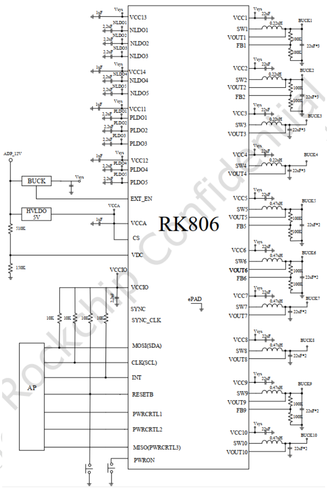
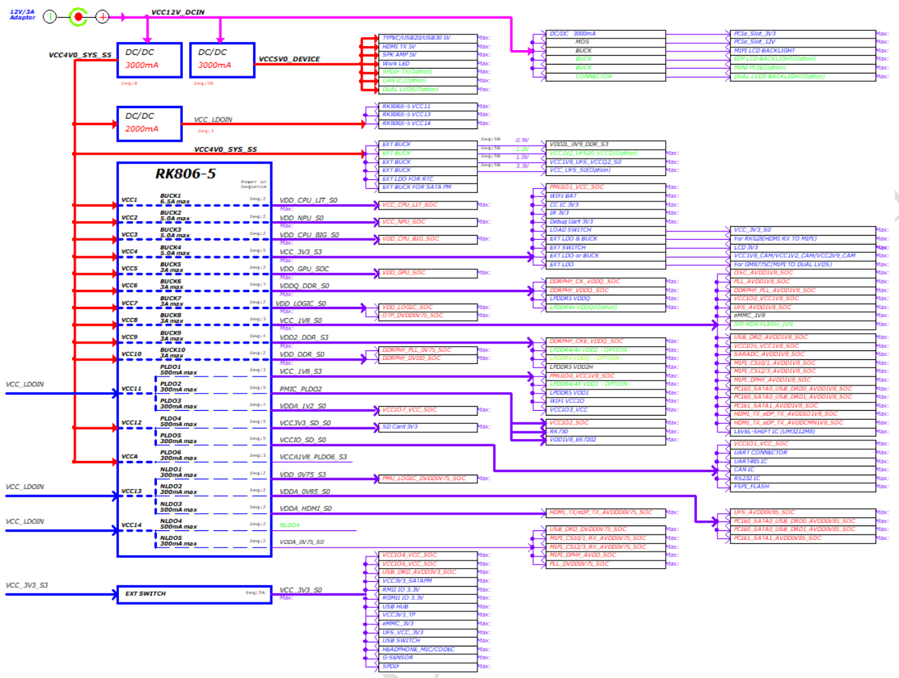

## Область применения

Материал предназначен для проектирования плат RK3572 и оценки проекта ArmSoM Zero5. Основа — Hardware Design Guide V1.1 и предоставленный комплект аппаратной документации. Интерфейс кристалла не обязательно выведен на плате. Окончательную конфигурацию Zero5, доступные ОС и версии ядра следует сверять с документацией конкретной ревизии изделия. Аппаратные испытания ArmSoM для этой статьи не проводились.

Питание RK3572 — это не только соединение шин нужного напряжения: важны порядок доменов, динамические нагрузки, удержание DDR, пробуждение и обратное питание через периферию. Схемы RK806-5 и RK809C-8 + RK805B-8 нельзя заменять друг другом только по числу выходов.

## 1. Выберите опорную архитектуру

Комплект рекомендует RK806-5/RK806S-5 для обычных AIoT-устройств без батареи, а RK809C-8 + RK805B-8 — для батарейных. Соответствующие варианты -5 представлены как совместимые, однако нужно сверять производителя, входное питание и OTP. RK806-2 не является прямой заменой RK806-5. Базовое имя RK806 не определяет последовательность включения.

*Типовое подключение RK806*

## 2. Дерево питания и последовательности интерфейсов

*Дерево питания RK3572*

| Блок | Локальная последовательность |
|---|---|
| UFS | 0.85 V → 1.8 V |
| USB | 0.75 V → 1.8 V → 3.3 V |
| MIPI / HDMI / eDP | 0.75 V → 1.8 V |
| PCIe / SATA / USB Combo PHY | 0.85 V → 1.8 V |
| DDR PHY | DVDD → VDDQH → VDDQ / CKVDDQ |

Локальные последовательности — лишь часть дерева питания. В опорной схеме сначала включаются ядра, затем 1.8 V, DDR VDD2/1.2 V, часть шин 3.3 V и SD, DDR 0.9 V и рабочие 3.3 V, DDRPHY_VDDQ, после чего снимается RESET_L. Суффиксы S0/S3 описывают состояния опорной схемы и не определяют автоматически ожидание на другой плате.

## 3. Источник пробуждения определяет сохраняемое питание

| Сценарий | Условия удержания |
|---|---|
| Опорный режим минимального потребления | DDRPHY_VDDQH + PMU_LOGIC + PMUIO0/1 |
| USB HID | OSC + USB2 PHY |
| Пробуждение USB 4G | OSC + PLL + LOGIC + USB |
| Голос / GMAC | OSC + PLL + LOGIC |
| CEC | OSC + LOGIC |
| IR / PWM | OSC; PWM из домена PMU |
| Другие GPIO | OSC + LOGIC + соответствующий VCCIO |

Это перечисленные в руководстве условия пробуждения; добавьте требования DDR, PMIC и периферии. Настройте удержание GPIO до отключения LOGIC. Если периферия остаётся включённой при обесточенном I/O SoC, проверьте обратное питание и подтяжки. Проверяйте suspend/resume по току, напряжениям доменов, источнику пробуждения и журналам.

## 4. Управление RK806, кнопки и входное питание

| Проверка | Требование |
|---|---|
| VCCA | Включать первым либо одновременно с другими входами |
| I2C | CS → VCCA; SDA/SCL: 2.2 kΩ → PMUIO0 |
| RESETB | 100 nF; суммарно ≤0.3 µF |
| PWRON | 45 kΩ внутренняя подтяжка; 20 ms низкого уровня запускают питание |
| VDC | Порог около 0.8 V; рекомендуется >1 V, не выше VCCA |

Отделяйте диапазон RK806 от рекомендации для платы: указан рабочий диапазон 2.7–5.5 V, но обычная опорная схема RK806 рекомендует 4 V. Проверяйте и конкретный RK806S. Длительное нажатие для выключения настраивается на 6/8/10/12 s. Постоянно высокий VDC влияет на аппаратное выключение; согласуйте его с кнопками и автозапуском.

## 5. Дроссели, конденсаторы и динамическая нагрузка

| Buck | Iout max | Cin / Cout | L | Isat | DCR |
|---|---|---|---|---|---|
| 1 | 6.5 A | 22 / 66 µF | 0.24 µH | ≥7.8 A | <15 mΩ |
| 2–4 | 5 A | 22 / 66 µF | 0.24 µH | ≥6.5 A | <20 mΩ |
| 5–10 | 3 A | 10 / 44 µF | 0.47 µH | ≥4 A | <40 mΩ |

Это условия выбора компонентов, а не слагаемые мощности RK3572. Проверьте нагрев и насыщение дросселей, а ёмкость керамики — с учётом постоянного смещения. На выходе LDO нужно не менее 2.2 µF. Вход PLDO должен быть минимум на 0.2 V выше выхода и не ниже 2 V. NLDO также требует 0.2 V запаса, а его выход ограничен VCCA − 1.5 V.

## 6. Обнаружение Type-C в двух-PMIC V1.4

Двух-PMIC V1.4 от 2026-10-12 добавляет HUSB311 для случая, когда адаптер и Type-C используют общий VDC RK809C (вывод 61). По описанию изменений HUSB311 — основной вариант, альтернативные компоненты GPIO не устанавливаются. Контроль уровня GPIO не реализует полный USB PD. При переносе старой схемы совместно проверьте CC, VDC, подключение, отключение и выключение.

## 7. Проверки до изготовления и на первой плате

Зафиксируйте полный суффикс PMIC, OTP, источник питания, напряжения и бюджет тока. Проверьте GPIO по умолчанию, обратное питание, RESET_L и DDR. Измерьте холодный запуск, перезапуск, длительное нажатие и подключение питания. Нагрузку CPU, NPU, DDR и периферии сочетайте; осциллографом проверяйте минимумы и пульсации, а не только среднее по мультиметру.

## Продукты ArmSoM и следующие шаги

Для компактного изделия на RK3572 начните с плана ArmSoM в форм-факторе Zero и составьте список необходимых интерфейсов дисплея, накопителей, сети и питания. План не является спецификацией выпущенной модели или окончательной схемой. Для выбора доступной платформы и проверки интерфейсов используйте официальный каталог и Docs.

- [План RK3572 / ArmSoM Zero](/ru/articles/rockchip-rk3572-armsom-zero-preview/)
- [ArmSoM](https://www.armsom.org/category/all-products) · [ArmSoM Docs](https://docs.armsom.org/)

## Порядок чтения серии

- [RK3572 Datasheet V1.1: характеристики, интерфейсы и изменения](/ru/articles/rk3572-datasheet-v10/)
- [Проектирование RK3572: от выбора документации до проверки первой платы](/ru/articles/rk3572-hardware-design-series/)
- [Минимальная система RK3572: 24 МГц, сброс, загрузка и UART](/ru/articles/rk3572-minimum-system-bringup/)
- [Питание RK3572: домены, RK806-5 и варианты с двумя PMIC](/ru/articles/rk3572-power-domains-pmic/)
- [DDR для RK3572: схемы LPDDR4X/LPDDR5 и требования к плате](/ru/articles/rk3572-ddr-circuit-pcb/)
- [Настройка RK3572 DDRBIN: шаблоны, выбор по ADC и несколько профилей](/ru/articles/rk3572-ddrbin-adc-configuration/)
- [Накопители и загрузка RK3572: подключения и питание eMMC, UFS и FSPI](/ru/articles/rk3572-storage-boot-design/)
- [USB и Type-C RK3572: прошивка, роли и обнаружение питания](/ru/articles/rk3572-usb-typec-power-design/)
- [PCIe и SATA RK3572: мультиплексирование Combo PHY, тактирование и трассировка](/ru/articles/rk3572-high-speed-interface-design/)
- [Дисплеи и камеры RK3572: HDMI, eDP, MIPI и согласование уровней](/ru/articles/rk3572-display-camera-design/)
