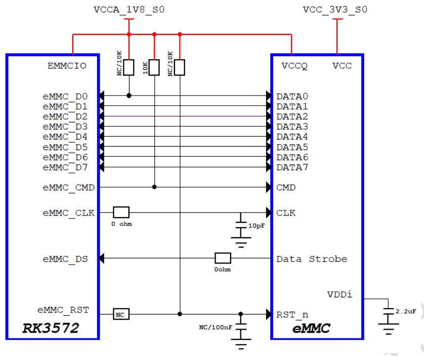
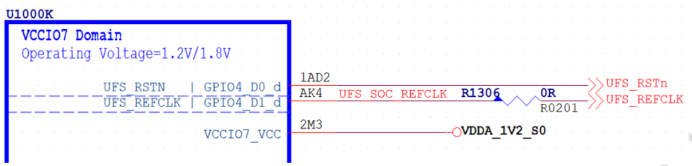
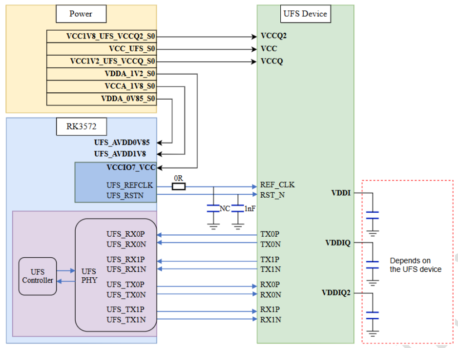
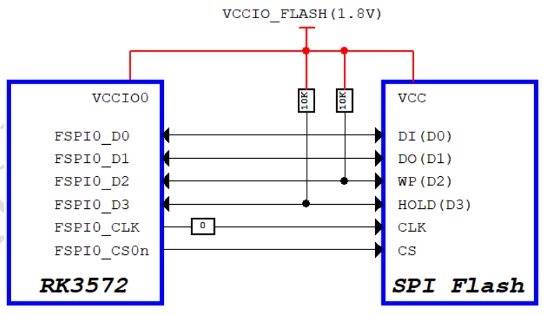
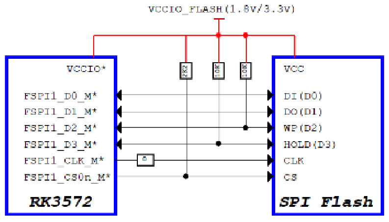

## Область применения

Материал предназначен для проектирования плат RK3572 и оценки проекта ArmSoM Zero5. Основа — Hardware Design Guide V1.1 и предоставленный комплект аппаратной документации. Интерфейс кристалла не обязательно выведен на плате. Окончательную конфигурацию Zero5, доступные ОС и версии ядра следует сверять с документацией конкретной ревизии изделия. Аппаратные испытания ArmSoM для этой статьи не проводились.

При выборе eMMC, UFS или SPI Flash для RK3572 совместно проверьте BootROM, контроллер, уровни I/O, мультиплексирование и PCB. Версия устройства UFS отличается от скорости хоста: более новый накопитель не обновляет контроллер RK3572 UFS 2.0.

## 1. Выбор накопителя

| Параметр | Требование |
|---|---|
| eMMC | eMMC 5.1; HS400 Enhanced Strobe / HS400 / HS200 / DDR50; 1/4/8-bit |
| UFS | Хост UFS 2.0, 2 линии по 5.8 Gbit/s; совместимые устройства ограничены хостом |
| FSPI0 | Совмещён с eMMC; VCCIO0 = 1.8 V |
| FSPI1 | M0 использует VCCIO1, M1 — VCCIO4; согласуйте весь домен |

Поддержка файловой системы в SDK не доказывает прямую загрузку BootROM. Для ОС на PCIe SSD нужен загрузчик из поддерживаемого носителя. Путь определяется ADC и реализацией загрузчика. Сохраните USB DRD0 для прошивки, чтобы обслуживание не зависело только от исправного накопителя.

## 2. eMMC: CMD, D0, CLK и STRB

*Опорное подключение eMMC*

| Параметр | Требование |
|---|---|
| CMD | Внешняя подтяжка 10 kΩ |
| D0 | Предусмотреть 10 kΩ; внутренние подтяжки остальных DQ сверить со схемой |
| CLK | 0 Ω у SoC; место для 10 pF на землю у eMMC |
| STRB | 0 Ω у eMMC; предусмотреть подтяжку 47 kΩ вниз |
| RST_n | В опорной схеме не подключён, сброс по CMD; аппаратный сброс требует проверки подтяжки, 0 Ω и 100 nF |

eMMC и FSPI0 используют общий домен. Поддержка 3.3 V одной Flash не разрешает переводить VCCIO0 на 3.3 V. Ёмкость, HS400 и Enhanced Strobe зависят от микросхемы и BSP. Успех на низкой скорости не подтверждает целевой высокоскоростной режим.

## 3. Совместимость UFS и питание

Руководство описывает UFS 2.0/2.1/2.2/3.0/3.1, но не 4.0. VCCIO7 для RSTN и REFCLK — 1.2 V. Питания PHY 0.85/1.8 V, VCCIO7 SoC и VCC/VCCQ/VCCQ2 накопителя — разные сети, каждую нужно проверить.

| UFS device | VCC | VCCQ | VCCQ2 |
|---|---|---|---|
| 2.0 | 3.3 V | 1.2 V | 1.8 V |
| 2.1 / 2.2 | 3.3 V | — | 1.8 V |
| 3.0 / 3.1 | 2.5 / 3.3 V | 1.2 V | — |

*I/O и питание UFS*

*Опорное подключение UFS*

TX/RX соединяются напрямую. REFCLK имеет 0 Ω у SoC и место для конденсатора у накопителя; RSTN — прямое соединение с резервом 1 nF. Последовательность: UFS 0.85 V → 1.8 V → VCCIO7. VCCQ2/VCCQ включайте по требованиям устройства, VCC — не раньше VCCIO7. Выполняйте также JEDEC и datasheet накопителя. Для неиспользуемого UFS обработайте отдельные питания PHY и узлы ПО по руководству; обесточенное устройство не подходит для проверки линка.

## 4. FSPI: не забывайте подтяжку выбора кристалла

*Четырёхбитная схема FSPI0*

*Четырёхбитная схема FSPI1*

FSPI1 M0 и M1 — варианты выводов одного контроллера, не два контроллера. У CS FSPI0 есть внутренняя подтяжка; CS FSPI1 по умолчанию высокоимпедансный и требует 2.2 kΩ у Flash, включая проверку CS1/RST. При однобитном режиме четырёхбитного интерфейса D2/D3 требуют 10 kΩ по схеме. CLK 0 Ω размещается у SoC, а DQS 0 Ω восьмибитного режима — у Flash.

## 5. PCB и проверка

| Параметр | eMMC | UFS |
|---|---|---|
| Импеданс | 50 Ω ±10% | 100 Ω differential ±10% |
| Перекос | CLK/data <20 ps / 120 mil | Внутри пары <1 ps / 6 mil; между парами <16 ps / 100 mil |
| Длина | <3.5 in | <4 in |
| Сигнальные vias | ≤2 | ≤2 |
| Расстояние возвратного via | ≤30 mil | ≤25 mil |

Для UFS оставьте минимум 4W между парами и 5W до других сигналов; REFCLK экранируйте землёй с шагом vias не более 400 mil. Для eMMC — минимум 2W, возле такта желательно 3W. Сохраняйте идентификацию, согласованный режим, ошибки, длительную нагрузку и восстановление после потери питания. Скорость интерфейса не заменяет измеренную скорость файлов с указанными условиями.

## Продукты ArmSoM и следующие шаги

Для компактного изделия на RK3572 начните с плана ArmSoM в форм-факторе Zero и составьте список необходимых интерфейсов дисплея, накопителей, сети и питания. План не является спецификацией выпущенной модели или окончательной схемой. Для выбора доступной платформы и проверки интерфейсов используйте официальный каталог и Docs.

- [План RK3572 / ArmSoM Zero](/ru/articles/rockchip-rk3572-armsom-zero-preview/)
- [ArmSoM](https://www.armsom.org/category/all-products) · [ArmSoM Docs](https://docs.armsom.org/)

## Порядок чтения серии

- [RK3572 Datasheet V1.1: характеристики, интерфейсы и изменения](/ru/articles/rk3572-datasheet-v10/)
- [Проектирование RK3572: от выбора документации до проверки первой платы](/ru/articles/rk3572-hardware-design-series/)
- [Минимальная система RK3572: 24 МГц, сброс, загрузка и UART](/ru/articles/rk3572-minimum-system-bringup/)
- [Питание RK3572: домены, RK806-5 и варианты с двумя PMIC](/ru/articles/rk3572-power-domains-pmic/)
- [DDR для RK3572: схемы LPDDR4X/LPDDR5 и требования к плате](/ru/articles/rk3572-ddr-circuit-pcb/)
- [Настройка RK3572 DDRBIN: шаблоны, выбор по ADC и несколько профилей](/ru/articles/rk3572-ddrbin-adc-configuration/)
- [Накопители и загрузка RK3572: подключения и питание eMMC, UFS и FSPI](/ru/articles/rk3572-storage-boot-design/)
- [USB и Type-C RK3572: прошивка, роли и обнаружение питания](/ru/articles/rk3572-usb-typec-power-design/)
- [PCIe и SATA RK3572: мультиплексирование Combo PHY, тактирование и трассировка](/ru/articles/rk3572-high-speed-interface-design/)
- [Дисплеи и камеры RK3572: HDMI, eDP, MIPI и согласование уровней](/ru/articles/rk3572-display-camera-design/)
