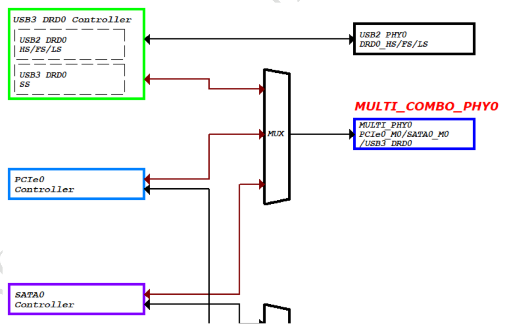
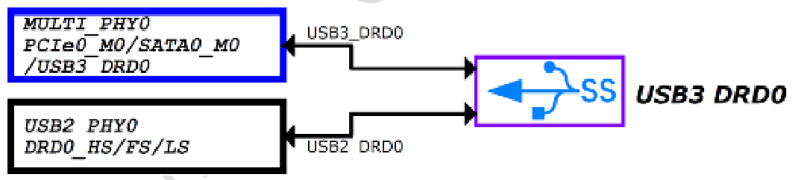
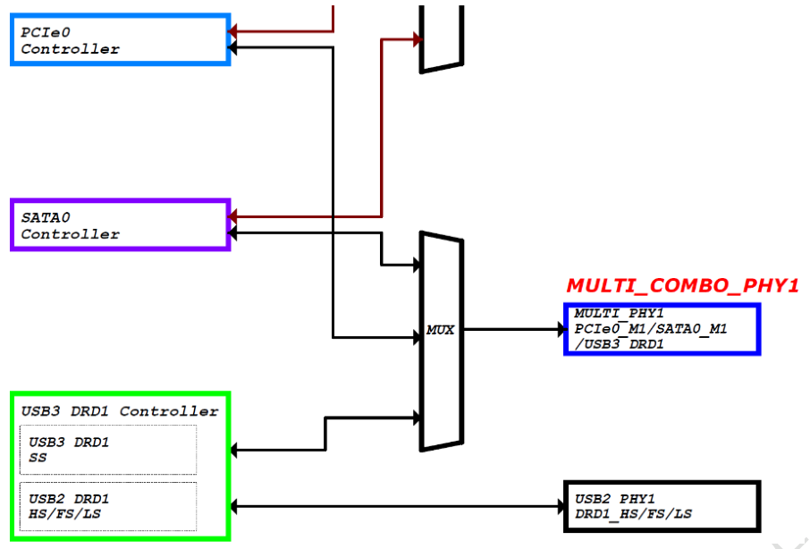
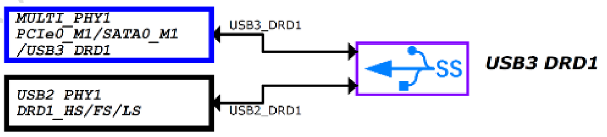
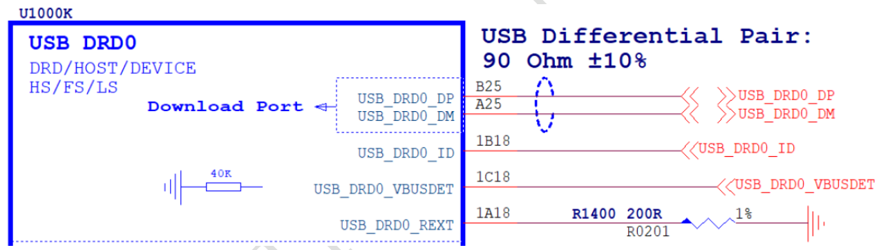
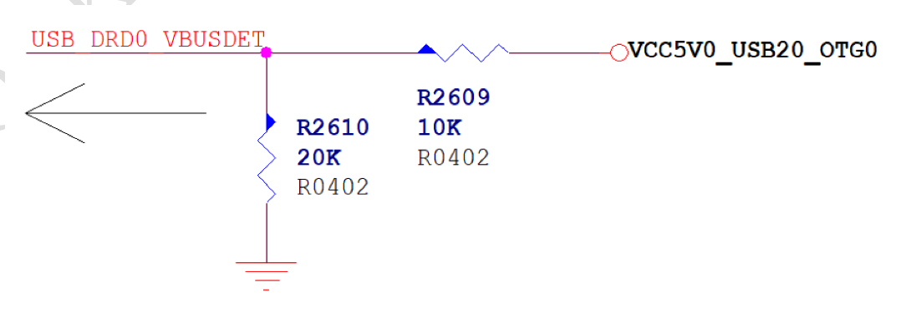
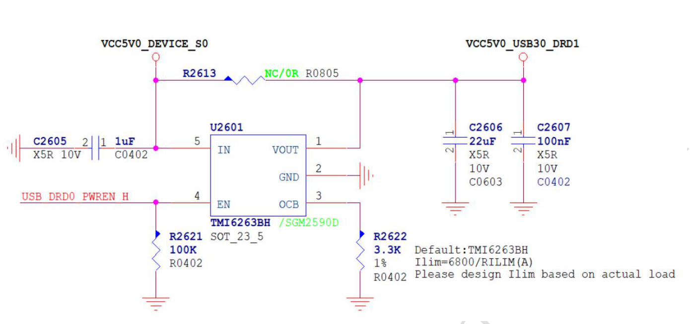
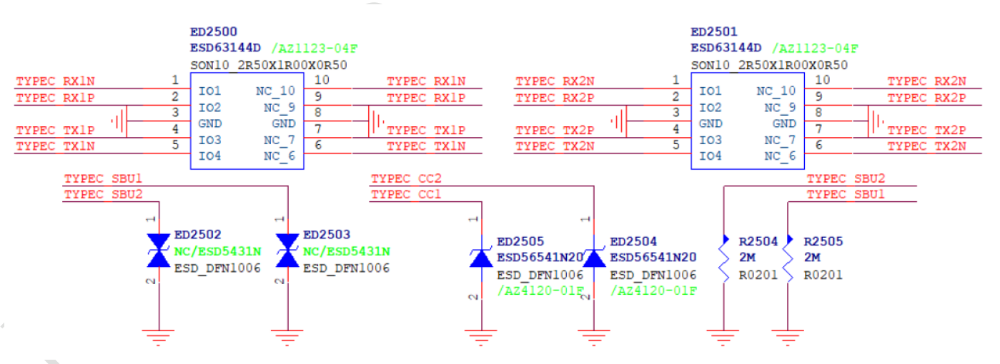

## Область применения

Материал предназначен для проектирования плат RK3572 и оценки проекта ArmSoM Zero5. Основа — Hardware Design Guide V1.1 и предоставленный комплект аппаратной документации. Интерфейс кристалла не обязательно выведен на плате. Окончательную конфигурацию Zero5, доступные ОС и версии ядра следует сверять с документацией конкретной ревизии изделия. Аппаратные испытания ArmSoM для этой статьи не проводились.

USB RK3572 требует согласования роли данных и питания. Type-C — тип разъёма, а не подтверждение DP Alt Mode или USB PD. Сопоставьте DRD, Combo PHY, VBUS, CC и путь прошивки, иначе формально полная схема может не обнаруживать устройство.

## 1. Связь USB3 DRD и Combo PHY

У RK3572 два пути USB3 DRD. USB2 и SuperSpeed одного пути должны иметь общую роль HOST/DEVICE. Combo PHY0 выбирает USB3 DRD0, PCIe0 M0 либо SATA0 M0; PHY1 — USB3 DRD1, PCIe0 M1 либо SATA0 M1. Разные названия не позволяют одновременно использовать один PHY.

*Мультиплексирование Combo PHY0*

*Опорное подключение USB3 DRD0*

*Мультиплексирование Combo PHY1*

*Опорное подключение USB3 DRD1*

## 2. Сохраните путь прошивки

Даже устройству с основной ролью Host нужен сервисный доступ к DRD0 DP/DM, VBUSDET и Maskrom. Опорные схемы допускают USB2 DRD0 вместе с PHY, выбранным для PCIe/SATA, но нужно соблюдать конкретную схему MUX, а не подключать неактивный SuperSpeed. Номера DRD0/DRD1 в схеме и device tree должны совпадать.

*USB2 DRD0 и сервисное подключение*

## 3. VBUSDET, ID и вход 5 V

| Параметр | Требование |
|---|---|
| ID | Внутренняя подтяжка около 12 kΩ к 1.8 V; согласовать уровни и защиту |
| VBUSDET | Внутренняя подтяжка около 40 kΩ вниз; типично 3 V, рекомендуется 2.7–3.3 V; порог >2.3 V |
| DP / DM | Последовательные резисторы 2.2 Ω |
| SuperSpeed TX / RX | TX: 100 nF, 0201; RX: 0 Ω |

*Делитель обнаружения VBUS*

Не подавайте 5 V VBUS прямо на VBUSDET. В расчёт делителя включите внутренние примерно 40 kΩ и допуски, а не только два внешних резистора. Схемы Type-C, Micro-USB и постоянного Host различаются; сначала выберите топологию, затем проверяйте питание и смену ролей.

## 4. Ограничение тока Host и обнаружение CC

*Опорная схема ограничения тока USB Host*

Выход Host 5 V должен проходить через ограничитель тока; уровень управляющего GPIO сверяйте с доменом 3.3 V. Руководство задаёт 22 µF + 100 nF. Большие ёмкости для внешнего диска требуют оценки пускового тока и запаса питания; они не исправляют слабый источник. Двух-PMIC V1.4 применяет HUSB311 для CC и общего VDC адаптера/Type-C; GPIO не заменяет USB PD.

## 5. Совместный выбор ESD и PCB

*Защита интерфейса Type-C*

| Параметр | USB 2.0 | USB 3.x |
|---|---|---|
| Дифференциальный импеданс | 90 Ω ±10% | 90 Ω ±10% |
| Перекос внутри пары | <3 ps / 20 mil | <1 ps / 6 mil |
| Длина | <6 in | <6 in |
| Сигнальные vias | Желательно ≤4, максимум 6 | ≤2 |
| Предел ёмкости защиты здесь | ≤1 pF | ≤0.2 pF |

Раздел схем указывает ESD ≤3 pF для USB2 и ≤0.25 pF для SuperSpeed; PCB-раздел строже: ≤1 pF и ≤0.2 pF. Здесь выбраны строгие значения с сохранением различия. Проверьте S-параметры защиты и потери канала. Для SuperSpeed нужен зазор минимум 4W и непрерывная опорная плоскость.

## 6. Проверяйте не только однократное обнаружение

Проверьте USB2 и SuperSpeed отдельно, обе ориентации, роли, подключение до старта, hot-plug, ограничение при КЗ, resume и Maskrom. Запишите кабель, периферию, BSP и device tree. Если работает только USB2, проверьте PHY, тракт SuperSpeed и ориентацию; если обнаружения нет — VBUSDET, CC/ID, DP/DM и питание.

## Продукты ArmSoM и следующие шаги

Для компактного изделия на RK3572 начните с плана ArmSoM в форм-факторе Zero и составьте список необходимых интерфейсов дисплея, накопителей, сети и питания. План не является спецификацией выпущенной модели или окончательной схемой. Для выбора доступной платформы и проверки интерфейсов используйте официальный каталог и Docs.

- [План RK3572 / ArmSoM Zero](/ru/articles/rockchip-rk3572-armsom-zero-preview/)
- [ArmSoM](https://www.armsom.org/category/all-products) · [ArmSoM Docs](https://docs.armsom.org/)

## Порядок чтения серии

- [RK3572 Datasheet V1.1: характеристики, интерфейсы и изменения](/ru/articles/rk3572-datasheet-v10/)
- [Проектирование RK3572: от выбора документации до проверки первой платы](/ru/articles/rk3572-hardware-design-series/)
- [Минимальная система RK3572: 24 МГц, сброс, загрузка и UART](/ru/articles/rk3572-minimum-system-bringup/)
- [Питание RK3572: домены, RK806-5 и варианты с двумя PMIC](/ru/articles/rk3572-power-domains-pmic/)
- [DDR для RK3572: схемы LPDDR4X/LPDDR5 и требования к плате](/ru/articles/rk3572-ddr-circuit-pcb/)
- [Настройка RK3572 DDRBIN: шаблоны, выбор по ADC и несколько профилей](/ru/articles/rk3572-ddrbin-adc-configuration/)
- [Накопители и загрузка RK3572: подключения и питание eMMC, UFS и FSPI](/ru/articles/rk3572-storage-boot-design/)
- [USB и Type-C RK3572: прошивка, роли и обнаружение питания](/ru/articles/rk3572-usb-typec-power-design/)
- [PCIe и SATA RK3572: мультиплексирование Combo PHY, тактирование и трассировка](/ru/articles/rk3572-high-speed-interface-design/)
- [Дисплеи и камеры RK3572: HDMI, eDP, MIPI и согласование уровней](/ru/articles/rk3572-display-camera-design/)
