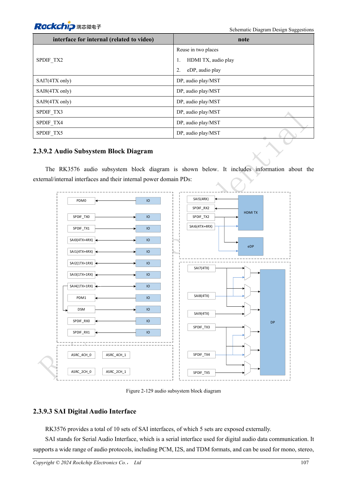
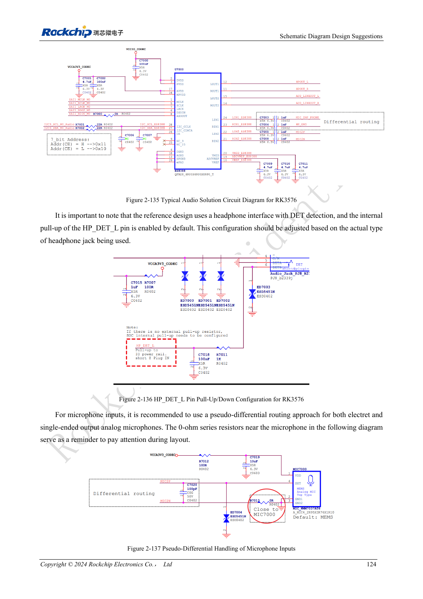

<!-- rk3576-hardware-v11-rest-20261109 -->

# Аудиотракт RK3576: SAI, PDM, ASRC и микрофоны

Основа — китайская и английская версии RK3576 Hardware Design Guide V1.1 (2024-05-28), для плат с SoC. Носители CM5 проектируют по интерфейсу модуля; Sige5 подходит для программной базы сравнения. Единого SDK/BSP или ядра для всех изделий руководство не задаёт: совместимость проверяют для каждой платы. Значения взяты из источника, а не измерены ArmSoM.

**RK3576_Hardware_Design_Guide_V1.1_20240528_EN.pdf** · §2.3.9; Audio PCB

## Разделяйте внутренние и внешние ресурсы

В SoC десять SAI, но наружу выведены пять; также есть две PDM, две внешние группы SPDIF TX/RX и DSM. Остальные связаны с видео. При DSM внешний SAI4 недоступен. Для PCM/I2S/TDM сначала определяют ведущий/ведомый режим, направление такта, слоты и разрядность, затем частоту дискретизации.

## Рассчитайте полосу и асинхронность

Частота на линию определяется IO rate/(slots×width). TDM16 при 32bit/48kHz требует 24.576MHz SCLK, TDM32 — 49.152MHz. Предел 50MHz относится к master TX/RX и slave RX, для slave TX — 25MHz, при соблюдении качества сигналов. Четыре ASRC преобразуют частоты или асинхронные такты, а не добавляют IO.

## Разводка, усилитель и испытания

Такты используют эталонные 22Ω у источника и последовательную топологию для нескольких устройств; два синфазных PDM-такта сокращают ветви. Аналоговые микрофоны ведут псевдодифференциально вдали от DDR, LCD, дросселей и RF. Защиту ставят у разъёмов. Согласуйте codec, enable усилителя и детекцию наушников с ПО. Проверьте воспроизведение, запись, loopback, щелчки и помехи. DSM не заменяет качественный DAC.

## Параметры и проверочная таблица

| Параметр | Значение источника |
| --- | --- |
| Внешние SAI | 5 |
| PDM | 2 groups |
| TDM16: 32bit ×48kHz | 24.576MHz |
| Slave TX SCLK | ≤25MHz |
| ASRC | 8–384kHz |

## Исходные рисунки

Ниже страницы источника со схемами или временными диаграммами; нажмите для полного разрешения. Обозначения и номиналы относятся к эталонной схеме, не к схеме изделия ArmSoM.

Английский оригинал · PDF 126 · 2-129

Английский оригинал · PDF 143 · 2-137

## Разработка с ArmSoM

CM5 уменьшает объём повторной разработки вычислительного ядра; Sige5 подходит для первичной проверки ПО и периферии. Вывод интерфейсов, контакты, уровни и поддержка образа проверяются по документации платы, не по возможностям SoC.

- [ArmSoM CM5](https://www.armsom.org/cm5) · [CM5 Docs](https://docs.armsom.org/armsom-cm5)
- [ArmSoM Sige5](https://www.armsom.org/sige5) · [Sige5 Docs](https://docs.armsom.org/armsom-sige5)

## Читайте далее

- [RK3576: 30 тем аппаратного проектирования](/ru/articles/rk3576-hardware-design-series/)
- [DP/eDP RK3576: распределение PHY, AUX и расхождение ёмкостей](/ru/articles/rk3576-dp-edp-hardware-design/)
- [Ethernet RK3576: задержка RGMII, такт PHY и защита](/ru/articles/rk3576-gmac-hardware-design/)
