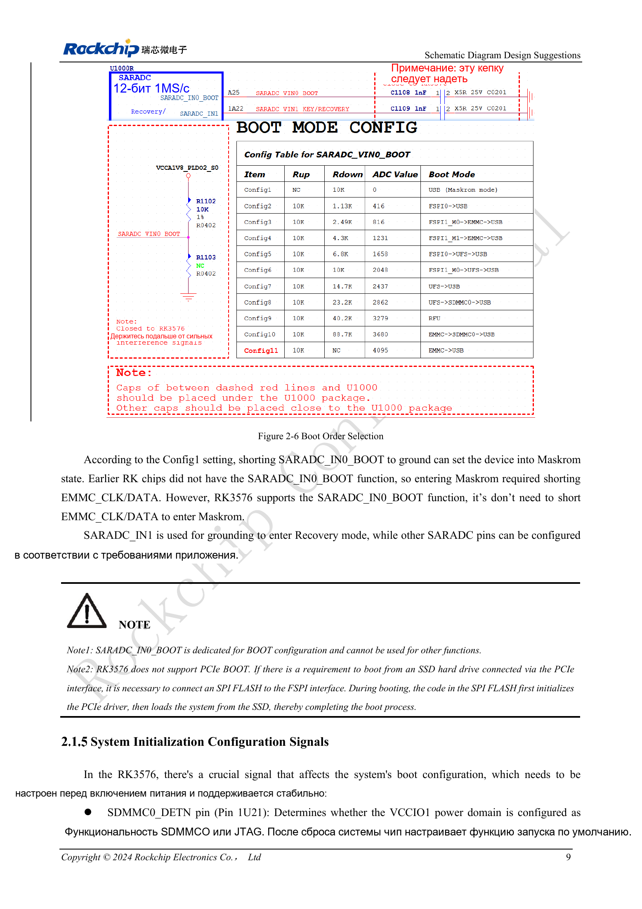

<!-- rk3576-hardware-v11-deep-20261109 -->

# Загрузка и отладка RK3576: конфигурация, Maskrom, UART и JTAG

Надёжное восстановление — часть серийной конструкции. Загрузочные резисторы, UART и USB для прошивки предусматривают в схеме, а не добавляют проводами после отказа.

Основа — китайская и английская версии RK3576 Hardware Design Guide V1.1 (2024-05-28), для плат с SoC. Носители CM5 проектируют по интерфейсу модуля; Sige5 подходит для программной базы сравнения. Единого SDK/BSP или ядра для всех изделий руководство не задаёт: совместимость проверяют для каждой платы. Значения взяты из источника, а не измерены ArmSoM.

**RK3576_Hardware_Design_Guide_V1.1_20240528_EN.pdf** · §2.1.3–2.1.6

## Конфигурация и два режима восстановления

SARADC_IN0_BOOT (Pin A25) выбирает порядок загрузки; на рисунке приведены Config1–11. Для eMMC по умолчанию используются Config10/11, для UFS — Config7/8. Config1 заземляет вход для Maskrom без замыкания такта/данных eMMC. Заземление SARADC_IN1 вызывает другой режим — Recovery. Вход BOOT не используют для посторонних аналоговых измерений. Полные комбинации резисторов смотрите на исходном рисунке.

## SSD PCIe не загружается напрямую из BootROM

Руководство не предусматривает прямую загрузку PCIe из BootROM. Код в SPI Flash на FSPI сначала инициализирует PCIe, затем загружает систему с SSD. Одновременно предусматривают Flash, восстановление и обслуживание образов; одного разъёма NVMe недостаточно.

## Выводы отладки и серийные тесты

SDMMC0_DETN (Pin 1U21) должен быть стабилен до включения: высокий уровень выбирает JTAG, низкий — SDMMC0; предусмотрен 1nF. После запуска управление передаётся IOMUX. Двухпроводный SWD использует TCK/TMS; M0 разделяет SDMMC0 в VCCIO1, M1 — UART0_M0 в PMUIO1. UART0 по умолчанию работает на 1500000bps. Сохраните последовательные 100Ω, ESD и доступные тестовые точки. Образ может менять скорость; нельзя напрямую подключать адаптер UART 5V.

## Параметры и проверочная таблица

| Параметр | Значение/сеть | Проверка |
| --- | --- | --- |
| Maskrom | SARADC_IN0_BOOT = GND | Config1; отличается от Recovery |
| Домен UART | PMUIO1 | Согласовать с питанием |
| Тестовые точки | ≥0.7mm / 2.54mm | Диаметр площадки / шаг разъёма |

## Исходные схемы и рисунки

Ниже страницы источника со схемами или временными диаграммами; нажмите для полного разрешения. Обозначения и номиналы относятся к эталонной схеме, не к схеме изделия ArmSoM.

Английский оригинал · PDF 28 · 2-6

## Продукты ArmSoM и путь разработки

CM5 позволяет использовать готовый вычислительный модуль на своём носителе; Sige5 подходит для первичной проверки Linux и периферии. Наличие интерфейса в SoC не означает его вывод на обоих продуктах. До покупки или разводки проверьте разъёмы, ревизию и образ системы.

- [ArmSoM CM5](https://www.armsom.org/cm5) · [CM5 Docs](https://docs.armsom.org/armsom-cm5)
- [ArmSoM Sige5](https://www.armsom.org/sige5) · [Sige5 Docs](https://docs.armsom.org/armsom-sige5)

## Порядок чтения серии

- [Серия по аппаратному проектированию RK3576: от минимальной системы до DDR и USB](/ru/articles/rk3576-hardware-design-series/)
- [Минимальная система RK3576: от проверки схемы до повторяемого запуска](/ru/articles/rk3576-hardware-bringup/)
- [Тактирование RK3576: кварц 24MHz, режим 32kHz и такты периферии](/ru/articles/rk3576-clock-circuit-design/)
- [Сброс RK3576: NPOR, RK806S-5, watchdog и температурная защита](/ru/articles/rk3576-reset-watchdog-design/)
- [Питание RK3576: домены CPU, GPU, NPU, LOGIC и развязка](/ru/articles/rk3576-power-domain-design/)
- [RK3576 и RK806S-5: выбор PMIC, управляющие выводы и обратная связь](/ru/articles/rk3576-rk806s5-pmic-design/)
- [Питание и сон RK3576: последовательность, удерживаемые шины и пробуждение](/ru/articles/rk3576-power-sequencing-standby/)
- [DDR RK3576: схемы и питание LPDDR4, LPDDR4X и LPDDR5](/ru/articles/rk3576-ddr-circuit-power/)
- [Трассировка DDR RK3576: импеданс, длина, возвратный ток и PDN](/ru/articles/rk3576-ddr-pcb-routing/)
- [Аппаратное дополнение USB/Type-C RK3576: мультиплексирование и защита](/ru/articles/168-rockchip-rk3576-usb/)
