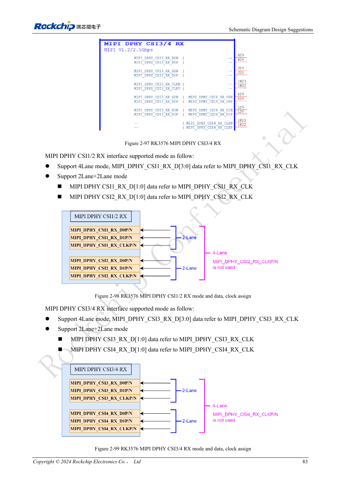
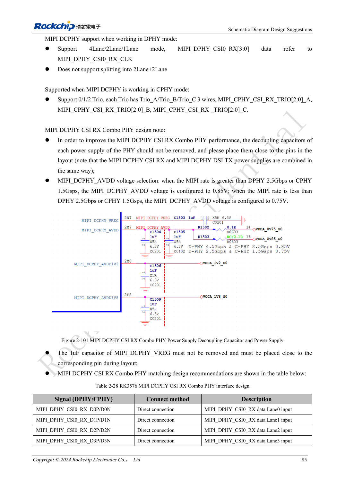

<!-- rk3576-hardware-v11-rest-20261109 -->

# Камеры RK3576: группы CSI, режимы DCPHY и питание

Основа — китайская и английская версии RK3576 Hardware Design Guide V1.1 (2024-05-28), для плат с SoC. Носители CM5 проектируют по интерфейсу модуля; Sige5 подходит для программной базы сравнения. Единого SDK/BSP или ядра для всех изделий руководство не задаёт: совместимость проверяют для каждой платы. Значения взяты из источника, а не измерены ArmSoM.

**RK3576_Hardware_Design_Guide_V1.1_20240528_EN.pdf** · §2.3.7; Camera PCB

## Начните с физических групп

Две группы DPHY CSI допускают четыре линии или 2+2, до 2.5Gbps/lane. CSI0 использует DCPHY: четыре DPHY до 4.5Gbps/lane либо три CPHY до 5.7Gbps/trio; разделение CSI0 на 2+2 не поддерживается. TX/RX DCPHY должны оба работать как DPHY либо CPHY. Вывод ресурсов SoC на CM5/Sige5 проверяют отдельно.

## Не копируйте три напряжения вслепую

DVDD датчика может быть 1.2/1.5/1.8V. Последовательность 1.8→1.2→2.8V не универсальна. PWDN, RESET и подтяжки I2C согласуют с DOVDD; сохраняют 100nF сброса и развязку у разъёма. Датчики с одинаковым адресом I2C размещают на разных шинах. Конденсатор MIPI_DCPHY_VREG 1μF обязателен. Зависимость AVDD от скорости сверяют с актуальной спецификацией: равенство порогов в источнике не определено.

## Противоречие источника и испытания

В разделе CIF указан VCCIO4, в замечаниях камеры — VCCIO6: CN PDF 98/100, EN 105/107. Ни один вариант здесь не объявляется готовой инструкцией: сверяйте PinOut, mux и актуальные схемы. Между парами разъёма ставьте землю, отделяйте MCLK. При слабом освещении оценивайте шум DVDD. Проверяйте совместную работу камер, ошибки кадров, экспозицию и нагрев.

## Параметры и проверочная таблица

| Параметр | Значение источника |
| --- | --- |
| Группы CSI DPHY | 4 lanes / 2+2 |
| CSI0 DCPHY | No 2+2 |
| VREG | 1μF |
| RESET | 100nF |
| Противоречие CIF | VCCIO4 / VCCIO6 |

## Исходные рисунки

Ниже страницы источника со схемами или временными диаграммами; нажмите для полного разрешения. Обозначения и номиналы относятся к эталонной схеме, не к схеме изделия ArmSoM.

Английский оригинал · PDF 102 · 2-98

Английский оригинал · PDF 104 · 2-101

## Разработка с ArmSoM

CM5 уменьшает объём повторной разработки вычислительного ядра; Sige5 подходит для первичной проверки ПО и периферии. Вывод интерфейсов, контакты, уровни и поддержка образа проверяются по документации платы, не по возможностям SoC.

- [ArmSoM CM5](https://www.armsom.org/cm5) · [CM5 Docs](https://docs.armsom.org/armsom-cm5)
- [ArmSoM Sige5](https://www.armsom.org/sige5) · [Sige5 Docs](https://docs.armsom.org/armsom-sige5)

## Читайте далее

- [RK3576: 30 тем аппаратного проектирования](/ru/articles/rk3576-hardware-design-series/)
- [SATA RK3576: общие PHY, развязка и питание накопителя](/ru/articles/rk3576-sata-hardware-design/)
- [Дисплеи RK3576: MIPI, RGB, подсветка и сенсорная панель](/ru/articles/rk3576-display-panel-hardware/)
