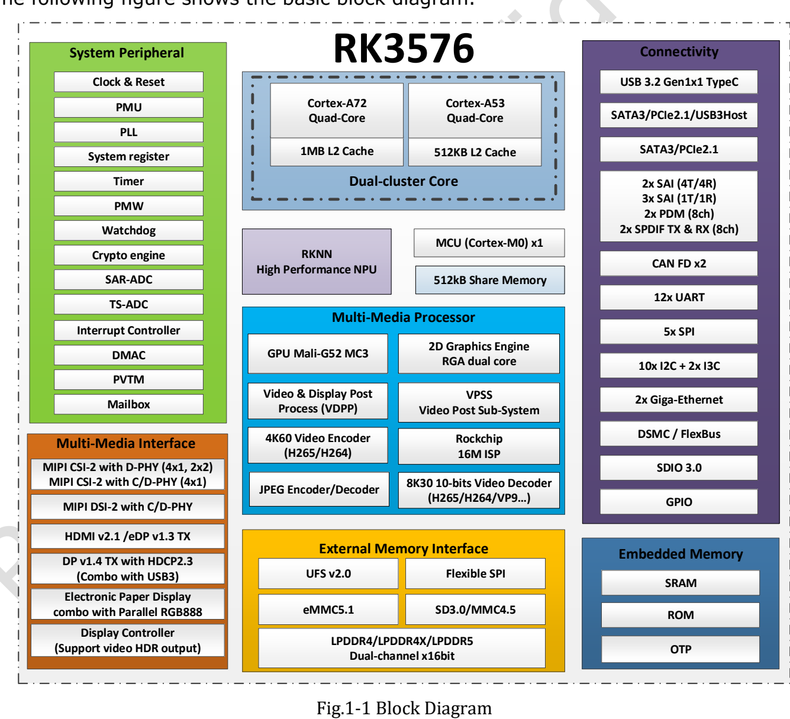

RK3576 объединяет обработку изображения, вывод, нейросетевой инференс и интерфейсы периферийного устройства. Важнее числа ядер — распределить этапы приложения между подходящими вычислительными блоками, а затем выбрать плату или модуль ArmSoM с нужными разъёмами.

## Роли CPU, GPU и NPU

| Блок | Спецификация V1.0 | Роль в приложении |
|---|---|---|
| CPU | 4× Cortex-A72 + 4× Cortex-A53; L2 1MB / 512KB | ОС, протоколы, логика, пред- и постобработка |
| GPU | Mali-G52 MC3 | Интерфейс и графические задачи, поддержанные драйвером |
| NPU | Два ядра, совместная или независимая работа; 6 TOPS INT8 со звёздочкой | Конвертированные сети с поддержанными операторами |
| Память | Два канала по 16-bit; LPDDR4/4X-4266, LPDDR5-4800; адресное пространство до 16GB | Модели, кадры и данные |
| Изображение/видео | 16MP ISP, RGA и видеокодеки | Захват, масштабирование и сжатие |

Это возможности чипа, а не обещание вывести все интерфейсы на каждой плате. На странице 41 V1.0 максимальные частоты CPU, GPU и NPU ещё обозначены TBD. Рабочие частоты проверяют по продукту и образу ОС. В V1.0 и более новом официальном Brief V1.2 звёздочка у 6 TOPS означает **Sparsity, разреженные вычисления**. Это не частота кадров модели и не прямой эквивалент TOPS с другой методикой.

## Практический конвейер машинного зрения

При контроле рабочего места камера снимает деталь, настроенный ISP обрабатывает изображение, RGA может менять размер и цветовой формат, NPU выполняет конвертированную модель. CPU применяет правила решения, сохраняет события и передаёт результат, а экран показывает состояние и кадры для проверки.

Локальный конвейер может сократить передачу исходного видео. Результат зависит от драйвера камеры, света, обучающих данных, покрытия операторов и обмена с памятью. Измеряйте полную задержку, ложные срабатывания и температуру при длительной работе, а не только один вызов NPU.

## Ограничения видео зависят от формата

Обзор V1.0 указывает декодирование до 8K30 или 4K120, а подробные пункты задают пределы конкретных кодеков. Нельзя переносить максимум другого формата на H.264. Более новый Brief V1.2 преимущественно перечисляет режимы 4K по кодекам; здесь версии не объединяются в безусловную максимальную характеристику.

Декодирование, видеовыход и параллельные потоки — разные задачи. Проверяйте файлы с требуемыми разрешением, частотой кадров, битрейтом, глубиной цвета и кодеком, а также реальное использование ускорения приложением. Номер версии HDMI не гарантирует любой режим экрана.

## От прототипа на Sige5 к продукту на CM5

Sige5 — одноплатный компьютер для прямого подключения периферии и проверки алгоритмов, сети и интерфейса. CM5 — модуль для несущей платы под корпус, разъёмы и специализированные устройства. Общая RK3576 позволяет использовать часть опыта разработки, но Device Tree, мультиплексирование выводов, питание и охлаждение всё равно проверяются заново.

Для терминала, HMI или шлюза сначала перечислите обязательную периферию. Функции PCIe, SATA и USB на общем combo PHY не обязательно доступны одновременно как независимые порты.

## Порядок проверки проекта

1. Зафиксировать ревизию платы, образ ОС, ядро и runtime NPU.
2. Отдельно проверить камеру, сеть, накопители и вывод изображения.
3. Конвертировать модель, оценить точность и полную производительность на реальных данных.
4. Добавить восстановление, ротацию журналов, обработку потери питания и обновления.
5. Проверить длительную нагрузку и нагрев в окончательном корпусе.

Это разбор документации и предлагаемый путь разработки, а не отчёт о выполненных тестах приложений ArmSoM.

## Статьи серии и продукты

- [ArmSoM CM5 как альтернатива Raspberry Pi CM4/CM5: выбор и перенос](/ru/articles/cm5-raspberry-pi-cm4-cm5-alternative/)
- [Возможности Sige5: шесть применений RK3576 на периферии](/ru/articles/sige5-rk3576-applications/)
- [RK3576 Datasheet V1.0: загрузка, корпус, питание и охлаждение](/ru/articles/rk3576-datasheet-v10/)
- [ArmSoM CM5](https://www.armsom.org/cm5) · [ArmSoM Sige5](https://docs.armsom.org/armsom-sige5)

## Источники

- [Rockchip RK3576](https://www.rock-chips.com/a/en/products/RK35_Series/2024/1212/2033.html)
- [RK3576 Brief V1.2 (2025-08-28)](https://www.rock-chips.com/uploads/pdf/2024.3.18/191/RK3576%20Brief%20Datasheet%20V1.2-20250828.pdf)
- [ArmSoM CM5](https://docs.armsom.org/armsom-cm5)
- [ArmSoM Sige5](https://docs.armsom.org/armsom-sige5)
- [Raspberry Pi CM5](https://www.raspberrypi.com/products/compute-module-5/)
