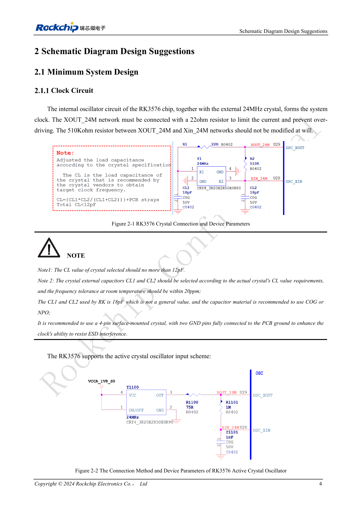

<!-- rk3576-hardware-v11-deep-20261109 -->

# Тактирование RK3576: кварц 24MHz, режим 32kHz и такты периферии

Ошибки тактирования проявляются отказами запуска, USB или пробуждения. Проверяют схему генератора, точность, уровни и источники, остающиеся активными во сне; наличия кварца 24MHz недостаточно.

Основа — китайская и английская версии RK3576 Hardware Design Guide V1.1 (2024-05-28), для плат с SoC. Носители CM5 проектируют по интерфейсу модуля; Sige5 подходит для программной базы сравнения. Единого SDK/BSP или ядра для всех изделий руководство не задаёт: совместимость проверяют для каждой платы. Значения взяты из источника, а не измерены ArmSoM.

**RK3576_Hardware_Design_Guide_V1.1_20240528_EN.pdf** · §2.1.1

## Элементы пассивного генератора

Последовательный резистор 22Ω в XOUT_24M ограничивает возбуждение; резистор 510kΩ между XOUT и XIN нельзя произвольно менять. Нагрузочная ёмкость кварца CL не должна превышать 12pF. CL1/CL2 рассчитывают и проверяют для выбранного кварца; 18pF — значение примера. Рекомендуются C0G/NP0 и четырёхконтактный кварц с обоими земляными контактами. Ёмкость щупа может нарушить генерацию.

## Активный вход и скважность

Для активного источника указаны 1.35–1.8V, заполнение 50% и точность 20ppm. Руководство предлагает наблюдать обходной сигнал 24MHz на REF_CLK0_OUT (Pin V29), подбирая R1100; это не универсальная команда регистра. При входе 0.8V заполнение 50% может быть недостижимо, даже если генерация присутствует.

## Совместная проверка сна и выходных тактов

Перед остановкой 24MHz переключитесь на PMU_PVTM либо внешние 32.768kHz и убедитесь, что источники пробуждения не требуют 24MHz. Минимальный сон использует прерывания PMUIO0/1. Для RTC с открытым стоком на CLK32K_IN отключают внутреннюю подтяжку GPIO вниз. После остановки 24MHz выход CLK0/1_32K_OUT не гарантируется. Для тактов камер и Ethernet также проверяют мультиплексирование и напряжение периферии.

## Параметры и проверочная таблица

| Параметр | Значение/сеть | Проверка |
| --- | --- | --- |
| Допуск кварца | ≤20ppm | При комнатной температуре, по источнику |
| Внешний такт сна | 32.768kHz ±30ppm; 45–55% | Амплитуда 0.7×VDD…VDD; VDD=PMUIO0 |
| Опорные выходы | REF_CLK0/1/2_OUT | 12/24/25/26/27/37.125/74.25/10/20/40/50/58.5/100MHz |
| Такты камер | CAM_CLK0/1/2_OUT | По умолчанию 24MHz; варианты 27/37.125/74.25MHz |

## Исходные схемы и рисунки

Ниже страницы источника со схемами или временными диаграммами; нажмите для полного разрешения. Обозначения и номиналы относятся к эталонной схеме, не к схеме изделия ArmSoM.

Английский оригинал · PDF 23 · 2-1 / 2-2

## Продукты ArmSoM и путь разработки

CM5 позволяет использовать готовый вычислительный модуль на своём носителе; Sige5 подходит для первичной проверки Linux и периферии. Наличие интерфейса в SoC не означает его вывод на обоих продуктах. До покупки или разводки проверьте разъёмы, ревизию и образ системы.

- [ArmSoM CM5](https://www.armsom.org/cm5) · [CM5 Docs](https://docs.armsom.org/armsom-cm5)
- [ArmSoM Sige5](https://www.armsom.org/sige5) · [Sige5 Docs](https://docs.armsom.org/armsom-sige5)

## Порядок чтения серии

- [Серия по аппаратному проектированию RK3576: от минимальной системы до DDR и USB](/ru/articles/rk3576-hardware-design-series/)
- [Минимальная система RK3576: от проверки схемы до повторяемого запуска](/ru/articles/rk3576-hardware-bringup/)
- [Сброс RK3576: NPOR, RK806S-5, watchdog и температурная защита](/ru/articles/rk3576-reset-watchdog-design/)
- [Загрузка и отладка RK3576: конфигурация, Maskrom, UART и JTAG](/ru/articles/rk3576-boot-debug-design/)
- [Питание RK3576: домены CPU, GPU, NPU, LOGIC и развязка](/ru/articles/rk3576-power-domain-design/)
- [RK3576 и RK806S-5: выбор PMIC, управляющие выводы и обратная связь](/ru/articles/rk3576-rk806s5-pmic-design/)
- [Питание и сон RK3576: последовательность, удерживаемые шины и пробуждение](/ru/articles/rk3576-power-sequencing-standby/)
- [DDR RK3576: схемы и питание LPDDR4, LPDDR4X и LPDDR5](/ru/articles/rk3576-ddr-circuit-power/)
- [Трассировка DDR RK3576: импеданс, длина, возвратный ток и PDN](/ru/articles/rk3576-ddr-pcb-routing/)
- [Аппаратное дополнение USB/Type-C RK3576: мультиплексирование и защита](/ru/articles/168-rockchip-rk3576-usb/)
