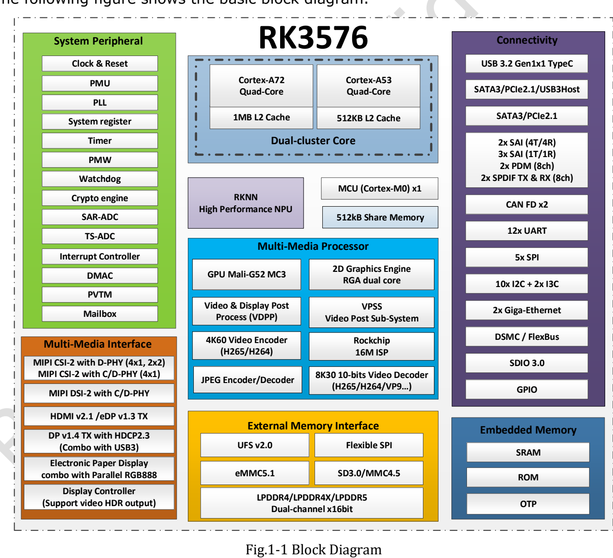
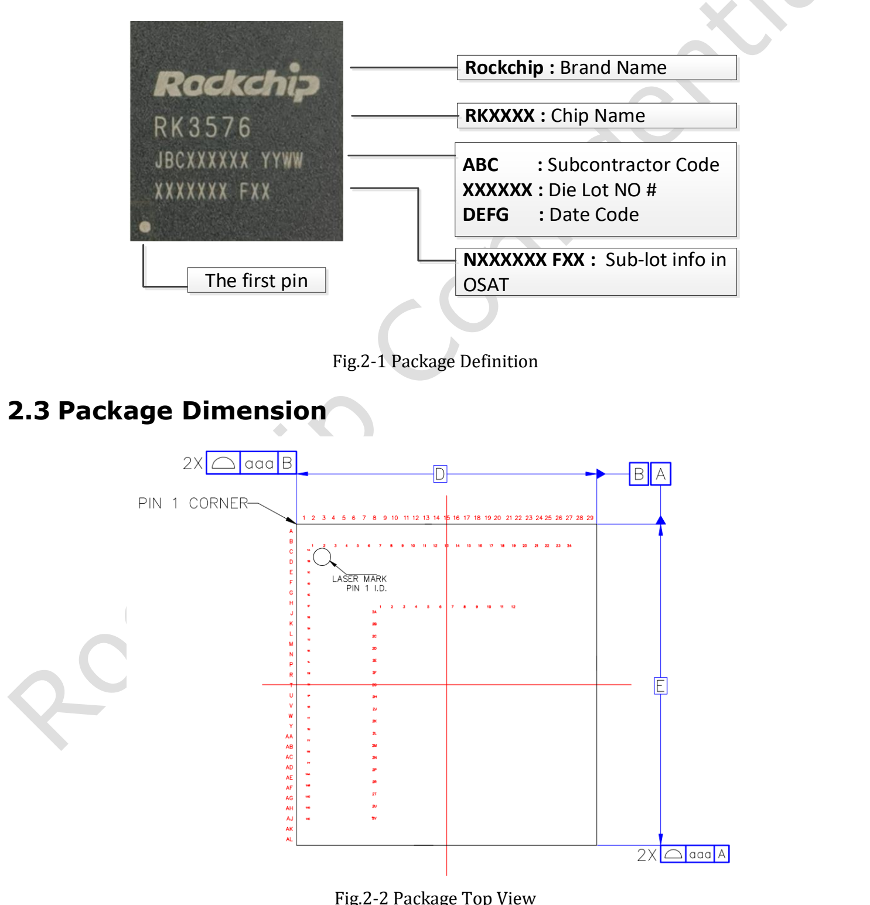
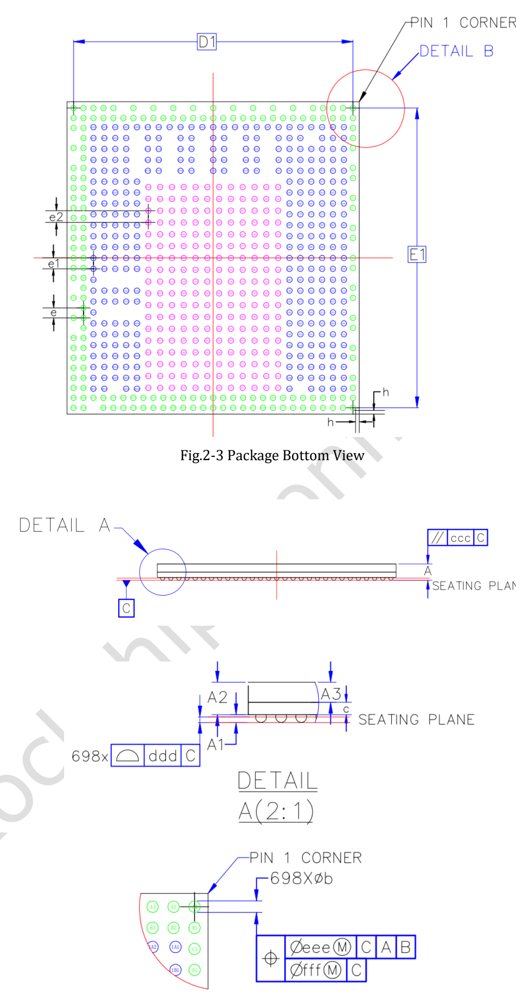
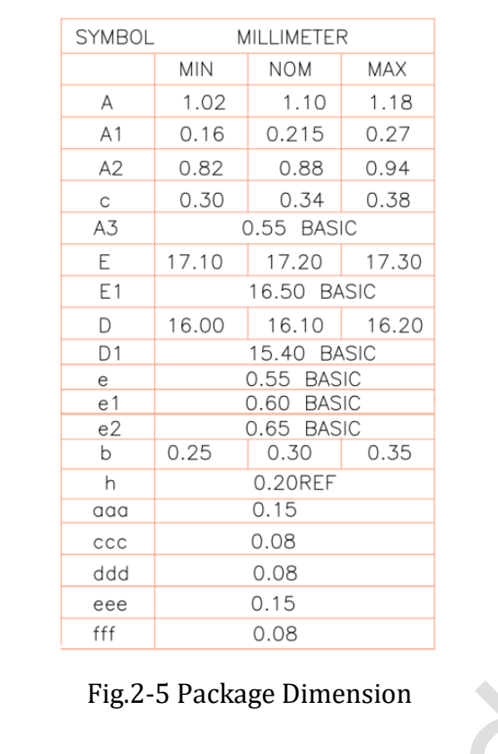

**RK3576 Datasheet V1.0 от 2024-03-15 содержит 46 страниц** об архитектуре, корпусе, выводах и электрических условиях. Статья служит навигацией и пояснением, а не построчным переводом и не утверждением, что первая редакция является последней спецификацией.

[Скачать полный оригинальный PDF](/assets/rk3576/Rockchip-RK3576-Datasheet-V1.0-20240315.pdf)

## Карта документа

| Страницы оригинала | Содержание | Назначение |
|---|---|---|
| 6–22 | CPU, память, система, мультимедиа, интерфейсы и схема | Планирование архитектуры |
| 23–25 | Маркировка, чертежи, размеры, MSL и материал шариков | Корпус и производство |
| 26–37 | Таблица номеров выводов | Проверка питания и сигналов |
| 38 | Absolute Ratings | Предельные, не рекомендуемые рабочие значения |
| 39–45 | Рабочие условия и характеристики интерфейсов | Проектирование питания и сигналов |
| 46 | Тепловые параметры и условия | Ориентир для охлаждения |

## Архитектура и память

V1.0 описывает четыре Cortex-A72 и четыре Cortex-A53 с общим L2 по 1MB и 512KB соответственно. Два канала по 16-bit поддерживают LPDDR4/4X-4266 и LPDDR5-4800 с адресным пространством до 16GB. eMMC 5.1, UFS 2.0 и последовательный Flash — возможности чипа; доступность подключения зависит от платы.

## Три важных различия редакций

- **Частоты:** страница 41 оставляет максимальные частоты A72, A53, GPU и NPU как TBD. Текущие значения продукта нельзя выдавать за исходные значения V1.0.
- **NPU:** страница 11 содержит 6 TOPS* INT8 со сноской Sparsity; более новый официальный Brief V1.2 сохраняет это определение. Сохраняйте оговорку о разреженности в продвижении.
- **Графика и видео:** V1.0 перечисляет Vulkan 1.1 и OpenCL 2.0, новый Brief — Vulkan 1.2 и OpenCL 2.1 и иначе представляет видеопределы. Проверяйте драйвер, кодек, глубину цвета и режим.

## Корпус и выводы

В V1.0 указан FCCSP698L, корпус 16.1 × 17.2mm, шарики диаметром 0.30mm и смешанный шаг 0.55/0.60/0.65mm. MSL — 3, материал шариков — SnAgCu. Нельзя строить посадочное место по упрощённому единственному шагу; используйте исходную таблицу и официальные проектные файлы.

## Электрические и тепловые условия

Предельные параметры и рекомендуемые условия даны отдельно. Домены ядра, памяти и IO имеют разные напряжения; вход 5V на плате не означает допустимость 5V на выводах SoC. Некоторые значения страницы 39 ещё TBD и требуют подтверждения до выпуска проекта.

Страница 46 требует температуры перехода ниже 125°C, а не окружающей среды. θJA=15.84, θJB=6.96, θJC=0.67 и ψJT=0.031°C/W относятся к указанным условиям; текст называет их результатами моделирования, которые следует проверять физически. Не переносите θJA на произвольный корпус и не считайте ψJT обычным тепловым сопротивлением.

## Значение для CM5 и Sige5

Для готовой платы сначала используйте её требования к питанию, выводам и охлаждению. Для несущей платы CM5 нужны определения разъёмов модуля и референсная схема, а не таблица шариков SoC. Электрические значения здесь не измерялись повторно. Оригинальный PDF и исходные обозначения на иллюстрациях сохранены.

## Статьи серии и продукты

- [RK3576: от восьмиядерного CPU до устройств ArmSoM для периферийного ИИ](/ru/articles/rk3576-chip-guide/)
- [ArmSoM CM5 как альтернатива Raspberry Pi CM4/CM5: выбор и перенос](/ru/articles/cm5-raspberry-pi-cm4-cm5-alternative/)
- [Возможности Sige5: шесть применений RK3576 на периферии](/ru/articles/sige5-rk3576-applications/)
- [ArmSoM CM5](https://www.armsom.org/cm5) · [ArmSoM Sige5](https://docs.armsom.org/armsom-sige5)

## Источники

- [Rockchip RK3576](https://www.rock-chips.com/a/en/products/RK35_Series/2024/1212/2033.html)
- [RK3576 Brief V1.2 (2025-08-28)](https://www.rock-chips.com/uploads/pdf/2024.3.18/191/RK3576%20Brief%20Datasheet%20V1.2-20250828.pdf)
- [ArmSoM CM5](https://docs.armsom.org/armsom-cm5)
- [ArmSoM Sige5](https://docs.armsom.org/armsom-sige5)
- [Raspberry Pi CM5](https://www.raspberrypi.com/products/compute-module-5/)
