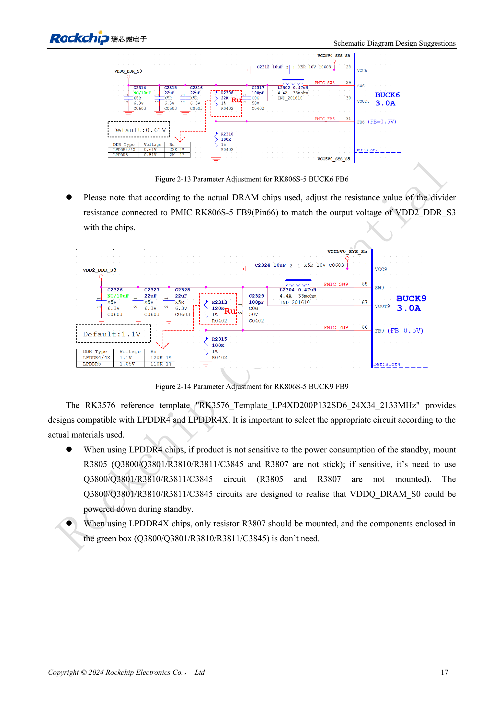
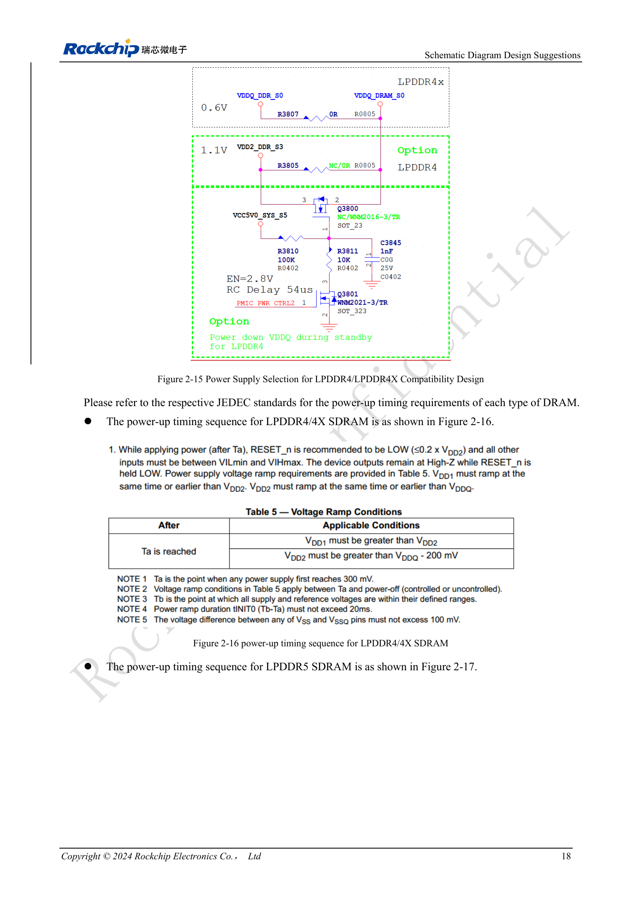

<!-- rk3576-hardware-v11-deep-20261109 -->

# DDR RK3576: схемы и питание LPDDR4, LPDDR4X и LPDDR5

Совместимость DDR определяется не только корпусом: согласуют питание памяти и PHY, ZQ, сигналы, сон и прошивку. Ниже сохранены типовые значения источника и разделены DRAM/PHY, чтобы не путать 1.1V LPDDR4 с 0.61V PHY.

Основа — китайская и английская версии RK3576 Hardware Design Guide V1.1 (2024-05-28), для плат с SoC. Носители CM5 проектируют по интерфейсу модуля; Sige5 подходит для программной базы сравнения. Единого SDK/BSP или ядра для всех изделий руководство не задаёт: совместимость проверяют для каждой платы. Значения взяты из источника, а не измерены ArmSoM.

**RK3576_Hardware_Design_Guide_V1.1_20240528_EN.pdf** · §2.1.7

## Интерфейс и ёмкость

RK3576 поддерживает LPDDR4/4X/5: два канала по 16 бит, суммарно 32 бита. До 8GB на канал и 16GB всего — адресация SoC, а не комплектация каждой CM5/Sige5. DQ/CA нельзя произвольно менять местами; выводы сверяют с шаблоном и таблицей 2-4. В LPDDR5 появляется WCK с 2× или 4× CK; назначения CKE и других сигналов LPDDR4 нельзя просто перенести.

## ZQ и делители PMIC

ZQ PHY подключается через 240Ω, 1% к DDRPHY_VDDQ_S0. ZQ памяти LPDDR4X/5 подключают к тому же домену, LPDDR4 — к VDD2_DDR_S3. ODT_CA LPDDR4/4X подключается к VDD2_DDR_S3. После выбора памяти проверяют делители RK806S-5 FB6 (Pin31) для VDDQ_DDR_S0 и FB9 (Pin66) для VDD2_DDR_S3. Типовые напряжения не заменяют допуски и временные требования памяти.

## Варианты монтажа и сон

В RK3576_Template_LP4XD200P132SD6_24X34_2133MHz вариант LPDDR4 с экономичным сном использует Q3800/Q3801/R3810/R3811/C3845 без R3805/R3807; альтернативный LPDDR4 использует R3805. LPDDR4X использует R3807 без схемы в зелёной рамке. Обозначения относятся только к шаблону, а не к переделке любого носителя CM5. Во сне сохраняют DDRPHY_CKE_VDDQ; последовательность всех шин сверяют с JEDEC для памяти.

## Параметры и проверочная таблица

| Параметр | Значение/сеть | Проверка |
| --- | --- | --- |
| DRAM VDD1 | 1.8 / 1.8 / 1.8V | Порядок: LPDDR4 / 4X / 5 |
| DRAM VDD2/VDD2H | 1.1 / 1.1 / 1.05V | LPDDR5 дополнительно VDD2L=0.9V |
| DRAM VDDQ | 1.1 / 0.61 / 0.51V | Не путать с питанием PHY |
| PHY VDDQ/CK_VDDQ | 0.61 / 0.61 / 0.51V | Типовые |
| PHY CKE_VDDQ | 1.1 / 1.1 / 1.05V | Сохранить во сне |
| PHY DVDD / PLL_DVDD | 0.75–0.85V | PLL_AVDD1V8=1.8V |

## Исходные схемы и рисунки

Ниже страницы источника со схемами или временными диаграммами; нажмите для полного разрешения. Обозначения и номиналы относятся к эталонной схеме, не к схеме изделия ArmSoM.

Английский оригинал · PDF 36 · 2-13

Английский оригинал · PDF 37 · 2-15

## Продукты ArmSoM и путь разработки

CM5 позволяет использовать готовый вычислительный модуль на своём носителе; Sige5 подходит для первичной проверки Linux и периферии. Наличие интерфейса в SoC не означает его вывод на обоих продуктах. До покупки или разводки проверьте разъёмы, ревизию и образ системы.

- [ArmSoM CM5](https://www.armsom.org/cm5) · [CM5 Docs](https://docs.armsom.org/armsom-cm5)
- [ArmSoM Sige5](https://www.armsom.org/sige5) · [Sige5 Docs](https://docs.armsom.org/armsom-sige5)

## Порядок чтения серии

- [Серия по аппаратному проектированию RK3576: от минимальной системы до DDR и USB](/ru/articles/rk3576-hardware-design-series/)
- [Минимальная система RK3576: от проверки схемы до повторяемого запуска](/ru/articles/rk3576-hardware-bringup/)
- [Тактирование RK3576: кварц 24MHz, режим 32kHz и такты периферии](/ru/articles/rk3576-clock-circuit-design/)
- [Сброс RK3576: NPOR, RK806S-5, watchdog и температурная защита](/ru/articles/rk3576-reset-watchdog-design/)
- [Загрузка и отладка RK3576: конфигурация, Maskrom, UART и JTAG](/ru/articles/rk3576-boot-debug-design/)
- [Питание RK3576: домены CPU, GPU, NPU, LOGIC и развязка](/ru/articles/rk3576-power-domain-design/)
- [RK3576 и RK806S-5: выбор PMIC, управляющие выводы и обратная связь](/ru/articles/rk3576-rk806s5-pmic-design/)
- [Питание и сон RK3576: последовательность, удерживаемые шины и пробуждение](/ru/articles/rk3576-power-sequencing-standby/)
- [Трассировка DDR RK3576: импеданс, длина, возвратный ток и PDN](/ru/articles/rk3576-ddr-pcb-routing/)
- [Аппаратное дополнение USB/Type-C RK3576: мультиплексирование и защита](/ru/articles/168-rockchip-rk3576-usb/)
