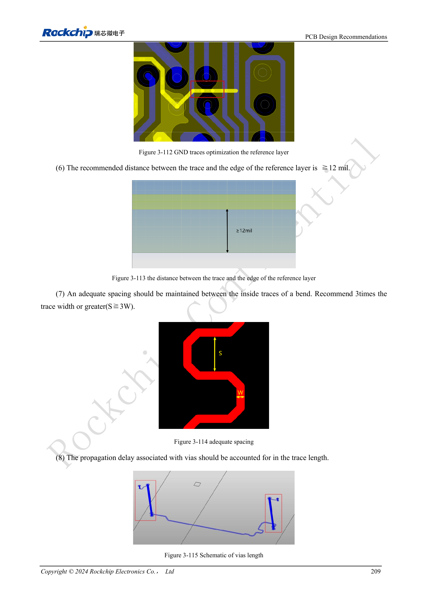

<!-- rk3576-hardware-v11-deep-20261109 -->

# Трассировка DDR RK3576: импеданс, длина, возвратный ток и PDN

Начинайте с проверенного шаблона PCB и соответствующей DDR firmware. Выравнивание длин — лишь часть: запас определяется также опорными слоями, возвратом через переходы, импедансом, помехами и PDN. Основа — §3.5.3.

Основа — китайская и английская версии RK3576 Hardware Design Guide V1.1 (2024-05-28), для плат с SoC. Носители CM5 проектируют по интерфейсу модуля; Sige5 подходит для программной базы сравнения. Единого SDK/BSP или ядра для всех изделий руководство не задаёт: совместимость проверяют для каждой платы. Значения взяты из источника, а не измерены ArmSoM.

**RK3576_Hardware_Design_Guide_V1.1_20240528_EN.pdf** · §3.5.3; Tables 3-18 / 3-19

## Сначала обеспечьте непрерывный возврат

Не удаляйте GND-переходы шаблона под SoC/DRAM. В пределах 25mil от центра сигнального перехода нужен минимум один GND-переход, соединяющий оба опорных слоя. Чередуйте сигнальные и земляные переходы. Сохраняйте минимум один сплошной GND и расстояние трассы от края ≥12mil. Меандр не исправляет разрыв пути возврата.

## Длина, зазоры и переходы

W — реальная ширина проводника, а не фиксированное число mil. Внутренний зазор меандра S≥3W; расстояние до площадки перехода ≥8mil. Учитывайте задержки переходов; рассогласование внутри пары ≤5mil. Заземляйте защитные проводники DQS/CLK/WCLK с шагом ≤400mil. Удаление неиспользуемых площадок согласуют с производством.

## Цели PDN и приёмка

Для LPDDR4X VDD2/VDDQ и LPDDR5 VDD2H пределы импеданса в полосах 100kHz–1MHz, 1–30MHz и 30–100MHz составляют 0.03/0.03/0.04Ω. Для LPDDR5 VDD2L — 0.07/0.07/0.08Ω. Сохраняйте развязку и проверяйте модели конденсаторов. Китайское введение содержит «4266bps», английское — «4266Mbps»; расхождение единиц фиксируется, а не превращается в гарантию скорости изделия. Нужны моделирование, реальная firmware DDR, холодные старты и нагрузочные проверки.

## Параметры и проверочная таблица

| Параметр | Значение/сеть | Проверка |
| --- | --- | --- |
| DQ/DM одиночные | LPDDR5:40Ω±10%; LPDDR4/4X:45Ω±10% | Рассчитать ширину по стеку |
| CA/управление | 50Ω±10% | Дифференциальные пары 90Ω±10% |
| Разброс внутри байта | ≤90mil | DQ/DM относительно DQS/WCLK |
| Разброс адреса/управления | ≤90mil | Относительно CLK |
| Строб и такт | DQS/WCLK ↔ CLK ≤230mil | С учётом задержек переходов |
| Зазор | ≥2W; DQ↔DQS/WCLK, CLK: ≥3W preferred | Критические группы: минимум 2W, желательно 3W |

## Исходные схемы и рисунки

Ниже страницы источника со схемами или временными диаграммами; нажмите для полного разрешения. Обозначения и номиналы относятся к эталонной схеме, не к схеме изделия ArmSoM.

Английский оригинал · PDF 228 · 3-112 / 3-113

## Продукты ArmSoM и путь разработки

CM5 позволяет использовать готовый вычислительный модуль на своём носителе; Sige5 подходит для первичной проверки Linux и периферии. Наличие интерфейса в SoC не означает его вывод на обоих продуктах. До покупки или разводки проверьте разъёмы, ревизию и образ системы.

- [ArmSoM CM5](https://www.armsom.org/cm5) · [CM5 Docs](https://docs.armsom.org/armsom-cm5)
- [ArmSoM Sige5](https://www.armsom.org/sige5) · [Sige5 Docs](https://docs.armsom.org/armsom-sige5)

## Порядок чтения серии

- [Серия по аппаратному проектированию RK3576: от минимальной системы до DDR и USB](/ru/articles/rk3576-hardware-design-series/)
- [Минимальная система RK3576: от проверки схемы до повторяемого запуска](/ru/articles/rk3576-hardware-bringup/)
- [Тактирование RK3576: кварц 24MHz, режим 32kHz и такты периферии](/ru/articles/rk3576-clock-circuit-design/)
- [Сброс RK3576: NPOR, RK806S-5, watchdog и температурная защита](/ru/articles/rk3576-reset-watchdog-design/)
- [Загрузка и отладка RK3576: конфигурация, Maskrom, UART и JTAG](/ru/articles/rk3576-boot-debug-design/)
- [Питание RK3576: домены CPU, GPU, NPU, LOGIC и развязка](/ru/articles/rk3576-power-domain-design/)
- [RK3576 и RK806S-5: выбор PMIC, управляющие выводы и обратная связь](/ru/articles/rk3576-rk806s5-pmic-design/)
- [Питание и сон RK3576: последовательность, удерживаемые шины и пробуждение](/ru/articles/rk3576-power-sequencing-standby/)
- [DDR RK3576: схемы и питание LPDDR4, LPDDR4X и LPDDR5](/ru/articles/rk3576-ddr-circuit-power/)
- [Аппаратное дополнение USB/Type-C RK3576: мультиплексирование и защита](/ru/articles/168-rockchip-rk3576-usb/)
