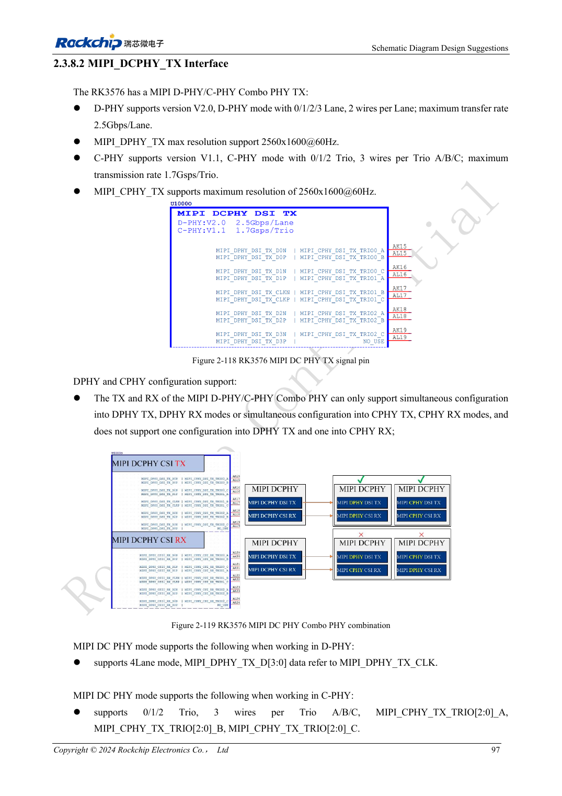
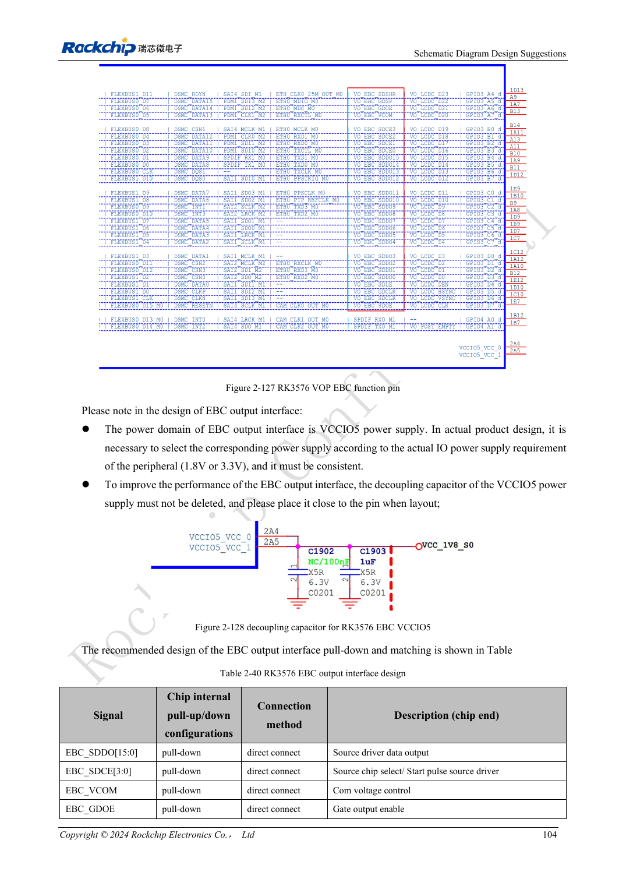

<!-- rk3576-hardware-v11-rest-20261109 -->

# Дисплеи RK3576: MIPI, RGB, подсветка и сенсорная панель

Основа — китайская и английская версии RK3576 Hardware Design Guide V1.1 (2024-05-28), для плат с SoC. Носители CM5 проектируют по интерфейсу модуля; Sige5 подходит для программной базы сравнения. Единого SDK/BSP или ядра для всех изделий руководство не задаёт: совместимость проверяют для каждой платы. Значения взяты из источника, а не измерены ArmSoM.

**RK3576_Hardware_Design_Guide_V1.1_20240528_EN.pdf** · §2.3.8.2, §2.3.8.4–6; MIPI/RGB PCB

## Выбирайте экран по интерфейсу, не только разрешению

MIPI TX предлагает четыре DPHY до 2.5Gbps/lane либо три CPHY до 1.7Gsps; источник указывает 2560×1600@60. Общий DCPHY TX/RX требует одинакового режима. RGB/BT1120 использует VCCIO5 с подходящими 1.8/3.3V. RGB666/RGB565 используют старшие биты; подключать автоматически от D0 нельзя.

## При включении экран и подсветка выключены

Питание панели должно управляться и исходно быть выключено. EN/PWM подсветки выбирают с внутренней и внешней подтяжкой вниз. Дроссель, диод и конденсаторы повышающей схемы рассчитывают и на холостой ход; резистор FB — 1%. I2C сенсора подтягивают 2.2kΩ к VCC3V3_TP, желательно на отдельной шине. При общей шине проверяют адреса, последовательность и обратное питание.

## Разделяйте ограничения DPHY и CPHY

DPHY разводят парами, CPHY — тройками, не обычными дифференциальными парами. В тракт включают FPC, разъёмы, ESD и тестовые точки; ответвления сокращают. Проверяют старт, яркость, сон, прерывания сенсора и длительную работу. Инициализация выбирается по панели, а не только по SoC.

## Параметры и проверочная таблица

| Параметр | Значение источника |
| --- | --- |
| DPHY Zdiff | 100Ω ±10% preferred |
| DPHY внутри пары / такт-данные | <6mil / <12mil |
| CPHY Zsingle | 50Ω ±10% |
| CPHY внутри / между тройками | <6mil / <100mil |
| Длина DPHY / CPHY | <6inch / <5inch |

## Исходные рисунки

Ниже страницы источника со схемами или временными диаграммами; нажмите для полного разрешения. Обозначения и номиналы относятся к эталонной схеме, не к схеме изделия ArmSoM.

Английский оригинал · PDF 116 · 2-118

Английский оригинал · PDF 123 · 2-127

## Разработка с ArmSoM

CM5 уменьшает объём повторной разработки вычислительного ядра; Sige5 подходит для первичной проверки ПО и периферии. Вывод интерфейсов, контакты, уровни и поддержка образа проверяются по документации платы, не по возможностям SoC.

- [ArmSoM CM5](https://www.armsom.org/cm5) · [CM5 Docs](https://docs.armsom.org/armsom-cm5)
- [ArmSoM Sige5](https://www.armsom.org/sige5) · [Sige5 Docs](https://docs.armsom.org/armsom-sige5)

## Читайте далее

- [RK3576: 30 тем аппаратного проектирования](/ru/articles/rk3576-hardware-design-series/)
- [Камеры RK3576: группы CSI, режимы DCPHY и питание](/ru/articles/rk3576-camera-hardware-design/)
- [HDMI RK3576: FRL/TMDS, уровни DDC и защита](/ru/articles/rk3576-hdmi-hardware-design/)
