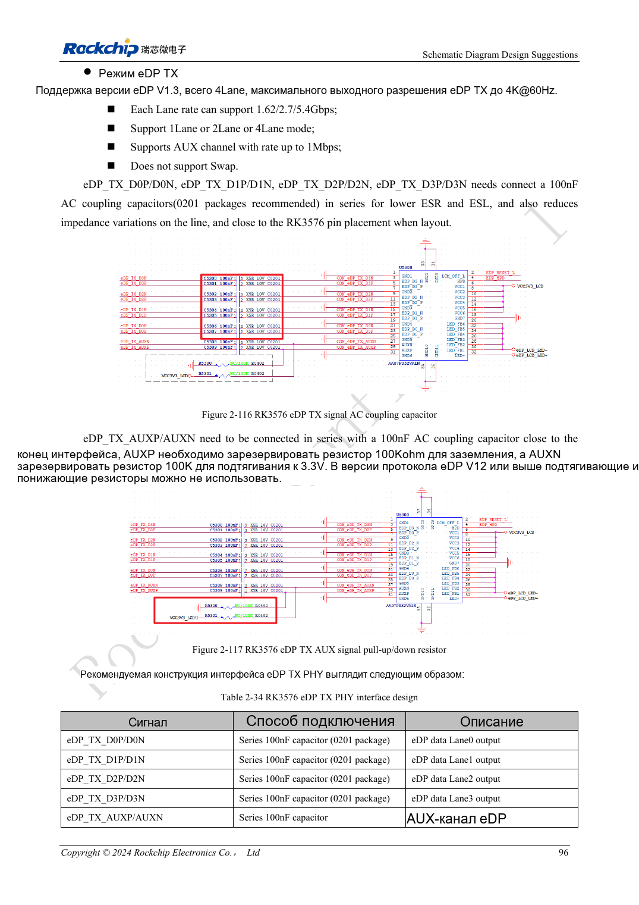
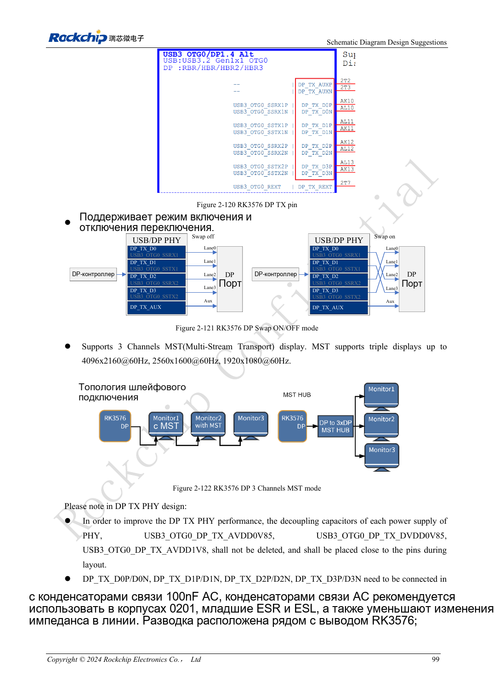

<!-- rk3576-hardware-v11-rest-20261109 -->

# DP/eDP RK3576: распределение PHY, AUX и расхождение ёмкостей

Основа — китайская и английская версии RK3576 Hardware Design Guide V1.1 (2024-05-28), для плат с SoC. Носители CM5 проектируют по интерфейсу модуля; Sige5 подходит для программной базы сравнения. Единого SDK/BSP или ядра для всех изделий руководство не задаёт: совместимость проверяют для каждой платы. Значения взяты из источника, а не измерены ArmSoM.

**RK3576_Hardware_Design_Guide_V1.1_20240528_EN.pdf** · §2.3.8.1, §2.3.8.3; DP/eDP PCB

## DP и eDP используют разные ресурсы

DP 1.4 делит Combo PHY с USB3 OTG0: 1/2/4 линии, 1.62/2.7/5.4/8.1Gbps. eDP 1.3 делит PHY с HDMI: 1/2/4 линии, 1.62/2.7/5.4Gbps; перестановка линий запрещена источником. Для MST, нескольких экранов и Type-C проверяйте mux и выводы платы, не только число дисплеев.

## AUX и противоречие номиналов

DP data и AUX используют 100nF; AUX-конденсаторы ставят у разъёма. Опорный резистор — 8.2kΩ, 1%. Раздел схемы eDP задаёт 100nF, таблица PCB — 220nF±20%: CN PDF 106–107/222; английская схема и PDF 244 тоже расходятся. Сохранены оба значения. Перед выбором BOM нужны актуальная схема, требования приёмника и подтверждение изготовителя.

## Проверяйте питание наряду с обучением линии

Эталон: 100Ω для отдельного DP, 95Ω совместно с USB, 90Ω для eDP с согласованным кабелем. Проверьте AUX, HPD, обучение, последовательность панели/подсветки и пробуждение. При чёрном экране различайте отсутствие AUX, отказ обучения и выключенную подсветку.

## Параметры и проверочная таблица

| Параметр | Значение источника |
| --- | --- |
| DP / eDP Zdiff | 100Ω (95Ω shared) / 90Ω |
| Разница внутри пары | <6mil |
| Длина трассы | <6inch |
| Связь eDP: не разрешено | 100nF / 220nF ±20% |
| Рекомендуемые переходы | ≤2 |

## Исходные рисунки

Ниже страницы источника со схемами или временными диаграммами; нажмите для полного разрешения. Обозначения и номиналы относятся к эталонной схеме, не к схеме изделия ArmSoM.

Английский оригинал · PDF 115 · 2-116

Английский оригинал · PDF 118 · 2-121

## Разработка с ArmSoM

CM5 уменьшает объём повторной разработки вычислительного ядра; Sige5 подходит для первичной проверки ПО и периферии. Вывод интерфейсов, контакты, уровни и поддержка образа проверяются по документации платы, не по возможностям SoC.

- [ArmSoM CM5](https://www.armsom.org/cm5) · [CM5 Docs](https://docs.armsom.org/armsom-cm5)
- [ArmSoM Sige5](https://www.armsom.org/sige5) · [Sige5 Docs](https://docs.armsom.org/armsom-sige5)

## Читайте далее

- [RK3576: 30 тем аппаратного проектирования](/ru/articles/rk3576-hardware-design-series/)
- [HDMI RK3576: FRL/TMDS, уровни DDC и защита](/ru/articles/rk3576-hdmi-hardware-design/)
- [Аудиотракт RK3576: SAI, PDM, ASRC и микрофоны](/ru/articles/rk3576-audio-hardware-design/)
