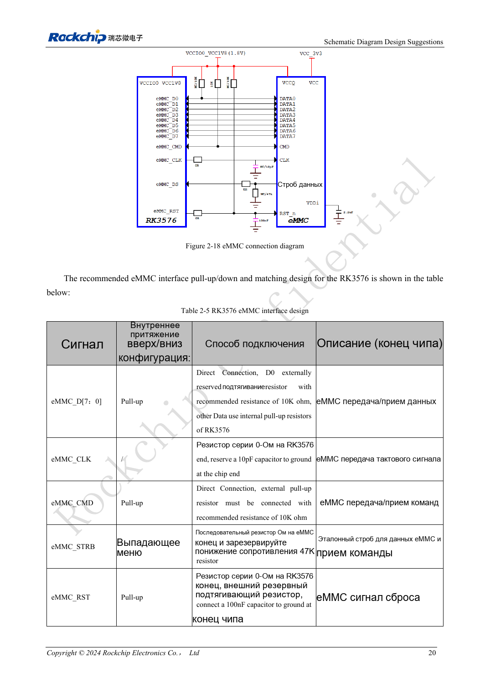
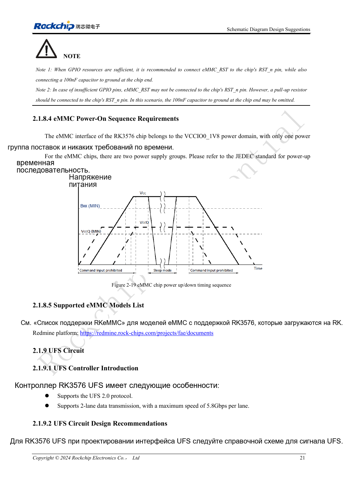

<!-- rk3576-hardware-v11-rest-20261109 -->

# Аппаратный интерфейс eMMC RK3576: питание, подтяжки и HS400

Основа — китайская и английская версии RK3576 Hardware Design Guide V1.1 (2024-05-28), для плат с SoC. Носители CM5 проектируют по интерфейсу модуля; Sige5 подходит для программной базы сравнения. Единого SDK/BSP или ядра для всех изделий руководство не задаёт: совместимость проверяют для каждой платы. Значения взяты из источника, а не измерены ArmSoM.

**RK3576_Hardware_Design_Guide_V1.1_20240528_EN.pdf** · §2.1.8; eMMC PCB

## Планируйте весь тракт загрузочной памяти

RK3576 поддерживает eMMC 5.1, 5.0, 4.51 и 4.41, включая HS400ES, HS400, HS200 и DDR50. Поддержка контроллером не гарантирует работу любого накопителя и PCB в этом режиме. Сначала выбирают память, Loader, питание IO и разводку, затем проверяют согласованный режим. eMMC делит выводы с FSPI0: это не два независимых загрузочных порта.

## CMD, D0 и сброс проверяют отдельно

VCCIO0 фиксирован на 1.8V; питание ядра памяти и IO подключают по её спецификации и последовательности. CMD требует внешней подтяжки 10kΩ. На D0 резервируют 10kΩ, остальные линии данных используют внутренние подтяжки эталона. Резистор CLK 0Ω ставят у SoC, 10pF резервируют у памяти. STRB 0Ω располагают у памяти, предусматривают 47kΩ к земле. При сбросе через GPIO сохраняют 100nF у памяти. Без GPIO вывод RST_n всё равно требует подтяжки.

## От разводки к проверке

Задайте ограничения ниже и обеспечьте возвратный ток земли при переходах между слоями. Проверьте холодный старт, длительное чтение/запись, перезапуск и восстановление после отключения питания. Запишите модель памяти, режим шины, образ и ошибки. Работа на сниженной частоте помогает диагностике, но не заменяет проверку питания и сигналов.

## Параметры и проверочная таблица

| Параметр | Значение источника |
| --- | --- |
| Z | 50Ω ±10% |
| CLK ↔ DATA | <120mil |
| Длина трассы | <3.5inch |
| Зазор | ≥2W |
| Рекомендуемые переходы | ≤2 |
| Расстояние земляного via | ≤30mil |

## Исходные рисунки

Ниже страницы источника со схемами или временными диаграммами; нажмите для полного разрешения. Обозначения и номиналы относятся к эталонной схеме, не к схеме изделия ArmSoM.

Английский оригинал · PDF 39 · 2-18

Английский оригинал · PDF 40 · 2-19

## Разработка с ArmSoM

CM5 уменьшает объём повторной разработки вычислительного ядра; Sige5 подходит для первичной проверки ПО и периферии. Вывод интерфейсов, контакты, уровни и поддержка образа проверяются по документации платы, не по возможностям SoC.

- [ArmSoM CM5](https://www.armsom.org/cm5) · [CM5 Docs](https://docs.armsom.org/armsom-cm5)
- [ArmSoM Sige5](https://www.armsom.org/sige5) · [Sige5 Docs](https://docs.armsom.org/armsom-sige5)

## Читайте далее

- [RK3576: 30 тем аппаратного проектирования](/ru/articles/rk3576-hardware-design-series/)
- [UFS RK3576: совместимость памяти, последовательность питания и разводка](/ru/articles/rk3576-ufs-hardware-design/)
