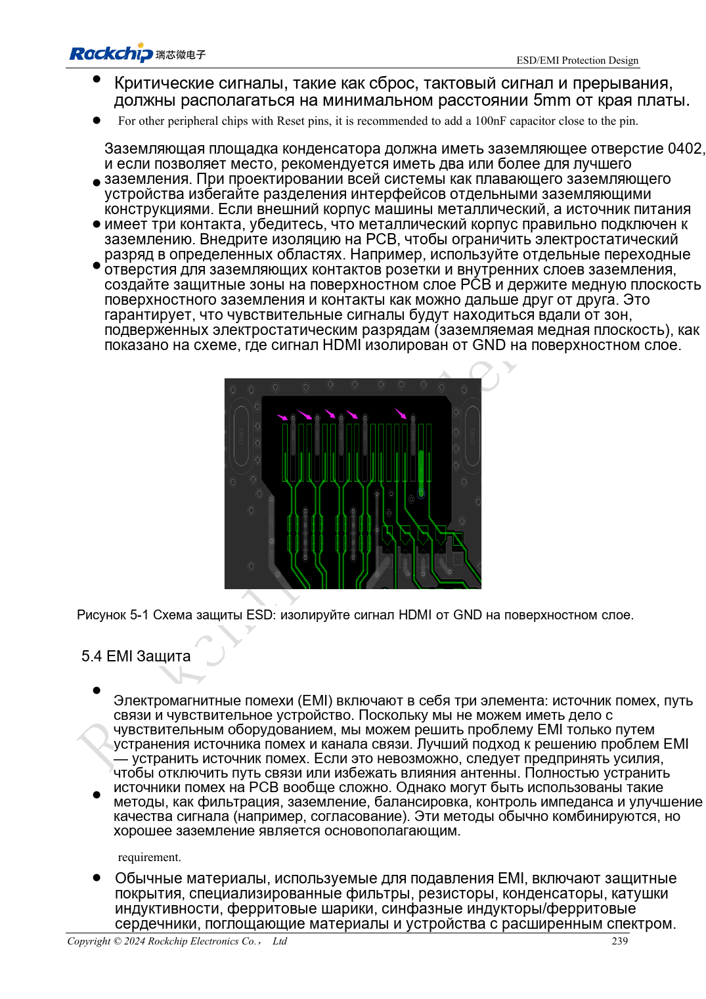

<!-- rk3576-hardware-v11-rest-20261109 -->

# ESD и EMI RK3576: разряд у разъёмов, сброс и подготовка производства

Основа — китайская и английская версии RK3576 Hardware Design Guide V1.1 (2024-05-28), для плат с SoC. Носители CM5 проектируют по интерфейсу модуля; Sige5 подходит для программной базы сравнения. Единого SDK/BSP или ядра для всех изделий руководство не задаёт: совместимость проверяют для каждой платы. Значения взяты из источника, а не измерены ArmSoM.

**RK3576_Hardware_Design_Guide_V1.1_20240528_EN.pdf** · Chapters 5–6

## Защите нужен реальный путь разряда

ESD ставят у входа разъёма, до чипа по пути сигнала. Земляной разряд ведут коротко и вдали от чувствительных цепей. Для скоростной защиты важна ёмкость, не только напряжение. Общие диапазоны резисторов ESD не заменяют значения конкретных HDMI, USB или SDIO.

## Проверяйте сброс, такты и корпус вместе

Источник рекомендует отступ reset, clock и interrupt от края не менее 5mm. NPOR 100nF ставят у чипа с земляным переходом рядом. Демпфирование такта — у источника, трасса предпочтительно внутри со сплошным возвратом. Радиатор и корпус тоже излучают; заземление проверяют на изделии, не перебором дросселей.

## Превратите рекомендации в прослеживаемые испытания

Записывайте порт, полярность, точку, режим и симптомы. После ESD проверяют reset, связь, память и восстановление; отсутствие зависания не доказывает целостность данных. До производства проверьте пайку, влагу и упаковку. MSL3 в источнике: 168 часов при ≤30°C/60%RH, не гарантия любого хранения. Уровни выбирают по стандарту изделия; сертификация не заявляется.

## Параметры и проверочная таблица

| Параметр | Значение источника |
| --- | --- |
| Отступ чувствительных сетей | ≥5mm |
| Фильтр NPOR | 100nF |
| Расстояние демпфирования такта | ≤400mil |
| Срок вне упаковки MSL3 | 168h; ≤30°C / 60%RH |

## Исходные рисунки

Ниже страницы источника со схемами или временными диаграммами; нажмите для полного разрешения. Обозначения и номиналы относятся к эталонной схеме, не к схеме изделия ArmSoM.

Английский оригинал · PDF 258 · 5-1

## Разработка с ArmSoM

CM5 уменьшает объём повторной разработки вычислительного ядра; Sige5 подходит для первичной проверки ПО и периферии. Вывод интерфейсов, контакты, уровни и поддержка образа проверяются по документации платы, не по возможностям SoC.

- [ArmSoM CM5](https://www.armsom.org/cm5) · [CM5 Docs](https://docs.armsom.org/armsom-cm5)
- [ArmSoM Sige5](https://www.armsom.org/sige5) · [Sige5 Docs](https://docs.armsom.org/armsom-sige5)

## Читайте далее

- [RK3576: 30 тем аппаратного проектирования](/ru/articles/rk3576-hardware-design-series/)
- [Тепловой проект RK3576: сопротивление, PCB и длительная нагрузка](/ru/articles/rk3576-thermal-hardware-design/)
