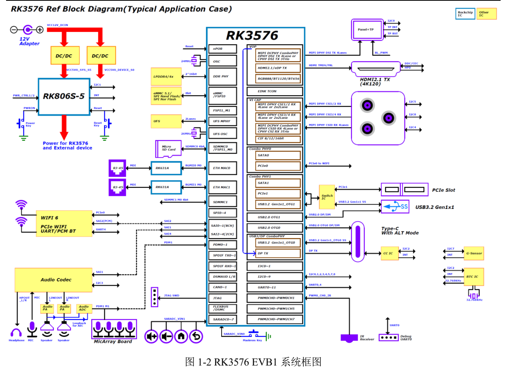
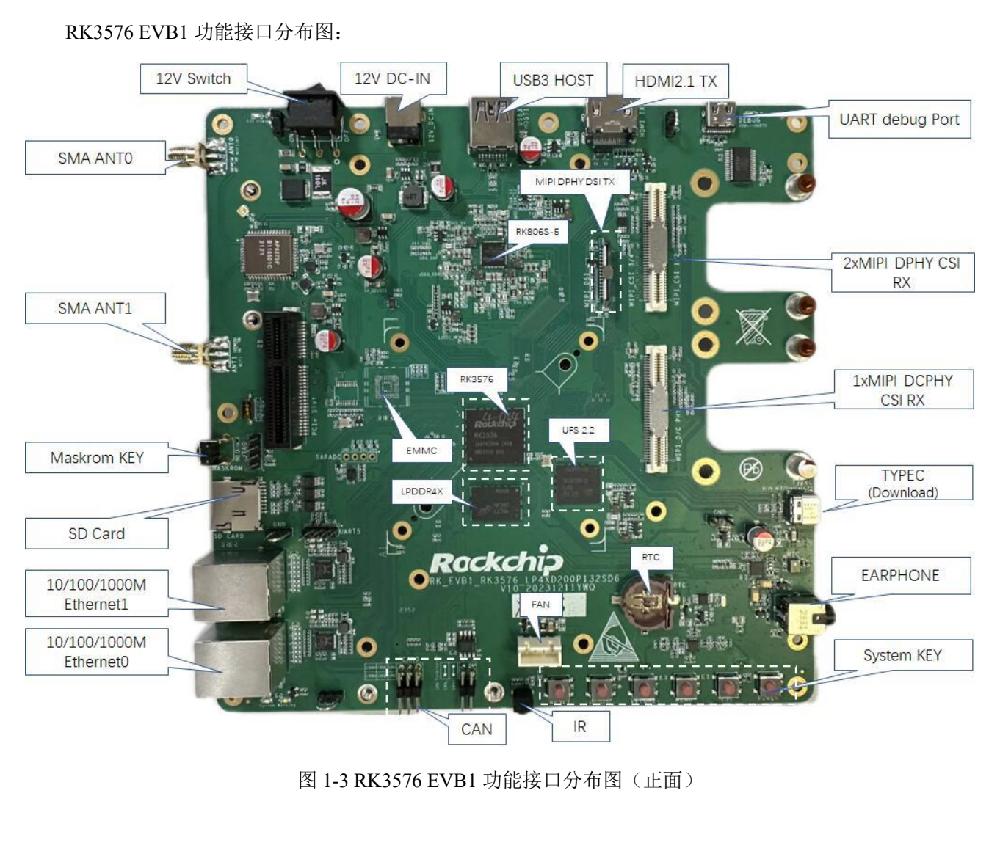
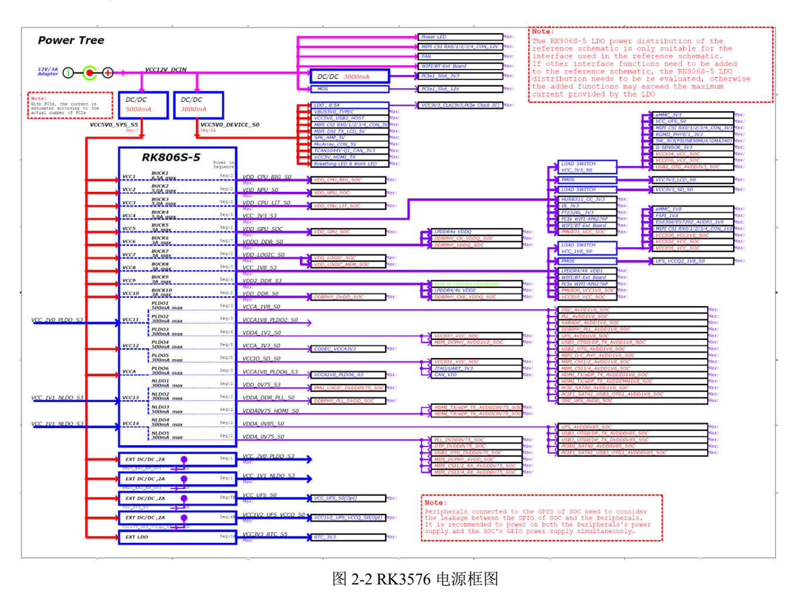

Это тематическое руководство по исходному документу: ключевые параметры, ограничения и оригинальные иллюстрации. Оно не заменяет полный перевод, таблицу выводов или регистров. Примеры производителя не являются измерениями ArmSoM. Перед применением проверьте ревизию платы, схему, SDK/BSP, ядро и драйверы; новых аппаратных испытаний для статьи не проводилось.

**Основной источник：** `Rockchip_RK3576_EVB1_User_Guide_V1.0_CN.pdf` · PDF 53 стр..

## Определить ревизию эталонной платы

Руководство относится к `RK_EVB1_RK3576_LP4XD200P132SD6_V10_20231211YWQ_final`. Таблица содержит 8GB LPDDR4x, 128GB UFS, eMMC N/A, питание комплекта 12V/3A. Это EVB1, а не конфигурация CM5/Sige5. Обе платы ArmSoM используют RK3576, но нужны их собственные схемы и BSP.


[](/assets/hardware-reference-20261110/rk3576-evb-p12.png)

*Система RK3576 EVB1 — Оригинал на китайском; соответствующей английской иллюстрации в этой подборке нет. `Rockchip_RK3576_EVB1_User_Guide_V1.0_CN.pdf`, PDF p. 12.*


## Различить порты перед включением

Основной Type-C обслуживает загрузку и DP Alt Mode, другой Type-C — USB-UART Debug. Определите COM и используйте указанную скорость `1500000` (1.5M). Проверьте поддержку скорости последовательным трактом и сохраняйте журнал с момента reset.


[](/assets/hardware-reference-20261110/rk3576-evb-p14.png)

*Разъёмы RK3576 EVB1 — Оригинал на китайском; соответствующей английской иллюстрации в этой подборке нет. `Rockchip_RK3576_EVB1_User_Guide_V1.0_CN.pdf`, PDF p. 14.*


## Loader, MASKROM и USB3

1. Согласуйте образ, Loader, Parameter и Uboot с накопителем и ревизией; сохраните данные.
2. MASKROM эталонной платы: подключить Type-C загрузки, удерживать MASKROM, подать питание и включить переключатель; отпустить после обнаружения.
3. Loader: удерживать Volume+(RECOVERY) при включении/reset и отпустить после обнаружения. Источник связывает это с низким `SARADC_IN1`.
4. Нужен инструмент v3.28 или новее. Для USB3 источник задаёт в `config.ini` следующую строку; выбор USB3 также зависит от устройства.

```ini
USB3_TRANSFER=TRUE
```

Это пример источника, не настройка всех версий ПО. Кнопки, питание и порты CM5/Sige5 проверяйте по их документации, не переносите процедуру 12V с EVB.

## Три частые ошибки

**Форма слота не равна ширине линка.** Разъём описан как PCIex4, но таблица даёт 1 активную линию и альтернативу USB3.0 Host. До выбора карты проверьте питание, линии, PHY и BSP; не рассчитывайте throughput x4 по форме разъёма.

**Разъём камеры не универсален.** Есть DCPHY/DPHY, 80pin и пример IMX415. Обзор указывает 1×3 trios CPHY, далее встречается иная формулировка. Режим уточняйте по схеме и официальным данным чипа, не складывайте количества интерфейсов. Питание, reset, такт, I2C и драйвер должны совпасть.

**USB wake зависит от питания.** Стр. 30 перечисляет перестановки резисторов для Host 5V, USB PHY и генератора. Одной программной настройки недостаточно. Позиционные обозначения относятся только к указанной EVB.


[](/assets/hardware-reference-20261110/rk3576-evb-p23.png)

*Питание RK3576 EVB1 — Оригинал на китайском; соответствующей английской иллюстрации в этой подборке нет. `Rockchip_RK3576_EVB1_User_Guide_V1.0_CN.pdf`, PDF p. 23.*


## Выбранные адреса I2C

| Шина EVB | Устройство | Адрес источника | Напряжение |
| --- | --- | --- | --- |
| I2C1_M0 | RK806S-5 | `0x23` | 1.8V |
| I2C2_M0 | HYM8563TS / HUSB311 | `0x51` / `0x4E` | 3.3V |
| I2C3_M0 | ES8388 / ES7202 | `0x11` / `0x30` | 1.8V |
| I2C4_M3 | CAM0 | `0x1A` | 1.8V |

Это известные строки со стр. 23. У других камер, touch и MicArray есть `TBD`; адреса не следует придумывать. До расширения проверьте конфликты, питание подтяжек и обратное питание во сне.

## Отладка и перенос

С установленной SD-картой JTAG недоступен; CAN тоже отмечен как общий с SD Card. Для вентилятора указаны 12V/5V, стандартно 12V, но Sensor-регулирование EVB1 пока не поддерживается. Наличие разъёма не доказывает замкнутый контур оборотов.

Если образ поддерживает ADB, проверка подключения из источника:

```sh
adb devices
adb shell
```

Проверяйте питание, загрузку, UART, накопитель, экран, сеть и камеру последовательно, затем совместную работу и suspend/resume. Носитель CM5 и Sige5 требуют собственных выводов, памяти, прошивки и питания; EVB даёт метод поиска проблемы.


## Продукты и документация

- **CM5** — [Продукт](https://www.armsom.org/cm5) · [Документация](https://docs.armsom.org/armsom-cm5)
- **Sige5** — [Продукт](https://www.armsom.org/sige5) · [Документация](https://docs.armsom.org/armsom-sige5)
