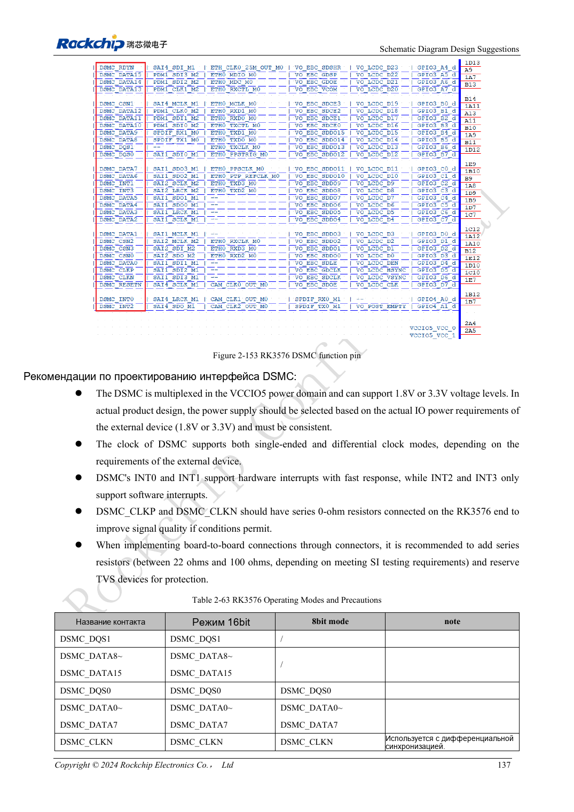

<!-- rk3576-hardware-v11-rest-20261109 -->

# FlexBus и DSMC RK3576: FPGA, PSRAM и параллельная разводка

Основа — китайская и английская версии RK3576 Hardware Design Guide V1.1 (2024-05-28), для плат с SoC. Носители CM5 проектируют по интерфейсу модуля; Sige5 подходит для программной базы сравнения. Единого SDK/BSP или ядра для всех изделий руководство не задаёт: совместимость проверяют для каждой платы. Значения взяты из источника, а не измерены ArmSoM.

**RK3576_Hardware_Design_Guide_V1.1_20240528_EN.pdf** · §2.3.11–12; DSMC/FlexBus PCB

## Сначала различите шины

FlexBus0 передаёт или принимает, FlexBus1 только принимает; режимы 2/4/8/16bit, такт до 100MHz. DSMC предназначен для DDR PSRAM или FPGA: 8/16bit, четыре CS, до 100MHz. Одинаковая ширина не делает контроллеры взаимозаменяемыми: нужны подходящий протокол, фронты и ПО.

## Домены и упаковка данных

FlexBus главным образом использует VCCIO5, дополнительные выводы — VCCIO2; уровни согласуют. Нестандартная ширина упаковывается шире: 3bit в 4bit, 5/6/7bit в 8bit. По числу выводов нельзя определять буфер. DSMC находится на VCCIO5; INT0/1 имеют аппаратный путь, INT2/3 обрабатываются программно, что влияет на задержку.

## Ветви проверяют по топологии

Для DSMC L2/L3 менее 500mil, L4 менее 1inch, L5 менее 100mil; L1 плюс основная ветвь менее 5inch, разность T-ветвей менее 100mil. Сохраняйте исходное определение L1–L5: другая топология требует пересмотра. Проверяйте шаблоны, граничные длины и непрерывную передачу, порядок битов, фронты и упаковку.

## Параметры и проверочная таблица

| Параметр | Значение источника |
| --- | --- |
| Такт | ≤100MHz |
| DSMC Z | 50Ω single / 100Ω differential ±10% |
| DSMC CLK-data | <120mil |
| FlexBus CLK-data | <180mil |
| Основной путь | <5inch |

## Исходные рисунки

Ниже страницы источника со схемами или временными диаграммами; нажмите для полного разрешения. Обозначения и номиналы относятся к эталонной схеме, не к схеме изделия ArmSoM.

Английский оригинал · PDF 156 · 2-153

## Разработка с ArmSoM

CM5 уменьшает объём повторной разработки вычислительного ядра; Sige5 подходит для первичной проверки ПО и периферии. Вывод интерфейсов, контакты, уровни и поддержка образа проверяются по документации платы, не по возможностям SoC.

- [ArmSoM CM5](https://www.armsom.org/cm5) · [CM5 Docs](https://docs.armsom.org/armsom-cm5)
- [ArmSoM Sige5](https://www.armsom.org/sige5) · [Sige5 Docs](https://docs.armsom.org/armsom-sige5)

## Читайте далее

- [RK3576: 30 тем аппаратного проектирования](/ru/articles/rk3576-hardware-design-series/)
- [Интерфейсы управления RK3576: UART, I2C/I3C, SPI, CAN и PWM](/ru/articles/rk3576-industrial-control-interfaces/)
- [Стек и fanout PCB RK3576: шесть/восемь слоёв и смешанный шаг BGA](/ru/articles/rk3576-pcb-stackup-fanout/)
