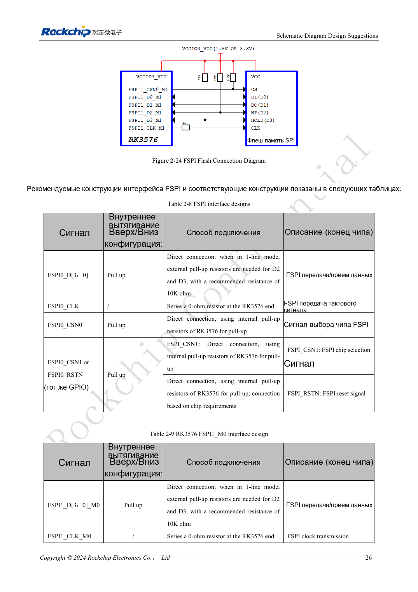
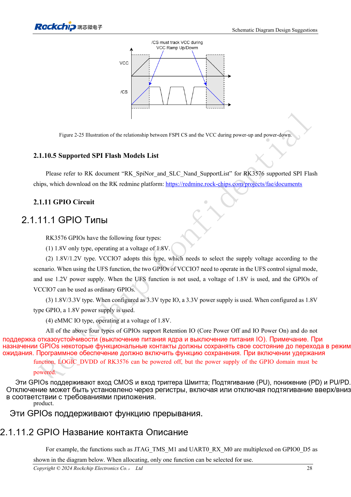

<!-- rk3576-hardware-v11-rest-20261109 -->

# Загрузка RK3576 через FSPI: NOR/NAND, напряжение и состояние CS

Основа — китайская и английская версии RK3576 Hardware Design Guide V1.1 (2024-05-28), для плат с SoC. Носители CM5 проектируют по интерфейсу модуля; Sige5 подходит для программной базы сравнения. Единого SDK/BSP или ядра для всех изделий руководство не задаёт: совместимость проверяют для каждой платы. Значения взяты из источника, а не измерены ArmSoM.

**RK3576_Hardware_Design_Guide_V1.1_20240528_EN.pdf** · §2.1.10; FSPI PCB

## Выберите контроллер и полную группу выводов

Два FSPI поддерживают NOR/NAND и SDR по 1/2/4 линиям. FSPI0 делит выводы с eMMC; VCCIO0 допускает только 1.8V. FSPI1_M0 использует VCCIO1, M1 — VCCIO3; 1.8V или 3.3V выбирают для всего домена. Нельзя смешивать CLK, CS и данные разных групп.

## Обеспечьте правильный CS при включении

В однолинейном режиме D2/D3 требуют внешних 10kΩ. CSN FSPI1_M0 по умолчанию подтянут вниз: нужна внешняя подтяжка вверх. Таблица указывает 2.2kΩ, текст — 2.2kΩ/4.7kΩ; сверяйте актуальный BOM и временные параметры. Питание flash согласуют с IO, CS поднимают вместе с питанием. Загрузочный поиск меняет подтяжки GPIO1_B0 и GPIO1_C2; чувствительные сигналы разрешения сюда не подключают.

## Проверяйте разводку и восстановление вместе

На CLK резервируют 0Ω у SoC. Проверяют 50Ω, разницу CLK/данные менее 200mil и длину менее 4inch. Сохраняют независимое USB-восстановление. Испытывают пустую flash, повреждённый образ, отключение при программировании и холодный старт; одной успешной прошивки недостаточно.

## Параметры и проверочная таблица

| Параметр | Значение источника |
| --- | --- |
| FSPI0 | VCCIO0 = 1.8V |
| FSPI1_M0 / M1 | VCCIO1 / VCCIO3 |
| Z | 50Ω ±10% |
| CLK ↔ DATA | <200mil |
| Длина трассы | <4inch |

## Исходные рисунки

Ниже страницы источника со схемами или временными диаграммами; нажмите для полного разрешения. Обозначения и номиналы относятся к эталонной схеме, не к схеме изделия ArmSoM.

Английский оригинал · PDF 45 · 2-24

Английский оригинал · PDF 47 · 2-25

## Разработка с ArmSoM

CM5 уменьшает объём повторной разработки вычислительного ядра; Sige5 подходит для первичной проверки ПО и периферии. Вывод интерфейсов, контакты, уровни и поддержка образа проверяются по документации платы, не по возможностям SoC.

- [ArmSoM CM5](https://www.armsom.org/cm5) · [CM5 Docs](https://docs.armsom.org/armsom-cm5)
- [ArmSoM Sige5](https://www.armsom.org/sige5) · [Sige5 Docs](https://docs.armsom.org/armsom-sige5)

## Читайте далее

- [RK3576: 30 тем аппаратного проектирования](/ru/articles/rk3576-hardware-design-series/)
- [UFS RK3576: совместимость памяти, последовательность питания и разводка](/ru/articles/rk3576-ufs-hardware-design/)
- [SD-карты и SDIO Wi-Fi RK3576: переключение уровней, питание и RF](/ru/articles/rk3576-sdio-wifi-hardware/)
