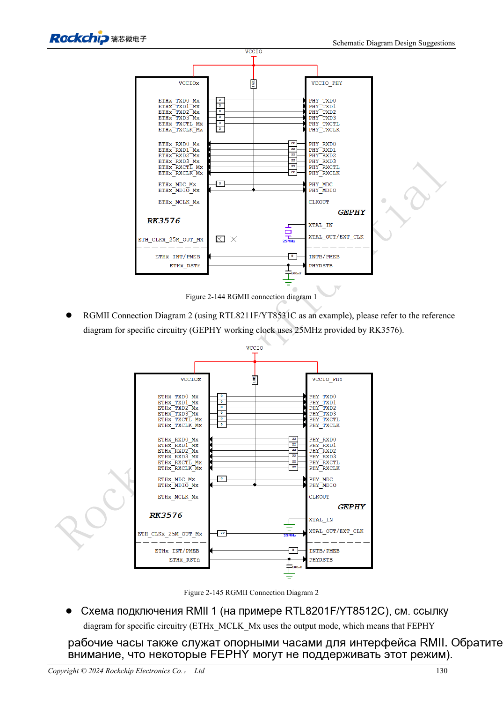
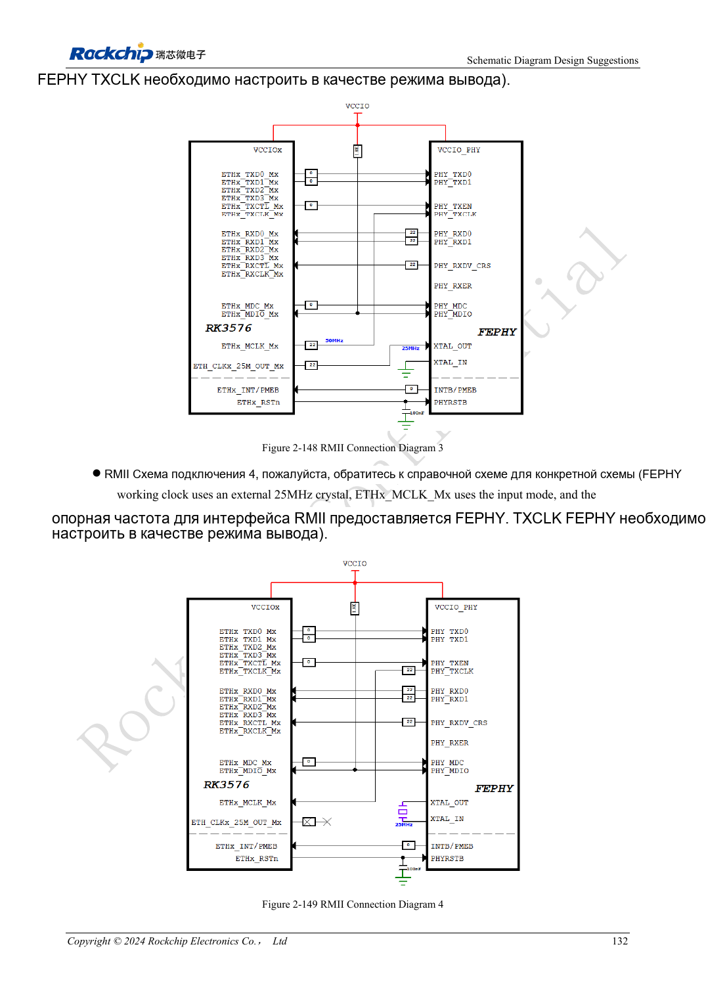

<!-- rk3576-hardware-v11-rest-20261109 -->

# Ethernet RK3576: задержка RGMII, такт PHY и защита

Основа — китайская и английская версии RK3576 Hardware Design Guide V1.1 (2024-05-28), для плат с SoC. Носители CM5 проектируют по интерфейсу модуля; Sige5 подходит для программной базы сравнения. Единого SDK/BSP или ядра для всех изделий руководство не задаёт: совместимость проверяют для каждой платы. Значения взяты из источника, а не измерены ArmSoM.

**RK3576_Hardware_Design_Guide_V1.1_20240528_EN.pdf** · §2.3.10

## MAC требует внешнего PHY

Два GMAC подключаются к PHY через RGMII 10/100/1000Mbps либо RMII 10/100Mbps. GMAC0 M0/M1: VCCIO5/VCCIO4; GMAC1 M0/M1: VCCIO4/VCCIO3. Выбирайте полную группу. Источник предпочитает 1.8V для качества сигнала, если PHY поддерживает этот уровень.

## Направление и задержку задают согласованно

RMII 50MHz может выдавать MAC либо PHY, но не оба одновременно. В эталоне RGMII TX задаёт MAC, RX — PHY; RTL8211F/FI включает 2ns RXCLK. После смены PHY перепроверьте задержки и device tree, исключая двойное добавление. TX: 0Ω у SoC; RX: 22Ω у PHY; MDIO: подтяжка 1.5–1.8kΩ.

## Важна и сторона разъёма

Для reset RTL8211F/FI указан 3.3V и 100nF рядом; уровень RGMII 1.8V не определяет reset. Средние точки трансформатора подключают по PHY, распиновку RJ45 проверяют с учётом защёлки. Испытывайте скорости, два порта, длинные кабели, перезапуск и сон, считая ошибки пакетов, а не только индикаторы.

## Параметры и проверочная таблица

| Параметр | Значение источника |
| --- | --- |
| Опорный такт RMII | 50MHz |
| Пример кварца PHY | 25MHz, ±20ppm |
| Подтяжка MDIO | 1.5–1.8kΩ |
| Резистор RX | 22Ω at PHY |
| Пример задержки RX RTL8211F/FI | 2ns |

## Исходные рисунки

Ниже страницы источника со схемами или временными диаграммами; нажмите для полного разрешения. Обозначения и номиналы относятся к эталонной схеме, не к схеме изделия ArmSoM.

Английский оригинал · PDF 149 · 2-144

Английский оригинал · PDF 151 · 2-149

## Разработка с ArmSoM

CM5 уменьшает объём повторной разработки вычислительного ядра; Sige5 подходит для первичной проверки ПО и периферии. Вывод интерфейсов, контакты, уровни и поддержка образа проверяются по документации платы, не по возможностям SoC.

- [ArmSoM CM5](https://www.armsom.org/cm5) · [CM5 Docs](https://docs.armsom.org/armsom-cm5)
- [ArmSoM Sige5](https://www.armsom.org/sige5) · [Sige5 Docs](https://docs.armsom.org/armsom-sige5)

## Читайте далее

- [RK3576: 30 тем аппаратного проектирования](/ru/articles/rk3576-hardware-design-series/)
- [Аудиотракт RK3576: SAI, PDM, ASRC и микрофоны](/ru/articles/rk3576-audio-hardware-design/)
- [GPIO и SARADC RK3576: домены, обратное питание и кнопки](/ru/articles/rk3576-gpio-saradc-hardware/)
