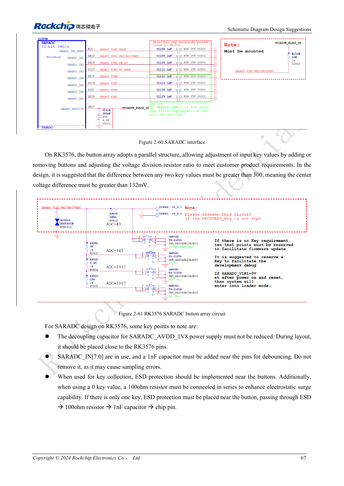

<!-- rk3576-hardware-v11-rest-20261109 -->

# GPIO и SARADC RK3576: домены, обратное питание и кнопки

Основа — китайская и английская версии RK3576 Hardware Design Guide V1.1 (2024-05-28), для плат с SoC. Носители CM5 проектируют по интерфейсу модуля; Sige5 подходит для программной базы сравнения. Единого SDK/BSP или ядра для всех изделий руководство не задаёт: совместимость проверяют для каждой платы. Значения взяты из источника, а не измерены ArmSoM.

**RK3576_Hardware_Design_Guide_V1.1_20240528_EN.pdf** · §2.1.11; §2.3.2

## Уровень GPIO задаётся всему домену

PMUIO0 и VCCIO0 фиксированы на 1.8V. VCCIO7 использует 1.2V для UFS, иначе 1.8V по руководству. PMUIO1 и VCCIO1–6 поддерживают 1.8/3.3V. Смена функции вывода не меняет напряжение остальных выводов домена. Суффиксы _u/_d/_z означают подтяжку вверх/вниз/высокое сопротивление; учитывайте загрузку и сон.

## Исключите обратное питание при выключении

Источник допускает сохранение IO при отключённом ядре, но не fail-safe вход при отключённых ядре и IO. Запитанная периферия не должна подавать высокий уровень в выключенный домен. Совместно проверяют питание подтяжек, порядок enable и изоляцию. Силу драйвера определяют для конкретного вывода.

## SARADC для кнопок и загрузки

SARADC: 12bit, до 1MS/s, восемь входов 0–1.8V. IN0 используется для загрузки; IN1 восстановления требует 10kΩ, 1% даже без кнопки. Между уровнями кнопок рекомендуются более 300 отсчётов или 132mV и 1nF рядом. Защита: разъём→ESD→100Ω→1nF→чип. Прямой вход 3.3V недопустим.

## Параметры и проверочная таблица

| Параметр | Значение источника |
| --- | --- |
| SARADC | 12bit; 0–1.8V |
| Подтяжка IN1 | 10kΩ ±1% |
| Разность уровней кнопок | >300 counts / >132mV |
| Фильтрующий конденсатор | 1nF |

## Исходные рисунки

Ниже страницы источника со схемами или временными диаграммами; нажмите для полного разрешения. Обозначения и номиналы относятся к эталонной схеме, не к схеме изделия ArmSoM.

Английский оригинал · PDF 86 · 2-61

## Разработка с ArmSoM

CM5 уменьшает объём повторной разработки вычислительного ядра; Sige5 подходит для первичной проверки ПО и периферии. Вывод интерфейсов, контакты, уровни и поддержка образа проверяются по документации платы, не по возможностям SoC.

- [ArmSoM CM5](https://www.armsom.org/cm5) · [CM5 Docs](https://docs.armsom.org/armsom-cm5)
- [ArmSoM Sige5](https://www.armsom.org/sige5) · [Sige5 Docs](https://docs.armsom.org/armsom-sige5)

## Читайте далее

- [RK3576: 30 тем аппаратного проектирования](/ru/articles/rk3576-hardware-design-series/)
- [Ethernet RK3576: задержка RGMII, такт PHY и защита](/ru/articles/rk3576-gmac-hardware-design/)
- [Интерфейсы управления RK3576: UART, I2C/I3C, SPI, CAN и PWM](/ru/articles/rk3576-industrial-control-interfaces/)
